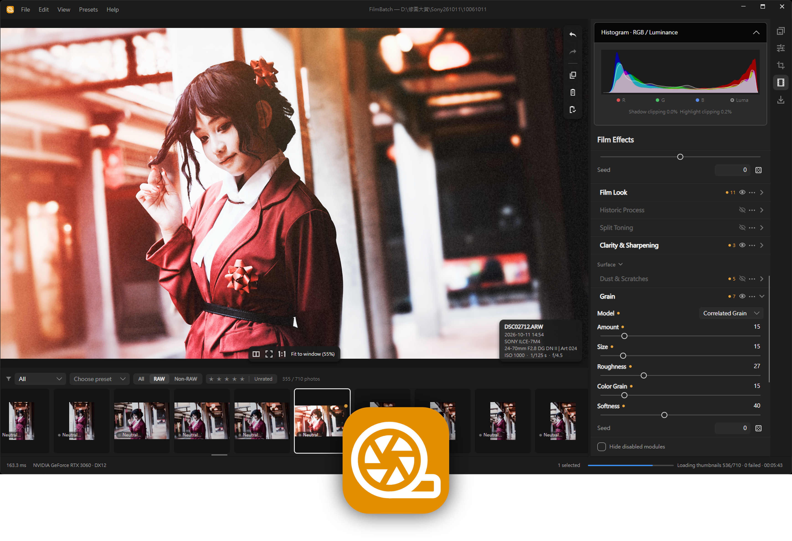

<p align="center">
  
</p>

<p align="center">
  <sub>Cover model: 腦腐 · Instagram: <a href="https://www.instagram.com/ouo.207/">@ouo.207</a></sub>
</p>


<h1 align="center">FilmBatch</h1>

<p align="center">
  <b>Batch film-look processing for your photos.</b><br>
  <a href="README.zh-TW.md">繁體中文</a> · English
</p>

<p align="center">
  
  
  
  
  
</p>

FilmBatch applies film colors and analog effects to every photo, then exports the whole batch in one go. It is built with C# / .NET 10, Avalonia 12 and WebGPU, and runs on Windows and macOS.

## Screenshots

| AI denoise | Film look | Grain |
| :---: | :---: | :---: |
| *(screenshot coming soon)* | *(screenshot coming soon)* | *(screenshot coming soon)* |

## Features

| Feature | Description |
| --- | --- |
| **Light leaks** | Adjustable light-leak overlays for a warm, accidental-exposure look. |
| **Film look** | Film color simulation with 36 bundled LUTs, adjustable strength, warmth, fade and 8-hue correction. |
| **Grain** | Reproducible grain with three models (clumped, multi-scale, optical statistics); tune seed and response per tone. |
| **AI denoise** | Local AI noise reduction (RAW and RGB models). Models are downloaded or imported explicitly; inference never connects to the network. |
| **AI background removal** | On-device subject selection on macOS via Apple Vision. Nothing is uploaded and no background is generated. |
| **Batch processing** | Open a whole folder, select many photos, and apply the same settings to all of them, with per-photo presets. |
| **Batch export** | Export JPEG, 16-bit TIFF or 16-bit PNG with EXIF preserved and an embedded sRGB ICC profile. Originals are never modified. |

More details, including the RAW camera list and the command-line interface, are in [docs/cli.md](docs/cli.md), [docs/building.md](docs/building.md) and [docs/film-looks.md](docs/film-looks.md).

## How to Build

### Requirements

- [.NET 10 SDK](https://dotnet.microsoft.com/download)
- Windows 10/11 or macOS (Apple Silicon for AI background removal)

### Run

```bash
dotnet run --project src/FilmBatch.App
```

Open a photo folder with **File → Open Folder** (`Ctrl/⌘+O`).

### Build and test

```bash
dotnet build FilmBatch.sln
dotnet test FilmBatch.sln
```

### Package

```bash
dotnet run build/Build.cs -- --rid win-x64 --zip
```

On macOS (Apple Silicon), use `osx-arm64` instead.

For the GUI gallery, shader checks, iOS build notes and other workflows, see [docs/building.md](docs/building.md) and [VERIFY.md](VERIFY.md).

## How to Contribute

Contributions are welcome.

1. Fork the repository and create a feature branch.
2. Keep changes focused, and follow the existing MVVM and project structure.
3. Run `dotnet build FilmBatch.sln` and `dotnet test FilmBatch.sln` before opening a pull request.
4. If you change an effect, update both the CPU reference implementation and the WGSL shader, and confirm they match (see [docs/architecture.md](docs/architecture.md)).
5. Open a pull request describing what changed and how you verified it.

Found a bug or have an idea? Please open an issue.

## Star History

[](https://www.star-history.com/#minexo79/FilmBatch&Date)

## Documentation

- [docs/README.md](docs/README.md): documentation map (current docs, history and proposals)
- [docs/architecture.md](docs/architecture.md): architecture and render pipeline
- [docs/building.md](docs/building.md): build and run; see also [testing](docs/testing.md), [release](docs/release.md) and [CLI](docs/cli.md)
- [docs/film-looks.md](docs/film-looks.md): LUT sources, licenses and how to add a film look
- [docs/history.md](docs/history.md): decision and commit history
- [VERIFY.md](VERIFY.md): verification entry point
- [THIRD-PARTY-NOTICES.txt](THIRD-PARTY-NOTICES.txt): third-party components and licenses

## License

FilmBatch is released under the [MIT License](LICENSE).

Third-party components and bundled assets (including the RawTherapee Film Simulation LUTs under CC BY-SA 4.0 and RAW decoding derived from [LightCraft](https://github.com/storytold/lightcraft)) are listed in [THIRD-PARTY-NOTICES.txt](THIRD-PARTY-NOTICES.txt).
