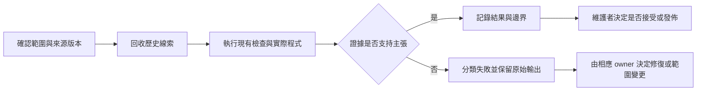

# FilmBatch 驗證入口

此頁讓沒有對話歷史的開發者從現有測試與真正的 App／CLI 驗證程式。領域契約仍在[文件地圖](docs/README.md)指向的原文件；本頁不建立第二套功能規格、驗收 runner 或治理 runtime。

- 驗證基準：`6e3291a5cbe33d267ec33b9d42054efde9bd82f3`，2026-10-18。
- 本次結果、輸入範圍與未知項：[有日期的稽核記錄](docs/superpowers/plans/2026-10-18-governed-verification-and-knowledge.md#current-observations)。這不是永遠有效的綠燈。
- 改動相關來源、相依庫、輸入、設定或驗收條件後，重跑涵蓋該改動的檢查；更新記錄，不改期望值來迎合產品。

## 範圍與權限

預設只允許本機檢查、產生拋棄式照片／輸出與文件更新。commit、push、發佈、公證、憑證／分支保護變更需要當次明確授權；舊對話與歷史計畫不是新授權。



這是有人監督的工作流，不是自主重試迴圈。模型 review 可提出疑點，不能代替執行結果或維護者接受。

## 準備

從儲存庫根目錄執行。需 .NET 10 SDK；Shader 檢查另需 Rust／Cargo 與固定版本的 naga-cli。原生 macOS 檢查需 Apple Silicon、作用中的桌面工作階段與已存在的 `dist/osx-arm64/`；沒有封裝時先依[建置文件](docs/building.md#macos)建立，不能把「二進位檔不存在」當產品回歸。

以下 shell 步驟適用 macOS，使用同一個 shell 的 `work`／`cli` 變數；Windows 建置與 GUI 驗證請走[Windows 流程](docs/building.md#windows)，不能拿 Mac 的結果替代。

```bash
dotnet --version
work=$(mktemp -d "${TMPDIR:-/tmp}/filmbatch-verify.XXXXXX")
cli="$PWD/dist/osx-arm64/cli/filmbatch-cli"
```

只用產生的照片。`--smoke` 會自行隔離 App 設定／預設；設置 `TMPDIR="$work"` 使其暫存資料留在同一區。一般啟動 App 並開啟使用者專案不具有這個隔離承諾。

<a id="v1"></a>
## V1：來源測試

```bash
dotnet test FilmBatch.sln -c Release --logger trx --results-directory "$work/test-results"
```

判定依各專案的 passed／failed／skipped，不只看 exit 0。沒有 `FILMBATCH_RAW_SAMPLES`／`FILMBATCH_RAW_ORACLE` 時，外部相機語料略過是明確的未覆蓋範圍；沒有 GPU 時，相關 GPU cases 可能略過。JPEG XL 的隨附原生庫／ABI 不可用不是可接受的略過理由。

| 要查的區域 | 測試入口 | 現行契約 |
|---|---|---|
| 參數、持久化、貼上、匯出快照 | `PhotoOperationsTests`、`ProjectServiceTests`、`PersistenceTests`、`BatchExporterTests` | [Core 與復原](docs/architecture.md#41-core參數-schemaparams) |
| RAW 場景域、白平衡、語意遮罩、鏡頭、DNG | `RawSceneIntegrationTests`、`RawWhiteBalanceTests`、`RawSemanticRenderingTests`、`LensProfileTests`、`RawDngConversionTests` | [RAW／匯出](docs/architecture.md#48-engine影像讀取與批次匯出imaging--exporting) |
| CPU／GPU 行為與精度 | `EffectPipelineTests`、`GpuSpikeTests`、`RawGpuDisplayTests` | [算圖管線](docs/architecture.md#46-engine算圖管線rendering)、[ADR 0003](docs/adr/0003-gpu-stack-decision.md) |
| 非同步來源、裁切取消、undo、視窗狀態 | `EditorLifecycleTests`、`PreviewInteractionTests`、`WindowLifecycleTests`、`RawControlsTests`、`RawSourceLifecycleTests` | [編輯生命週期](docs/architecture.md#410-app介面層) |
| 底片 LUT、色相帶、舊設定移除 | `FilmLutTests`、`FilmLookTests`、`RetiredParamsTests` | [底片契約與來源](docs/film-looks.md) |
| JPEG XL ABI、樣本與錯誤路徑 | `PortableJxlTests`、`JpegXlTests` | [發佈閉包](docs/building.md#macos)、[native manifest](src/FilmBatch.Raw/Native/Jxl/provenance.json) |

需要縮小範圍時，用 `--filter FullyQualifiedName~類別名稱`；先確認實際執行了預期測試，不能把沒有匹配 case 的 exit 當 pass。外部語料取得與釘選參考輸出見 [raw-oracle](tools/raw-oracle/README.md)。

<a id="v2"></a>
## V2：產品實際使用的 WGSL

```bash
cargo install --locked --version 30.0.1 naga-cli --root "$work/naga"
dotnet run build/CheckShaders.cs -- --naga "$work/naga/bin/naga"
```

`CheckShaders.cs` 經產品的 `ShaderLibrary` 展開 include，檢查嵌入的編譯單元；`common/` 不是獨立 entry point。naga 不在 PATH 是工具鏈失敗，不可跳過檢查或改成只驗證未展開的片段。靜態 Shader 驗證不證明特定 GPU／驅動已執行。

<a id="v3"></a>
## V3：實際 macOS 桌面

```bash
TMPDIR="$work" caffeinate -u -t 180 \
  dist/osx-arm64/FilmBatch.app/Contents/MacOS/FilmBatch --smoke "$work/mac-smoke.txt"
```

需 exit 0 且記錄為 `SMOKE PASS`；開啟相鄰的 `.png`，檢查實際預覽、直方圖、縮圖、參數與版面，不能只查視窗存在。此流程涵蓋原生相依庫、預覽算圖、設定／復原／重開、16-bit 匯出、ICC、來源不改寫與選單／語言等基本整合。

Avalonia.Headless 的通過不代表 Cocoa Spaces 動畫、實體全螢幕按鈕或其他 OS 的視窗操作已驗證。需要這些行為時，另依[生命週期檢查](docs/building.md#編輯生命週期回歸)操作與記錄；`WindowStateChanged` 不是動畫完成訊號。

<a id="v4"></a>
## V4：隔離的封裝 CLI 與輸出

```bash
"$cli" --help
"$cli" gpu-info
"$cli" samples "$work/photos"
mkdir -p "$work/presets"
shasum -a 256 "$work/photos/"*.tif > "$work/source.sha256"
"$cli" export "$work/photos" --out "$work/metal" --format png \
  --long-edge 256 --presets-folder "$work/presets" --backend Metal
cp "$work/photos/.filmbatch/export_log.json" "$work/metal-log.json"
"$cli" export "$work/photos" --out "$work/cpu" --format png \
  --long-edge 256 --presets-folder "$work/presets" --software
cp "$work/photos/.filmbatch/export_log.json" "$work/cpu-log.json"
"$cli" export "$work/photos" --out "$work/dng" --format dng \
  --long-edge 256 --presets-folder "$work/presets" --software
cp "$work/photos/.filmbatch/export_log.json" "$work/dng-log.json"
set -- "$work/dng/"*.dng
"$cli" raw convert "$1" "$work/converted.dng" --compression uncompressed
shasum -c "$work/source.sha256"
```

- 先讀 `samples` 實際回傳的檔名，不假設起始編號。`--long-edge` 大於 0 時合法範圍是 100–20000；256 是合法 smoke 尺寸，0 或負值依現行 CLI 實作選擇原尺寸。
- 每次匯出確認所有 `Entries[].Status` 為 `ok`；單次執行會更新專案的 `export_log.json`，所以上面另存每次記錄。
- 必須讀 `Device`／`Renderer`，確認 Metal 真正在用、軟體路徑實際選到哪個後端；兩次 exit 0 不證明 CPU／GPU 互相比對，更不證明獨立色彩正確性。
- 比較解碼後尺寸／RGB16／alpha，而非 PNG 檔案位元組。本次另用拋棄式 Engine API driver 比對，結果記於[稽核記錄](docs/superpowers/plans/2026-10-18-governed-verification-and-knowledge.md#current-observations)；該 driver 不是 fresh clone 的相依項。需要重做逐像素檢查時，可在儲存庫外建立指向 `FilmBatch.Engine.csproj` 的 .NET console，以 `ImageLoader.LoadFull` 比較 RGBA16；永久回歸仍由 V1 的數值／匯出測試負責。
- `raw convert` 的 uncompressed 模式會重解碼輸出並比較感光樣本；再次指向既有目的檔應 exit 2，且目的檔雜湊不變。這與 `export --format dng` 的算圖後輸出不同。
- 此例只涵蓋生成影像與由其匯出的 DNG，不宣稱涵蓋真實相機、所有 JXL tile 或 ProRAW。那些輸入的現行測試與歷史對照另列於 RAW 文件。

<a id="v5"></a>
## V5：封裝身分與完整性

```bash
codesign --verify --deep --strict dist/osx-arm64/FilmBatch.app
unzip -tq dist/FilmBatch-osx-arm64.zip
shasum -a 256 dist/FilmBatch-osx-arm64.zip \
  dist/osx-arm64/FilmBatch.app/Contents/MacOS/FilmBatch \
  dist/osx-arm64/cli/filmbatch-cli
```

記錄實際封裝與二進位檔的 digest，不能只寫原始碼 HEAD。執行既有封裝不是重新 publish；原生閉包／RID 傳遞、部署下限、解壓後執行與 Windows 執行是不同主張，依[建置文件](docs/building.md)補足相關檢查。ad-hoc 簽章通過不代表 Developer ID、公證或 macOS 14／15 的實機相容性。

## 失敗分類

| 類別 | 意義 | 處置 |
|---|---|---|
| Product regression | 產品在有效輸入／狀態下變差 | 保留重現；不改文件、oracle 或容差來迎合錯誤 |
| Doc drift | 健康的產品與文件路徑／主張不一致 | 修正文件，保留被取代的歷史理由 |
| Spec/oracle error | 需求或期望值本身不正確 | 保留原 oracle，提出維護者 review，不自行重釘結果 |
| Harness failure | 工具鏈、啟動方式、環境或測試輸入錯誤 | 修復 driver／環境後重跑；不改產品來掩蓋 |

檢查被阻擋時，寫出嘗試過的命令、輸入、exit、原因與 owner；不要把 unknown 改寫成 absent、safe 或 pass。

## 證據、治理與收尾

記錄來源版本、相依版本、輸入範圍、命令／exit、各專案 totals／skips、實際後端、輸出檢查與明確未測邊界。repo 內保留有日期的精簡結論，原始 TRX／畫面可另存；不能讓 `dist/`、內部工具 URI、私人路徑或刪除的暫存專案成為唯一證據。

[CI](.github/workflows/ci.yml)定義 Windows／Mac、WGSL 與 `pre-merge` 聚合工作，但必要狀態檢查／ruleset 是否啟用只能由 GitHub 的實際設定證明。本次無憑證，沒有驗證遠端保護或 CI 結果。此頁與計畫可讀寫，不是 host 封存的 oracle／capability token；不宣稱已證明強制治理，也未進行盲測產品故障注入來認證本地圖。

完成後只清理由本次建立的暫存資料；保留來源照片、既有發佈檔與使用者設定。只有相關程式改動才重跑對應檢查；純文件修訂檢查連結、導航、來源主張與驗收追溯，不為了改文字重建產品。
