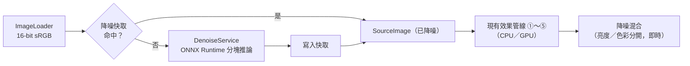

# ADR 0002：AI 降噪

- 狀態：**提議中**（2026-10-16，尚未實作，本文的效能數字皆為估算，需 spike 實測）
- 範圍：`src/FilmBatch.Engine`（新增來源階段）、`src/FilmBatch.Core/Params`（新增 `denoise` 模組）、發佈封裝

> **2026-10-18 現況註記**：本提案仍未實作。下方「沒有 RAW 管線」是 2026-10-16 的設計前提；目前已具備[場景線性 RAW 管線](../architecture.md#48-engine影像讀取與批次匯出imaging--exporting)。重新啟動此提案時，須重新比較資料域、模型／權重授權、品質與部署，不能直接把當時的 sRGB／ONNX 選型當成已採用的方案。原提案保留作為決策歷史。
>
> 最新的來源與授權比較見 [AI 降噪 Survey](../ai-denoise-survey.md)。調查優先評估線性 Rec.2020 RawNIND 與一般 RGB NAFNet，並記錄 Bayer 模型的 CoreML FP16 限制；兩者均未採用，也未完成實際權重檔與本機推論驗證。下方「決策」仍是原始提案，不因本次 Survey 轉為現行實作。

## 背景

使用者希望有類似 Lightroom「AI 降噪」的功能，並能調整降噪等級。曾評估 [stefanpenner/ai-denoise](https://github.com/stefanpenner/ai-denoise) 能否直接整合。

Lightroom AI 降噪的做法是：在**解馬賽克之前的 RAW（Bayer）資料**上跑卷積神經網路，同時完成解馬賽克與降噪，輸出新的 DNG；介面只有一個「量」滑桿。

2026-10-16 提案時的前提（非目前功能清單）：

- 只讀 JPEG／TIFF／PNG（`Project.SupportedExtensions`），以 Magick.NET 解碼成 16-bit sRGB RGBA，**沒有 RAW 管線**。
- 預覽使用 1600px 代理圖，GPU 拖曳更新約 2 ms（見 [ADR 0001](0001-webgpu-binding.md)）；匯出另建算圖器處理全解析度。
- 每個效果都有 CPU 與 GPU 兩份實作，並以測試鎖定兩者結果一致。

## 決策

1. **不整合 ai-denoise。** 只把它當作評測方法的參考。
2. **在 sRGB 域做 AI 降噪**，作為效果管線**之前**的「來源階段」：解碼 → 降噪 → 現有 ①～⑤ 階段。降噪後的影像會快取起來，效果滑桿拖曳時不重跑推論。
3. **推論執行環境採用 ONNX Runtime**。Windows 使用 DirectML 執行提供者，macOS 使用 CoreML 執行提供者，兩者都不可用時改用 CPU。模型由 PyTorch 匯出成 ONNX（fp16）。
4. **首選模型 DRUNet**，因為它支援可調的雜訊等級輸入。NAFNet-SIDD-width32 是較快的備案，SCUNet 是畫質候選。最終以 spike 結果決定（見下方「驗收標準」）。
5. **傳統降噪作為後備**：沒有可用的推論裝置，或使用者選擇「快速」模式時，改用 Magick.NET 的 `WaveletDenoise(threshold, softness)`。

## 為何不用 ai-denoise

| 項目 | ai-denoise | FilmBatch 的需求 |
|---|---|---|
| 性質 | 評測框架：Go 協調器，每個後端各自一個 Python venv，輸出 16-bit 線性 TIFF 並計算 PSNR | 可隨 .NET 程式發佈的推論函式庫 |
| 資料域 | 後端（ELD、PMN、Sony NMiOH、RawRefinery）都處理**解馬賽克前**的 RAW Bayer 資料；README 明確把 RGB 降噪器（DnCNN、RIDNet）列為不在範圍內 | 輸入是已解馬賽克、已套色調曲線的 sRGB JPEG／TIFF |
| 權重 | 03～05 號後端不附權重，要從 Google Drive 手動下載 | 需要可重複、可驗證的發佈流程 |
| 強度參數 | 沒有統一的強度或雜訊等級介面 | 使用者要能調整降噪等級 |

要採用 RAW 域的模型，FilmBatch 得先自建完整的 RAW 管線：解碼、黑白電位、白平衡、解馬賽克、相機色彩矩陣與色調映射。這等於另一個產品，不在本 ADR 範圍內；之後若加入 RAW 支援，再另立 ADR 重新評估 ELD、PMN 等 RAW 模型。

## 候選模型

| 模型 | 程式碼授權 | 訓練資料 | 雜訊等級輸入 | 規模（論文值，待以匯出檔確認） | 評價 |
|---|---|---|---|---|---|
| **DRUNet**（[cszn/DPIR](https://github.com/cszn/DPIR)、[cszn/KAIR](https://github.com/cszn/KAIR)） | MIT | 合成高斯雜訊（BSD400、Waterloo、DIV2K、Flickr2K） | **有**：多一個常數通道 σ/255 與影像串接（`in_nc = n_channels + 1`） | 約 32.6M 參數；4 層 U-Net，通道 64/128/256/512 | **首選**。σ 直接對應「降噪等級」。缺點：用合成高斯雜訊訓練，對 JPEG 壓縮後、空間相關的真實雜訊可能不夠好 |
| NAFNet-SIDD-width32（[megvii-research/NAFNet](https://github.com/megvii-research/NAFNet)） | MIT（內含 BasicSR 為 Apache-2.0） | SIDD 真實手機 sRGB 雜訊 | 無 | 約 29M 參數、約 16 GMACs（256×256） | **速度備案**。真實雜訊效果好、運算量約為 DRUNet 的 1/6；強度只能靠與原圖混合 |
| SCUNet real（[cszn/SCUNet](https://github.com/cszn/SCUNet)） | Apache-2.0 | 合成的真實雜訊退化模型 | 真實影像版本無（只有高斯版本有） | 待確認 | **畫質候選**。有 PSNR 版與 GAN 版；GAN 版可能產生假細節，不適合 |

### 授權注意事項

- 上述**程式碼**授權（MIT／Apache-2.0）都與 FilmBatch 的 MIT 授權相容。
- **權重檔沒有另外標示授權**，而訓練資料集（DIV2K、SIDD）多半限學術用途。FilmBatch 是非商業的開源專案，風險較低，但隨程式發佈權重前仍應：
  1. 在 `THIRD-PARTY-NOTICES.txt` 列出模型、程式碼授權、論文與權重來源；
  2. 在說明文件寫明權重的訓練資料來源與限制；
  3. 若日後有商業發佈的計畫，需重新評估或自行訓練。
- ONNX Runtime 為 MIT 授權；DirectML 可再發佈。

## 架構

說明：圖中「降噪混合」在概念上是效果管線的第一步，實際要放在 ① 之前，且只在 `denoise` 模組啟用時執行。

### 元件

| 元件 | 位置 | 職責 |
|---|---|---|
| `denoise` 模組 | `Core/Params/ModuleCatalog.cs` | 放在陣列最前面（處理順序第一）。參數見下節 |
| `DenoiseService` | `Engine/Denoising/`（新增） | 載入 ONNX 模型、選擇執行提供者、分塊推論（例如 512×512、重疊 32px、邊緣羽化接合），只在自己的背景執行緒執行 |
| 降噪快取 | `AppPaths` 新增 `Cache/denoise` | 鍵 = 來源檔內容雜湊（`System.IO.Hashing`）＋模型 ID＋σ＋解析度。記憶體保留目前照片，磁碟保留 16-bit 結果並設容量上限 |
| 混合 shader | `Gpu/Shaders/v1/`（新增）與 `CpuPipeline` | 以 YCbCr 分別混合「原圖」與「降噪圖」的亮度和色彩，維持 CPU／GPU 一致性測試 |

### 給使用者的參數

| 參數 | 範圍 | 作用 | 改動時的成本 |
|---|---|---|---|
| `enabled` | 開／關 | 關閉時完全跳過，輸出與輸入逐位元相同（符合 identity 規則） | — |
| `strength`（降噪等級） | 0～100 | DRUNet：對應 σ（例如 0～50，曲線待調）。NAFNet：無法調 σ，改為混合比例 | **需重跑推論**：去抖動後送背景工作，完成前預覽先顯示舊結果 |
| `luminance`（亮度降噪） | 0～100 | 亮度通道上「原圖 ↔ 降噪圖」的混合比例 | 即時（shader） |
| `color`（色彩降噪） | 0～100 | 色度通道的混合比例；色彩雜訊通常可以壓得比亮度更重 | 即時（shader） |
| `detail`（細節保留，可選） | 0～100 | 以原圖的高頻成分加回一部分 | 即時（shader） |

`ParamDef` 需要新增一個標記（例如 `RequiresSourceRecompute`），讓 UI 與 `RenderScheduler` 知道這個參數要觸發重算來源，而不是直接重繪。

與現有模組的關係：降噪必須在**顆粒之前**。先去除數位雜訊、再加上底片顆粒，正好是 FilmBatch 的使用情境。

### 預覽與匯出的一致性（重點風險）

1600px 代理圖是從原圖縮小而來，縮小時會平均掉大部分雜訊（縮小 k 倍時，白雜訊大約降為 1/k）。如果直接對代理圖降噪，預覽看到的效果會和全解析度匯出不同。

方案（spike 時擇一驗證）：

- **A（建議）**：啟用時在背景對**全解析度**影像推論並快取，預覽再從結果縮小；結果出來前先顯示對代理圖推論、σ 依縮放比例調低的近似結果。
- B：預覽只顯示 1:1 裁切區域的推論結果（類似 Lightroom 的預覽框）。

### 批次匯出

匯出時每張照片的推論成本遠大於效果管線：以下方估算，100 張 24MP 照片在 RTX 3060 上約需 10～30 分鐘。匯出需要：

- 優先使用快取（預覽時已算過的照片可直接取用）；
- 推論一次一張，不與效果管線同時佔用 GPU，避免 Dawn 與 ONNX Runtime 爭用顯示記憶體；
- 在進度列分別顯示「降噪」與「算圖」階段。

## 效能估算（未實測）

估算方法：以網路結構推算每像素運算量，再假設 GPU 能發揮理論 FP32 算力的 30～50%。使用 fp16 加速時可能快 2 倍以上。

| 模型 | 每像素運算量（估） | 1600×1067（1.7MP） | 6000×4000（24MP） |
|---|---|---|---|
| DRUNet · RTX 3060 Laptop | 約 1.4M MACs | 約 1～2 秒 | 約 15～25 秒 |
| DRUNet · Iris Xe | 〃 | 約 5～10 秒 | 約 1～2 分鐘 |
| DRUNet · CPU | 〃 | 數十秒 | 數分鐘以上，**不實用** |
| NAFNet-w32 · RTX 3060 Laptop | 約 0.25M MACs | 約 0.2～0.4 秒 | 約 3～5 秒 |
| Magick.NET WaveletDenoise · CPU | — | 次秒級（待量） | 數秒（待量） |

Apple M3 可能可以使用 Neural Engine（CoreML），數字需實測。

記憶體：分塊推論時中間張量的大小取決於塊大小而非整張圖。512×512 塊的第一層 64 通道 fp16 特徵約 32MB，整體峰值預估在 1GB 以內。

## 發佈影響

| 項目 | 估計大小 |
|---|---|
| ONNX Runtime 原生函式庫（含 DirectML／CoreML） | 每個平台約 20～40MB |
| DRUNet fp16 權重 | 約 65MB |
| NAFNet-w32 fp16 權重 | 約 58MB |

建議不把模型包進主程式的 zip：首次啟用降噪時從 GitHub Release 下載，並以固定的 SHA-256 驗證；離線環境另外提供「模型套件」zip。下載前須先詢問使用者。

## 風險與待決事項

1. **DirectML 的維護狀態**：Microsoft 已把重心移到 Windows ML。spike 時需確認 `Microsoft.ML.OnnxRuntime.DirectML` 的長期支援，或改用 Windows ML／ONNX Runtime 的 WebGPU 執行提供者。
2. **DRUNet 對真實雜訊的效果**：它以合成高斯雜訊訓練，手機或高 ISO JPEG 的雜訊在空間上有相關性，可能殘留色斑。若效果不夠好，改用 NAFNet 或 SCUNet，強度改為只靠混合。
3. **預設是否包含降噪**：雜訊大小取決於每張照片的 ISO，降噪設定也許不該隨預設同步。可能需要新的 `PasteCategory.Detail`，並決定是否從預設中排除。
4. **沒有 GPU 的電腦**：CPU 推論太慢，只提供 WaveletDenoise，並在介面上清楚標示。
5. **CI**：推論測試需要模型檔與（最好）GPU；在沒有模型時應自動略過，比照現有 GPU 測試。

## 驗收標準（spike）

- 以 ONNX Runtime 執行 DRUNet 與 NAFNet-w32，在 RTX 3060、Iris Xe、Apple M3 上量測 1.7MP 與 24MP 的推論時間，補上「效能估算」表的實測值。
- 準備 10～20 張真實高 ISO 的 JPEG／TIFF 照片，與 WaveletDenoise 做目視比較（可參考 ai-denoise 的拼貼比較方式）。
- 確認分塊接合沒有可見的接縫。
- 驗證預覽方案 A 的近似結果與全解析度結果在視覺上足夠接近。
- 達標後把狀態改為「已採用」，並補上實際選定的模型與參數對應曲線。
