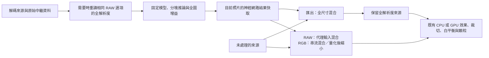

# ADR 0002：來源階段 AI 降噪

- 狀態：**已採用並完成可用平台驗證**（2026-10-19）。實際結果與未覆蓋平台記錄於[實作計畫](../superpowers/plans/2026-10-19-ai-denoising.md)。
- 範圍：Engine 來源階段、Core `denoise` 參數、App／CLI／匯出及原生相依庫。
- 本決策取代 2026-10-16 的 sRGB／DRUNet／傳統濾鏡後備提案；當時「尚無 RAW 管線」的前提已失效。歷史版本由 Git 保留，不再把估算值當產品效能。
- 2026-10-26 補充：低優先縮圖改為只對提供的像素推論；正式預覽／匯出的全品質契約不變。[重現與驗證](../history.md#縮圖-ai-降噪與合併意圖複核2026-10-26)。

## 決策與理由

使用 ONNX Runtime 執行兩個固定身分的 FP32 攝影模型；macOS／iOS 使用 `1.25.0`，Windows DirectML 保留 `1.24.4`。依**來源資料域**自動選擇，不提供可將 RAW 誤送進顯示 RGB 模型的選項。

| 來源資料 | 模型 | 固定輸入 | 上下文／有效核心 | 輸出契約 |
|---|---|---|---|---|
| 已現像、未夾取的線性 Rec.2020 RAW | RawNIND Linear | `[1,3,512,512]` FP32 | 每側 64 px／384 px | 同一線性域；整張影像計算一次有正負號的平均值增益比，保留有限高光與負值 |
| 一般 16-bit sRGB RGBA | NAFNet-SIDD width32 | `[1,3,768,768]` FP32 | 每側 64 px／640 px | 正規化顯示 sRGB；不套用 RAW 增益比 |

只使用 RawNIND 的三通道 linear 權重，不採用會同時解馬賽克的 Bayer 權重。現有 RAW 解碼、相機白平衡模型、色彩與幾何中繼資料仍是權威來源。這不是 Lightroom 的感光樣本域聯合解馬賽克，也不宣稱同等品質。

不引入 Python、不複製 GPL 訓練／匯出工具、不另寫一套 WGSL 神經網路。沒有模型、雜湊錯誤或推論錯誤均回報失敗；不改用傳統濾鏡，也不將原圖回傳並聲稱降噪成功。加速器初始化不成功時，Auto 才可明確標示原因並改用真實 CPU 推論。

## 資料流

以下是正式預覽／匯出的資料流；縮圖不進入全解析度重讀路徑。

- 降噪與混合都在裁切、藝術效果與底片顆粒之前。正式預覽／匯出仍以全解析度先行：RAW 的仿射混合可改成先 box 原始／神經輸入再於預覽尺寸混合，保持既有浮點容差。sRGB 的夾取／16-bit 量化不可移到縮小之後，因此逐個全圖像素混合、量化並累積覆蓋率，直接產生代理圖；省去全圖暫存，但不宣稱正式預覽的 sRGB 運算量只隨預覽尺寸增加。匯出仍以完整來源與完整神經結果混合。
- 低優先縮圖只在已提供的尺寸與資料域推論，保留原始參考尺寸、中繼資料與覆蓋率；內嵌 sRGB 預覽使用 NAFNet-SIDD，場景線性縮圖使用 RawNIND。排程器先準備縮圖來源，既有效果算圖器看到 `DenoiseReport` 後不再推論一次。模型缺失、錯誤與取消仍走既有失敗／取消通道，不以跳過 AI 換取完成計數。
- 關閉、強度為零或兩種有效混合量皆為零時，直接回傳相同來源參考，不讀模型、不配置影像緩衝。
- `denoise.amount`、`denoise.luminance`、`denoise.color` 都是後推論混合量，並不是估計感光 ISO 或模型雜訊參數。改變它們、曝光或底片效果，不應重跑同張照片的神經網路。
- Alpha 不交給模型推論；RAW 仍保留浮點場景資料、tone／WB／geometry／語意遮罩及原始參考尺寸。原圖比較不被降噪結果覆寫；照片工具則分析實際準備後的來源。
- 神經網路快取分開保留一筆完整來源與一筆縮圖結果；RAW 正式代理輸入最多保留最近四個尺寸，隨該完整結果失效；模型 session 數量仍有界。快取識別涵蓋來源、檔案版本、原始參考尺寸、實際推論尺寸、RAW 讀檔選項、模型身分與模型目錄，不包含藝術參數。縮圖不會逐出或污染完整來源結果；取消或失敗不寫入成功快取。
- `RenderResult` 與 `SourceImage` 攜帶 `DenoiseReport`；`export_log.json` 記錄實際模型 SHA-256、provider、推論時間、tile 數與快取命中，而不只記錄效果 GPU 名稱。

## 原生執行與取消

macOS／iOS 使用標準 `Microsoft.ML.OnnxRuntime 1.25.0`；iOS app 必須直接參考套件，才能連結 xcframework 並選取使用 `__Internal` 的 managed asset，避免 `1.24.4` 的 iOS 綁定缺失。Windows 目標保留 `.DirectML 1.24.4` 與 `Microsoft.AI.DirectML 1.15.4`，不能同時引入兩套原生 runtime。套件依**目標 RID**而非只有建置主機選擇，避免在 Mac 交叉發佈 Windows 時漏掉 DirectML；各平台的建置與實際推論證據仍須分開。

iOS 的原生 runtime 由 app 層的 xcframework 連結；Engine 與共用診斷專案須排除套件 `netstandard` props 對 AnyCPU 額外加入的 Windows 原生 DLL，並保留 ONNX 的授權／第三方聲明／隱私檔案。此排除只作用於 iOS RID，不影響 Windows DirectML 的實際封裝。

Auto 在 macOS 嘗試 CoreML MLProgram，在 Windows 嘗試 DirectML；CPU 是真實推論後備。報告使用 `CoreML + CPU`／`DirectML + CPU`，不保證所有節點位於 GPU 或 ANE。CoreML 使用固定輸入形狀、關閉 GPU 低精度累加，編譯快取位於可寫的使用者模型目錄，而非 `.app` 內。DirectML 使用 sequential execution 並停用 memory pattern。CPU session 使用有界執行緒，不把背景 CPU 目標說成硬性上限。

每次 native run 各有自己的 `RunOptions` 與取消註冊。取消時設 `Terminate=true`，**run 回來後仍必須檢查 token**：實測 CoreML 的融合圖可能正常返回，而非拋出 native 例外；不能依例外判斷是否可以發布或快取。此時目前一塊圖的運算可能先完成，再於 tile 邊界丟棄結果；不承諾作業系統層的即時中斷。

換來源、重建與關閉會取消舊工作；前景請求可中斷背景縮圖。相同來源的一般滑桿仍依完成順序交付，避免持續拖曳造成飢餓。明確取消 AI 預覽也會取消同來源待處理／稍後送達的縮圖，直到新的前景請求重新啟動，不修改照片設定。模型錯誤與取消不應當成 GPU 遺失而重建重試。

## 模型取得、身分與授權

權重是可選的使用者資料，不放進應用程式，也不在 render 時連線。App 模型面板與 CLI 的明確下載／匯入才會安裝，先顯示作者與授權；先驗證套件及 ONNX 的固定 SHA-256，再原子啟用。預設位置是 `AppPaths.Root/models/denoise/`。

來源封裝是 [darktable-ai `nightly-5.7.0`](https://github.com/darktable-org/darktable-ai/releases/tag/nightly-5.7.0)；資料契約查閱版本 [`f1a46e2`](https://github.com/darktable-org/darktable-ai/tree/f1a46e2d3feebc917a94f14705d128316fcf8114)。兩個實際下載的檔案均已核對發布雜湊，再抽出指定 ONNX；完整固定身分亦由 `DenoiseModelCatalog` 保存。

| 身分 | 套件 SHA-256 | ONNX SHA-256 |
|---|---|---|
| `rawnind-linear` | `1a0db3dc4a4db13ce5eee7aa2fed097914be28a3f628dc6071dc6aa8d16377bc` | `df957efadcc152c007d5d3b0917bdff9e41c0d4a0efe56584ef30b36393cd181` |
| `nafnet-sidd` | `027961b3e6d1d4d2ba2d7a412688c0542e6a6e2cf7ec2f8e16030cf0a311fb0a` | `8b437280db2f9f0ef5c733fa0fec70fc10012a62d19dac24a25b80ec8c529230` |

- **RawNIND 權重：採用 CC-BY-4.0 選項。** 原作者在 [LightCraft #1760](https://github.com/storytold/lightcraft/issues/1760) 明確說明權重可選 GPL-3 或 CC-BY-4.0，並要求標示作者。署名：RawNIND by Benoit Brummer；論文為 *Joint Denoising, Demosaicing, and Compression: A Recommended Paradigm for Learning-Based Image Workflows*，Benoit Brummer and Christophe De Vleeschouwer。這不是將 GPL 工具鏈重新標成 MIT，也不適用到不同的舊 NIND 權重。
- **NAFNet-SIDD 權重：MIT。** [選定模型文件](https://github.com/darktable-org/darktable-ai/blob/f1a46e2d3feebc917a94f14705d128316fcf8114/models/denoise-nafnet/README.md) 明列模型與訓練資料 MIT；[NAFNet 原始授權](https://github.com/megvii-research/NAFNet/blob/2b4af71ebe098a92a75910c233a3965a3e93ede4/LICENSE) 區分 NAFNet 的 MIT 與 BasicSR 的 Apache-2.0。FilmBatch 不引入這些 Python 程式。
- **ONNX Runtime：MIT，Microsoft Corporation。** 原生相依庫隨 self-contained App／CLI 發佈。完整再散布聲明見 [`THIRD-PARTY-NOTICES.txt`](../../THIRD-PARTY-NOTICES.txt)。

## 操作與驗證邊界

一般操作與 CLI 指令見[建置文件](../cli.md#本機-ai-降噪)。已實際驗證固定 CPU／CoreML 模型、HDR／alpha、實拍裁切品質、預覽／匯出同源、原生介面、取消／換照片、undo／保存及 Apple Silicon self-contained 執行。完整回歸、原生介面及可執行檔 smoke 結果與證據索引見[驗收紀錄](../superpowers/plans/2026-10-19-ai-denoising.md#observed-acceptance-evidence--2026-10-19)；Windows 只完成交叉封裝，不代表 DirectML 實機通過。

固定小型 ONNX 圖可用於離線、可重現的邊界回歸，不代表真實攝影品質。實際權重與實拍 smoke 的證據留於忽略的 `dist/ai-denoise-evidence/`，不是程式執行的依賴。NIND 配對若經 inverse-sRGB 轉為線性域，必須明說那不是原始感光樣本，也不是獨立留出的 RAW benchmark。Windows 的交叉建置不等於 DirectML 實機驗證；OS 鎖定時的原生畫面與控制項操作不等於已驗證真實 OS 焦點切換。
