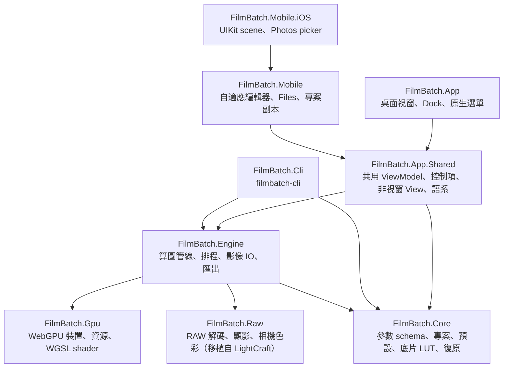
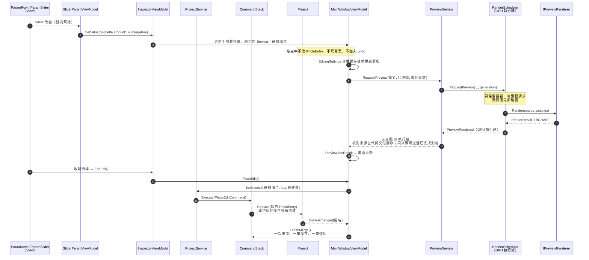

# FilmBatch 架構說明書

本文件寫給第一次修改 FilmBatch 的開發者：先看懂整體分層與一次編輯的資料流，再查閱各模組的職責、關鍵型別與注意事項。最後的「修改食譜」列出常見改動該動哪些檔案。

設計背景見 [plan.md](plan.md) 第 5、11 章；本頁以目前程式碼為準。依任務找文件見[文件地圖](README.md)，執行檢查見[驗證入口](../VERIFY.md)，決策原因與替代方案見[提交歷史](history.md)。

## 目錄

1. [名詞速查](#1-名詞速查)
2. [整體架構](#2-整體架構)
3. [一次編輯的完整資料流](#3-一次編輯的完整資料流)
4. [模組說明](#4-模組說明)
   - 4.1 [Core．參數 schema（Params）](#41-core參數-schemaparams)
   - 4.2 [Core．專案與照片設定（Projects）](#42-core專案與照片設定projects)
   - 4.3 [Core．復原堆疊（Commands）](#43-core復原堆疊commands)
   - 4.4 [Core．預設庫（Presets）](#44-core預設庫presets)
   - 4.5 [Core．底片風格（Film）](#45-core底片風格film)
   - 4.6 [Engine．算圖管線（Rendering）](#46-engine算圖管線rendering)
   - 4.7 [Engine．算圖排程（Scheduling）](#47-engine算圖排程scheduling)
   - 4.8 [Engine．影像讀取與批次匯出（Imaging / Exporting）](#48-engine影像讀取與批次匯出imaging--exporting)
   - 4.9 [Gpu．WebGPU 薄封裝與 Shader](#49-gpuwebgpu-薄封裝與-shader)
   - 4.10 [App．介面層](#410-app介面層)
   - 4.11 [Cli．命令列工具](#411-cli命令列工具)
5. [修改食譜](#5-修改食譜)
6. [測試對照](#6-測試對照)
7. [資料檔位置](#7-資料檔位置)

---

## 1. 名詞速查

| 名詞 | 意思 | 程式碼 |
|---|---|---|
| 模組（module） | 一個來源或效果區塊。`ModuleCatalog` 目前包含 RAW 來源、裁切與 16 個效果，共 18 個，各有 `enabled` 開關 | `ModuleSchema` |
| 參數（param） | 模組內的一個欄位，例如 `amount` | `ParamDef` |
| 扁平 key | `模組.參數` 形式的唯一名稱，例如 `vignette.amount`。整個程式都用它定位參數 | `ModuleSchema.FlatKey` |
| 設定（Settings） | 扁平 key → 值 的**不可變**字典 | `Settings` |
| 預設（preset） | 存在預設庫的一組設定（YAML），可指定給多張照片 | `Preset` |
| 覆寫（overrides） | 某張照片與其預設**不同**的欄位 | `PhotoEntry.Overrides` |
| 最終參數（resolved） | 系統預設 ⊕ 預設 ⊕ 覆寫，實際拿去算圖的值 | `ProjectService.SettingsFor` |
| 底片（look） | `film` 模組選用的一卷底片，即一個內附 3D LUT（`film.look` 存其 key） | `FilmLook`、`FilmLut` |
| 色相帶（hue band） | 底片風格的八個分色相修正區段，各有色相／飽和／明度 | `HueBands` |
| 算圖器（renderer） | 把「影像 + 設定」算成結果的物件，有 GPU 與 CPU 兩種 | `IPreviewRenderer` |
| 世代（generation / epoch） | 遞增的編號，用來丟棄過期的算圖結果 | `PreviewService`、`RenderScheduler` |

---

## 2. 整體架構

### 2.1 專案分層

| 專案 | 一句話職責 | 可以引用 | **不可以**引用 |
|---|---|---|---|
| `FilmBatch.Core` | 資料模型與規則：參數、專案、預設、底片 LUT、復原 | 只有 .NET 與 YAML 函式庫 | Avalonia、GPU、Magick.NET |
| `FilmBatch.Gpu` | WebGPU 的薄封裝與嵌入的 WGSL | WebGPUSharp | 其他 FilmBatch 專案、Avalonia |
| `FilmBatch.Raw` | RAW 容器與壓縮解碼、去馬賽克、相機色彩資料（移植自 LightCraft，見 [tools/raw-oracle](../tools/raw-oracle/README.md)） | managed 相依僅 .NET；JPEG XL 另需隨附的原生閉包 | 其他 FilmBatch 專案、Magick.NET、Avalonia、GPU |
| `FilmBatch.Engine` | 把設定變成影像：算圖、排程、讀檔、匯出 | Core、Gpu、Raw；桌面使用 Magick.NET，iOS RID 使用 Apple ImageIO | Avalonia |
| `FilmBatch.App.Shared` | 桌面與行動版唯一的編輯 ViewModel、控制項、非視窗 View、語系與主題 | Core、Engine、Avalonia | 桌面 Window／Dock host、行動 host |
| `FilmBatch.App` | 桌面視窗、Dock、選單、視窗式對話框與元件展示 | App.Shared、Core、Engine | 行動 host |
| `FilmBatch.Mobile` | 寬窄自適應編輯器、擁有的專案／照片副本、行動式對話框 | App.Shared | 桌面 App／Dock |
| `FilmBatch.Mobile.iOS` | iOS 啟動、scene 生命週期與使用者選取 Photos 匯入 | Mobile、Avalonia.iOS | 桌面 App／Magick.NET |
| `FilmBatch.Cli` | 命令列批次匯出 | Core、Engine | Avalonia |

相依方向由 `.csproj` 的 `ProjectReference` 強制，建置時就會擋下反向依賴。這帶來兩個好處：Engine 能在 CLI 與測試中直接使用；換掉 GPU 綁定只需動 `FilmBatch.Gpu`。

### 2.2 執行緒模型

FilmBatch 有三種執行緒，**這是改程式碼時最容易出錯的地方**：

| 執行緒 | 做什麼 | 規則 |
|---|---|---|
| UI 執行緒 | 所有 ViewModel、View、`Project` 的修改 | ViewModel 屬性只能在這裡改 |
| GPU 執行緒（名為 `FilmBatch GPU`，由 `RenderScheduler` 建立） | 預覽與縮圖的算圖 | 算圖器只能在建立它的執行緒上使用；事件在此執行緒觸發，需切回 UI 執行緒 |
| 背景工作（`Task.Run`） | 開啟專案、解碼照片、批次匯出 | 匯出會**另外建立一個自己的算圖器**，不與預覽共用 |

結果要回到 UI 時，一律經過 `PreviewService` 注入的 `post`（實際上是 `Dispatcher.UIThread.Post`）。

---

## 3. 一次編輯的完整資料流

以「使用者拖曳暗角滑桿」為例，這條路徑涵蓋了大部分核心類別：

讀懂這張圖後，記住三個原則：

1. **暫存與保存分開**：滑桿先改編輯器的暫存值；正式修改仍經 `ProjectService` 命令，不能繞過保存與復原。
2. **正式資料改了才發事件**：`Project.EntriesChanged` 通知已保存的照片設定；暫存預覽由 `MainWindowViewModel` 直接排程，不假造保存事件。
3. **算圖請求可以隨便送**：排程器只保留最新的待算預覽；同來源已完成的影格仍依序交付，避免持續拖曳時一直丟棄結果。換照片／來源、取消或重建算圖器後，不採用舊影格。

---

## 4. 模組說明

每個模組依「職責 → 關鍵型別 → 規則與陷阱 → 常改的地方」說明；細節拆在 `architecture/` 下的各檔，本節只給摘要與入口。

### 4.1 Core．參數 schema（Params）

`ModuleCatalog` 定義 RAW 來源、裁切與效果模組的參數、型別、範圍與預設值，是介面面板、存檔、貼上與範圍檢查的單一資料來源。`Settings` 為不可變字典，寫入前一律經 `ParamDef.Coerce`。詳見 [core.md](architecture/core.md#41-core參數-schemaparams)。

### 4.2 Core．專案與照片設定（Projects）

一個照片資料夾對應一個專案，採「系統預設 ⊕ 預設 ⊕ 覆寫」三層設定；UI 只能經 `ProjectService` 修改專案，操作包成可復原命令。詳見 [core.md](architecture/core.md#42-core專案與照片設定projects)。

### 4.3 Core．復原堆疊（Commands）

專案層級的復原／重做，上限 200 筆，連續相同 `MergeKey` 的命令（滑桿拖曳）會合併。詳見 [core.md](architecture/core.md#43-core復原堆疊commands)。

### 4.4 Core．預設庫（Presets）

全域、跨專案的預設，存成使用者資料夾中的 YAML；寫入磁碟成功才更新記憶體，損毀檔案記入 `LoadErrors`。詳見 [core.md](architecture/core.md#44-core預設庫presets)。

### 4.5 Core．底片風格（Film）

36 卷內附底片 3D LUT、八色相帶與舊參數相容處理；演算法與授權見 [film-looks.md](film-looks.md)。詳見 [core.md](architecture/core.md#45-core底片風格film)。

### 4.6 Engine．算圖管線（Rendering）

同一套演算法有 CPU 與 GPU 兩份實作，順序與數學必須一致，共用 `ModuleParams` 的解析結果；處理順序分幾何、光學、底片、顯示、表面五個階段。詳見 [engine.md](architecture/engine.md#46-engine算圖管線rendering)。

### 4.7 Engine．算圖排程（Scheduling）

`RenderScheduler` 擁有唯一的 GPU 執行緒，序列化預覽、縮圖與裝置重建；預覽只算最新一張並優先於縮圖，事件在 GPU 執行緒上觸發。詳見 [engine.md](architecture/engine.md#47-engine算圖排程scheduling)。

### 4.8 Engine．影像讀取與批次匯出（Imaging / Exporting）

影像解碼、RAW 來源載入、色彩判定與批次匯出；匯出以參數快照為準，拒絕覆寫來源，先寫暫存檔再改名。改匯出或 EXIF 前先讀其中的安全規則。詳見 [engine.md](architecture/engine.md#48-engine影像讀取與批次匯出imaging--exporting)。

### 4.9 Gpu．WebGPU 薄封裝與 Shader

把 WebGPUSharp（Dawn）包成少數簡單型別，Engine 只透過它們使用 GPU；shader 放在 `Shaders/v1/`，改完須跑 `dotnet run build/CheckShaders.cs`。詳見 [gpu.md](architecture/gpu.md#49-gpuwebgpu-薄封裝與-shader)。

### 4.10 App．介面層

Avalonia 12 桌面與共用行動版介面，採 MVVM（CommunityToolkit.Mvvm）；涵蓋共用專案結構、Loupe 預覽、ViewModel 結構、編輯生命週期、大量照片載入與背景 CPU、服務與控制項、主題與多國語系。詳見 [app.md](architecture/app.md#410-app介面層)。

### 4.11 Cli．命令列工具

`src/FilmBatch.Cli` 以 System.CommandLine 定義 `export`、`samples`、`gpu-info`、`spike` 與 `raw convert`／`raw masks`，與 GUI 共用 Core／Engine。詳見 [cli-design.md](architecture/cli-design.md#411-cli命令列工具)。

---

## 5. 修改食譜

### 5.1 為既有模組新增一個參數

以「暗角新增 `tint` 參數」為例：

1. **schema**：在 `Core/Params/ModuleCatalog.cs` 的 `vignette` 模組加上 `Float("tint", "色調", 0, -100, 100)`。介面面板、存檔、貼上會自動支援。
2. **解析**：在 `Engine/Rendering/ModuleParams.cs` 加欄位 `VigTint`，並在 `From` 中以 `N(s, "vignette.tint", 0)` 讀取。
3. **CPU**：在 `CpuPipeline.Vignette` 使用 `p.VigTint`。
4. **GPU**：
   - `GpuEffectPipeline.cs` 底部的 `VignetteUniforms` 加欄位（必要時調整 `_pad` 保持 16 位元組對齊），並在 `Process` 中傳入。
   - `Shaders/v1/optical/vignette.wgsl` 的 `struct Params` 以相同順序加欄位並使用。
5. **文字**：在 `Strings.resx` / `Strings.en.resx` 加 `Param.vignette.tint`。
6. **驗證**：`dotnet test`（identity 與 CPU / GPU 一致性）＋ `dotnet run build/CheckShaders.cs`。

### 5.2 新增一個效果模組

1. 在 `ModuleCatalog.Modules` 中**依處理順序**插入新的 `ModuleSchema`，第一個參數為 `Bool(ModuleSchema.EnabledKey, "啟用")`。
2. `ModuleParams` 加入 `XxxOn` 與參數欄位。
3. `CpuPipeline.Process` 在正確的階段加入呼叫與實作方法；關閉或參數為零時要跳過。
4. 在 `Shaders/v1/<階段>/` 新增 `.wgsl`，在 `GpuEffectPipeline` 建構子以 `K(...)` 載入、在 `Process` 對應位置派送，並新增 uniform record。
5. 若有隨機性，加 `Seed()` 參數並在 `ModuleParams` 計算種子；若有中心點，使用 `center_x` / `center_y` 即可自動得到畫布控制點。
6. 在資源檔加 `Module.<key>` 與各參數名稱。
7. 補測試：identity、CPU / GPU 一致性，必要時加視覺特性的測試（參考 `EffectPipelineTests` 中漏光、散景的寫法）。

### 5.3 新增一個可復原的照片操作

1. 在 `PhotoOperations` 寫純函式：輸入舊的 `PhotoEntry`，回傳新的。
2. 在 `ProjectService` 新增方法，透過私有的 `Apply(描述, 檔名們, 操作)` 包成命令。
3. 在 ViewModel 以 `[RelayCommand]` 呼叫，介面會經由 `EntriesChanged` 自動更新。
4. 在 `PhotoOperationsTests` 或 `ProjectServiceTests` 測試合併與復原。

### 5.4 新增介面文字或調整版面

- 文字：兩份 resx 都加相同 key，XAML 用 `{l:Tr Key}`。
- 版面：改 `Views/*.axaml`，邏輯放在對應的 ViewModel；顏色與間距用 `Themes/` 中的 token 與樣式。
- 檢查外觀：`dotnet run --project src/FilmBatch.App -- --gallery`。

### 5.5 新增一個對話框

1. 在 `ViewModels/Dialogs/` 建 ViewModel，在 `Dialogs/` 建 `Window`。
2. 在 `IDialogService` 加方法，並在 `DialogService` 中以 `ShowDialog` 實作。
3. ViewModel 只呼叫 `IDialogService`，測試時可以假物件替換。

### 5.6 新增一卷底片

1. 在 `Core/Film/Looks/looks.json` 加一筆（`key`、`name`、`group`、HaldCLUT.zip 內的 `source`）；陣列順序即介面順序。
2. 執行 `dotnet run --project tools/film-luts -- src/FilmBatch.Core/Film/Looks/looks.json src/FilmBatch.Core/Film/Looks` 產生 `<key>.fblut`（需要網路，只以 HTTP Range 抓列出的 PNG）。
3. 執行 `FilmLookTests`（卷數有改時更新測試中的數字）。
4. 更新 [film-looks.md](film-looks.md) 的底片表；新分組還要在資源檔加分組名稱。不需要改 CPU／GPU 程式碼。

---

## 6. 測試對照

| 想改的東西 | 對應測試 |
|---|---|
| 三層合併、貼上、重設 | `tests/FilmBatch.Core.Tests/PhotoOperationsTests.cs`、`ProjectServiceTests.cs` |
| 專案與預設存檔 | `PersistenceTests.cs` |
| 效果演算法、CPU / GPU 一致性 | `EffectPipelineTests.cs`、`GpuSpikeTests.cs` |
| 底片 LUT、底片清單、色相預設 | `FilmLutTests.cs`、`FilmLookTests.cs` |
| 舊參數丟棄、film schema | `RetiredParamsTests.cs` |
| 底片風格算圖、色相帶、CPU / GPU 一致性 | `EffectPipelineTests.cs`（`FilmLook_*`、`HueBandWeights_*`、`Gpu_MatchesCpu_OnFilmLook`） |
| 底片縮圖格與色相帶編輯器 | `tests/FilmBatch.App.Tests/FilmLookViewModelTests.cs` |
| 排程與裝置重建 | `RenderSchedulerTests.cs`、`RenderSchedulerReconfigureTests.cs` |
| Loupe 窗口的幾何與交付 | `LoupePlanTests.cs`、`RegionViewTests.cs`、`PreviewWindowServiceTests.cs`、`PreviewCanvasWindowTests.cs`、`ZoomWindowTests.cs`、`WindowRenderEquivalenceTests.cs`、`RenderSchedulerTests.cs`（`Window_*`、`Newer_window_*`、`Preview_runs_*`） |
| 拖曳草稿與 DragScale | `DragScaleTests.cs`、`DragDraftTests.cs` |
| 匯出與中繼資料 | `BatchExporterTests.cs`、`TiffMetadataTests.cs` |
| ViewModel 與介面互動 | `tests/FilmBatch.App.Tests/`（Avalonia.Headless，不需顯示器） |
| 多國語系資源完整 | `LocalizationTests.cs` |

沒有 GPU 的環境會自動略過 GPU 測試；CI 會在 Windows 與 macOS 上完整執行。

---

## 7. 資料檔位置

| 內容 | 位置 |
|---|---|
| 偏好設定 | `<使用者資料夾>/settings.json` |
| Dock 版面 | `<使用者資料夾>/layout.json` |
| 預設庫 | `<使用者資料夾>/presets/*.yaml` |
| 材質庫 | `<使用者資料夾>/textures/` |
| 記錄檔 | `<使用者資料夾>/logs/` |
| 專案（每個照片資料夾一份） | `<照片資料夾>/.filmbatch/project.json` |
| 匯出紀錄 | `<照片資料夾>/.filmbatch/export_log.json` |

`<使用者資料夾>`：Windows 為 `%APPDATA%\FilmBatch\`，macOS 為 `~/Library/Application Support/FilmBatch/`。路徑集中定義在 `Core/AppPaths.cs`。

## 相關文件

- [building.md](building.md)：建置、測試、CI 與發佈
- [adr/0001-webgpu-binding.md](adr/0001-webgpu-binding.md)：WebGPU 綁定選型
- [adr/0002-ai-denoise.md](adr/0002-ai-denoise.md)：本機 AI 降噪、模型身分、資料域、快取與原生執行決策
- [film-looks.md](film-looks.md)：底片風格的 LUT 來源與授權、演算法、色相帶與新增底片流程
