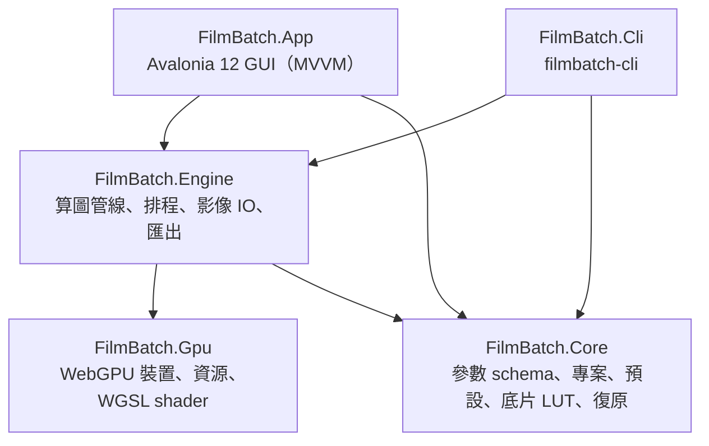
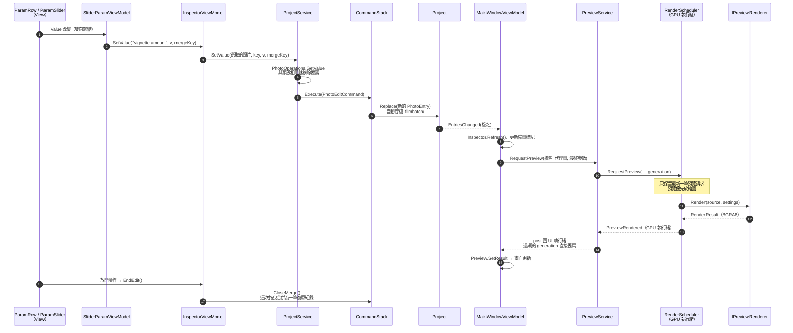
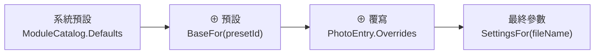
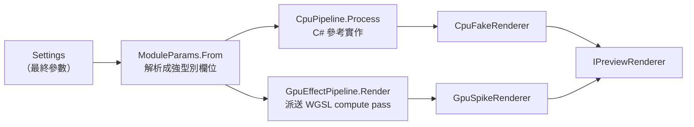
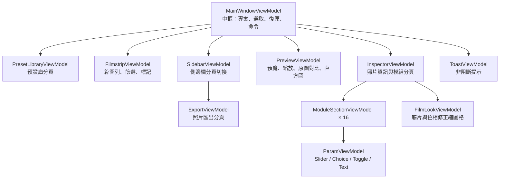

# FilmBatch 架構說明書

本文件寫給第一次修改 FilmBatch 的開發者：先看懂整體分層與一次編輯的資料流，再查閱各模組的職責、關鍵型別與注意事項。最後的「修改食譜」列出常見改動該動哪些檔案。

設計背景見 [plan.md](plan.md) 第 5、11 章；本頁以目前程式碼為準。

## 目錄

1. [名詞速查](#1-名詞速查)
2. [整體架構](#2-整體架構)
3. [一次編輯的完整資料流](#3-一次編輯的完整資料流)
4. [模組說明](#4-模組說明)
   - 4.1 [Core．參數 schema（Params）](#41-core參數-schemaparams)
   - 4.2 [Core．專案與照片設定（Projects）](#42-core專案與照片設定projects)
   - 4.3 [Core．復原堆疊（Commands）](#43-core復原堆疊commands)
   - 4.4 [Core．預設庫（Presets）](#44-core預設庫presets)
   - 4.5 [Core．底片風格（Film）](#45-core底片風格film)
   - 4.6 [Engine．算圖管線（Rendering）](#46-engine算圖管線rendering)
   - 4.7 [Engine．算圖排程（Scheduling）](#47-engine算圖排程scheduling)
   - 4.8 [Engine．影像讀取與批次匯出（Imaging / Exporting）](#48-engine影像讀取與批次匯出imaging--exporting)
   - 4.9 [Gpu．WebGPU 薄封裝與 Shader](#49-gpuwebgpu-薄封裝與-shader)
   - 4.10 [App．介面層](#410-app介面層)
   - 4.11 [Cli．命令列工具](#411-cli命令列工具)
5. [修改食譜](#5-修改食譜)
6. [測試對照](#6-測試對照)
7. [資料檔位置](#7-資料檔位置)

---

## 1. 名詞速查

| 名詞 | 意思 | 程式碼 |
|---|---|---|
| 模組（module） | 一個效果，例如暗角、顆粒。共 16 個，每個有 `enabled` 開關 | `ModuleSchema` |
| 參數（param） | 模組內的一個欄位，例如 `amount` | `ParamDef` |
| 扁平 key | `模組.參數` 形式的唯一名稱，例如 `vignette.amount`。整個程式都用它定位參數 | `ModuleSchema.FlatKey` |
| 設定（Settings） | 扁平 key → 值 的**不可變**字典 | `Settings` |
| 預設（preset） | 存在預設庫的一組設定（YAML），可指定給多張照片 | `Preset` |
| 覆寫（overrides） | 某張照片與其預設**不同**的欄位 | `PhotoEntry.Overrides` |
| 最終參數（resolved） | 系統預設 ⊕ 預設 ⊕ 覆寫，實際拿去算圖的值 | `ProjectService.SettingsFor` |
| 底片（look） | `film` 模組選用的一卷底片，即一個內附 3D LUT（`film.look` 存其 key） | `FilmLook`、`FilmLut` |
| 色相帶（hue band） | 底片風格的八個分色相修正區段，各有色相／飽和／明度 | `HueBands` |
| 算圖器（renderer） | 把「影像 + 設定」算成結果的物件，有 GPU 與 CPU 兩種 | `IPreviewRenderer` |
| 世代（generation / epoch） | 遞增的編號，用來丟棄過期的算圖結果 | `PreviewService`、`RenderScheduler` |

---

## 2. 整體架構

### 2.1 專案分層



| 專案 | 一句話職責 | 可以引用 | **不可以**引用 |
|---|---|---|---|
| `FilmBatch.Core` | 資料模型與規則：參數、專案、預設、底片 LUT、復原 | 只有 .NET 與 YAML 函式庫 | Avalonia、GPU、Magick.NET |
| `FilmBatch.Gpu` | WebGPU 的薄封裝與嵌入的 WGSL | WebGPUSharp | 其他 FilmBatch 專案、Avalonia |
| `FilmBatch.Engine` | 把設定變成影像：算圖、排程、讀檔、匯出 | Core、Gpu、Magick.NET | Avalonia |
| `FilmBatch.App` | 桌面介面 | Core、Engine | 直接呼叫 Gpu（一律經 Engine） |
| `FilmBatch.Cli` | 命令列批次匯出 | Core、Engine | Avalonia |

相依方向由 `.csproj` 的 `ProjectReference` 強制，建置時就會擋下反向依賴。這帶來兩個好處：Engine 能在 CLI 與測試中直接使用；換掉 GPU 綁定只需動 `FilmBatch.Gpu`。

### 2.2 執行緒模型

FilmBatch 有三種執行緒，**這是改程式碼時最容易出錯的地方**：

| 執行緒 | 做什麼 | 規則 |
|---|---|---|
| UI 執行緒 | 所有 ViewModel、View、`Project` 的修改 | ViewModel 屬性只能在這裡改 |
| GPU 執行緒（名為 `FilmBatch GPU`，由 `RenderScheduler` 建立） | 預覽與縮圖的算圖 | 算圖器只能在建立它的執行緒上使用；事件在此執行緒觸發，需切回 UI 執行緒 |
| 背景工作（`Task.Run`） | 開啟專案、解碼照片、批次匯出 | 匯出會**另外建立一個自己的算圖器**，不與預覽共用 |

結果要回到 UI 時，一律經過 `PreviewService` 注入的 `post`（實際上是 `Dispatcher.UIThread.Post`）。

---

## 3. 一次編輯的完整資料流

以「使用者拖曳暗角滑桿」為例，這條路徑涵蓋了大部分核心類別：



讀懂這張圖後，記住三個原則：

1. **UI 不直接改資料**：任何修改都經 `ProjectService` 包成命令，才能復原。
2. **資料改了就發事件**：`Project.EntriesChanged` 是「照片設定變了」的唯一通知來源，預覽、縮圖、面板都由它觸發更新。
3. **算圖請求可以隨便送**：排程器只保留最新的預覽請求，舊結果以世代編號丟棄，拖曳中狂送請求不會塞車。

---

## 4. 模組說明

每個模組依「職責 → 關鍵型別 → 規則與陷阱 → 常改的地方」說明。

### 4.1 Core．參數 schema（Params）

**職責**：定義 16 個效果模組有哪些參數、型別、範圍與預設值。這是整個程式的**單一資料來源**：介面面板、存檔、貼上、鏡像、範圍檢查都從這裡自動產生。

| 型別 | 檔案 | 說明 |
|---|---|---|
| `ModuleCatalog` | `Params/ModuleCatalog.cs` | 所有模組的清單，**陣列順序就是面板顯示順序與處理順序**。也提供 `Defaults`（系統預設值）、`Param(flatKey)`、`Module(key)` 查詢 |
| `ModuleSchema` | `Params/ModuleSchema.cs` | 一個模組：`Key`、`Label`、所屬分組 `ModuleGroup`、選擇性貼上分類 `PasteCategory`、參數清單 |
| `ParamDef` | `Params/ParamDef.cs` | 一個參數。以工廠方法建立：`Float`、`Int`、`Bool`、`Choice`、`Path`、`Seed`、`Position`、`Offset` |
| `ParamValue` | `Params/ParamValue.cs` | 參數值（數字 / 布林 / 文字），以 `AsNumber`、`AsBool`、`AsText` 讀取 |
| `Settings` | `Params/Settings.cs` | 扁平 key → `ParamValue` 的不可變字典。`Overlay` 用於三層合併，`With` / `Without` 回傳新物件 |

**規則與陷阱**

- `Settings` 是**不可變**的：`settings.With(k, v)` 不會改原物件，要接住回傳值。
- `ParamDef.Coerce` 會把值夾回合法範圍；寫入前一律經過它，所以不必在 UI 端重複檢查。
- `Position` / `Offset` 參數以 0–1 正規化座標儲存，換尺寸照片仍合理；帶有 `center_x`、`center_y` 的模組會自動在預覽上出現控制點（`ModuleSchema.HasCanvasPoint`）。
- `Seed` 參數預設不會被貼上，每張照片依檔名產生自己的種子（`Core/Random/SeedHash.cs`）。
- `Label` 是繁中後備文字；實際顯示名稱由 App 的資源檔決定（見 4.10 多國語系）。

### 4.2 Core．專案與照片設定（Projects）

**職責**：一個照片資料夾 = 一個專案。保存每張照片用哪個預設、有哪些覆寫，並提供所有可復原的編輯操作。

| 型別 | 檔案 | 說明 |
|---|---|---|
| `Project` | `Projects/Project.cs` | 照片清單與各自的 `PhotoEntry`；預設快照；`EntriesChanged` 事件；`Open` 時掃描資料夾並載入既有編輯 |
| `PhotoEntry` | `Projects/PhotoEntry.cs` | 一張照片：`FileName`、`PresetId`、`Overrides`（不可變 record） |
| `PhotoOperations` | `Projects/PhotoOperations.cs` | **純函式**：合併、清理、設值、重設、指定預設、三種貼上、鏡像。不碰檔案、不發事件，最容易寫單元測試 |
| `ProjectService` | `Projects/ProjectService.cs` | UI 修改專案的**唯一入口**：呼叫 `PhotoOperations` 算出新狀態，再包成 `PhotoEditCommand` 送進復原堆疊 |
| `ProjectStorage` | `Projects/ProjectStorage.cs` | `.filmbatch/project.json` 的讀寫，原子寫入並以 revision 偵測外部修改 |
| `SettingsClipboard` | `Projects/SettingsClipboard.cs` | 複製設定的內容（來源預設、覆寫、最終參數）與貼上選項 |

**三層設定模型**



- 覆寫只存「與預設不同」的欄位。`PhotoOperations.Clean` 會移除與基準相同的值，所以修改預設時，沒被覆寫的欄位自然跟著變。
- **預設快照**：專案會把用到的預設存一份在 `PresetSnapshots`。重新開啟舊專案時，即使預設庫裡的預設被改過，照片仍維持原樣，直到使用者在對話框中選擇同步（`Project.PendingPresetUpdates` / `ResolvePresetUpdate`）。
- 每次 `Project.Replace` 都會自動存檔，不需要另外呼叫儲存。

**規則與陷阱**

- 不要在 UI 直接修改 `Project`；`Replace` 是 `internal`，請透過 `ProjectService` 新增方法。
- `ProjectService.UpdatePresetFromPhoto` 會影響所有使用同一預設的照片，且**無法復原**（會清空復原堆疊），呼叫端必須先跟使用者確認。
- 照片 key 以 `StringComparer.Ordinal` 比對，保留原始大小寫。

### 4.3 Core．復原堆疊（Commands）

**職責**：專案層級的復原 / 重做。

| 型別 | 說明 |
|---|---|
| `IUndoableCommand` | `Execute()` / `Undo()` / `Description` |
| `IMergeableCommand` | 有相同 `MergeKey` 的連續命令會合併成一筆（滑桿拖曳） |
| `CommandStack` | 上限 200 筆；`CloseMerge()` 結束目前的合併（放開滑桿時呼叫） |
| `PhotoEditCommand` | 記錄「修改前 / 修改後」的 `PhotoEntry`，大部分照片編輯都用它 |
| `DelegateCommand`、`CompositeCommand` | 以委派實作的一般命令；多個命令組成一筆紀錄 |

**陷阱**：新增一種可復原的操作時，`Execute` 與 `Undo` 都要能重複執行（重做時會再呼叫 `Execute`）。

### 4.4 Core．預設庫（Presets）

**職責**：全域、跨專案的預設，存成使用者資料夾中的 YAML 檔。

| 型別 | 檔案 | 說明 |
|---|---|---|
| `Preset` | `Presets/Preset.cs` | `Id`（Guid，改名不影響已指定的照片）、名稱、分類、色彩標籤、是否釘選、`Settings` 與 `Resolved` |
| `PresetLibrary` | `Presets/PresetLibrary.cs` | 載入、儲存、刪除、`Watch` 監看資料夾的外部變更並發出 `Changed`；`Pinned` 取前 9 個釘選預設 |
| `PresetFile` | `Presets/PresetFile.cs` | YAML 序列化格式 |
| `SamplePresets` | `Presets/SamplePresets.cs` | 第一次啟動時建立的範例預設；`Neutral` 為新照片的預設值 |

**陷阱**：`PresetLibrary` 先寫入磁碟成功，才更新記憶體中的清單並發事件；損毀的 YAML 會記在 `LoadErrors`，不會被空白資料覆蓋。

### 4.5 Core．底片風格（Film）

**職責**：Nik 式底片風格的資料：36 卷內附底片（RawTherapee Film Simulation Collection 的 Hald CLUT 轉成的 3D LUT，CC BY-SA 4.0）、八色相帶定義與內建色相修正預設，以及舊參數的相容處理。演算法、來源與授權見 [film-looks.md](film-looks.md)。

| 型別 / 檔案 | 說明 |
|---|---|
| `FilmLut` | 3D LUT 資料（`Size`、`Data`，Hald 像素順序）；`Sample` 四面體內插、`Resample` 改邊長、`FromHald`、`ToTextureRgba` 轉成 GPU 紋理排列 |
| `FilmLutFile` | `.fblut` 二進位格式讀寫（magic、int32 邊長、16-bit unorm） |
| `FilmLookLibrary` | 底片清單（以 `JsonDocument` 讀嵌入的 `looks.json`）、`GroupsInOrder`、`DefaultKey`（`kodak-portra-400`）；`TryLut(key)` 第一次使用時載入並快取，未知 key 回傳 null |
| `HueBands`／`HuePresets` | 八個色相帶的 key、中心角（`CentersDegrees`，與 `film/look.wgsl` 同值）、24 個參數 schema（`Params`、`FlatKeys`）；內建色相修正預設與 `Find`（判斷目前值是否為某預設，否則為「自訂」） |
| `Film/Looks/` | `looks.json`（36 卷清單，順序即介面順序）、36 個 33³ `.fblut`、`LICENSE.txt`（CC BY-SA 4.0 聲明），皆為嵌入資源 `FilmBatch.Looks/*` |
| `Params/RetiredParams` | 舊 Recipe Lab 模組的 13 個 `film.*` key；`SettingsJsonConverter` 與 `PresetFile` 讀檔時靜默丟棄 |

**陷阱**

- `looks.json` 的 `key` 會存進專案與預設，發佈後不可改名；新增底片照 [film-looks.md](film-looks.md#5-新增或更換底片) 的流程以 `tools/film-luts` 產生 `.fblut`，不要手改 LUT。
- 卷數、分組與每卷都有 33³ LUT 由 `FilmLookTests` 鎖定；`film.look` 的選項由 `FilmLookLibrary.All` 產生（`RetiredParamsTests` 檢查兩者一致）。
- 色相帶中心角改動時，C#（`HueBands.CentersDegrees`）與 WGSL 要一起改。

### 4.6 Engine．算圖管線（Rendering）

**職責**：把「來源影像 + 最終參數」算成結果影像。同一套演算法有 **CPU 與 GPU 兩份實作**，順序與數學必須一致。



| 型別 | 檔案 | 說明 |
|---|---|---|
| `IPreviewRenderer` | `IPreviewRenderer.cs` | 算圖器介面：`Render`（預覽，8-bit BGRA）、`Render16`（匯出，16-bit RGBA）、`DeviceName`、`IsSoftware` |
| `ModuleParams` | `ModuleParams.cs` | 把 `Settings` 解析成一個個欄位（`VignetteOn`、`VigAmount`…），並計算各模組的種子。**CPU 與 GPU 共用同一份解析結果**，保證兩端讀到相同的值 |
| `CpuPipeline` | `CpuPipeline.cs` | CPU 完整管線，`Process` 方法裡依序呼叫每個模組，是閱讀處理順序最好的入口 |
| `GpuEffectPipeline` | `GpuEffectPipeline.cs` | GPU 管線。建構子以 `K("optical/vignette", …)` 載入每支 shader；`Process` 依序派送 pass；檔案底部是各 shader 的 uniform 結構（例如 `VignetteUniforms`） |
| `GpuSpikeRenderer` | `GpuSpikeRenderer.cs` | **正式的 GPU 算圖器**（名稱沿用自 M0 技術驗證）。超過 GPU 紋理上限或顯示記憶體不足時，自動改走 CPU 並在 `DeviceName` 標示原因 |
| `CpuFakeRenderer` | `CpuFakeRenderer.cs` | **正式的 CPU 算圖器**（名稱同樣是歷史遺留），內部呼叫 `CpuPipeline`；無 GPU 或使用者強制軟體模式時使用 |
| `FilmLookProcessing` | `FilmLookProcessing.cs` | 底片風格的 CPU 參考實作：LUT → 八色相帶（OKLCh）→ 暖色 → 褪色 → 依效果比例混合；`BandWeight` 為色相帶權重 |
| `FilmLookUniforms` | `FilmLookUniforms.cs` | 傳給 `film/look.wgsl` 的 uniform（`Mix`、`Flags`、`Band0`…`Band7`，與 WGSL `struct LookParams` 對齊） |
| `Oklab` | `Oklab.cs` | 線性 sRGB ↔ OKLab 轉換（與 `look.wgsl` 的 `to_oklab`／`from_oklab` 同係數） |
| `EffectAssets` | `EffectAssets.cs` | 解析外部素材：雙重曝光的第二張照片、漏光與灰塵的材質檔。材質庫為空時改用程序化效果 |

**處理順序**（`CpuPipeline.Process` 與 `GpuEffectPipeline.Process` 相同）

| 階段 | 色彩空間 | 模組 |
|---|---|---|
| ① 幾何 | 線性光 | 基本調整（曝光、色溫、色調）→ 鏡頭變形 → 多格分鏡 |
| ② 光學 | 線性光 | 雙重曝光 → 散景 → 縮放旋轉模糊 → 動態模糊 → 暗角 → 光暈 → 漏光 |
| ③ 底片 | 線性光 | 底片風格 → 古典版材 |
| — | 線性 → sRGB | `linear_to_display` |
| ④ 顯示 | sRGB | 基本調整（亮度、對比、亮部陰影、飽和、細節）→ 色調分離 → 清晰與銳化 |
| ⑤ 表面 | sRGB | 灰塵與刮痕 → 顆粒 |

**規則與陷阱**

- 模組關閉或參數為零時要**完全跳過**，輸出必須與輸入逐位元相同（identity 測試會檢查）。
- 改了 CPU 版就要改 GPU 版，反之亦然；`Gpu_MatchesCpu_*` 測試會比對兩者。
- C# 的 uniform record（`[StructLayout(LayoutKind.Sequential)]`）欄位順序、型別、對齊必須與 WGSL 的 `struct Params` 完全一致，通常以 `_pad` 補齊到 16 位元組的倍數。
- GPU 只有 4 張工作紋理輪流使用（`Next(...)` 會避開正在讀的紋理）；新增需要多張中間結果的 pass 時要用 `reserve` 參數保護。
- 半徑、大小類參數以**短邊比例**計算，預覽代理圖與原尺寸匯出的外觀才會一致。

### 4.7 Engine．算圖排程（Scheduling）

**職責**：`RenderScheduler` 擁有唯一的 GPU 執行緒，把預覽、縮圖、裝置重建序列化。

| 行為 | 實作 |
|---|---|
| 預覽只算最新的一張 | `_preview` 只有一格，新請求直接覆蓋舊的 |
| 預覽優先於縮圖 | 迴圈每輪先看預覽，沒有才取一張縮圖 |
| 同一張縮圖只算最新設定 | `RequestThumbnail` 會先移除同 key 的舊請求 |
| 偏好設定切換 GPU 後端 | `ResetRenderer` 推進 `Epoch`、清空佇列，在 GPU 執行緒上重建算圖器 |
| 算圖失敗 | 先重建裝置重試一次（處理驅動程式重置），仍失敗才發 `RenderFailed` |
| GPU 建立失敗 | 改用 fallback（CPU 算圖器）並發 `Notice` |

App 端由 `App/Services/PreviewService.cs` 包裝：負責 `generation` 比對、把事件 post 回 UI 執行緒、順便計算直方圖。

**陷阱**：`RenderScheduler` 的事件**在 GPU 執行緒上觸發**。在 Engine 以外訂閱時，不要直接更新 UI。

### 4.8 Engine．影像讀取與批次匯出（Imaging / Exporting）

| 型別 | 說明 |
|---|---|
| `Imaging/ImageLoader` | 以 Magick.NET 解碼，來源 ICC 轉成 sRGB、套用方向，產生 16-bit RGBA 的 `SourceImage`；可指定長邊產生預覽代理圖 |
| `Imaging/SourceImage` | 記憶體中的影像：寬、高、`Rgba16` 像素、`FilePath`（種子由檔名計算） |
| `Imaging/ImageHistogram` | 直方圖與裁切比例 |
| `Imaging/SampleImages` | 產生「開啟範例照片」用的測試圖 |
| `Exporting/BatchExporter` | 匯出主流程：`BuildJobs` 為每張照片建立不可變快照 → `RunAsync` 在背景依序讀檔、`Render16`、縮放、編碼、寫入 EXIF / ICC → 寫 `export_log.json` |
| `Exporting/ExportModels` | `ExportOptions`（格式、品質、尺寸、目的地、檔名範本）、`ExportJob` |
| `Exporting/ExportFileNames` | 檔名範本（例如 `{name}_{preset}`、`{index}`）展開，並移除各平台的非法字元 |
| `Exporting/TiffMetadata` | Magick.NET 無法寫 TIFF EXIF，這裡自行補寫 EXIF 目錄 |

**匯出的安全規則**（改匯出程式碼前務必知道）

- 匯出開始時先建立參數快照，匯出期間使用者繼續編輯不會影響已排入的照片。
- 拒絕覆寫來源檔與既有輸出；先寫暫存檔，完成才搬到正式檔名，取消或失敗不留下半成品。
- EXIF 解析失敗不會讓整張匯出失敗；JPEG EXIF 超過 APP1 上限（65,533 位元組）時先移除 MakerNote，仍超限才只保留方向、尺寸與 sRGB 宣告。這些縮減逐張記錄在 `export_log.json` 的 `MetadataWarning`。

### 4.9 Gpu．WebGPU 薄封裝與 Shader

**職責**：把 WebGPUSharp（Dawn）包成少數幾個簡單型別，Engine 只透過它們使用 GPU。選型理由見 [adr/0001-webgpu-binding.md](adr/0001-webgpu-binding.md)。

| 型別 | 檔案 | 說明 |
|---|---|---|
| `GpuDevice` | `Device/GpuDevice.cs` | 選擇介面卡（可指定 DX12 / Vulkan / Metal）、建立裝置；建立紋理、緩衝區、kernel；上傳與同步讀回；`TryAllocate` 偵測顯示記憶體不足 |
| `GpuAdapterInfo` | `Device/GpuAdapterInfo.cs` | 介面卡名稱、後端、是否為軟體、紋理尺寸上限 |
| `ComputeKernel`、`BindingSpec` | `ShaderSystem/ComputeKernel.cs` | 一支已編譯的 compute shader。`BindingSpec` 陣列的索引就是 WGSL 的 `@binding(n)` |
| `GpuCommandList` | `Resources/GpuCommandList.cs` | 錄製多個 pass 後一次送出；`Dispatch2D` 以 16×16 workgroup 覆蓋整張影像 |
| `GpuTexture`、`GpuBuffer` | `Resources/` | 紋理與緩衝區的封裝 |
| `ShaderLibrary` | `ShaderSystem/ShaderLibrary.cs` | 讀取嵌入的 WGSL 並展開 `#include "path"`（WGSL 原生不支援 include） |

**Shader 目錄**（`src/FilmBatch.Gpu/Shaders/v1/`）

| 資料夾 | 內容 |
|---|---|
| `common/` | 共用函式：色彩轉換、取樣、高斯模糊 |
| `io/` | 解碼 16-bit 輸入、線性 → 顯示空間、編碼成 BGRA8 / RGBA16 |
| `linear/` | 基本調整（線性段與顯示段） |
| `geometry/`、`optical/`、`film/`、`detail/`、`surface/` | 各階段的效果模組 |
| `spike/` | M0 技術驗證用的 shader，只供 `filmbatch-cli spike` 基準測試 |

每支 shader 的慣例（以 `optical/vignette.wgsl` 為例）：

```wgsl
struct Params { amount: f32, size: f32, /* … */ _pad: f32 }   // 對應 C# 的 VignetteUniforms

@group(0) @binding(0) var src: texture_2d<f32>;                          // 輸入
@group(0) @binding(1) var dst: texture_storage_2d<rgba32float, write>;   // 輸出
@group(0) @binding(2) var<uniform> p: Params;                            // 參數

@compute @workgroup_size(16, 16)
fn main(@builtin(global_invocation_id) id: vec3u) { /* 每個像素一次 */ }
```

**陷阱**

- `v1/` 是 pipeline 版本。日後改變算法導致舊專案外觀改變時，應新增 `v2/` 而不是改 `v1/`，讓舊專案仍以舊 shader 算圖。
- 改完 shader 一律執行 `dotnet run build/CheckShaders.cs`（naga 驗證）。
- 開發時可用 `ShaderLibrary` 的 `devFolder` 直接從原始碼讀取 shader，不必重新建置。

### 4.10 App．介面層

**職責**：Avalonia 12 桌面介面，採 MVVM（CommunityToolkit.Mvvm）。View 只負責呈現與輸入；ViewModel 不引用任何 Avalonia 控制項，所以能直接寫單元測試。

#### ViewModel 結構



| 型別 | 說明 |
|---|---|
| `MainWindowViewModel` | 建立所有子 ViewModel 與服務；開啟資料夾（`OpenFolderAsync`）、選取改變（`OnSelectionChanged`）、`RequestPreview`、複製貼上、指定預設、復原重做。**多數功能從這裡追起** |
| `InspectorViewModel` | 實作 `IParamHost`：參數 ViewModel 的修改都經它的 `SetValue` / `ResetParam` / `EndEdit` 送到 `ProjectService`；`Refresh()` 從焦點照片重新載入所有參數 |
| `ModuleSectionViewModel` | 一個模組區塊：開關、折疊、覆寫數、`⋯` 選單 |
| `ParamViewModel` 系列 | `ParamViewModel.Create` 依 `ParamKind` 產生對應子類別，`InspectorView.axaml` 依型別套用 `DataTemplate`，所以**新增參數不需要寫 XAML** |
| `FilmstripViewModel` | 縮圖清單、多選、篩選、縮圖背景載入、覆寫 / 預設更新標記 |
| `PreviewViewModel` | 預覽影像、縮放、分割對比、控制點、直方圖資料、右下角拍攝資訊（EXIF 跟著每次解碼的來源重讀，重開資料夾不沿用舊資訊） |
| `FilmLookViewModel` | film 模組的底片縮圖格、色相修正預設縮圖格與色相帶編輯器（`Controls/FilmLookControl.axaml`）。縮圖由 `FilmLookThumbnails` 以焦點照片算出，只在模組展開時計算，鍵前綴 `film-look/`，與縮圖列共用低優先佇列 |

#### 服務與控制項

| 位置 | 說明 |
|---|---|
| `Services/PreviewService.cs` | UI 與 GPU 執行緒之間的橋樑（見 4.7），也負責依偏好設定建立 GPU 或 CPU 算圖器 |
| `Services/ImageCache.cs` | 預覽代理圖與縮圖的解碼快取，開啟新資料夾時以世代編號丟棄舊結果 |
| `Services/AppSettings.cs` | `settings.json`：偏好設定、語言、最後開啟的資料夾等 |
| `Services/LayoutService.cs`、`Views/DockFactory.cs` | Dock.Avalonia 版面的建立、儲存與還原（`layout.json`）。Dock 相關程式碼只放這兩處，降低套件升級的影響 |
| `Services/NativeMenus.cs` | macOS 原生選單列。應用程式選單的根宣告在 `App.axaml`；Avalonia.Native 只更新第一次匯出的根選單，所以切換語言時只重建根之下的項目，不可替換根 |
| `Services/SmokeTest.cs` | 發佈版以 `--smoke` 啟動時執行的自動冒煙流程 |
| `Controls/PreviewCanvas.cs` | 自訂繪製的預覽畫布：縮放、平移、分割線、控制點命中測試 |
| `Controls/ParamSlider.cs` | 只在取得焦點時接受滾輪（避免捲動面板時誤改參數）、`Shift` 微調 |
| `Controls/ParamRow.axaml`、`ModuleSection.cs`、`HistogramView.cs` | 參數列、模組區塊、直方圖 |
| `Dialogs/` | 偏好設定、預設管理、選擇性貼上、關於；`DialogService` 實作 `IDialogService`，測試時可替換 |
| `Gallery/` | 以 `--gallery` 啟動的元件展示視窗，檢查各元件在各種狀態下的外觀 |

#### 主題

- `Themes/Colors.axaml`：所有顏色 token（`FB.*Brush`）。介面灰階必須 R = G = B，強調色只有一個藍色。新顏色請加 token，不要在 View 裡寫色碼。
- `Themes/Controls.axaml`：自訂樣式，以 class 選擇器套用（例如 `Border.module-header`）。
- `Themes/Icons.axaml`：單色線條圖示（`StreamGeometry`）。

#### 多國語系

- 字串在 `Localization/Strings.resx`（繁中）與 `Strings.en.resx`（英文），英文檔必須涵蓋每個 key 且不含中文（`LocalizationTests` 會檢查）。
- XAML 使用 `{l:Tr Key}`；C# 使用 `Loc.Get("Key")` 或 `Loc.Format("Key", 參數)`。切換語言時畫面即時更新。
- 模組與參數名稱依序查找 `Module.<模組>`、`Param.<模組>.<參數>`、`Param.<參數>`，找不到才用 `ModuleCatalog` 的中文 `Label`。選項為 `Choice.<模組>.<參數>.<選項>`。
- 需要在 macOS 顯示不同文字（例如 ⌘ 快捷鍵）時，加一個 `<key>.Mac` 項目即可。
- Core 與 Gpu 各自有資源檔（`CoreText`、`GpuText`），用於會顯示給使用者的錯誤訊息，跟隨介面語言切換。

### 4.11 Cli．命令列工具

`src/FilmBatch.Cli/Program.cs` 以 System.CommandLine 定義指令：`export`（套用已保存的專案設定批次匯出）、`gpu-info`、`spike`（GPU 基準測試）。它與 GUI 共用 Core 與 Engine，因此匯出結果與 GUI 一致。用法見 [building.md](building.md#命令列工具cli)。

---

## 5. 修改食譜

### 5.1 為既有模組新增一個參數

以「暗角新增 `tint` 參數」為例：

1. **schema**：在 `Core/Params/ModuleCatalog.cs` 的 `vignette` 模組加上 `Float("tint", "色調", 0, -100, 100)`。介面面板、存檔、貼上會自動支援。
2. **解析**：在 `Engine/Rendering/ModuleParams.cs` 加欄位 `VigTint`，並在 `From` 中以 `N(s, "vignette.tint", 0)` 讀取。
3. **CPU**：在 `CpuPipeline.Vignette` 使用 `p.VigTint`。
4. **GPU**：
   - `GpuEffectPipeline.cs` 底部的 `VignetteUniforms` 加欄位（必要時調整 `_pad` 保持 16 位元組對齊），並在 `Process` 中傳入。
   - `Shaders/v1/optical/vignette.wgsl` 的 `struct Params` 以相同順序加欄位並使用。
5. **文字**：在 `Strings.resx` / `Strings.en.resx` 加 `Param.vignette.tint`。
6. **驗證**：`dotnet test`（identity 與 CPU / GPU 一致性）＋ `dotnet run build/CheckShaders.cs`。

### 5.2 新增一個效果模組

1. 在 `ModuleCatalog.Modules` 中**依處理順序**插入新的 `ModuleSchema`，第一個參數為 `Bool(ModuleSchema.EnabledKey, "啟用")`。
2. `ModuleParams` 加入 `XxxOn` 與參數欄位。
3. `CpuPipeline.Process` 在正確的階段加入呼叫與實作方法；關閉或參數為零時要跳過。
4. 在 `Shaders/v1/<階段>/` 新增 `.wgsl`，在 `GpuEffectPipeline` 建構子以 `K(...)` 載入、在 `Process` 對應位置派送，並新增 uniform record。
5. 若有隨機性，加 `Seed()` 參數並在 `ModuleParams` 計算種子；若有中心點，使用 `center_x` / `center_y` 即可自動得到畫布控制點。
6. 在資源檔加 `Module.<key>` 與各參數名稱。
7. 補測試：identity、CPU / GPU 一致性，必要時加視覺特性的測試（參考 `EffectPipelineTests` 中漏光、散景的寫法）。

### 5.3 新增一個可復原的照片操作

1. 在 `PhotoOperations` 寫純函式：輸入舊的 `PhotoEntry`，回傳新的。
2. 在 `ProjectService` 新增方法，透過私有的 `Apply(描述, 檔名們, 操作)` 包成命令。
3. 在 ViewModel 以 `[RelayCommand]` 呼叫，介面會經由 `EntriesChanged` 自動更新。
4. 在 `PhotoOperationsTests` 或 `ProjectServiceTests` 測試合併與復原。

### 5.4 新增介面文字或調整版面

- 文字：兩份 resx 都加相同 key，XAML 用 `{l:Tr Key}`。
- 版面：改 `Views/*.axaml`，邏輯放在對應的 ViewModel；顏色與間距用 `Themes/` 中的 token 與樣式。
- 檢查外觀：`dotnet run --project src/FilmBatch.App -- --gallery`。

### 5.5 新增一個對話框

1. 在 `ViewModels/Dialogs/` 建 ViewModel，在 `Dialogs/` 建 `Window`。
2. 在 `IDialogService` 加方法，並在 `DialogService` 中以 `ShowDialog` 實作。
3. ViewModel 只呼叫 `IDialogService`，測試時可以假物件替換。

### 5.6 新增一卷底片

1. 在 `Core/Film/Looks/looks.json` 加一筆（`key`、`name`、`group`、HaldCLUT.zip 內的 `source`）；陣列順序即介面順序。
2. 執行 `dotnet run --project tools/film-luts -- src/FilmBatch.Core/Film/Looks/looks.json src/FilmBatch.Core/Film/Looks` 產生 `<key>.fblut`（需要網路，只以 HTTP Range 抓列出的 PNG）。
3. 執行 `FilmLookTests`（卷數有改時更新測試中的數字）。
4. 更新 [film-looks.md](film-looks.md) 的底片表；新分組還要在資源檔加分組名稱。不需要改 CPU／GPU 程式碼。

---

## 6. 測試對照

| 想改的東西 | 對應測試 |
|---|---|
| 三層合併、貼上、重設 | `tests/FilmBatch.Core.Tests/PhotoOperationsTests.cs`、`ProjectServiceTests.cs` |
| 專案與預設存檔 | `PersistenceTests.cs` |
| 效果演算法、CPU / GPU 一致性 | `EffectPipelineTests.cs`、`GpuSpikeTests.cs` |
| 底片 LUT、底片清單、色相預設 | `FilmLutTests.cs`、`FilmLookTests.cs` |
| 舊參數丟棄、film schema | `RetiredParamsTests.cs` |
| 底片風格算圖、色相帶、CPU / GPU 一致性 | `EffectPipelineTests.cs`（`FilmLook_*`、`HueBandWeights_*`、`Gpu_MatchesCpu_OnFilmLook`） |
| 底片縮圖格與色相帶編輯器 | `tests/FilmBatch.App.Tests/FilmLookViewModelTests.cs` |
| 排程與裝置重建 | `RenderSchedulerTests.cs`、`RenderSchedulerReconfigureTests.cs` |
| 匯出與中繼資料 | `BatchExporterTests.cs`、`TiffMetadataTests.cs` |
| ViewModel 與介面互動 | `tests/FilmBatch.App.Tests/`（Avalonia.Headless，不需顯示器） |
| 多國語系資源完整 | `LocalizationTests.cs` |

沒有 GPU 的環境會自動略過 GPU 測試；CI 會在 Windows 與 macOS 上完整執行。

---

## 7. 資料檔位置

| 內容 | 位置 |
|---|---|
| 偏好設定 | `<使用者資料夾>/settings.json` |
| Dock 版面 | `<使用者資料夾>/layout.json` |
| 預設庫 | `<使用者資料夾>/presets/*.yaml` |
| 材質庫 | `<使用者資料夾>/textures/` |
| 記錄檔 | `<使用者資料夾>/logs/` |
| 專案（每個照片資料夾一份） | `<照片資料夾>/.filmbatch/project.json` |
| 匯出紀錄 | `<照片資料夾>/.filmbatch/export_log.json` |

`<使用者資料夾>`：Windows 為 `%APPDATA%\FilmBatch\`，macOS 為 `~/Library/Application Support/FilmBatch/`。路徑集中定義在 `Core/AppPaths.cs`。

## 相關文件

- [building.md](building.md)：建置、測試、CI 與發佈
- [adr/0001-webgpu-binding.md](adr/0001-webgpu-binding.md)：WebGPU 綁定選型
- [film-looks.md](film-looks.md)：底片風格的 LUT 來源與授權、演算法、色相帶與新增底片流程
