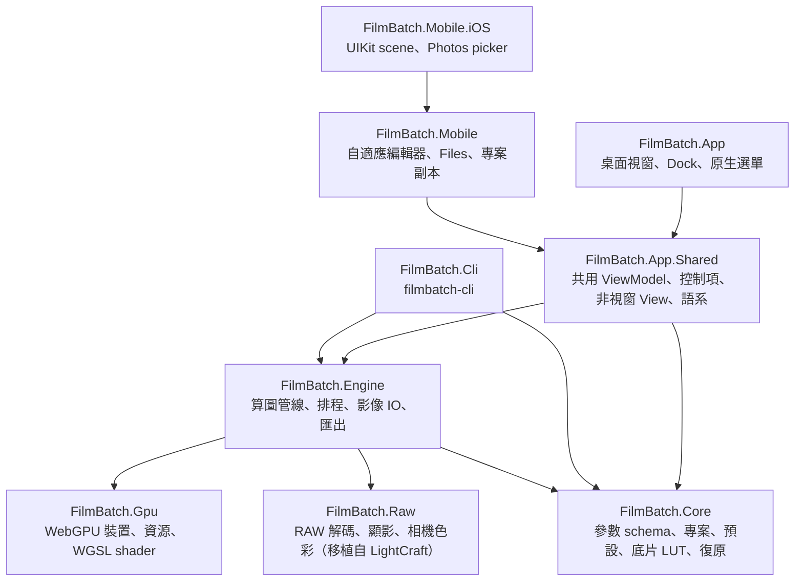
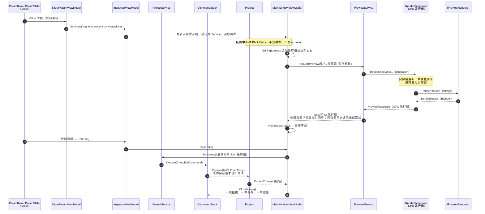
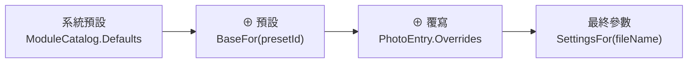
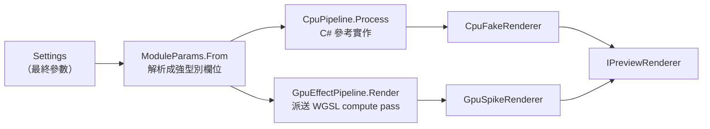
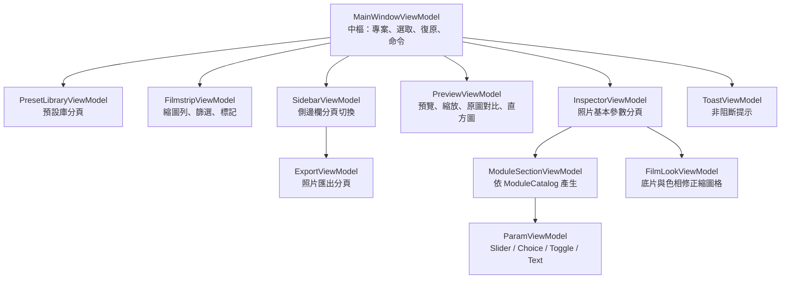

# FilmBatch 架構說明書

本文件寫給第一次修改 FilmBatch 的開發者：先看懂整體分層與一次編輯的資料流，再查閱各模組的職責、關鍵型別與注意事項。最後的「修改食譜」列出常見改動該動哪些檔案。

設計背景見 [plan.md](plan.md) 第 5、11 章；本頁以目前程式碼為準。依任務找文件見[文件地圖](README.md)，執行檢查見[驗證入口](../VERIFY.md)，決策原因與替代方案見[提交歷史](history.md)。

## 目錄

1. [名詞速查](#1-名詞速查)
2. [整體架構](#2-整體架構)
3. [一次編輯的完整資料流](#3-一次編輯的完整資料流)
4. [模組說明](#4-模組說明)
   - 4.1 [Core．參數 schema（Params）](#41-core參數-schemaparams)
   - 4.2 [Core．專案與照片設定（Projects）](#42-core專案與照片設定projects)
   - 4.3 [Core．復原堆疊（Commands）](#43-core復原堆疊commands)
   - 4.4 [Core．預設庫（Presets）](#44-core預設庫presets)
   - 4.5 [Core．底片風格（Film）](#45-core底片風格film)
   - 4.6 [Engine．算圖管線（Rendering）](#46-engine算圖管線rendering)
   - 4.7 [Engine．算圖排程（Scheduling）](#47-engine算圖排程scheduling)
   - 4.8 [Engine．影像讀取與批次匯出（Imaging / Exporting）](#48-engine影像讀取與批次匯出imaging--exporting)
   - 4.9 [Gpu．WebGPU 薄封裝與 Shader](#49-gpuwebgpu-薄封裝與-shader)
   - 4.10 [App．介面層](#410-app介面層)
   - 4.11 [Cli．命令列工具](#411-cli命令列工具)
5. [修改食譜](#5-修改食譜)
6. [測試對照](#6-測試對照)
7. [資料檔位置](#7-資料檔位置)

---

## 1. 名詞速查

| 名詞 | 意思 | 程式碼 |
|---|---|---|
| 模組（module） | 一個來源或效果區塊。`ModuleCatalog` 目前包含 RAW 來源、裁切與 16 個效果，共 18 個，各有 `enabled` 開關 | `ModuleSchema` |
| 參數（param） | 模組內的一個欄位，例如 `amount` | `ParamDef` |
| 扁平 key | `模組.參數` 形式的唯一名稱，例如 `vignette.amount`。整個程式都用它定位參數 | `ModuleSchema.FlatKey` |
| 設定（Settings） | 扁平 key → 值 的**不可變**字典 | `Settings` |
| 預設（preset） | 存在預設庫的一組設定（YAML），可指定給多張照片 | `Preset` |
| 覆寫（overrides） | 某張照片與其預設**不同**的欄位 | `PhotoEntry.Overrides` |
| 最終參數（resolved） | 系統預設 ⊕ 預設 ⊕ 覆寫，實際拿去算圖的值 | `ProjectService.SettingsFor` |
| 底片（look） | `film` 模組選用的一卷底片，即一個內附 3D LUT（`film.look` 存其 key） | `FilmLook`、`FilmLut` |
| 色相帶（hue band） | 底片風格的八個分色相修正區段，各有色相／飽和／明度 | `HueBands` |
| 算圖器（renderer） | 把「影像 + 設定」算成結果的物件，有 GPU 與 CPU 兩種 | `IPreviewRenderer` |
| 世代（generation / epoch） | 遞增的編號，用來丟棄過期的算圖結果 | `PreviewService`、`RenderScheduler` |

---

## 2. 整體架構

### 2.1 專案分層



| 專案 | 一句話職責 | 可以引用 | **不可以**引用 |
|---|---|---|---|
| `FilmBatch.Core` | 資料模型與規則：參數、專案、預設、底片 LUT、復原 | 只有 .NET 與 YAML 函式庫 | Avalonia、GPU、Magick.NET |
| `FilmBatch.Gpu` | WebGPU 的薄封裝與嵌入的 WGSL | WebGPUSharp | 其他 FilmBatch 專案、Avalonia |
| `FilmBatch.Raw` | RAW 容器與壓縮解碼、去馬賽克、相機色彩資料（移植自 LightCraft，見 [tools/raw-oracle](../tools/raw-oracle/README.md)） | managed 相依僅 .NET；JPEG XL 另需隨附的原生閉包 | 其他 FilmBatch 專案、Magick.NET、Avalonia、GPU |
| `FilmBatch.Engine` | 把設定變成影像：算圖、排程、讀檔、匯出 | Core、Gpu、Raw；桌面使用 Magick.NET，iOS RID 使用 Apple ImageIO | Avalonia |
| `FilmBatch.App.Shared` | 桌面與行動版唯一的編輯 ViewModel、控制項、非視窗 View、語系與主題 | Core、Engine、Avalonia | 桌面 Window／Dock host、行動 host |
| `FilmBatch.App` | 桌面視窗、Dock、選單、視窗式對話框與元件展示 | App.Shared、Core、Engine | 行動 host |
| `FilmBatch.Mobile` | 寬窄自適應編輯器、擁有的專案／照片副本、行動式對話框 | App.Shared | 桌面 App／Dock |
| `FilmBatch.Mobile.iOS` | iOS 啟動、scene 生命週期與使用者選取 Photos 匯入 | Mobile、Avalonia.iOS | 桌面 App／Magick.NET |
| `FilmBatch.Cli` | 命令列批次匯出 | Core、Engine | Avalonia |

相依方向由 `.csproj` 的 `ProjectReference` 強制，建置時就會擋下反向依賴。這帶來兩個好處：Engine 能在 CLI 與測試中直接使用；換掉 GPU 綁定只需動 `FilmBatch.Gpu`。

### 2.2 執行緒模型

FilmBatch 有三種執行緒，**這是改程式碼時最容易出錯的地方**：

| 執行緒 | 做什麼 | 規則 |
|---|---|---|
| UI 執行緒 | 所有 ViewModel、View、`Project` 的修改 | ViewModel 屬性只能在這裡改 |
| GPU 執行緒（名為 `FilmBatch GPU`，由 `RenderScheduler` 建立） | 預覽與縮圖的算圖 | 算圖器只能在建立它的執行緒上使用；事件在此執行緒觸發，需切回 UI 執行緒 |
| 背景工作（`Task.Run`） | 開啟專案、解碼照片、批次匯出 | 匯出會**另外建立一個自己的算圖器**，不與預覽共用 |

結果要回到 UI 時，一律經過 `PreviewService` 注入的 `post`（實際上是 `Dispatcher.UIThread.Post`）。

---

## 3. 一次編輯的完整資料流

以「使用者拖曳暗角滑桿」為例，這條路徑涵蓋了大部分核心類別：



讀懂這張圖後，記住三個原則：

1. **暫存與保存分開**：滑桿先改編輯器的暫存值；正式修改仍經 `ProjectService` 命令，不能繞過保存與復原。
2. **正式資料改了才發事件**：`Project.EntriesChanged` 通知已保存的照片設定；暫存預覽由 `MainWindowViewModel` 直接排程，不假造保存事件。
3. **算圖請求可以隨便送**：排程器只保留最新的待算預覽；同來源已完成的影格仍依序交付，避免持續拖曳時一直丟棄結果。換照片／來源、取消或重建算圖器後，不採用舊影格。

---

## 4. 模組說明

每個模組依「職責 → 關鍵型別 → 規則與陷阱 → 常改的地方」說明。

### 4.1 Core．參數 schema（Params）

**職責**：定義 RAW 來源、裁切與效果模組的參數、型別、範圍與預設值。這是整個程式的**單一資料來源**：介面面板、存檔、貼上、鏡像、範圍檢查都從這裡自動產生。

| 型別 | 檔案 | 說明 |
|---|---|---|
| `ModuleCatalog` | `Params/ModuleCatalog.cs` | 模組順序為 RAW 來源 → 裁切 → 基本調整與後續效果；RAW 解碼先於效果，白平衡／局部調整與顯示收尾在算圖時執行。面板依分頁／分組顯示；以 `Defaults`、`Param(flatKey)`、`Module(key)` 查詢，不依賴固定數量或陣列索引 |
| `ModuleSchema` | `Params/ModuleSchema.cs` | 一個模組：`Key`、`Label`、所屬分組 `ModuleGroup`、選擇性貼上分類 `PasteCategory`、參數清單 |
| `ParamDef` | `Params/ParamDef.cs` | 一個參數。工廠方法包括 `Float`、`Int`、`Bool`、`Choice`、`Path`、`Directory`、`Text`、`Curve`、`Seed`、`Position`、`Offset` |
| `ParamValue` | `Params/ParamValue.cs` | 參數值（數字 / 布林 / 文字），以 `AsNumber`、`AsBool`、`AsText` 讀取 |
| `Settings` | `Params/Settings.cs` | 扁平 key → `ParamValue` 的不可變字典。`Overlay` 用於三層合併，`With` / `Without` 回傳新物件 |

**規則與陷阱**

- `Settings` 是**不可變**的：`settings.With(k, v)` 不會改原物件，要接住回傳值。
- `ParamDef.Coerce` 會把值夾回合法範圍；寫入前一律經過它，所以不必在 UI 端重複檢查。
- `Position` / `Offset` 參數以 0–1 正規化座標儲存，換尺寸照片仍合理；帶有 `center_x`、`center_y` 的模組會自動在預覽上出現控制點（`ModuleSchema.HasCanvasPoint`）。
- `Seed` 參數預設不會被貼上，每張照片依檔名產生自己的種子（`Core/Random/SeedHash.cs`）。
- `Label` 是繁中後備文字；實際顯示名稱由 App 的資源檔決定（見 4.10 多國語系）。
- 自由識別字用 `Text`，不要借用 `Path` 或固定 `Choice`：`ProjectService.SetValue` 會把絕對路徑改成專案相對路徑，`Choice.Coerce` 會把未知值改回預設。語意遮罩的 `Name`／`InstanceId` 必須原樣保存；只有真正的檔案／目錄參數才走路徑處理。

### 4.2 Core．專案與照片設定（Projects）

**職責**：一個照片資料夾 = 一個專案。保存每張照片用哪個預設、有哪些覆寫，並提供所有可復原的編輯操作。

| 型別 | 檔案 | 說明 |
|---|---|---|
| `Project` | `Projects/Project.cs` | 照片清單與各自的 `PhotoEntry`；預設快照；`EntriesChanged` 事件；`Open` 時掃描資料夾並載入既有編輯 |
| `PhotoEntry` | `Projects/PhotoEntry.cs` | 一張照片：`FileName`、`PresetId`、`Overrides` 與可空的 `ForegroundMask`（不可變 record） |
| `PhotoOperations` | `Projects/PhotoOperations.cs` | **純函式**：合併、清理、設值、重設、指定預設、三種貼上、鏡像。不碰檔案、不發事件，最容易寫單元測試 |
| `ProjectService` | `Projects/ProjectService.cs` | UI 修改專案的**唯一入口**：呼叫 `PhotoOperations` 算出新狀態，再包成 `PhotoEditCommand` 送進復原堆疊 |
| `ProjectStorage` | `Projects/ProjectStorage.cs` | `.filmbatch/project.json` 的讀寫，原子寫入並以 revision 偵測外部修改 |
| `ForegroundMask` | `Projects/ForegroundMask.cs` | 不可變的 16-bit 前景覆蓋率、遮罩尺寸與完整來源參考尺寸；不存 RGB，不屬於預設或設定剪貼簿 |
| `SettingsClipboard` | `Projects/SettingsClipboard.cs` | 複製設定的內容（來源預設、覆寫、最終參數）與貼上選項 |

**三層設定模型**



- 覆寫只存「與預設不同」的欄位。`PhotoOperations.Clean` 會移除與基準相同的值，所以修改預設時，沒被覆寫的欄位自然跟著變。
- **預設快照**：專案會把用到的預設存一份在 `PresetSnapshots`。重新開啟舊專案時，即使預設庫裡的預設被改過，照片仍維持原樣，直到使用者在對話框中選擇同步（`Project.PendingPresetUpdates` / `ResolvePresetUpdate`）。
- 每次 `Project.Replace` 都會自動存檔，不需要另外呼叫儲存。
- 去背透過 `ProjectService.SetForegroundMask` 形成單張照片命令；`SetForegroundMasks` 把一批不同遮罩保存成同一個 `PhotoEditCommand`，成功後才加入復原堆疊。專案格式 3 在每張照片內保存 zlib 壓縮、little-endian 16-bit 覆蓋率；讀取接受格式 1／2，寫入升為 3，舊版不得覆寫新格式。解壓依尺寸限定長度，遮罩最多 16,777,216 個樣本；上限不限制來源照片本身的像素數。

**規則與陷阱**

- 不要在 UI 直接修改 `Project`；`Replace` 是 `internal`，請透過 `ProjectService` 新增方法。
- `ProjectService.UpdatePresetFromPhoto` 會影響所有使用同一預設的照片，且**無法復原**（會清空復原堆疊），呼叫端必須先跟使用者確認。
- 照片 key 以 `StringComparer.Ordinal` 比對，保留原始大小寫。

### 4.3 Core．復原堆疊（Commands）

**職責**：專案層級的復原 / 重做。

| 型別 | 說明 |
|---|---|
| `IUndoableCommand` | `Execute()` / `Undo()` / `Description` |
| `IMergeableCommand` | 有相同 `MergeKey` 的連續命令會合併成一筆（滑桿拖曳） |
| `CommandStack` | 上限 200 筆；`CloseMerge()` 結束目前的合併（放開滑桿時呼叫） |
| `PhotoEditCommand` | 記錄「修改前 / 修改後」的 `PhotoEntry`，大部分照片編輯都用它 |
| `DelegateCommand`、`CompositeCommand` | 以委派實作的一般命令；多個命令組成一筆紀錄 |

**陷阱**：新增一種可復原的操作時，`Execute` 與 `Undo` 都要能重複執行（重做時會再呼叫 `Execute`）。
儲存失敗時不能消耗復原紀錄：`Undo`／`Redo` 在命令成功之後才移動堆疊節點；專案 revision 衝突保留原磁碟內容、目前照片與可重試的歷史。

複合操作要走一次 `ProjectService.SetValues`：例如裁切的一組欄位、語意遮罩的名稱＋實例，undo 一次應還原整組。`InspectorViewModel.SetValues` 提供這個專案契約；`IParamHost` 的預設實作只是逐 key 轉送，不保證其他 host 也有原子復原語意。

去背草稿不使用專案 `CommandStack`。`ForegroundBrushTool` 以 32×32 區塊保存受影響的原始覆蓋率，undo／redo 交換相同緩衝區；每次按下／移動／放開是一筆，反轉另是一筆，不變的筆畫不清除 redo。保留最多 200 筆及 32 MiB 區塊樣本 payload，超過時丟棄最舊紀錄；這不是整個工具的 RAM 上限。編輯草稿期間，共用 Undo／Redo 一律路由到草稿，即使本地歷史為空也不能消耗既有照片歷史。套用只將目前覆蓋率存成一筆照片命令，取消丟棄草稿；中斷捕捉／雙指接手沿 `PreviewCanvas.EndDrag` 的 `OnReleased` 收尾。

### 4.4 Core．預設庫（Presets）

**職責**：全域、跨專案的預設，存成使用者資料夾中的 YAML 檔。

| 型別 | 檔案 | 說明 |
|---|---|---|
| `Preset` | `Presets/Preset.cs` | `Id`（Guid，改名不影響已指定的照片）、名稱、分類、色彩標籤、是否釘選、`Settings` 與 `Resolved` |
| `PresetLibrary` | `Presets/PresetLibrary.cs` | 載入、儲存、刪除、`Watch` 監看資料夾的外部變更並發出 `Changed`；`Pinned` 取前 9 個釘選預設 |
| `PresetFile` | `Presets/PresetFile.cs` | YAML 序列化格式 |
| `SamplePresets` | `Presets/SamplePresets.cs` | 第一次啟動時建立的範例預設；`Neutral` 為新照片的預設值 |

**陷阱**：`PresetLibrary` 先寫入磁碟成功，才更新記憶體中的清單並發事件；損毀的 YAML 會記在 `LoadErrors`，不會被空白資料覆蓋。

### 4.5 Core．底片風格（Film）

**職責**：底片顏色模擬的資料：36 卷內附底片（RawTherapee Film Simulation Collection 的 Hald CLUT 轉成的 3D LUT，CC BY-SA 4.0）、八色相帶定義與內建色相修正預設，以及舊參數的相容處理。演算法、來源與授權見 [film-looks.md](film-looks.md)。

| 型別 / 檔案 | 說明 |
|---|---|
| `FilmLut` | 3D LUT 資料（`Size`、`Data`，Hald 像素順序）；`Sample` 四面體內插、`Resample` 改邊長、`FromHald`、`ToTextureRgba` 轉成 GPU 紋理排列 |
| `FilmLutFile` | `.fblut` 二進位格式讀寫（magic、int32 邊長、16-bit unorm） |
| `FilmLookLibrary` | 底片清單（以 `JsonDocument` 讀嵌入的 `looks.json`）、`GroupsInOrder`、`DefaultKey`（`kodak-portra-400`）；`TryLut(key)` 第一次使用時載入並快取，未知 key 回傳 null |
| `HueBands`／`HuePresets` | 八個色相帶的 key、中心角（`CentersDegrees`，與 `film/look.wgsl` 同值）、24 個參數 schema（`Params`、`FlatKeys`）；內建色相修正預設與 `Find`（判斷目前值是否為某預設，否則為「自訂」） |
| `Film/Looks/` | `looks.json`（36 卷清單，順序即介面順序）、36 個 33³ `.fblut`、`LICENSE.txt`（CC BY-SA 4.0 聲明），皆為嵌入資源 `FilmBatch.Looks/*` |
| `Params/RetiredParams` | 舊 Recipe Lab 模組的 13 個 `film.*` key，以及改為偏好設定的 `raw.lens_database`；`SettingsJsonConverter` 與 `PresetFile` 讀檔時靜默丟棄 |

**陷阱**

- `looks.json` 的 `key` 會存進專案與預設，發佈後不可改名；新增底片照 [film-looks.md](film-looks.md#5-新增或更換底片) 的流程以 `tools/film-luts` 產生 `.fblut`，不要手改 LUT。
- 卷數、分組與每卷都有 33³ LUT 由 `FilmLookTests` 鎖定；`film.look` 的選項由 `FilmLookLibrary.All` 產生（`RetiredParamsTests` 檢查兩者一致）。
- 色相帶中心角改動時，C#（`HueBands.CentersDegrees`）與 WGSL 要一起改。

### 4.6 Engine．算圖管線（Rendering）

**職責**：把「來源影像 + 最終參數」算成結果影像。同一套演算法有 **CPU 與 GPU 兩份實作**，順序與數學必須一致。



| 型別 | 檔案 | 說明 |
|---|---|---|
| `IPreviewRenderer` | `IPreviewRenderer.cs` | 算圖器介面：`Render`（預覽，8-bit BGRA）、`Render16`（匯出，16-bit RGBA）、`DeviceName`、`IsSoftware` |
| `ModuleParams` | `ModuleParams.cs` | 把 `Settings` 解析成一個個欄位（`VignetteOn`、`VigAmount`…），並計算各模組的種子。**CPU 與 GPU 共用同一份解析結果**，保證兩端讀到相同的值 |
| `CpuPipeline` | `CpuPipeline.cs` | CPU 完整管線，`Process` 依序執行模組；RGBA 算術、模糊累積與量化使用 `Vector128`，sRGB 曲線與 gamma 保留純量 `MathF.Pow` |
| `GpuEffectPipeline` | `GpuEffectPipeline.cs` | GPU 管線；高斯模糊沿用相同權重、tap 順序與 clamp 邊界，半徑 ≤320 用 14 KiB workgroup tile 共讀來源，較大半徑走直接核心；兩核心共用展平 workgroup 起點，每累計至多 64 Mi 個輸出取樣運算就提交並等待，跨軸／效果也計入，不延長裝置的 10 秒期限 |
| `GpuSpikeRenderer` | `GpuSpikeRenderer.cs` | **正式的 GPU 算圖器**（名稱沿用自 M0 技術驗證）。超過 GPU 紋理上限或顯示記憶體不足時，自動改走 CPU 並在 `DeviceName` 標示原因 |
| `CpuFakeRenderer` | `CpuFakeRenderer.cs` | **正式的 CPU 算圖器**（名稱同樣是歷史遺留），內部呼叫 `CpuPipeline`；無 GPU 或使用者強制軟體模式時使用 |
| `DenoiseProcessor` | `Denoising/` | CPU／GPU 共用的效果前來源階段；全解析度先推論。RAW 快取代理輸入後混合；sRGB 串流逐像素混合／量化並直接縮小，避免全圖暫存；匯出仍用完整神經結果，見 [ADR 0002](adr/0002-ai-denoise.md) |
| `FilmLookProcessing` | `FilmLookProcessing.cs` | 底片風格的 CPU 參考實作：LUT → 八色相帶（OKLCh）→ 暖色 → 褪色 → 依效果比例混合；`BandWeight` 為色相帶權重 |
| `FilmLookUniforms` | `FilmLookUniforms.cs` | 傳給 `film/look.wgsl` 的 uniform（`Mix`、`Flags`、`Band0`…`Band7`，與 WGSL `struct LookParams` 對齊） |
| `PhotoAdjustments` | `PhotoAdjustments.cs` | BasicLinear 後的羽化膚色與單調 Zone 亮度曲線；CPU 逐像素與有界分析共用純量數學，GPU 對應 `linear/photo_adjustments.wgsl` |
| `ShadowRecovery` | `ShadowRecovery.cs` | 場景線性局部暗部增益與增益前亮度／色度降噪；覆蓋率加權 guided 基底、共享 `ShadowLayout` 與 CPU／GPU uniforms；GPU 對應 `linear/shadow_stats.wgsl`、`shadow_box.wgsl`、`shadow_apply.wgsl` 與共用 `shadow_common.wgsl` |
| `Oklab` | `Oklab.cs` | 線性 sRGB ↔ OKLab 轉換（與 `look.wgsl` 的 `to_oklab`／`from_oklab` 同係數） |
| `EffectAssets` | `EffectAssets.cs` | 解析外部素材：雙重曝光的第二張照片、漏光與灰塵的材質檔。材質庫為空時改用程序化效果 |
| `RenderView` / `FrameStats` | `RenderView.cs` | 窗口渲染的視圖（畫框內的子矩形）與 Main 整張渲染記錄的全畫框統計。`IPreviewRenderer.RenderWindow` 只算窗口，結果等於「整張渲染後裁切」（逐通道誤差 ≤ 1 LSB、平均 < 0.05 LSB） |

**處理順序**（`CpuPipeline.Process` 與 `GpuEffectPipeline.Process` 相同）

RAW 來源保持未夾取的浮點線性 Rec.2020，`Rgba16` 只在原圖比較／直方圖等顯示用途首次取用時編碼。兩套算圖管線先轉到未夾取的線性 sRGB 工作域，在裁切後套用相機白平衡與語意遮罩，再執行既有效果；顯示段前轉回 Rec.2020，依原順序完成相機色調、高光去飽和與壓縮，再轉顯示 sRGB。高光壓縮的通道最大值不能與色域轉換交換順序。一般影像維持原有 sRGB 路徑；藝術 LUT 仍有自身的有界輸入限制。

| 階段 | 色彩空間 | 模組 |
|---|---|---|
| ⓪ 來源（選用） | RAW 線性 Rec.2020／一般顯示 sRGB | 固定模型分塊 AI 降噪 → 亮度／色彩混合 → 需要時縮小；兩個 renderer 共用同一實作，不重複一份神經網路 shader |
| ① 幾何 | 線性光 | 基本調整（曝光、色溫、色調）→ 局部膚色 → Zone 曲線（僅場景來源）→ 暗部還原（選用）→ 鏡頭變形 → 多格分鏡 |
| ② 光學 | 線性光 | 雙重曝光 → 散景 → 縮放旋轉模糊 → 動態模糊 → 暗角 → 光暈 → 漏光 |
| ③ 底片 | 線性光 | 底片風格 → 古典版材 |
| — | 線性 → sRGB | `linear_to_display` |
| ④ 顯示 | sRGB | 基本調整（細節 → 亮度 → 對比 → 亮部陰影 → 飽和）→ 色調曲線 → 色調分離 → 清晰與銳化 |
| ⑤ 表面 | sRGB | 灰塵與刮痕 → 顆粒 |

**規則與陷阱**

- 模組關閉或參數為零時要**完全跳過**，輸出必須與輸入逐位元相同（identity 測試會檢查）。
- 改了 CPU 版就要改 GPU 版，反之亦然；`Gpu_MatchesCpu_*` 測試會比對兩者。
- C# 的 uniform record（`[StructLayout(LayoutKind.Sequential)]`）欄位順序、型別、對齊必須與 WGSL 的 `struct Params` 完全一致，通常以 `_pad` 補齊到 16 位元組的倍數。
- GPU 只有 4 張工作紋理輪流使用（`Next(...)` 會避開正在讀的紋理）；新增需要多張中間結果的 pass 時要用 `reserve` 參數保護。
- 半徑、大小類參數以**短邊比例**計算，預覽代理圖與原尺寸匯出的外觀才會一致。
- 顆粒例外地以來源參考平面的短邊決定粒徑：`SourceImage.ReferenceWidth/Height` 穿過代理圖，輸出像素經裁切逆仿射回到該平面；三種模型共用座標、seed、明暗響應與像素足跡濾波。光學圓盤數截斷於每格 8，最大 λ=1.6 時截斷尾機率低於 0.0046%；不是精確片種或化學模擬。

**基本調整的細節契約**：`basic.structure` 比較目前像素與 Gaussian 基底的亮度，兩者必須來自相同、尚未套用全域顯示調整的影像。`CpuPipeline.BasicDisplay` 與 `basic_display.wgsl` 都先做細節，再做亮度／對比／亮部陰影／飽和；不能用調整後亮度與調整前基底相減，再除以正負通道相消後接近零的亮度。均勻色塊沒有空間細節，即使極端全域設定下也不應被細節增益改色；回歸入口為 `EffectPipelineTests.BasicStructure_UniformColourRemainsUniformUnderExtremeGlobalAdjustments`。這項順序修正不增加 blur、pass 或暫存，不變更參數格式；細節與全域調整同時非零的舊設定會得到修正後外觀，單獨啟用任一類則維持原行為。

**暗部還原契約**：獨立的 `shadow_recovery` 模組預設關閉，不重定義顯示域的 `basic.shadows`。在未夾取的工作線性 sRGB 上，以 `log2((max(Y,0)+2⁻⁷)/0.18)` 作導引，按 alpha 加權的代理格統計與分數盒狀 guided filter 求局部基底，再把亮度／色度降噪與共同 RGB 增益套回來源。增益曲線不加黑位偏移，基底階調斜率下限 0.3；高於膝點的基底增益為 1，不在此處裁掉 HDR。alpha 不變，完全透明的隱藏 RGB 不進鄰域；純黑仍為黑。一般 RGB 來源先按既有流程線性化。

局部半徑按裁切後短邊比例；降噪 σ 按 `ReferenceWidth/Height` 的來源像素足跡換算，因此縮小預覽可能減弱／跳過次像素降噪，不宣稱和全圖逐像素相同。CPU 重用既有兩張暫存，GPU 重用工作紋理；有效曝光與兩種降噪均為零時直接跳過，不讀取未寫入的暫存。取消在各 pass／列間檢查。`PhotoSamplingSettings` 暫停此局部算子，避免白平衡／Zone 取樣納入創意映射；參數沿用 Settings、預設、貼上、undo 與匯出快照，專案格式仍為 3。實際操作與測試入口見[建置說明](building.md#局部暗部還原)，研究／解碼比較的證據與產品驗收分列於[暗部研究](shadow-recovery-survey.md)。

**色調曲線契約**：`curves` 位於「照片基本參數 → 基本」，緊接「基本調整」，不另設分頁。分段曲線 → RGB 主曲線 → 個別 R／G／B 通道依序作用於顯示編碼 RGB；CPU 與 GPU 共用 `ToneCurveSet` 合成的 3×1024 查表，再選用曲線飽和度修正，保留 alpha。預設啟用但恆等，直接略過算圖階段；GPU 緩衝區首次需要才配置，隨管線重用及釋放。

四段調整與分界參考 LightCraft v0.13.0；分界排序、保持最小間距，累積最大值讓分段表維持單調，畫布使用同一份表。控制點沿用 `ToneCurve` 的單調三次樣條；通道與預設選單只屬 UI 狀態，實際點值沿用 Settings、預設快照、模組貼上與專案格式 3。拖曳只更新暫存預覽，放開／失去捕捉提交一筆復原；切換照片不會把舊手勢寫入新照片。調整曲線不重新解碼 RAW。展開曲線時，即使主直方圖已收合也收集實際影像分布；白平衡／膚色／Zone 取樣暫停曲線效果。操作見[色調曲線](building.md#色調曲線)。


### 4.7 Engine．算圖排程（Scheduling）

**職責**：`RenderScheduler` 擁有唯一的 GPU 執行緒，把預覽、縮圖、裝置重建序列化。

| 行為 | 實作 |
|---|---|
| 預覽只算最新的一張 | `_preview` 只有一格，新請求直接覆蓋舊的 |
| 預覽優先於縮圖 | 迴圈每輪先看預覽，沒有才取一張縮圖 |
| 被前景預覽中斷的縮圖 | 若 Epoch／來源仍有效且沒有較新同 key 要求，取消回收後重新排入；即使取代它的預覽也已取消，縮圖仍須交付。明確取消縮圖、換資料夾與 dispose 不恢復舊要求 |
| 同一張縮圖只算最新設定 | `RequestThumbnail` 會先移除同 key 的舊請求 |
| Loupe 窗口 slot | `RequestWindow` 只留最新一筆；優先序為預覽 > 窗口 > 預取 > 縮圖。窗口有獨立要求世代，不因 Main 未換代而重用；`CancelWindow`、重建與清空縮圖時作廢，成功與失敗在 UI 排入前及送達時都再核對世代 |
| 偏好設定切換 GPU 後端 | `ResetRenderer` 推進 `Epoch`、清空佇列，在 GPU 執行緒上重建算圖器 |
| 算圖失敗 | 先重建裝置重試一次，仍失敗以 `RenderFailure` 回報原始例外與要求來源；無法建立算圖器也須回報逐筆要求的失敗終態。窗口走獨立 `WindowFailed`，只解除該要求的去重狀態，不污染主預覽／縮圖錯誤，也不無限自動重送 |
| GPU 建立失敗 | 改用 fallback（CPU 算圖器）並發 `Notice` |
| 閒置來源釋放 | 每筆工作在不可內聯的 `RunNext` 中完成後才回到等待迴圈，避免上一筆要求／結果留在常駐執行緒的堆疊上；不靠產品端強制 GC |

App 端由 `FilmBatch.App.Shared/Services/PreviewService.cs` 包裝：核對來源世代、遞增的交付順序與算圖器 `Epoch`，把事件 post 回 UI 執行緒，並計算直方圖。同一來源的參數調整允許先顯示已完成影格，再接續最新結果；取消、來源更換與裝置重建會封鎖先前交付。

排程器只在鎖內判斷資格並擷取事件委派，解鎖後才呼叫訂閱者／計算直方圖。預覽、縮圖、失敗、通知與裝置就緒的 payload 都帶「原要求的 Epoch」，`PreviewService` 在計算後及 UI 投遞時再次驗證；不可在回呼入口重新讀取目前 Epoch，否則舊結果可能被誤標為新世代。

Main／Window 完成時，算圖執行緒立即擷取不可變的 `RenderBackend`（裝置名稱與是否使用 CPU，名稱包含回退原因），隨影格送達；不可延後在 UI 讀取 live renderer，因為下一筆縮圖可能已改變後端狀態。`PreviewService` 只在影格通過世代／Epoch 檢查後更新 `DeviceName`／`IsSoftware`，以 `BackendChanged` 更新狀態列；縮圖、預取與單純顯示縮放不改寫此狀態。`DeviceReady` 仍只表示初始化／重建，不拿來逐格發提示。

CPU 名稱與回退原因在快照中保留雙語文字，讀取快照時才依目前語言選擇；裝置初始化也使用同一表示方式。切換語言不需重算影格、不讀取 live renderer，也不把已翻譯的字串當成固定的後端身分。

失敗事件的 `PreviewGeneration` 只有預覽要求有值；縮圖及 `$init` 初始化診斷為空。預覽失敗只結束自己的世代，不消耗較新的預覽，也不替照片縮圖記失敗；背景失敗不得清掉等待中的前景影格。縮圖重算失敗時可以保留舊點陣圖，但仍須完成該筆交付等待，讓下一張繼續；初始化錯誤不能讓已取出的縮圖要求無聲消失。

**陷阱**：`RenderScheduler` 的事件**在 GPU 執行緒上觸發**。在 Engine 以外訂閱時，不要直接更新 UI。

### 4.8 Engine．影像讀取與批次匯出（Imaging / Exporting）

| 型別 | 說明 |
|---|---|
| `Imaging/ImageLoader` | RAW 縮圖（長邊 ≤240，且不需語意遮罩）先稀疏讀取相機內嵌預覽；其餘 RAW（與含感光資料的 TIFF）交給共用 `RawSourceLoader`。一般影像與內嵌縮圖經 `ImageBackend` 在桌面使用 Magick.NET、iOS 使用 Apple ImageIO，轉成已定向的 16-bit straight sRGB RGBA；RAW 編輯／匯出仍保留場景線性資料 |
| `Imaging/AppleImageCodec` | iOS RID 的原生影像 I/O：ImageIO／CoreGraphics／ColorSync 解碼與 ICC 轉換、JPEG／PNG16／TIFF16 編碼、串流 EXIF 擷取；macOS 回歸可直接呼叫此後端，不代表桌面已切換 codec |
| `Imaging/Raw/RawSourceLoader` | RAW 解碼、起始外觀、分箱／去馬賽克、高光重建與色彩處理，產生浮點 Rec.2020 場景來源；有 gain table 的 DNG 不額外擬合全域 JPEG tone。CPU／GPU 共用晚期 RAW 收尾，來源載入不提前量化成 SDR |
| `Imaging/SourceImage` | 一般影像保存 sRGB `Rgba16`；已算圖輸出以 `Encoding` 明確標記 sRGB／ProPhoto，複製與縮放保留編碼。RAW 保存場景像素、相機色調／白平衡、共用幾何與語意遮罩；`Downscale` 在場景域縮放，保留原始已定向的 `ReferenceWidth/Height`，算圖不改寫來源 |
| `Imaging/MagickImageCodec` | 桌面 JPEG 預覽先讀尺寸；兩軸都大於兩倍預覽長邊才使用既有 decoder-size hint，避免小圖／窄圖反而被 decoder 放大。保留方向、原始參考尺寸與 ICC；完整載入／匯出不使用提示 |
| `Imaging/ImageHistogram` | 直方圖與裁切比例 |
| `Imaging/SampleImages` | 產生「開啟範例照片」用的測試圖 |
| `Imaging/PhotoAnalysis`／`ZonePlacement` | 至多 4096 點的工作線性 RGB 穩健取樣、相對參考色、候選白平衡正向擬合與 Zone 算術；重用有界取樣緩衝區，不建立全圖遮罩／顯示副本。WB 候選先於 semantic／Basic／局部調整套用，再聚合與計算殘差 |
| `Exporting/BatchExporter` | 匯出主流程：`BuildJobs` 為每張照片建立不可變快照 → `RunAsync` 在背景依序讀檔、`Render16`、縮放、編碼、寫入 EXIF / ICC → 寫 `export_log.json` |
| `Exporting/ExportModels` | `ExportOptions`（格式、色彩空間、品質、尺寸、目的地、檔名範本）、`ExportJob`；色彩空間屬於匯出快照，不寫入照片設定或專案 schema |
| `Exporting/ExportFileNames` | 檔名範本（例如 `{name}_{preset}`、`{index}`）展開，並移除各平台的非法字元 |
| `Exporting/TiffMetadata` | 使用正規化 EXIF 位元組，不依賴 Magick profile 型別；保留 TIFF 原有大小端與像素 strips，附加 EXIF／GPS 目錄；RAW 來源（CR3 為 CMT1／CMT2／CMT4 區塊）亦由此正規化 |

內嵌縮圖的方向以 RAW 檔頭為準，覆寫預覽自帶的 EXIF，並保留 RAW 的原始已定向參考尺寸；找不到或無法解碼預覽時，回到完整 RAW 顯影，原始 RAW 的解碼錯誤仍會回報。Apple 記憶體來源只在同步解碼期間借用已固定的預覽位元組，原生參考全部釋放後才解除固定。ImageIO 縮圖可能使用首位 padding 的 XRGB，讀取時須略過 padding，不能將它當作紅色或 alpha。

Apple 後端以串流讀取 JPEG／PNG／HEIF 的來源 EXIF，不因影像超過標頭探測範圍而丟失拍攝資訊；PNG 使用標準 `eXIf` chunk。輸出 JPEG／PNG 時，ImageIO 對 named sRGB 可能省略 ICC，因此編碼後明確寫入 JPEG APP2 `ICC_PROFILE`／PNG `iCCP`，並保留單一正規化 EXIF；TIFF 則保留 ICC tag 34675，再附加來源 EXIF／GPS。中繼資料重寫使用有界串流，不為大型影像額外複製整個檔案，也不加入舊式 `zTXt` ICC 副本來迎合解碼器。

**ProPhoto RGB 輸出：** `Render16` 的輸出編碼預設仍為 sRGB；TIFF16／PNG16 可要求 ProPhoto RGB（D50、純 gamma 1.8）。RAW 的線性 Rec.2020 來源保留到晚期收尾：此路徑略過 sRGB 色域壓縮、以有正負值的延伸 sRGB 傳遞既有效果，最後轉至 ProPhoto、在目標色域壓縮並編碼；不是對已削波的 sRGB 像素換 ICC 標籤。CPU 融入最後量化，GPU 使用既有浮點工作紋理再加一個輸出轉換 pass，沒有新增中途 CPU readback。

ProPhoto 色域壓縮以實際限制通道的 0／1 邊界為投影基準，與朝中性軸縮放的幾何相同；不要改回在零附近相消的 `y + (channel - y) * t`。該式的浮點殘差會被純 gamma 1.8 放大，實拍曾造成 CPU／Metal 相差 4/65535；六面飽和漸層回歸維持 2/65535 上限，不以 epsilon 削波補救。既有 sRGB 色域壓縮與線性 toe 不變。

預覽、縮圖、直方圖與取樣仍為 sRGB；一般 raster 匯入仍由 codec 轉為 sRGB，不宣稱全廣色域匯入或螢幕 soft-proof。既有曲線、有限 LUT 與創意效果保留 sRGB 座標語意，它們主動裁切的色彩不會因選擇 ProPhoto 而恢復。JPEG／DNG 不接受 ProPhoto，UI 切換時重設 sRGB，API／CLI 則在產檔前拒絕不合法組合。

Magick 與 Apple 編碼器依 `SourceImage.Encoding` 寫入匹配的 ICC，不再轉換已編碼像素；16-bit samples 與 straight alpha 保持不變。ProPhoto 的 EXIF ColorSpace 為 `0xFFFF`，不保留聲稱 sRGB 的 Interop 目錄；Apple TIFF／PNG 均回填相同的標準 ICC 位元組。`export_log.json` 每筆記錄 `ColorSpace`。自建 profile 為 ICC v4.3、parametric gamma 1.8，沒有 ROMM 線性 toe 或 flare；可重建來源及授權見 [ICC 產生器](../tools/prophoto-icc/README.md)，驗收見 [ProPhoto 計畫](superpowers/plans/2026-10-23-prophoto-output.md)。

RAW 預覽擬合會先依 JPEG 的 ICC／EXIF／容器宣告決定色彩，只線性化一次，在線性光下縮放後轉到 Rec.2020。截斷代理像素以 NaN 排除；鄰域對比採 Rust `f32::min/max` 的略過 NaN 語意，避免連帶排除截斷像素周圍的有效樣本。X-Trans 穩健平均則沿用 Rust `total_cmp` 的負數與正負零排序。

同一檔案重疊載入 Thumb／Preview／Full 時，`RawSourceLoader.DecodeLease` 依完整路徑與當次內容 SHA-256 共用感光解碼；色彩擬合另核對實際套用的 List3 校正鏈。每位使用者各自持有可變的色彩標籤與運算碼清單，最後一份租約結束即移除完整 RAW／檔案位元組，不建立常駐感光快取。各等級仍按自己的分箱倍率顯影、保留場景線性與語意遮罩，不拿 Preview 縮小後冒充 Thumb，也不以相機 JPEG 替代最終縮圖。每次仍讀取並雜湊檔案；不同照片的首次解碼不會因此消失。

外部 Lensfun 的徑向／橫向色差校正先計算統一的前置構圖倍率，使 R／G／B 三個通道的完整周界都落在預設裁切的有效像素中心內；除了角落與邊中點，也檢查徑向多項式在邊上的極值。倍率直接折入同一個 `WarpRectilinear` 的係數，完整現像、分箱預覽、相機外觀擬合與語意遮罩沿用同一條逆映射，不增加全圖取樣階段。必要時縮小視野，但保留輸出尺寸與原始解析度；不以重複邊緣像素、遮邊或事後裁切補洞。此構圖只套用在外部校正，不重縮放已驗證的內嵌鏡頭校正。

RAW 中繼資料的標頭辨識與感光解碼一致：RW2 的 `0x0055`、ORF 的 `0x4f52`／`0x5352` 都使用 classic TIFF IFD 佈局，保留其 Make／Model 與 EXIF 子目錄，不誤報為損毀的 TIFF。

一般 TIFF 大於 RAW 可緩衝大小時，略過 RAW 探測，仍由已選定的平台影像後端載入；RAW 中繼資料損毀不阻止像素匯出，但必須在 `export_log.json` 記錄 `MetadataWarning`。RAW 移植的明確排除項目與 JPEG／ICC 偏差見 [參考輸出說明](../tools/raw-oracle/README.md#比較範圍與已知偏差)。

**讀檔與色彩陷阱**

- 不要在判斷一般 TIFF 之前整檔 `File.ReadAllBytes`；大型一般 TIFF 可由平台影像後端／串流中繼資料路徑處理，不代表 managed 全檔 RAW 解碼也支援任意大小。檔頭決定的尺寸／樣本數須先以 checked／寬整數驗證，再套用 `RawLimits.MaxSamples`（`1 << 30`）及各分支上限；語意遮罩另限 16 個 IFD、每張 `1 << 25` 個樣本。上限不是保證有足夠記憶體。
- 損毀 RAW 的內容錯誤依 `RawException.Kind` 分類，不應洩漏索引／整數溢位例外；檔案存取錯誤與資源不足仍需保留原本原因。二維樣本以 `[height, width]`／`[y, x]` 對應，不能用正方形 fixture 掩蓋寬高顛倒。
- CR3 的 CMT1／CMT2／CMT4 可各自使用不同 byte order；正規化各目錄，不把根目錄的大小端直接套到 EXIF／GPS 子區塊。
- 嵌入預覽的色彩宣告與像素轉換是兩件事。不要先令 Magick.NET `ColorSpace = RGB`，再套一次 sRGB EOTF；歷史重現中，8-bit 灰階 128 的線性值由約 0.216 變成約 0.038。ICC／EXIF／容器的來源判定與「只線性化一次」須一起驗證，不能只檢查色彩空間標籤。

上述規則由早期 RAW 修復筆記回收；現行支援範圍以程式碼及[語料比較限制](../tools/raw-oracle/README.md#比較範圍與已知偏差)為準，舊筆記的 exclusions 不是目前功能清單。

**匯出的安全規則**（改匯出程式碼前務必知道）

- 匯出開始時先建立參數快照，匯出期間使用者繼續編輯不會影響已排入的照片。
- 拒絕覆寫來源檔與既有輸出；先寫暫存檔，完成才搬到正式檔名，取消或失敗不留下半成品。
- EXIF 解析失敗不會讓整張匯出失敗；JPEG EXIF 超過 APP1 上限（65,533 位元組）時先移除 MakerNote，仍超限才只保留方向、尺寸與 sRGB 宣告。這些縮減逐張記錄在 `export_log.json` 的 `MetadataWarning`。
- 輸出皆已轉正：重建尺寸、方向與色彩宣告；僅 sRGB 寫入 Interop `R98`／`0100`，ProPhoto 不寫此目錄。不要沿用來源 Adobe RGB 的 `R03` 或失效指標。Photoshop `ImageSourceData`（37724）等原圖圖層不屬於新算出的影像，不能一併搬入。
- iOS 的 JPEG／PNG16／TIFF16 由 ImageIO 編碼；`ImageBackend` 於編譯時依 iOS RID 選用，桌面仍使用 Magick.NET。TIFF metadata append 支援大小端序，不重寫或重壓縮影像條帶；來源 EXIF／GPS 重新正規化後取代編碼器自行產生的 EXIF 指標。DNG 仍走共用 managed 寫入器。
- 完整尺寸的 Apple 影像不經縮圖解碼器；已辨識為完整 sRGB 空間時不再透過量化 ICC TRC 做一次 identity 轉換。方向、straight alpha、低有效位元及 Adobe RGB 轉換由 `AppleImageCodecTests`／`AppleImagingTests` 覆蓋。
- Box／Lanczos 縮小以 alpha 加權 RGB，濾波後再轉回 straight RGBA；全透明輸出清空 RGB，隱藏色不能污染可見邊緣。桌面 PNG16 明確寫成 16-bit RGBA（PNG64），避免編碼器把少色影像改成調色盤而將 alpha 量化為 8-bit。

去背遮罩以 `SourceImage.WithForegroundMask` 附加，共享原始像素與 RAW 的延遲顯示副本；原圖比較仍使用未遮罩來源。降噪重新建立來源時也必須傳遞遮罩。`ForegroundAlpha` 在解碼後、所有幾何之前以來源像素中心雙線性取樣遮罩，只乘 alpha 一次，RGB 保持 straight；CPU／GPU、預覽 BGRA8 與 PNG16／TIFF16 使用同一透明度語意。已去背 RAW 的縮圖略過可能有不同裁切的相機 JPEG，從現像預覽產生。`ExportJob` 捕捉當時遮罩，批次中繼續編輯不改已排入工作；有透明像素時拒絕 JPEG／DNG。

批次去背採兩階段：`ForegroundBatch.BuildJobs` 捕捉去重選取、來源路徑、照片與解析後設定；`RunAsync` 依序載入長邊至多 2048 的現像代理圖，略過既有遮罩，無主體／損毀／取消逐張記錄，不修改 live project。`Apply` 在呼叫端驗證路徑、照片與設定仍相符，拒絕覆寫期間新增的遮罩，經 `SetForegroundMasks` 一起保存。使用者取消仍可保存已完成項目；換專案／暫停／dispose 由 `BackgroundRemovalViewModel` 的 generation＋service 身分丟棄整批過期投遞。CLI 使用同一組 API，不另建推論流程。

現行 `basic.shadows` 仍在顯示轉換後處理，不是場景域邊緣保留局部 tone mapping。2026-10-23 修正原本會抬黑、洗淡暗部的加法：改為由亮度決定的共同 RGB 增益，保留黑點、暗色比例與 alpha，亮度到 0.45 時平滑回到增益 1；零值完全略過。非零的既存陰影設定會採用修正後外觀，參數範圍、專案格式及 CPU／GPU 算圖順序不變。[暗部還原研究](shadow-recovery-survey.md)所述空間局部映射仍屬獨立的 `shadow_recovery` 模組，不把本次曲線修正宣稱為 LightCraft 暗部演算法的完整移植。

### 4.9 Gpu．WebGPU 薄封裝與 Shader

**職責**：把 WebGPUSharp（Dawn）包成少數幾個簡單型別，Engine 只透過它們使用 GPU。初始選型見 [ADR 0001](adr/0001-webgpu-binding.md)；CPU SIMD、RAW 顯示收尾與 Halide AOT 取捨見 [ADR 0003](adr/0003-gpu-stack-decision.md)。

| 型別 | 檔案 | 說明 |
|---|---|---|
| `GpuDevice` | `Device/GpuDevice.cs` | 選擇介面卡（可指定 DX12 / Vulkan / Metal）、建立裝置；建立紋理、緩衝區、kernel；上傳與同步讀回；`TryAllocate` 偵測顯示記憶體不足 |
| `GpuAdapterInfo` | `Device/GpuAdapterInfo.cs` | 介面卡名稱、後端、是否為軟體、紋理尺寸上限 |
| `ComputeKernel`、`BindingSpec` | `ShaderSystem/ComputeKernel.cs` | 一支已編譯的 compute shader。`BindingSpec` 陣列的索引就是 WGSL 的 `@binding(n)` |
| `GpuCommandList` | `Resources/GpuCommandList.cs` | 錄製多個 pass 後一次送出；`Dispatch2D` 以 16×16 workgroup 覆蓋整張影像 |
| `GpuTexture`、`GpuBuffer` | `Resources/` | 紋理與緩衝區的封裝 |
| `ShaderLibrary` | `ShaderSystem/ShaderLibrary.cs` | 讀取嵌入的 WGSL 並展開 `#include "path"`（WGSL 原生不支援 include） |

**Shader 目錄**（`src/FilmBatch.Gpu/Shaders/v1/`）

| 資料夾 | 內容 |
|---|---|
| `common/` | 共用函式：色彩轉換、取樣、高斯模糊 |
| `io/` | 解碼 16-bit 輸入、線性 → 顯示空間、編碼成 BGRA8 / RGBA16 |
| `linear/` | 基本調整（線性段與顯示段） |
| `geometry/`、`optical/`、`film/`、`detail/`、`surface/` | 各階段的效果模組 |
| `spike/` | M0 技術驗證用的 shader，只供 `filmbatch-cli spike` 基準測試 |

每支 shader 的慣例（以 `optical/vignette.wgsl` 為例）：

```wgsl
struct Params { amount: f32, size: f32, /* … */ _pad: f32 }   // 對應 C# 的 VignetteUniforms

@group(0) @binding(0) var src: texture_2d<f32>;                          // 輸入
@group(0) @binding(1) var dst: texture_storage_2d<rgba32float, write>;   // 輸出
@group(0) @binding(2) var<uniform> p: Params;                            // 參數

@compute @workgroup_size(16, 16)
fn main(@builtin(global_invocation_id) id: vec3u) { /* 每個像素一次 */ }
```

**陷阱**

- `v1/` 是 pipeline 版本。日後改變算法導致舊專案外觀改變時，應新增 `v2/` 而不是改 `v1/`，讓舊專案仍以舊 shader 算圖。
- 改完 shader 一律執行 `dotnet run build/CheckShaders.cs`（naga 驗證）。
- 開發時可用 `ShaderLibrary` 的 `devFolder` 直接從原始碼讀取 shader，不必重新建置。

### 4.10 App．介面層

本節 `ViewModels/`、`Controls/`、非視窗 `Views/`、`Localization/` 及共用 `Themes/` 均位於 `src/FilmBatch.App.Shared/`，仍使用原本 `FilmBatch.App` namespace；桌面 App 不再編譯另一份相同實作。資源 URI 的 assembly 為 `avares://FilmBatch.App.Shared/`。桌面專用 `MainWindow`、Dock、對話框視窗及 Gallery 留在 `FilmBatch.App`。

行動版由 `MobileEditorView` 組合相同的 `MainWindowViewModel` 與各編輯 View，不複製參數、RAW、底片 LUT、復原或匯出演算法。`Suspend()` 取消入場、預覽、背景縮圖、分析與匯出，結束觸控互動並保存有效編輯；`Resume()` 保留專案、選取與復原，只恢復先前待處理的工作。iOS 的照片運算明確使用 CPU，不將 Avalonia 的 Metal 繪圖稱為攝影 GPU 運算。操作與建置見 [iOS 行動版](building.md#ios-行動版)。


**職責**：Avalonia 12 桌面介面，採 MVVM（CommunityToolkit.Mvvm）。View 只負責呈現與輸入；ViewModel 不引用任何 Avalonia 控制項，所以能直接寫單元測試。

#### Loupe 預覽

- **Main 層**：繪製長邊（畫布物理像素）以 `LoupePlan.EdgeStep`（64）為一級向上取整，上限為預覽等級 2560（`AppSettings.PreviewLongEdge`，0 = 自動）。顯示縮放以 Lanczos 縮到繪製尺寸，畫布以 1:1 繪製。
- **Window 層**：繪製尺寸 ≥ Main × 1.25 時出現。窗口對齊 256 網格、四周留 margin、單軸跨度上限 `MaxSpan`（6144），從 Full 來源算到 100%；結果與整張渲染後裁切一致（見 `WindowRenderEquivalenceTests`）。
- **GPU 預算**：單一窗口區域超過預算時，沿長邊切成最多四塊；每塊各自計算效果鄰域（halo），只拼回窗口需要的像素。整張 Full 來源仍保留，各塊的工作區加來源／素材皆須符合原預算與裝置上限；無法容納才回退 CPU，不提高預算、不縮小細節來源。
- **可見範圍**：畫布只回報可見範圍（畫框的 0..1 比例）。平移與縮放只改變繪製位置；窗口位置跨過網格時才送出新的請求。
- **來源生命週期**：Thumb / Preview / Full 三級。Full 每張照片只持有一份（`ImageCache`）；換照片即清除舊窗口持有的來源，沒有窗口持續 3 秒後釋放閒置 Full。對應 GPU 來源快取由算圖執行緒排程逐筆移除，不從 UI 執行緒與進行中的算圖競爭。關閉算圖器也清除來源強參照。
- **來源縮放**：Main 與 Window 的 `SourceImage.ScaledTo` 都在背景執行緒執行，沿用來源內的兩格身分快取。Main 最多一個縮放工作，期間只保留最新請求；Window 沿用單一載入工作與 pending 機制。UI 先擷取狀態，完成後重新核對照片、來源、設定／畫框與算圖世代；換照片、Suspend 或取消後不送過期結果。`Preview.IsBusy` 包含尚未送進算圖器的 Main 縮放，不能只用 `Renderer.IsBusy` 判斷畫面已完成。
- **替身順序**：ViewRenderCache → 內嵌 JPEG → 縮圖。替身不進直方圖、照片工具與匯出，顯示期間暫停窗口送件，但仍按正式影像規劃 Main／Window；同尺寸照片送達後不必等待平移或尺寸變更才接上細節窗口。
- **不畫窗口**：裁切工具、去背編輯、AI 降噪、替身，以及畫布旋轉（裁切拉直）時。
- **拖曳**：草稿期間不送新窗口，沿用舊窗口；放手後的完整 Main 送達時補送。
- **世代與圍欄**：窗口採獨立要求世代。`PreviewService` 在排入 UI 與實際交付時都丟棄已取代、取消、換照片與重建前的成功／失敗；畫面上另以 `RegionView.IsCurrent` 核對照片與設定（拖曳時容許沿用既有窗口）。Suspend 清除未完成窗口的去重狀態，Resume 與完整 Main 送達時重新檢查需求，不須平移才恢復。
- **已知限制**：原圖對比（分割的原圖側與按住空白鍵看原圖）沒有窗口，只顯示 Main 層。
- **比較與 bitmap 所有權**：原圖 bitmap 只在按住空白鍵或分割比較時建立，隱藏後釋放；一般載入不先在 UI 執行緒編碼一張看不到的 RAW 原圖。尺寸變更淘汰的雙緩衝 bitmap、被替換的原圖與清空／關閉時仍持有的 bitmap 都明確 `Dispose`。

#### ViewModel 結構



| 型別 | 說明 |
|---|---|
| `MainWindowViewModel` | 建立所有子 ViewModel 與服務；開啟資料夾（`OpenFolderAsync`）、選取改變（`OnSelectionChanged`）、`RequestPreview`、複製貼上、指定預設、復原重做。**多數功能從這裡追起** |
| `InspectorViewModel` | 實作 `IParamHost`；連續手勢交給 `MainWindowViewModel` 暫存，離散修改先 `FlushEdit` 再送 `ProjectService`；`Refresh()` 顯示目前焦點的暫存／已保存參數 |
| `ModuleSectionViewModel` | 一個模組區塊：開關、折疊、覆寫數、`⋯` 選單 |
| `ParamViewModel` 系列 | `ParamViewModel.Create` 依 `ParamKind` 產生對應子類別，`InspectorView.axaml` 依型別套用 `DataTemplate`，所以**新增參數不需要寫 XAML** |
| `FilmstripViewModel` | 縮圖清單、多選、篩選、縮圖背景載入、覆寫 / 預設更新標記 |
| `PreviewViewModel` | 預覽影像、縮放、兩個畫布共用的平移位置、分割對比、控制點、直方圖資料、右下角拍攝資訊（EXIF 跟著每次解碼的來源重讀，重開資料夾不沿用舊資訊） |
| `FilmLookViewModel` | film 模組的底片縮圖格、色相修正預設縮圖格與色相帶編輯器（`Controls/FilmLookControl.axaml`）。縮圖由 `FilmLookThumbnails` 以焦點照片算出，只在模組展開時計算，鍵前綴 `film-look/`，與縮圖列共用低優先佇列 |
| `Tools/PhotoToolsViewModel`／`PhotoRegionTool` | 基本參數裡、「AI 功能」下方的照片工具；裁切逆仿射區域取樣、WB／膚色提案、同專案相對參考色與 Zone 錨點。背景只求解，UI 更新及一次 `SetValues` 接受都在 UI 執行緒 |
| `Tools/BackgroundRemovalViewModel`／`ForegroundBrushTool` | 單張 Vision 草稿、多選批次、筆刷逐筆復原／重做；控制項在基本參數的「AI 功能」內，與降噪模組、模型面板同一塊。共用桌面／行動按鈕與桌面快捷鍵路由，同步保存與生命週期隔離。AI 仍依平台停用，Mac／Headless 結果不是 iOS 原生驗收 |

#### 編輯生命週期

- 連續滑桿拖曳、按鍵／滾輪手勢以 `mergeKey` 辨識；預覽即時更新，結束才保存一次。暫存捕捉原 `Service` 與照片集合；切換選取／專案先結束舊手勢，晚到的釋放事件不得改新照片。儲存、undo、其他修改、匯出快照與關閉會先 flush；保存失敗不發布正式照片修改或消耗 undo。
- 裁切的 Cancel／Esc 放棄未套用的修改並結束工具，留在裁切分頁顯示「編輯裁切」；來源尚未解碼時，Esc 也會取消延後的進入請求。套用或取消後，同照片的 RAW／偏好設定重載、重新選取不會重新開啟工具；明確進入或換照片才建立新的裁切編輯。
- 開啟資料夾先驗證目標專案，再以舊 `Service`／焦點照片／復原堆疊套用舊裁切，最後才切換專案。若提交了裁切，同一個 UI 工作內重新讀取目標，避免重開同一資料夾或別名時採用提交前的設定與磁碟版本；不改寫原始照片。
- 畫布失去指標擷取、視窗失焦、工具／控制點移除或畫布卸載時，都結束拖曳並恢復繪圖品質；控制點的復原合併區間也一併結束。可見的分割比較線優先接收拖曳，不交給裁切工具；命中與拖曳均透過 `CanvasMapping.ToImage` 逆向換算，拉直旋轉後也不會誤改裁切。
- 平移位置由共用的 `PreviewViewModel.Pan` 保存，Tab／全螢幕切換畫布時不歸零；符合視窗則明確置中。原生 `WindowState` 與 `IsFullScreen` 雙向同步，退出全螢幕還原進入前的面板隱藏狀態；視窗失焦會解除按住空白鍵的原圖比較。
- 匯出的選項驗證錯誤與上一批執行錯誤分開保存：有效選項可直接重試，上一批逐檔錯誤仍保留到下次開始。重試不會自動覆寫先前成功產生的檔案，既有輸出保護不變。
- 預設管理的 Esc 透過 `IsCancel` 關閉視窗，包含焦點位於文字欄位時；關閉後沿用原本的套用流程。偏好設定仍維持關閉時套用；背景載入 CPU 目標是唯一即時套用並保存的效能選項，不重建 GPU。
- RAW 原廠處理只在焦點來源已解碼為 RAW（`SourceImage.RawInfo` 存在）時顯示，仍遵守「隱藏未啟用模組」；一般影像即使帶有已保存的 RAW 設定也不顯示此面板、不刪除設定。來源解碼完成或失敗時重新整理面板；照片基本參數預設依 `basic` key 展開基本調整，不依賴模組目錄的位置。
- 底片風格與色相修正縮圖在送出前核對來源的 `RawOptions` 與焦點照片設定；RAW 尚在重新顯影時沿用等待來源的排程，不以舊來源產生新設定的縮圖。匹配來源就緒後自動重算，包含在底片分頁復原／重做 RAW 選項的情況。
- RAW 的 `wb_mode=as-shot|custom`、自訂 2500–9900 K／色偏與 `mask_*` 只重算畫面，不重新解碼。控制項、JSON 專案、YAML 預設及直接建立的算圖輸入共用自訂色溫範圍；舊自訂值正規化至邊界，不改寫來源的拍攝白平衡中繼資料，也不改相對的 `basic.temperature`。遮罩精確保存 `Name`＋`InstanceId`；缺失或同名不明確時顯示不可用，不改成全圖作用。全尺寸算圖保留原有16-bit alpha與單像素細節，不先降成固定大小；上游 developed matte 會量化為8-bit，不能泛稱任意16-bit軟邊逐碼相同。
- `embedded_lens`、`camera_local_tone`、外部 Lensfun 資料夾與模組啟用狀態屬於來源快取鍵。外部資料夾是應用程式偏好設定（`AppSettings.LensDatabaseFolder` → 程序共用的 `RawLoadOptions.LensDatabaseDirectory`；CLI 用 `--lens-database`；兩者皆未設定時讀 `FILMBATCH_LENSFUN_DIR`，再其次為 `LensDatabaseStore` 明確下載的 `data/db`；下載與 AI 模型共用 `Downloads/Downloader`），不屬於照片設定，變更時重新解碼目前照片與縮圖。外部 Lensfun-format XML 只在缺少已驗證內嵌校正時匹配，略過 DOCTYPE（官方資料庫每個檔案都有）但不解析外部資源、不定義實體，並限制檔案大小；不隨程式散布資料庫。校正的光學中心與半徑取預設裁切，再轉成 ActiveArea 的既有 opcode 慣例；warp、gain table 與語意遮罩共用輸出→有效 RAW 的逆映射。未設定／無匹配不加校正；明確設定但不存在、不可讀或格式錯誤的資料庫不讓照片打不開：來源退回不使用外部校正，並以 `SourceImage.LensDatabaseWarning` 回報（App 提示一次並寫入記錄、匯出記錄寫入 `LensDatabaseWarning`），帶警告的來源不進快取重用，修好資料夾後下次載入即重新比對。
- 解碼失敗／取消的快取項目不重用；外部檔案或資料夾修復後可用相同選項重新要求來源。過期解碼失敗必須同時核對來源選項，不能清除 undo 已還原的畫面。
- 照片工具以服務、照片、來源及設定世代綁定提案；背景結果另核對請求序號。進入取樣視圖先取消已排隊的一般預覽，收到新影格才允許點選；接受前只疊加暫存設定。Esc（包含文字焦點）、失焦、收合、來源／設定變更、裁切替換與主 ViewModel 處置都不能套用過期提案。
- 「AI 功能」只在照片基本參數，預設展開且不寫入設定。降噪模組仍在 `InspectorViewModel.Modules`（載入、隱藏停用模組、複製與重設照舊），但不進基本分組。收合會取消未套用的單張去背草稿與進行中的單張選取；進行中的批次去背、模型下載／匯入與降噪推論繼續。離開基本參數分頁仍沿用原本的取消，與收合不同。底片效果分頁沒有這塊面板，收合它的狀態不會取消去背。
- `Zoom <= 0` 的 Fit 置中由 `PreviewCanvas.ZoomProperty` 的 class handler 清除 Pan，不只放在 `PreviewViewModel`。Gallery 等沒有綁定同一個 ViewModel 的獨立畫布也需要這個契約；一般畫布切換則仍保留共用 Pan。

#### 大量照片載入與背景 CPU

- `OpenFolderAsync` 在背景列舉檔名，先顯示掃描狀態；安裝有效專案後才開始縮圖工作。主視窗持續顯示完成張數／總數、失敗數與耗時；成功送達點陣圖或處理失敗才計入終態，不以佇列長度冒充進度。
- `FilmstripViewModel` 使用一個有界工作泵，依「目前照片 → 可見範圍 → 明確重算要求 → 資料夾順序」取下一張；等待算圖交付後才繼續，不為每張照片建立等待中的解碼工作。可見範圍取自虛擬清單的實現索引；未顯示的照片最終仍會載入。
- `ImageCache` 分開前景預覽與單槽背景解碼的入場控制；同鍵共享解碼，不讓單一呼叫端取消毒化共享結果。預覽 LRU 以路徑、尺寸與 RAW 選項為鍵，所有選項合計保留最多八筆，復原可重用先前來源；逐出時取消尚未開始的解碼。
- 已完成的縮圖來源另有 64 筆 LRU；飛行中的共享解碼不因逐出而取消，完成時再修剪。縮圖列的點陣圖／來源以 64 筆為保留目標，焦點、可見與飛行中項目受保護；離開保留集就釋放像素，捲回時重載。終態計數不依賴像素是否仍在記憶體，重載不重複增加完成數。
- 背景 CPU 目標可在背景工作浮出面板或「GPU 與效能」偏好設定即時調整並保存，範圍 10–100%、預設 70%；100% 停用額外等待。採程序 CPU 時間 ÷（經過時間 × 邏輯核心數），在背景工作間合作式讓出時間；不是單核心百分比，也不是系統整體或單次 RAW／原生解碼的硬性上限。前景預覽與匯出不受此節流控制，不更動全域執行緒池或 RAW 演算法。
- 取消只停止自動背景掃描／縮圖，保留目前專案、照片、編輯與已完成縮圖；後續明確的編輯仍可更新相關縮圖，不會悄悄恢復整批掃描。資料夾換代會取消舊排隊與配速等待，舊成功／錯誤均不得污染新專案。已開始的同步解碼不能硬殺，但回傳後會核對換代；取消不算壞檔。


#### 服務與控制項

| 位置 | 說明 |
|---|---|
| `Services/PreviewService.cs` | UI 與 GPU 執行緒之間的橋樑（見 4.7），也負責依偏好設定建立 GPU 或 CPU 算圖器 |
| `Services/ImageCache.cs` | 預覽代理圖與縮圖的解碼快取，開啟新資料夾時以世代編號丟棄舊結果 |
| `Services/AppSettings.cs` | `settings.json`：偏好設定、語言、最後開啟的資料夾等 |
| `Services/LayoutService.cs`、`Views/DockFactory.cs` | Dock.Avalonia 版面的建立、儲存與還原（`layout.json`）。Dock 相關程式碼只放這兩處，降低套件升級的影響 |
| `Services/NativeMenus.cs` | macOS 原生選單列。應用程式選單的根宣告在 `App.axaml`；Avalonia.Native 只更新第一次匯出的根選單，所以切換語言時只重建根之下的項目，不可替換根 |
| `Services/SmokeTest.cs` | 發佈版以 `--smoke` 啟動時執行的自動冒煙流程 |
| `Controls/PreviewCanvas.cs` | 自訂繪製的預覽畫布：縮放、平移、分割線、控制點命中測試 |
| `Controls/ParamSlider.cs` | 只在取得焦點時接受滾輪（避免捲動面板時誤改參數）、`Shift` 微調 |
| `Controls/ParamRow.axaml`、`ModuleSection.cs`、`HistogramView.cs` | 參數列、模組區塊、直方圖 |
| `Dialogs/` | 偏好設定、預設管理、選擇性貼上、關於；`DialogService` 實作 `IDialogService`，測試時可替換 |
| `Gallery/` | 以 `--gallery` 啟動的元件展示視窗，檢查各元件在各種狀態下的外觀 |

直方圖的平滑只在 `Controls/HistogramView.cs` 的顯示高度上套用五格 `[1,4,6,4,1]/16` 濾波，不改 `ImageHistogram` 的原始 bins 或黑白裁切比例。每次資料更新建立新的 `StreamGeometry`，只在相同資料的重繪間快取；重新 `Open()` 舊 geometry 會累加 figures。空資料與卸載必須清掉舊圖，避免把歷史曲線當成目前統計。

#### 主題

- `Themes/Colors.axaml`：所有顏色 token（`FB.*Brush`）。介面灰階必須 R = G = B，強調色只有一個藍色。新顏色請加 token，不要在 View 裡寫色碼。
- `Themes/Controls.axaml`：自訂樣式，以 class 選擇器套用（例如 `Border.module-header`）。
- `Themes/Icons.axaml`：單色線條圖示（`StreamGeometry`）。

#### 多國語系

- 字串在 `Localization/Strings.resx`（繁中）與 `Strings.en.resx`（英文），英文檔必須涵蓋每個 key 且不含中文（`LocalizationTests` 會檢查）。
- XAML 使用 `{l:Tr Key}`；C# 使用 `Loc.Get("Key")` 或 `Loc.Format("Key", 參數)`。切換語言時畫面即時更新。
- 模組與參數名稱依序查找 `Module.<模組>`、`Param.<模組>.<參數>`、`Param.<參數>`，找不到才用 `ModuleCatalog` 的中文 `Label`。選項為 `Choice.<模組>.<參數>.<選項>`。
- 需要在 macOS 顯示不同文字（例如 ⌘ 快捷鍵）時，加一個 `<key>.Mac` 項目即可。
- Core 與 Gpu 各自有資源檔（`CoreText`、`GpuText`），用於會顯示給使用者的錯誤訊息，跟隨介面語言切換。

### 4.11 Cli．命令列工具

`src/FilmBatch.Cli/Program.cs` 以 System.CommandLine 定義 `export`（套用已保存的專案設定）、`samples`（產生測試照片）、`gpu-info`、`spike`（GPU 基準測試）及 `raw convert`／`raw masks`。CLI 與 GUI 共用 Core／Engine；`export --format dng` 是算圖後的 DNG，`raw convert` 則保留感光樣本並補足來源色彩描述，兩者不能混為一談。用法見 [building.md](building.md#命令列工具cli)，隔離驗證見 [VERIFY.md](../VERIFY.md)。

---

## 5. 修改食譜

### 5.1 為既有模組新增一個參數

以「暗角新增 `tint` 參數」為例：

1. **schema**：在 `Core/Params/ModuleCatalog.cs` 的 `vignette` 模組加上 `Float("tint", "色調", 0, -100, 100)`。介面面板、存檔、貼上會自動支援。
2. **解析**：在 `Engine/Rendering/ModuleParams.cs` 加欄位 `VigTint`，並在 `From` 中以 `N(s, "vignette.tint", 0)` 讀取。
3. **CPU**：在 `CpuPipeline.Vignette` 使用 `p.VigTint`。
4. **GPU**：
   - `GpuEffectPipeline.cs` 底部的 `VignetteUniforms` 加欄位（必要時調整 `_pad` 保持 16 位元組對齊），並在 `Process` 中傳入。
   - `Shaders/v1/optical/vignette.wgsl` 的 `struct Params` 以相同順序加欄位並使用。
5. **文字**：在 `Strings.resx` / `Strings.en.resx` 加 `Param.vignette.tint`。
6. **驗證**：`dotnet test`（identity 與 CPU / GPU 一致性）＋ `dotnet run build/CheckShaders.cs`。

### 5.2 新增一個效果模組

1. 在 `ModuleCatalog.Modules` 中**依處理順序**插入新的 `ModuleSchema`，第一個參數為 `Bool(ModuleSchema.EnabledKey, "啟用")`。
2. `ModuleParams` 加入 `XxxOn` 與參數欄位。
3. `CpuPipeline.Process` 在正確的階段加入呼叫與實作方法；關閉或參數為零時要跳過。
4. 在 `Shaders/v1/<階段>/` 新增 `.wgsl`，在 `GpuEffectPipeline` 建構子以 `K(...)` 載入、在 `Process` 對應位置派送，並新增 uniform record。
5. 若有隨機性，加 `Seed()` 參數並在 `ModuleParams` 計算種子；若有中心點，使用 `center_x` / `center_y` 即可自動得到畫布控制點。
6. 在資源檔加 `Module.<key>` 與各參數名稱。
7. 補測試：identity、CPU / GPU 一致性，必要時加視覺特性的測試（參考 `EffectPipelineTests` 中漏光、散景的寫法）。

### 5.3 新增一個可復原的照片操作

1. 在 `PhotoOperations` 寫純函式：輸入舊的 `PhotoEntry`，回傳新的。
2. 在 `ProjectService` 新增方法，透過私有的 `Apply(描述, 檔名們, 操作)` 包成命令。
3. 在 ViewModel 以 `[RelayCommand]` 呼叫，介面會經由 `EntriesChanged` 自動更新。
4. 在 `PhotoOperationsTests` 或 `ProjectServiceTests` 測試合併與復原。

### 5.4 新增介面文字或調整版面

- 文字：兩份 resx 都加相同 key，XAML 用 `{l:Tr Key}`。
- 版面：改 `Views/*.axaml`，邏輯放在對應的 ViewModel；顏色與間距用 `Themes/` 中的 token 與樣式。
- 檢查外觀：`dotnet run --project src/FilmBatch.App -- --gallery`。

### 5.5 新增一個對話框

1. 在 `ViewModels/Dialogs/` 建 ViewModel，在 `Dialogs/` 建 `Window`。
2. 在 `IDialogService` 加方法，並在 `DialogService` 中以 `ShowDialog` 實作。
3. ViewModel 只呼叫 `IDialogService`，測試時可以假物件替換。

### 5.6 新增一卷底片

1. 在 `Core/Film/Looks/looks.json` 加一筆（`key`、`name`、`group`、HaldCLUT.zip 內的 `source`）；陣列順序即介面順序。
2. 執行 `dotnet run --project tools/film-luts -- src/FilmBatch.Core/Film/Looks/looks.json src/FilmBatch.Core/Film/Looks` 產生 `<key>.fblut`（需要網路，只以 HTTP Range 抓列出的 PNG）。
3. 執行 `FilmLookTests`（卷數有改時更新測試中的數字）。
4. 更新 [film-looks.md](film-looks.md) 的底片表；新分組還要在資源檔加分組名稱。不需要改 CPU／GPU 程式碼。

---

## 6. 測試對照

| 想改的東西 | 對應測試 |
|---|---|
| 三層合併、貼上、重設 | `tests/FilmBatch.Core.Tests/PhotoOperationsTests.cs`、`ProjectServiceTests.cs` |
| 專案與預設存檔 | `PersistenceTests.cs` |
| 效果演算法、CPU / GPU 一致性 | `EffectPipelineTests.cs`、`GpuSpikeTests.cs` |
| 底片 LUT、底片清單、色相預設 | `FilmLutTests.cs`、`FilmLookTests.cs` |
| 舊參數丟棄、film schema | `RetiredParamsTests.cs` |
| 底片風格算圖、色相帶、CPU / GPU 一致性 | `EffectPipelineTests.cs`（`FilmLook_*`、`HueBandWeights_*`、`Gpu_MatchesCpu_OnFilmLook`） |
| 底片縮圖格與色相帶編輯器 | `tests/FilmBatch.App.Tests/FilmLookViewModelTests.cs` |
| 排程與裝置重建 | `RenderSchedulerTests.cs`、`RenderSchedulerReconfigureTests.cs` |
| Loupe 窗口的幾何與交付 | `LoupePlanTests.cs`、`RegionViewTests.cs`、`PreviewWindowServiceTests.cs`、`PreviewCanvasWindowTests.cs`、`ZoomWindowTests.cs`、`WindowRenderEquivalenceTests.cs`、`RenderSchedulerTests.cs`（`Window_*`、`Newer_window_*`、`Preview_runs_*`） |
| 拖曳草稿與 DragScale | `DragScaleTests.cs`、`DragDraftTests.cs` |
| 匯出與中繼資料 | `BatchExporterTests.cs`、`TiffMetadataTests.cs` |
| ViewModel 與介面互動 | `tests/FilmBatch.App.Tests/`（Avalonia.Headless，不需顯示器） |
| 多國語系資源完整 | `LocalizationTests.cs` |

沒有 GPU 的環境會自動略過 GPU 測試；CI 會在 Windows 與 macOS 上完整執行。

---

## 7. 資料檔位置

| 內容 | 位置 |
|---|---|
| 偏好設定 | `<使用者資料夾>/settings.json` |
| Dock 版面 | `<使用者資料夾>/layout.json` |
| 預設庫 | `<使用者資料夾>/presets/*.yaml` |
| 材質庫 | `<使用者資料夾>/textures/` |
| 記錄檔 | `<使用者資料夾>/logs/` |
| 專案（每個照片資料夾一份） | `<照片資料夾>/.filmbatch/project.json` |
| 匯出紀錄 | `<照片資料夾>/.filmbatch/export_log.json` |

`<使用者資料夾>`：Windows 為 `%APPDATA%\FilmBatch\`，macOS 為 `~/Library/Application Support/FilmBatch/`。路徑集中定義在 `Core/AppPaths.cs`。

## 相關文件

- [building.md](building.md)：建置、測試、CI 與發佈
- [adr/0001-webgpu-binding.md](adr/0001-webgpu-binding.md)：WebGPU 綁定選型
- [adr/0002-ai-denoise.md](adr/0002-ai-denoise.md)：本機 AI 降噪、模型身分、資料域、快取與原生執行決策
- [film-looks.md](film-looks.md)：底片風格的 LUT 來源與授權、演算法、色相帶與新增底片流程
