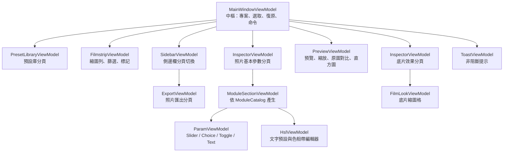

# 架構：App 介面層

本文件是[架構說明書](../architecture.md)「4. 模組說明」的一部分，涵蓋 4.10：共用／行動版介面、Loupe 預覽、ViewModel、編輯生命週期、大量照片載入、服務與控制項、主題、多國語系。

## 4.10 App．介面層

本節 `ViewModels/`、`Controls/`、非視窗 `Views/`、`Localization/` 及共用 `Themes/` 均位於 `src/FilmBatch.App.Shared/`，仍使用原本 `FilmBatch.App` namespace；桌面 App 不再編譯另一份相同實作。資源 URI 的 assembly 為 `avares://FilmBatch.App.Shared/`。桌面專用 `MainWindow`、Dock、對話框視窗及 Gallery 留在 `FilmBatch.App`。

行動版由 `MobileEditorView` 組合相同的 `MainWindowViewModel` 與各編輯 View，不複製參數、RAW、底片 LUT、復原或匯出演算法。`Suspend()` 取消入場、預覽、背景縮圖、分析與匯出，結束觸控互動並保存有效編輯；`Resume()` 保留專案、選取與復原，只恢復先前待處理的工作。iOS 的照片運算明確使用 CPU，不將 Avalonia 的 Metal 繪圖稱為攝影 GPU 運算。操作與建置見 [iOS 行動版](../release.md#ios-行動版)。

**職責**：Avalonia 12 桌面介面，採 MVVM（CommunityToolkit.Mvvm）。View 只負責呈現與輸入；ViewModel 不引用任何 Avalonia 控制項，所以能直接寫單元測試。

### Loupe 預覽

- **Main 層**：繪製長邊（畫布物理像素）以 `LoupePlan.EdgeStep`（64）為一級向上取整，上限為預覽等級 2560（`AppSettings.PreviewLongEdge`，0 = 自動）。顯示縮放以 Lanczos 縮到繪製尺寸，畫布以 1:1 繪製。
- **Window 層**：繪製尺寸 ≥ Main × 1.25 時出現。窗口對齊 256 網格、四周留 margin、單軸跨度上限 `MaxSpan`（6144），從 Full 來源算到 100%；結果與整張渲染後裁切一致（見 `WindowRenderEquivalenceTests`）。
- **GPU 預算**：單一窗口區域超過預算時，沿長邊切成最多四塊；每塊各自計算效果鄰域（halo），只拼回窗口需要的像素。整張 Full 來源仍保留，各塊的工作區加來源／素材皆須符合原預算與裝置上限；無法容納才回退 CPU，不提高預算、不縮小細節來源。
- **可見範圍**：畫布只回報可見範圍（畫框的 0..1 比例）。平移與縮放只改變繪製位置；窗口位置跨過網格時才送出新的請求。
- **來源生命週期**：Thumb / Preview / Full 三級。Full 每張照片只持有一份（`ImageCache`）；換照片即清除舊窗口持有的來源，沒有窗口持續 3 秒後釋放閒置 Full。對應 GPU 來源快取由算圖執行緒排程逐筆移除，不從 UI 執行緒與進行中的算圖競爭。只有確實移除 Full／窗口來源時，才在背景執行緒觸發 Aggressive GC；這仍可能暫停全部託管執行緒，不能視為不阻塞 UI。關閉算圖器也清除來源強參照。
- **來源縮放**：Main 與 Window 的 `SourceImage.ScaledTo` 都在背景執行緒執行，沿用來源內的兩格身分快取。Window 畫框長邊另向上吸附到 1024 級距、以 Full 尺寸為上限；新級距需要縮小 Full 時先等 250 ms，再核對最新照片、來源、設定、級距與算圖世代。相同級距的平移不等待；已取消窗口不能把 `null` 當成 1024 級距繼續送件。Main 最多一個縮放工作、期間只留最新請求；Window 沿用單一載入工作與 pending 機制。`Preview.IsBusy` 包含尚未送進算圖器的 Main 縮放，不能只用 `Renderer.IsBusy` 判斷畫面已完成。
- **替身順序**：ViewRenderCache → 內嵌 JPEG → 縮圖。替身不進直方圖、照片工具與匯出，顯示期間暫停窗口送件，但仍按正式影像規劃 Main／Window；同尺寸照片送達後不必等待平移或尺寸變更才接上細節窗口。
- **不畫窗口**：裁切工具、去背編輯、AI 降噪、替身，以及畫布旋轉（裁切拉直）時。
- **拖曳**：草稿期間不送新窗口，沿用舊窗口；放手後的完整 Main 送達時補送。
- **世代與圍欄**：窗口採獨立要求世代。`PreviewService` 在排入 UI 與實際交付時都丟棄已取代、取消、換照片與重建前的成功／失敗；畫面上另以 `RegionView.IsCurrent` 核對照片與設定（拖曳時容許沿用既有窗口）。Suspend 清除未完成窗口的去重狀態，Resume 與完整 Main 送達時重新檢查需求，不須平移才恢復。
- **已知限制**：原圖對比（分割的原圖側與按住空白鍵看原圖）沒有窗口，只顯示 Main 層。
- **比較與 bitmap 所有權**：原圖 bitmap 只在按住空白鍵或分割比較時建立，隱藏後釋放；一般載入不先在 UI 執行緒編碼一張看不到的 RAW 原圖。尺寸變更淘汰的雙緩衝 bitmap、被替換的原圖與清空／關閉時仍持有的 bitmap 都明確 `Dispose`。

### ViewModel 結構

| 型別 | 說明 |
|---|---|
| `MainWindowViewModel` | 建立所有子 ViewModel 與服務；開啟資料夾（`OpenFolderAsync`）、選取改變（`OnSelectionChanged`）、`RequestPreview`、複製貼上、指定預設、復原重做。**多數功能從這裡追起** |
| `InspectorViewModel` | 實作 `IParamHost`；連續手勢交給 `MainWindowViewModel` 暫存，離散修改先 `FlushEdit` 再送 `ProjectService`；`Refresh()` 顯示目前焦點的暫存／已保存參數 |
| `ModuleSectionViewModel` | 一個模組區塊：開關、折疊、覆寫數、`⋯` 選單 |
| `ParamViewModel` 系列 | `ParamViewModel.Create` 依 `ParamKind` 產生對應子類別，`InspectorView.axaml` 依型別套用 `DataTemplate`，所以**新增參數不需要寫 XAML** |
| `FilmstripViewModel` | 縮圖清單、多選、篩選、縮圖背景載入、覆寫 / 預設更新標記 |
| `PreviewViewModel` | 預覽影像、縮放、兩個畫布共用的平移位置、分割對比、控制點、直方圖資料、右下角拍攝資訊（EXIF 跟著每次解碼的來源重讀，重開資料夾不沿用舊資訊） |
| `FilmLookViewModel` | film 模組的底片縮圖格（`Controls/FilmLookControl.axaml`）。縮圖由 `FilmLookThumbnails` 以焦點照片算出，只在模組展開時計算，鍵前綴 `film-look/look/`，與縮圖列共用低優先佇列 |
| `HslViewModel` | 基本參數中「色彩」分組的 HSL 編輯器（`Controls/HslControl.axaml`），與 `curves` 同組；七個文字預設、八個色相帶與每帶三滑桿，不產生縮圖。預設以 `IParamHost.SetValues` 一次套用選取照片；載入／復原／語言切換不回寫 |
| `Tools/PhotoToolsViewModel`／`PhotoRegionTool` | 基本參數裡、「AI 功能」下方的照片工具；裁切逆仿射區域取樣、WB／膚色提案、同專案相對參考色與 Zone 錨點。背景只求解，UI 更新及一次 `SetValues` 接受都在 UI 執行緒 |
| `Tools/BackgroundRemovalViewModel`／`ForegroundBrushTool` | 單張 Vision 草稿、多選批次、筆刷逐筆復原／重做；控制項在基本參數的「AI 功能」內，與降噪模組、模型面板同一塊。共用桌面／行動按鈕與桌面快捷鍵路由，同步保存與生命週期隔離。AI 仍依平台停用，Mac／Headless 結果不是 iOS 原生驗收 |

### 編輯生命週期

- 連續滑桿拖曳、按鍵／滾輪手勢以 `mergeKey` 辨識；預覽即時更新，結束才保存一次。暫存捕捉原 `Service` 與照片集合；切換選取／專案先結束舊手勢，晚到的釋放事件不得改新照片。儲存、undo、其他修改、匯出快照與關閉會先 flush；保存失敗不發布正式照片修改或消耗 undo。
- 裁切的 Cancel／Esc 放棄未套用的修改並結束工具，留在裁切分頁顯示「編輯裁切」；來源尚未解碼時，Esc 也會取消延後的進入請求。套用或取消後，同照片的 RAW／偏好設定重載、重新選取不會重新開啟工具；明確進入或換照片才建立新的裁切編輯。
- 開啟資料夾先驗證目標專案，再以舊 `Service`／焦點照片／復原堆疊套用舊裁切，最後才切換專案。若提交了裁切，同一個 UI 工作內重新讀取目標，避免重開同一資料夾或別名時採用提交前的設定與磁碟版本；不改寫原始照片。
- 畫布失去指標擷取、視窗失焦、工具／控制點移除或畫布卸載時，都結束拖曳並恢復繪圖品質；控制點的復原合併區間也一併結束。可見的分割比較線優先接收拖曳，不交給裁切工具；命中與拖曳均透過 `CanvasMapping.ToImage` 逆向換算，拉直旋轉後也不會誤改裁切。
- 平移位置由共用的 `PreviewViewModel.Pan` 保存，Tab／全螢幕切換畫布時不歸零；符合視窗則明確置中。原生 `WindowState` 與 `IsFullScreen` 雙向同步，退出全螢幕還原進入前的面板隱藏狀態；視窗失焦會解除按住空白鍵的原圖比較。
- 匯出的選項驗證錯誤與上一批執行錯誤分開保存：有效選項可直接重試，上一批逐檔錯誤仍保留到下次開始。重試不會自動覆寫先前成功產生的檔案，既有輸出保護不變。
- 預設管理的 Esc 透過 `IsCancel` 關閉視窗，包含焦點位於文字欄位時；關閉後沿用原本的套用流程。偏好設定仍維持關閉時套用；背景載入 CPU 目標是唯一即時套用並保存的效能選項，不重建 GPU。
- RAW 原廠處理只在焦點來源已解碼為 RAW（`SourceImage.RawInfo` 存在）時顯示，仍遵守「隱藏未啟用模組」；一般影像即使帶有已保存的 RAW 設定也不顯示此面板、不刪除設定。來源解碼完成或失敗時重新整理面板；照片基本參數預設依 `basic` key 展開基本調整，不依賴模組目錄的位置。
- 底片風格縮圖在送出前核對來源的 `RawOptions` 與焦點照片設定；RAW 尚在重新顯影時沿用等待來源的排程，不以舊來源產生新設定的縮圖。匹配來源就緒後自動重算，包含在底片分頁復原／重做 RAW 選項的情況。獨立 HSL 不再有預覽圖與縮圖工作。
- RAW 的 `wb_mode=as-shot|custom`、自訂 2500–9900 K／色偏與 `mask_*` 只重算畫面，不重新解碼。控制項、JSON 專案、YAML 預設及直接建立的算圖輸入共用自訂色溫範圍；舊自訂值正規化至邊界，不改寫來源的拍攝白平衡中繼資料，也不改相對的 `basic.temperature`。遮罩精確保存 `Name`＋`InstanceId`；缺失或同名不明確時顯示不可用，不改成全圖作用。全尺寸算圖保留原有16-bit alpha與單像素細節，不先降成固定大小；上游 developed matte 會量化為8-bit，不能泛稱任意16-bit軟邊逐碼相同。
- `embedded_lens`、`camera_local_tone`、外部 Lensfun 資料夾與模組啟用狀態屬於來源快取鍵。外部資料夾是應用程式偏好設定（`AppSettings.LensDatabaseFolder` → 程序共用的 `RawLoadOptions.LensDatabaseDirectory`；CLI 用 `--lens-database`；兩者皆未設定時讀 `FILMBATCH_LENSFUN_DIR`，再其次為 `LensDatabaseStore` 明確下載的 `data/db`；下載與 AI 模型共用 `Downloads/Downloader`），不屬於照片設定，變更時重新解碼目前照片與縮圖。外部 Lensfun-format XML 只在缺少已驗證內嵌校正時匹配，略過 DOCTYPE（官方資料庫每個檔案都有）但不解析外部資源、不定義實體，並限制檔案大小；不隨程式散布資料庫。校正的光學中心與半徑取預設裁切，再轉成 ActiveArea 的既有 opcode 慣例；warp、gain table 與語意遮罩共用輸出→有效 RAW 的逆映射。未設定／無匹配不加校正；明確設定但不存在、不可讀或格式錯誤的資料庫不讓照片打不開：來源退回不使用外部校正，並以 `SourceImage.LensDatabaseWarning` 回報（App 提示一次並寫入記錄、匯出記錄寫入 `LensDatabaseWarning`），帶警告的來源不進快取重用，修好資料夾後下次載入即重新比對。
- 解碼失敗／取消的快取項目不重用；外部檔案或資料夾修復後可用相同選項重新要求來源。過期解碼失敗必須同時核對來源選項，不能清除 undo 已還原的畫面。
- 照片工具以服務、照片、來源及設定世代綁定提案；背景結果另核對請求序號。進入取樣視圖先取消已排隊的一般預覽，收到新影格才允許點選；接受前只疊加暫存設定。Esc（包含文字焦點）、失焦、收合、來源／設定變更、裁切替換與主 ViewModel 處置都不能套用過期提案。
- 「AI 功能」只在照片基本參數，預設展開且不寫入設定。降噪模組仍在 `InspectorViewModel.Modules`（載入、隱藏停用模組、複製與重設照舊），但不進基本分組。收合會取消未套用的單張去背草稿與進行中的單張選取；進行中的批次去背、模型下載／匯入與降噪推論繼續。離開基本參數分頁仍沿用原本的取消，與收合不同。底片效果分頁沒有這塊面板，收合它的狀態不會取消去背。
- `Zoom <= 0` 的 Fit 置中由 `PreviewCanvas.ZoomProperty` 的 class handler 清除 Pan，不只放在 `PreviewViewModel`。Gallery 等沒有綁定同一個 ViewModel 的獨立畫布也需要這個契約；一般畫布切換則仍保留共用 Pan。
- 畫布以 `PreviewViewModel.FrameSize` 的來源／裁切畫框計算 Fit、倍率及可見範圍；`FrameLongEdge` 由它推導。`PreviewCanvas.LayoutFrameSize` 不從顯示 bitmap 的整數尺寸反推長寬比，避免 Lanczos 顯示縮放取整後又改變下一次尺寸、在靜止視窗持續 refit。沒有來源幾何的獨立畫布仍使用 bitmap 尺寸。

### 大量照片載入與背景 CPU

- `OpenFolderAsync` 在背景列舉檔名，先顯示掃描狀態；安裝有效專案後才開始縮圖工作。主視窗持續顯示完成張數／總數、失敗數與耗時；成功送達點陣圖或處理失敗才計入終態，不以佇列長度冒充進度。
- `FilmstripViewModel` 使用一個有界工作泵，依「目前照片 → 可見範圍 → 明確重算要求 → 資料夾順序」取下一張；等待算圖交付後才繼續，不為每張照片建立等待中的解碼工作。可見範圍取自虛擬清單的實現索引；未顯示的照片最終仍會載入。
- 縮圖算圖中的 AI 降噪只在已提供的像素尺寸與資料域推論，不因原始參考尺寸較大而重開全尺寸來源。相機內嵌 sRGB 縮圖使用 NAFNet-SIDD；完整顯影的線性縮圖使用 RawNIND。縮圖神經結果另保留一筆、識別包含實際推論尺寸，不取代正式預覽／匯出的全品質快取；原始參考尺寸與中繼資料仍傳給後續效果。停用、模型錯誤、取消與交付計數契約不變。
- `ImageCache` 分開前景預覽與單槽背景解碼的入場控制；同鍵共享已開始的解碼，不讓單一呼叫端取消毒化共享結果。背景預取完成 CPU 配速及記憶體入場後，才在取消／世代圍欄內標為已開始；等待中的同鍵預取可被前景取代，不讓前景跟著等背景預算。預覽 LRU 以路徑、尺寸與 RAW 選項為鍵，所有選項合計保留最多八筆，復原可重用先前來源；逐出時取消尚未開始的解碼。
- 已完成的縮圖來源另有 64 筆 LRU；飛行中的共享解碼不因逐出而取消，完成時再修剪。縮圖列的點陣圖／來源以 64 筆為保留目標，焦點、可見與飛行中項目受保護；離開保留集就釋放像素，捲回時重載。終態計數不依賴像素是否仍在記憶體，重載不重複增加完成數。
- 背景 CPU 目標可在背景工作浮出面板或「GPU 與效能」偏好設定即時調整並保存，範圍 10–100%、預設 70%；100% 停用額外配速等待與背景降限，但仍保留共用 RAW 每個迴圈的半數邏輯核心上限。採程序 CPU 時間 ÷（經過時間 × 邏輯核心數），在背景工作間合作式讓出時間；不是單核心百分比，也不是系統整體或單次 RAW／原生解碼的硬性上限。
- `RawProcessingScope.Options` 是共用 RAW 迴圈的唯一入口；未進入範圍時最多使用 `max(1, 邏輯核心數 / 2)` 個工作者。低於 100% 的縮圖／預取，在已准入的背景解碼內再取此上限與 `max(1, 邏輯核心數 × 百分比 / 100)` 的較小值。範圍只影響目前執行內容，離開即恢復；不更動全域執行緒池，不加入 RAW 選項或快取鍵，也不改像素演算法。前景預覽及匯出不加背景降限，同鍵飛行中解碼仍可共享；其他 Engine／原生迴圈與同時工作的總量不受此單一上限保證。
- 配速等待每段最多兩秒，但分段結束不清除尚未抵銷的 CPU 累計量；重新量測，直到已有足夠經過時間才更新基準。目標調整、取消與資料夾換代仍可喚醒等待；前景工作不等背景入場閘門。程序 CPU 計量包含前景與 UI，因此其他工作忙碌時可能延後背景載入，並非即時的程序 CPU 硬上限。
- 取消只停止自動背景掃描／縮圖，保留目前專案、照片、編輯與已完成縮圖；後續明確的編輯仍可更新相關縮圖，不會悄悄恢復整批掃描。資料夾換代會取消舊排隊與配速等待，舊成功／錯誤均不得污染新專案。已開始的同步解碼不能硬殺，但回傳後會核對換代；取消不算壞檔。
- `DecodeBudget` 的 64／400／1700 MiB 是縮圖／Preview／Full 入場估計，不是配置或程序記憶體硬上限；RAW 縮圖回完整顯影時可能超過估計。前景只登記、不等候；背景在沒有其他解碼時可超額准入一筆，避免永遠等待。租約結束必須歸還，已取消的請求不能先拿到閒置預算。
- RAW GPU 的 AHD 為 256 列加邊界、色彩收尾為 512 列一帶；執行前檢查整張 AHD 結果、各帶 CPU scratch／GPU 工作區與裝置單一緩衝區限制。色彩讀回先寫 scratch，整帶成功才提交；中途失敗只讓 CPU 接手未提交的列，避免已變色像素被重算。預算是解碼端的局部估計，不含其他裝置的同時用量，不能解讀為跨裝置總 GPU 上限。
- `FILMBATCH_NO_GPU_DEMOSAIC=1` 在程序啟動時同時停用 AHD 與色彩收尾。正常執行的 shader／裝置錯誤記錄原因並回 CPU；AHD 與色彩各自停用，同後端不反覆重試，切換後端才清除舊裝置與失敗狀態。數值沿用原有容差，沒有跨廠牌逐位元一致的保證。

### 服務與控制項

| 位置 | 說明 |
|---|---|
| `Services/PreviewService.cs` | UI 與 GPU 執行緒之間的橋樑（見 4.7），也負責依偏好設定建立 GPU 或 CPU 算圖器 |
| `Services/ImageCache.cs` | 預覽代理圖與縮圖的解碼快取，開啟新資料夾時以世代編號丟棄舊結果 |
| `Services/AppSettings.cs` | `settings.json`：偏好設定、語言、最後開啟的資料夾等 |
| `Services/LayoutService.cs`、`Views/DockFactory.cs` | Dock.Avalonia 版面的建立、儲存與還原（`layout.json`）。Dock 相關程式碼只放這兩處，降低套件升級的影響 |
| `Services/NativeMenus.cs` | macOS 原生選單列。應用程式選單的根宣告在 `App.axaml`；Avalonia.Native 只更新第一次匯出的根選單，所以切換語言時只重建根之下的項目，不可替換根 |
| `Services/SmokeTest.cs` | 發佈版以 `--smoke` 啟動時執行的自動冒煙流程 |
| `Controls/PreviewCanvas.cs` | 自訂繪製的預覽畫布：縮放、平移、分割線、控制點命中測試 |
| `Controls/ParamSlider.cs` | 只在取得焦點時接受滾輪（避免捲動面板時誤改參數）、`Shift` 微調 |
| `Controls/ParamRow.axaml`、`ModuleSection.cs`、`HistogramView.cs` | 參數列、模組區塊、直方圖 |
| `Dialogs/` | 偏好設定、預設管理、選擇性貼上、以此張建立預設（勾選要存的模組，與選擇性貼上共用 `ModuleChecklistViewModel`）、關於；`DialogService` 實作 `IDialogService`，測試時可替換 |
| `Gallery/` | 以 `--gallery` 啟動的元件展示視窗，檢查各元件在各種狀態下的外觀 |

直方圖的平滑只在 `Controls/HistogramView.cs` 的顯示高度上套用五格 `[1,4,6,4,1]/16` 濾波，不改 `ImageHistogram` 的原始 bins 或黑白裁切比例。每次資料更新建立新的 `StreamGeometry`，只在相同資料的重繪間快取；重新 `Open()` 舊 geometry 會累加 figures。空資料與卸載必須清掉舊圖，避免把歷史曲線當成目前統計。

資源使用率沿用既有左下角 RAM 區塊：提示分列系統 RAM、FilmBatch RSS 與 AI retained pixels（神經／來源／預覽輸入），不相加。`SystemMonitor` 每秒在背景取得值型別快照，經既有 `_post` 更新 UI；監控本身不建立 shared AI processor／ORT session。提示在語言切換時立即更新，關閉原有「顯示使用率」偏好即一起隱藏。RAM 百分比與 hot 門檻不變；非 Windows 仍沿用 .NET GC 的系統記憶體觀測，程序尚未 GC 時可能顯示零，這不是 AI 像素統計或即時 OS 計數器。

### 主題

- `Themes/Colors.axaml`：所有顏色 token（`FB.*Brush`）。介面灰階必須 R = G = B，強調色只有一個藍色。新顏色請加 token，不要在 View 裡寫色碼。
- `Themes/Controls.axaml`：自訂樣式，以 class 選擇器套用（例如 `Border.module-header`）。
- `Themes/Icons.axaml`：單色線條圖示（`StreamGeometry`）。

### 多國語系

- 字串在 `Localization/Strings.resx`（繁中）與 `Strings.en.resx`（英文），英文檔必須涵蓋每個 key 且不含中文（`LocalizationTests` 會檢查）。
- XAML 使用 `{l:Tr Key}`；C# 使用 `Loc.Get("Key")` 或 `Loc.Format("Key", 參數)`。切換語言時畫面即時更新。
- 模組與參數名稱依序查找 `Module.<模組>`、`Param.<模組>.<參數>`、`Param.<參數>`，找不到才用 `ModuleCatalog` 的中文 `Label`。選項為 `Choice.<模組>.<參數>.<選項>`。
- 需要在 macOS 顯示不同文字（例如 ⌘ 快捷鍵）時，加一個 `<key>.Mac` 項目即可。
- Core 與 Gpu 各自有資源檔（`CoreText`、`GpuText`），用於會顯示給使用者的錯誤訊息，跟隨介面語言切換。
