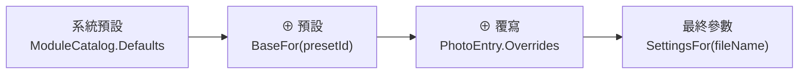

# 架構：Core 模組

本文件是[架構說明書](../architecture.md)「4. 模組說明」的一部分，涵蓋 4.1–4.5：參數 schema、專案與照片設定、復原堆疊、預設庫、底片風格。

## 4.1 Core．參數 schema（Params）

**職責**：定義 RAW 來源、裁切與效果模組的參數、型別、範圍與預設值。這是整個程式的**單一資料來源**：介面面板、存檔、貼上、鏡像、範圍檢查都從這裡自動產生。

| 型別 | 檔案 | 說明 |
|---|---|---|
| `ModuleCatalog` | `Params/ModuleCatalog.cs` | 模組順序為 RAW 來源 → 裁切 → 基本調整與後續效果；RAW 解碼先於效果，白平衡／局部調整與顯示收尾在算圖時執行。面板依分頁／分組顯示；以 `Defaults`、`Param(flatKey)`、`Module(key)` 查詢，不依賴固定數量或陣列索引 |
| `ModuleSchema` | `Params/ModuleSchema.cs` | 一個模組：`Key`、`Label`、所屬分組 `ModuleGroup`、選擇性貼上分類 `PasteCategory`、參數清單 |
| `ParamDef` | `Params/ParamDef.cs` | 一個參數。工廠方法包括 `Float`、`Int`、`Bool`、`Choice`、`Path`、`Directory`、`Text`、`Curve`、`Seed`、`Position`、`Offset` |
| `ParamValue` | `Params/ParamValue.cs` | 參數值（數字 / 布林 / 文字），以 `AsNumber`、`AsBool`、`AsText` 讀取 |
| `Settings` | `Params/Settings.cs` | 扁平 key → `ParamValue` 的不可變字典。`Overlay` 用於三層合併，`With` / `Without` 回傳新物件 |

**規則與陷阱**

- `Settings` 是**不可變**的：`settings.With(k, v)` 不會改原物件，要接住回傳值。
- `ParamDef.Coerce` 會把值夾回合法範圍；寫入前一律經過它，所以不必在 UI 端重複檢查。
- `Position` / `Offset` 參數以 0–1 正規化座標儲存，換尺寸照片仍合理；帶有 `center_x`、`center_y` 的模組會自動在預覽上出現控制點（`ModuleSchema.HasCanvasPoint`）。
- `Seed` 參數預設不會被貼上，每張照片依檔名產生自己的種子（`Core/Random/SeedHash.cs`）。
- `Label` 是繁中後備文字；實際顯示名稱由 App 的資源檔決定（見 4.10 多國語系）。
- 自由識別字用 `Text`，不要借用 `Path` 或固定 `Choice`：`ProjectService.SetValue` 會把絕對路徑改成專案相對路徑，`Choice.Coerce` 會把未知值改回預設。語意遮罩的 `Name`／`InstanceId` 必須原樣保存；只有真正的檔案／目錄參數才走路徑處理。

## 4.2 Core．專案與照片設定（Projects）

**職責**：一個照片資料夾 = 一個專案。保存每張照片用哪個預設、有哪些覆寫，並提供所有可復原的編輯操作。

| 型別 | 檔案 | 說明 |
|---|---|---|
| `Project` | `Projects/Project.cs` | 照片清單與各自的 `PhotoEntry`；預設快照；`EntriesChanged` 事件；`Open` 時掃描資料夾並載入既有編輯 |
| `PhotoEntry` | `Projects/PhotoEntry.cs` | 一張照片：`FileName`、`PresetId`、`Overrides` 與可空的 `ForegroundMask`（不可變 record） |
| `PhotoOperations` | `Projects/PhotoOperations.cs` | **純函式**：合併、清理、設值、重設、指定預設、三種貼上、鏡像。不碰檔案、不發事件，最容易寫單元測試 |
| `ProjectService` | `Projects/ProjectService.cs` | UI 修改專案的**唯一入口**：呼叫 `PhotoOperations` 算出新狀態，再包成 `PhotoEditCommand` 送進復原堆疊 |
| `ProjectStorage` | `Projects/ProjectStorage.cs` | `.filmbatch/project.json` 的讀寫，原子寫入並以 revision 偵測外部修改 |
| `ForegroundMask` | `Projects/ForegroundMask.cs` | 不可變的 16-bit 前景覆蓋率、遮罩尺寸與完整來源參考尺寸；不存 RGB，不屬於預設或設定剪貼簿 |
| `SettingsClipboard` | `Projects/SettingsClipboard.cs` | 複製設定的內容（來源預設、覆寫、最終參數）與貼上選項 |

**三層設定模型**

- 覆寫只存「與預設不同」的欄位。`PhotoOperations.Clean` 會移除與基準相同的值，所以修改預設時，沒被覆寫的欄位自然跟著變。
- **預設快照**：專案會把用到的預設存一份在 `PresetSnapshots`。重新開啟舊專案時，即使預設庫裡的預設被改過，照片仍維持原樣，直到使用者在對話框中選擇同步（`Project.PendingPresetUpdates` / `ResolvePresetUpdate`）。
- 每次 `Project.Replace` 都會自動存檔，不需要另外呼叫儲存。
- 去背透過 `ProjectService.SetForegroundMask` 形成單張照片命令；`SetForegroundMasks` 把一批不同遮罩保存成同一個 `PhotoEditCommand`，成功後才加入復原堆疊。專案格式 3 在每張照片內保存 zlib 壓縮、little-endian 16-bit 覆蓋率；讀取接受格式 1／2，寫入升為 3，舊版不得覆寫新格式。解壓依尺寸限定長度，遮罩最多 16,777,216 個樣本；上限不限制來源照片本身的像素數。

**規則與陷阱**

- 不要在 UI 直接修改 `Project`；`Replace` 是 `internal`，請透過 `ProjectService` 新增方法。
- `ProjectService.UpdatePresetFromPhoto` 會影響所有使用同一預設的照片，且**無法復原**（會清空復原堆疊），呼叫端必須先跟使用者確認。
- 照片 key 以 `StringComparer.Ordinal` 比對，保留原始大小寫。

## 4.3 Core．復原堆疊（Commands）

**職責**：專案層級的復原 / 重做。

| 型別 | 說明 |
|---|---|
| `IUndoableCommand` | `Execute()` / `Undo()` / `Description` |
| `IMergeableCommand` | 有相同 `MergeKey` 的連續命令會合併成一筆（滑桿拖曳） |
| `CommandStack` | 上限 200 筆；`CloseMerge()` 結束目前的合併（放開滑桿時呼叫） |
| `PhotoEditCommand` | 記錄「修改前 / 修改後」的 `PhotoEntry`，大部分照片編輯都用它 |
| `DelegateCommand`、`CompositeCommand` | 以委派實作的一般命令；多個命令組成一筆紀錄 |

**陷阱**：新增一種可復原的操作時，`Execute` 與 `Undo` 都要能重複執行（重做時會再呼叫 `Execute`）。
儲存失敗時不能消耗復原紀錄：`Undo`／`Redo` 在命令成功之後才移動堆疊節點；專案 revision 衝突保留原磁碟內容、目前照片與可重試的歷史。

複合操作要走一次 `ProjectService.SetValues`：例如裁切的一組欄位、語意遮罩的名稱＋實例，undo 一次應還原整組。`InspectorViewModel.SetValues` 提供這個專案契約；`IParamHost` 的預設實作只是逐 key 轉送，不保證其他 host 也有原子復原語意。

去背草稿不使用專案 `CommandStack`。`ForegroundBrushTool` 以 32×32 區塊保存受影響的原始覆蓋率，undo／redo 交換相同緩衝區；每次按下／移動／放開是一筆，反轉另是一筆，不變的筆畫不清除 redo。保留最多 200 筆及 32 MiB 區塊樣本 payload，超過時丟棄最舊紀錄；這不是整個工具的 RAM 上限。編輯草稿期間，共用 Undo／Redo 一律路由到草稿，即使本地歷史為空也不能消耗既有照片歷史。套用只將目前覆蓋率存成一筆照片命令，取消丟棄草稿；中斷捕捉／雙指接手沿 `PreviewCanvas.EndDrag` 的 `OnReleased` 收尾。

## 4.4 Core．預設庫（Presets）

**職責**：全域、跨專案的預設，存成使用者資料夾中的 YAML 檔。

| 型別 | 檔案 | 說明 |
|---|---|---|
| `Preset` | `Presets/Preset.cs` | `Id`（Guid，改名不影響已指定的照片）、名稱、分類、色彩標籤、是否釘選、`Settings` 與 `Resolved` |
| `PresetLibrary` | `Presets/PresetLibrary.cs` | 載入、儲存、刪除、`Watch` 監看資料夾的外部變更並發出 `Changed`；`Pinned` 取前 9 個釘選預設 |
| `PresetFile` | `Presets/PresetFile.cs` | YAML 序列化格式 |
| `SamplePresets` | `Presets/SamplePresets.cs` | 第一次啟動時建立的範例預設；`Neutral` 為新照片的預設值 |

**陷阱**：`PresetLibrary` 先寫入磁碟成功，才更新記憶體中的清單並發事件；損毀的 YAML 會記在 `LoadErrors`，不會被空白資料覆蓋。

## 4.5 Core．底片風格（Film）

**職責**：底片顏色模擬的資料：36 卷內附底片（RawTherapee Film Simulation Collection 的 Hald CLUT 轉成的 3D LUT，CC BY-SA 4.0）、八色相帶定義與內建色相修正預設，以及舊參數的相容處理。演算法、來源與授權見 [film-looks.md](../film-looks.md)。

| 型別 / 檔案 | 說明 |
|---|---|
| `FilmLut` | 3D LUT 資料（`Size`、`Data`、`ColorSpace`；`FilmLutColorSpace` 為 sRGB 或 ProPhoto D50／gamma 1.8；Hald 像素順序）；`Sample` 四面體內插、`Resample` 改邊長、`FromHald`、`ToTextureRgba` 轉成 GPU 紋理排列 |
| `FilmLutFile` | `.fblut` 二進位格式讀寫：sRGB 為 FBLUT1（magic、int32 邊長、16-bit unorm）；ProPhoto 為 FBLUT2（邊長後多一個色彩空間位元組） |
| `FilmLookLibrary` | 底片清單（以 `JsonDocument` 讀嵌入的 `looks.json`）、`GroupsInOrder`、`DefaultKey`（`kodak-portra-400`）；`TryLut(key)` 第一次使用時載入並快取，未知 key 回傳 null |
| `HueBands`／`HuePresets` | 獨立 `hsl` 模組的八色相帶 key、中心角（與 `linear/hsl.wgsl` 同值）、24 個參數 schema（`Params`、`FlatKeys`）；七個文字預設與 `Find`（判斷目前值是否為某預設，否則為「自訂」）。與曲線同屬 `ModuleGroup.Color` |
| `Film/Looks/` | `looks.json`（36 卷清單，順序即介面順序）、36 個 33³ `.fblut`、`LICENSE.txt`（CC BY-SA 4.0 聲明），皆為嵌入資源 `FilmBatch.Looks/*` |
| `Params/RetiredParams` | 舊 Recipe Lab 模組的 13 個 `film.*` key，以及改為偏好設定的 `raw.lens_database`；`SettingsJsonConverter` 與 `PresetFile` 讀檔時靜默丟棄 |
| `Params/HslMigration` | JSON／YAML 讀入時把 `film.hue_*` 轉成 `hsl.hue_*`，新 key 優先；只在有舊色相欄位時繼承同層明確的 `film.enabled`，不為稀疏層新增開關。寫入不保留舊 key，未知欄位仍拒絕 |

**陷阱**

- `looks.json` 的 `key` 會存進專案與預設，發佈後不可改名；新增底片照 [film-looks.md](../film-looks.md#5-新增或更換底片) 的流程以 `tools/film-luts` 產生 `.fblut`，不要手改 LUT。
- 卷數、分組與每卷都有 33³ LUT 由 `FilmLookTests` 鎖定；`film.look` 的選項由 `FilmLookLibrary.All` 產生（`RetiredParamsTests` 檢查兩者一致）。
- 色相帶中心角改動時，C#（`HueBands.CentersDegrees`）與 WGSL 要一起改。
