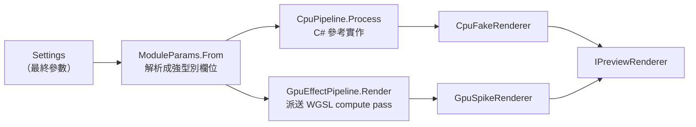

# 架構：Engine 模組

本文件是[架構說明書](../architecture.md)「4. 模組說明」的一部分，涵蓋 4.6–4.8：算圖管線、算圖排程、影像讀取與批次匯出。

## 4.6 Engine．算圖管線（Rendering）

**職責**：把「來源影像 + 最終參數」算成結果影像。同一套演算法有 **CPU 與 GPU 兩份實作**，順序與數學必須一致。

| 型別 | 檔案 | 說明 |
|---|---|---|
| `IPreviewRenderer` | `IPreviewRenderer.cs` | 算圖器介面：`Render`（預覽，8-bit BGRA）、`Render16`（匯出，16-bit RGBA）、`DeviceName`、`IsSoftware` |
| `ModuleParams` | `ModuleParams.cs` | 把 `Settings` 解析成一個個欄位（`VignetteOn`、`VigAmount`…），並計算各模組的種子。**CPU 與 GPU 共用同一份解析結果**，保證兩端讀到相同的值 |
| `CpuPipeline` | `CpuPipeline.cs` | CPU 完整管線，`Process` 依序執行模組；RGBA 算術、模糊累積與量化使用 `Vector128`，sRGB 曲線與 gamma 保留純量 `MathF.Pow` |
| `GpuEffectPipeline` | `GpuEffectPipeline.cs` | GPU 管線；高斯模糊沿用相同權重、tap 順序與 clamp 邊界，半徑 ≤320 用 14 KiB workgroup tile 共讀來源，較大半徑走直接核心；兩核心共用展平 workgroup 起點，每累計至多 64 Mi 個輸出取樣運算就提交並等待，跨軸／效果也計入，不延長裝置的 10 秒期限 |
| `GpuSpikeRenderer` | `GpuSpikeRenderer.cs` | **正式的 GPU 算圖器**（名稱沿用自 M0 技術驗證）。超過 GPU 紋理上限或顯示記憶體不足時，自動改走 CPU 並在 `DeviceName` 標示原因 |
| `CpuFakeRenderer` | `CpuFakeRenderer.cs` | **正式的 CPU 算圖器**（名稱同樣是歷史遺留），內部呼叫 `CpuPipeline`；無 GPU 或使用者強制軟體模式時使用 |
| `DenoiseProcessor` | `Denoising/` | CPU／GPU 共用的效果前來源階段。正式預覽／匯出仍先全解析度推論；縮圖只處理提供的像素，不重開原檔，另有一筆神經結果快取。RAW 快取代理輸入後混合；sRGB 串流混合／量化並直接縮小；見 [ADR 0002](../adr/0002-ai-denoise.md) |
| `FilmLookProcessing` | `FilmLookProcessing.cs` | 底片風格的 CPU 參考實作：LUT → 暖色 → 褪色 → 依效果比例混合；不再內含 HSL |
| `ColorTransformProcessing`／`ColorTransformKernel` | `ColorTransformProcessing.cs`、`ColorTransformKernel.cs` | 同一有限 CLF 序列的 CPU 與 GPU 算術；GPU 以一個固定 shader 執行，ops／table storage 及在途資產計入裝置限制與預算 |
| `FilmLookUniforms` | `FilmLookUniforms.cs` | 傳給 `film/look.wgsl` 的單一 `Mix`（16 bytes），與 WGSL `LookParams` 對齊 |
| `HslProcessing`／`HslUniforms` | `HslProcessing.cs`、`HslUniforms.cs` | 獨立八色相帶（OKLCh），底片混合後、古典版材前執行；`HslOn` 與底片開關／強度無關。八個固定 `Vector4`（128 bytes）對齊 `linear/hsl.wgsl`，全零跳過、alpha 不動 |
| `PhotoAdjustments` | `PhotoAdjustments.cs` | BasicLinear 後的羽化膚色與單調 Zone 亮度曲線；CPU 逐像素與有界分析共用純量數學，GPU 對應 `linear/photo_adjustments.wgsl` |
| `ShadowRecovery` | `ShadowRecovery.cs` | 場景線性局部暗部增益與增益前亮度／色度降噪；覆蓋率加權 guided 基底、共享 `ShadowLayout` 與 CPU／GPU uniforms；GPU 對應 `linear/shadow_stats.wgsl`、`shadow_box.wgsl`、`shadow_apply.wgsl` 與共用 `shadow_common.wgsl` |
| `Oklab` | `Oklab.cs` | 線性 sRGB ↔ OKLab 轉換（與 `linear/hsl.wgsl` 的 `to_oklab`／`from_oklab` 同係數） |
| `EffectAssets` | `EffectAssets.cs` | 解析外部素材：雙重曝光的第二張照片、漏光與灰塵的材質檔。材質庫為空時改用程序化效果 |
| `RenderView` / `FrameStats` | `RenderView.cs` | 窗口渲染的視圖（畫框內的子矩形）與 Main 整張渲染記錄的全畫框統計。`IPreviewRenderer.RenderWindow` 只算窗口，結果等於「整張渲染後裁切」（逐通道誤差 ≤ 1 LSB、平均 < 0.05 LSB） |

**AI 像素保留量**：`DenoiseProcessor.MemoryUsage` 分列未混合神經結果、來源與既有縮放／顯示陣列，以及預覽尺寸混合輸入。full／thumbnail 共用的陣列依參考去重；查詢不建立 RAW 的延遲 `Rgba16`，重用的去重集合在查詢後清空，不成為保留者。`SharedMemoryUsage` 在未使用 AI 時回傳零，不建立處理器或 session。這只是 AI 快取可達的主要 managed 像素陣列，不含遮罩、中繼資料、session tensor、ORT/native 或 GPU 記憶體；不是 heap、RSS 或入場預算，不能與程序 RSS 相加。

全品質 cache miss 取得行程級 `InferenceGate` 後，先檢查取消並再次查找；仍未命中才釋放舊 full 結果，再載入／推論新來源。等待中或預先取消的呼叫、同來源混合命中與縮圖工作都不逐出 full。查找集中於禁止內嵌的 `FindCached`，避免未命中的舊結果被長時間推論的 JIT stack frame 保留；不在產品路徑加入強制 GC。新 full 取消／失敗不發布半成品，也不恢復舊快取；返回舊照片可能重推論，既有呼叫者持有的結果與設定不變。

神經快取命中後，相同請求來源物件與相同 `DenoiseSettings` 可沿用最近一筆仍存活的混合 `SourceImage`，讓 GPU 來源紋理依參考命中；模型／RAW 選項／來源快取失效時隨神經結果作廢。單槽只弱參考輸入與成品，不把全尺寸混合像素加入 AI 強保留量。首次推論回報 `CacheHit=false`，首次命中建立 `true` 的報告後才重用；改變混合量或遮罩包裝來源會重建，不改像素公式、正式解析度、推論／模型或取消語意。

**處理順序**（`CpuPipeline.Process` 與 `GpuEffectPipeline.Process` 相同）

RAW 來源保持未夾取的浮點線性 Rec.2020，`Rgba16` 只在原圖比較／直方圖等顯示用途首次取用時編碼。兩套算圖管線先轉到未夾取的線性 sRGB 工作域，在裁切後套用相機白平衡與語意遮罩，再執行既有效果；顯示段前轉回 Rec.2020，依原順序完成相機色調、高光去飽和與壓縮，再轉顯示 sRGB。高光壓縮的通道最大值不能與色域轉換交換順序。一般影像維持原有 sRGB 路徑；藝術 LUT 仍有自身的有界輸入限制。

選用外部 DCP 時，RAW 解碼依來源機型與 profile policy 驗證內容定址資產，在相機矩陣、白平衡、highlight 與 HueSat／Look 前建立獨立有效 profile；來源 gain map 保留。非線性 profile 的自訂 WB 會重新顯影，後段不得再套一次 WB。白平衡分析對候選以相同感光／幾何快照重算矩陣與色彩表，最多取 4096 個輸出樣本；無裁剪時只計算樣本所需的像素，裁剪的 highlight 重建仍需整張感光鄰域。來源內容被更換或 profile 缺失／機型不符時回報錯誤，不回退舊外觀。

機型比對先正規化空白並忽略大小寫，仍要求完整相機型號相等：DNG 使用 `UniqueCameraModel`；非 DNG 以 EXIF `Make` 全名或第一個詞（廠商名稱）搭配 `Model`，已含該前綴時不重複加入。第一個詞支援 `NIKON CORPORATION`／`NIKON D5300` 這類廠商後綴差異，並不忽略型號或放寬非 DNG 的 profile policy。

CLF 的 `WorkingLinear` 固定放在原 film 位置；`DisplayEncoded` 在顯示編碼後、基本顯示調整前，兩者擇一。包裝使用明確宣告的編碼，暖色／褪色與強度在線性 sRGB 混合，alpha 不變；取樣不解析 film 資產。實作與合成測試不代表所有 CLF、相機、平台或第三方外觀已驗證。

| 階段 | 色彩空間 | 模組 |
|---|---|---|
| ⓪ 來源（選用） | RAW 線性 Rec.2020／一般顯示 sRGB | 固定模型分塊 AI 降噪 → 亮度／色彩混合 → 需要時縮小；兩個 renderer 共用同一實作，不重複一份神經網路 shader |
| ① 幾何 | 線性光 | 基本調整（曝光、色溫、色調）→ 局部膚色 → Zone 曲線（僅場景來源）→ 暗部還原（選用）→ 鏡頭變形 → 多格分鏡 |
| ② 光學 | 線性光 | 雙重曝光 → 散景 → 縮放旋轉模糊 → 動態模糊 → 暗角 → 光暈 → 漏光 |
| ③ 底片／色相 | 線性光 | 底片風格 → 獨立 HSL → 古典版材 → 亮部保護（僅 RAW 場景、選用；相機曲線之前） |
| — | 線性 → sRGB | `linear_to_display` |
| ④ 顯示 | sRGB | 基本調整（細節 → 亮度 → 對比 → 亮部陰影 → 飽和）→ 色調曲線 → 色調分離 → 清晰與銳化 |
| ⑤ 表面 | sRGB | 灰塵與刮痕 → 顆粒 |

**規則與陷阱**

- 模組關閉或參數為零時要**完全跳過**，輸出必須與輸入逐位元相同（identity 測試會檢查）。
- 改了 CPU 版就要改 GPU 版，反之亦然；`Gpu_MatchesCpu_*` 測試會比對兩者。
- C# 的 uniform record（`[StructLayout(LayoutKind.Sequential)]`）欄位順序、型別、對齊必須與 WGSL 的 `struct Params` 完全一致，通常以 `_pad` 補齊到 16 位元組的倍數。
- 散景的清晰區與動態模糊、縮放旋轉模糊的保護區共用同一組形狀（圓、橢圓、水平帶、垂直帶，加長寬比與角度）：算圖用 `ShapeMask.Distance`／`common/sampling.wgsl` 的 `shape_distance`，預覽範圍輪廓與拖曳用 `EffectFootprint` 的 `ShapeKeys`。三處的公式要一起改。預設（圓形、長寬比 0、角度 0）與舊版輸出相同。
- GPU 只有 4 張工作紋理輪流使用（`Next(...)` 會避開正在讀的紋理）；新增需要多張中間結果的 pass 時要用 `reserve` 參數保護。
- 半徑、大小類參數以**短邊比例**計算，預覽代理圖與原尺寸匯出的外觀才會一致。
- 顆粒例外地以來源參考平面的短邊決定粒徑：`SourceImage.ReferenceWidth/Height` 穿過代理圖，輸出像素經裁切逆仿射回到該平面；三種模型共用座標、seed、明暗響應與像素足跡濾波。光學圓盤數截斷於每格 8，最大 λ=1.6 時截斷尾機率低於 0.0046%；不是精確片種或化學模擬。

**基本調整的細節契約**：`basic.structure` 比較目前像素與 Gaussian 基底的亮度，兩者必須來自相同、尚未套用全域顯示調整的影像。`CpuPipeline.BasicDisplay` 與 `basic_display.wgsl` 都先做細節，再做亮度／對比／亮部陰影／飽和；不能用調整後亮度與調整前基底相減，再除以正負通道相消後接近零的亮度。均勻色塊沒有空間細節，即使極端全域設定下也不應被細節增益改色；回歸入口為 `EffectPipelineTests.BasicStructure_UniformColourRemainsUniformUnderExtremeGlobalAdjustments`。這項順序修正不增加 blur、pass 或暫存，不變更參數格式；細節與全域調整同時非零的舊設定會得到修正後外觀，單獨啟用任一類則維持原行為。

**暗部還原契約**：獨立的 `shadow_recovery` 模組預設關閉，不重定義顯示域的 `basic.shadows`。在未夾取的工作線性 sRGB 上，以 `log2((max(Y,0)+2⁻⁷)/0.18)` 作導引，按 alpha 加權的代理格統計與分數盒狀 guided filter 求局部基底，再把亮度／色度降噪與共同 RGB 增益套回來源。增益曲線不加黑位偏移，基底階調斜率下限 0.3；高於膝點的基底增益為 1，不在此處裁掉 HDR。alpha 不變，完全透明的隱藏 RGB 不進鄰域；純黑仍為黑。一般 RGB 來源先按既有流程線性化。

guided 統計先對導引作固定平移 `v=u+4`，累積 `(Σw,Σw·v,Σw·v²)`，重建後減回 4；變異數與理想 guided 基底不變，避免深暗部以兩個接近的大二階矩相減而丟失小變異數。CPU／GPU 同步採用，原導引仍供降噪差值使用，不加 pass、緩衝、量化或控制參數。`Recovery_SmoothDarkCoverageMatchesIndependentGuideReference` 以獨立 double／中心差平方的字面值檢查鏡射與不完整代理格；實拍修復與非普遍性的 2 LSB 研究目標見[追加數值證據](../evidence/performance-local-2026-10-26.md#12-暗部-guided-矩抵消修復)。

局部半徑按裁切後短邊比例；降噪 σ 按 `ReferenceWidth/Height` 的來源像素足跡換算，因此縮小預覽可能減弱／跳過次像素降噪，不宣稱和全圖逐像素相同。CPU 重用既有兩張暫存，GPU 重用工作紋理；有效曝光與兩種降噪均為零時直接跳過，不讀取未寫入的暫存。取消在各 pass／列間檢查。`PhotoSamplingSettings` 暫停此局部算子，避免白平衡／Zone 取樣納入創意映射；參數沿用 Settings、預設、貼上、undo 與匯出快照，專案格式仍為 3。實際操作與測試入口見[建置說明](../building.md#局部暗部還原)，研究／解碼比較的證據與產品驗收分列於[暗部研究](../research/shadow-recovery-survey.md)。

**亮部保護契約**：獨立的 `highlight_rolloff` 模組預設關閉，不重定義顯示域的 `basic.highlights`。僅 `Scene` 存在時套用。在底片／HSL／版材之後、相機曲線之前，把工作線性 sRGB 乘回 Rec.2020，只壓亮度高於 0.35 的像素：膝點後 1 EV 以三次 Hermite 把 EV 斜率從 1 收到 `1 − 0.60×強度`，其後維持該斜率。共同乘 RGB，alpha 與膝點以下不變。強度 0 跳過。CPU 與 `linear/highlight_rolloff.wgsl` 同式。取樣暫停、參數與專案格式沿用既有設定路徑。操作見[建置說明](../building.md#亮部保護)，候選比較見[亮部實驗](../research/highlight-rolloff.md)。

**色調曲線契約**：`curves` 位於「照片基本參數 → 基本」，緊接「基本調整」，不另設分頁。分段曲線 → RGB 主曲線 → 個別 R／G／B 通道依序作用於顯示編碼 RGB；CPU 與 GPU 共用 `ToneCurveSet` 合成的 3×1024 查表，再選用曲線飽和度修正，保留 alpha。預設啟用但恆等，直接略過算圖階段；GPU 緩衝區首次需要才配置，隨管線重用及釋放。

四段調整與分界參考 LightCraft v0.13.0；分界排序、保持最小間距，累積最大值讓分段表維持單調，畫布使用同一份表。控制點沿用 `ToneCurve` 的單調三次樣條；通道與預設選單只屬 UI 狀態，實際點值沿用 Settings、預設快照、模組貼上與專案格式 3。拖曳只更新暫存預覽，放開／失去捕捉提交一筆復原；切換照片不會把舊手勢寫入新照片。調整曲線不重新解碼 RAW。展開曲線時，即使主直方圖已收合也收集實際影像分布；白平衡／膚色／Zone 取樣暫停曲線效果。操作見[色調曲線](../building.md#色調曲線)。

## 4.7 Engine．算圖排程（Scheduling）

**職責**：`RenderScheduler` 擁有唯一的 GPU 執行緒，把預覽、縮圖、裝置重建序列化。

| 行為 | 實作 |
|---|---|
| 預覽只算最新的一張 | `_preview` 只有一格，新請求直接覆蓋舊的 |
| 預覽優先於縮圖 | 迴圈每輪先看預覽，沒有才取一張縮圖 |
| 被前景預覽中斷的縮圖 | 若 Epoch／來源仍有效且沒有較新同 key 要求，取消回收後重新排入；即使取代它的預覽也已取消，縮圖仍須交付。明確取消縮圖、換資料夾與 dispose 不恢復舊要求 |
| 同一張縮圖只算最新設定 | `RequestThumbnail` 會先移除同 key 的舊請求 |
| Loupe 窗口 slot | `RequestWindow` 只留最新一筆；優先序為預覽 > 窗口 > 預取 > 縮圖。窗口有獨立要求世代，不因 Main 未換代而重用；`CancelWindow`、重建與清空縮圖時作廢，成功與失敗在 UI 排入前及送達時都再核對世代 |
| 偏好設定切換 GPU 後端 | `ResetRenderer` 推進 `Epoch`、清空佇列，在 GPU 執行緒上重建算圖器 |
| 算圖失敗 | 一般錯誤先重建裝置重試一次，仍失敗以 `RenderFailure` 回報原始例外與要求來源；`ColorTransformAssetException` 為資產錯誤，直接回報、不重建裝置或回傳原圖。無法建立算圖器也須回報逐筆要求的失敗終態；窗口走獨立 `WindowFailed` |
| GPU 建立失敗 | 改用 fallback（CPU 算圖器）並發 `Notice` |
| 閒置來源釋放 | 每筆工作在不可內聯的 `RunNext` 中完成後才回到等待迴圈，避免上一筆要求／結果留在常駐執行緒的堆疊上；不靠產品端強制 GC |

App 端由 `FilmBatch.App.Shared/Services/PreviewService.cs` 包裝：核對來源世代、遞增的交付順序與算圖器 `Epoch`，把事件 post 回 UI 執行緒，並計算直方圖。同一來源的參數調整允許先顯示已完成影格，再接續最新結果；取消、來源更換與裝置重建會封鎖先前交付。

排程器只在鎖內判斷資格並擷取事件委派，解鎖後才呼叫訂閱者／計算直方圖。預覽、縮圖、失敗、通知與裝置就緒的 payload 都帶「原要求的 Epoch」，`PreviewService` 在計算後及 UI 投遞時再次驗證；不可在回呼入口重新讀取目前 Epoch，否則舊結果可能被誤標為新世代。

Main／Window 完成時，算圖執行緒立即擷取不可變的 `RenderBackend`（裝置名稱與是否使用 CPU，名稱包含回退原因），隨影格送達；不可延後在 UI 讀取 live renderer，因為下一筆縮圖可能已改變後端狀態。`PreviewService` 只在影格通過世代／Epoch 檢查後更新 `DeviceName`／`IsSoftware`，以 `BackendChanged` 更新狀態列；縮圖、預取與單純顯示縮放不改寫此狀態。`DeviceReady` 仍只表示初始化／重建，不拿來逐格發提示。

CPU 名稱與回退原因在快照中保留雙語文字，讀取快照時才依目前語言選擇；裝置初始化也使用同一表示方式。切換語言不需重算影格、不讀取 live renderer，也不把已翻譯的字串當成固定的後端身分。

失敗事件的 `PreviewGeneration` 只有預覽要求有值；縮圖及 `$init` 初始化診斷為空。預覽失敗只結束自己的世代，不消耗較新的預覽，也不替照片縮圖記失敗；背景失敗不得清掉等待中的前景影格。縮圖重算失敗時可以保留舊點陣圖，但仍須完成該筆交付等待，讓下一張繼續；初始化錯誤不能讓已取出的縮圖要求無聲消失。

**陷阱**：`RenderScheduler` 的事件**在 GPU 執行緒上觸發**。在 Engine 以外訂閱時，不要直接更新 UI。

## 4.8 Engine．影像讀取與批次匯出（Imaging / Exporting）

| 型別 | 說明 |
|---|---|
| `Imaging/ImageLoader` | RAW 縮圖（長邊 ≤240，不論是否要求語意遮罩）先稀疏讀取相機內嵌預覽；取不到才回完整顯影。內嵌縮圖不反映 RAW 白平衡／鏡頭調整、不帶語意遮罩；選取後的預覽與匯出仍走 `RawSourceLoader`。一般影像與內嵌縮圖經 `ImageBackend` 在桌面使用 Magick.NET、iOS 使用 Apple ImageIO，轉成已定向的 16-bit straight sRGB RGBA |
| `Imaging/AppleImageCodec` | iOS RID 的原生影像 I/O：ImageIO／CoreGraphics／ColorSync 解碼與 ICC 轉換、JPEG／PNG16／TIFF16 編碼、串流 EXIF 擷取；macOS 回歸可直接呼叫此後端，不代表桌面已切換 codec |
| `Imaging/Raw/RawSourceLoader` | RAW 解碼、起始外觀、分箱／去馬賽克、高光重建與色彩處理，產生浮點 Rec.2020 場景來源；有 gain table 的 DNG 不額外擬合全域 JPEG tone。CPU／GPU 共用晚期 RAW 收尾，來源載入不提前量化成 SDR |
| `Imaging/Raw/RawGpuDemosaic` | 僅 App 的快取解碼工作進入 GPU 政策範圍；遵守軟體模式、後端與 GPU 記憶體預算，iOS 停用。AHD／色彩收尾共用獨立裝置，但 kernel 延後建立、失敗分別停用；直接 `ImageLoader`、CLI 與批次匯出使用 CPU RAW |
| `Imaging/SourceImage` | 一般影像保存 sRGB `Rgba16`；已算圖輸出以 `Encoding` 明確標記 sRGB／ProPhoto，複製與縮放保留編碼。RAW 保存場景像素、相機色調／白平衡、共用幾何與語意遮罩；`Downscale` 在場景域縮放，保留原始已定向的 `ReferenceWidth/Height`，算圖不改寫來源 |
| `Imaging/MagickImageCodec` | 桌面 JPEG 預覽先讀尺寸；兩軸都大於兩倍預覽長邊才使用既有 decoder-size hint，避免小圖／窄圖反而被 decoder 放大。保留方向、原始參考尺寸與 ICC；完整載入／匯出不使用提示 |
| `Imaging/ImageHistogram` | 直方圖與裁切比例 |
| `Imaging/SampleImages` | 產生「開啟範例照片」用的測試圖 |
| `Imaging/PhotoAnalysis`／`ZonePlacement` | 至多 4096 點的工作線性 RGB 穩健取樣、相對參考色、候選白平衡正向擬合與 Zone 算術；重用有界取樣緩衝區，不建立全圖遮罩／顯示副本。WB 候選先於 semantic／Basic／局部調整套用，再聚合與計算殘差 |
| `Exporting/BatchExporter` | 匯出主流程：`BuildJobs` 為每張照片建立不可變快照 → `RunAsync` 在背景依序讀檔、`Render16`、縮放、編碼、寫入 EXIF / ICC → 寫 `export_log.json`。工作入口明確停用 RAW GPU，即使呼叫端帶入預覽政策也不受影響；效果算圖仍依匯出選擇使用 CPU／GPU |
| `Exporting/ExportModels` | `ExportOptions`（格式、色彩空間、品質、尺寸、目的地、檔名範本）、`ExportJob`；色彩空間屬於匯出快照，不寫入照片設定或專案 schema |
| `Exporting/ExportFileNames` | 檔名範本（例如 `{name}_{preset}`、`{index}`）展開，並移除各平台的非法字元 |
| `Exporting/TiffMetadata` | 使用正規化 EXIF 位元組，不依賴 Magick profile 型別；保留 TIFF 原有大小端與像素 strips，附加 EXIF／GPS 目錄；RAW 來源（CR3 為 CMT1／CMT2／CMT4 區塊）亦由此正規化 |

內嵌縮圖的方向以 RAW 檔頭為準，覆寫預覽自帶的 EXIF，並保留 RAW 的原始已定向參考尺寸；找不到或無法解碼預覽時，回到完整 RAW 顯影，原始 RAW 的解碼錯誤仍會回報。Apple 記憶體來源只在同步解碼期間借用已固定的預覽位元組，原生參考全部釋放後才解除固定。ImageIO 縮圖可能使用首位 padding 的 XRGB，讀取時須略過 padding，不能將它當作紅色或 alpha。

Apple 後端以串流讀取 JPEG／PNG／HEIF 的來源 EXIF，不因影像超過標頭探測範圍而丟失拍攝資訊；PNG 使用標準 `eXIf` chunk。輸出 JPEG／PNG 時，ImageIO 對 named sRGB 可能省略 ICC，因此編碼後明確寫入 JPEG APP2 `ICC_PROFILE`／PNG `iCCP`，並保留單一正規化 EXIF；TIFF 則保留 ICC tag 34675，再附加來源 EXIF／GPS。中繼資料重寫使用有界串流，不為大型影像額外複製整個檔案，也不加入舊式 `zTXt` ICC 副本來迎合解碼器。

**ProPhoto RGB 輸出：** `Render16` 的輸出編碼預設仍為 sRGB；TIFF16／PNG16 可要求 ProPhoto RGB（D50、純 gamma 1.8）。RAW 的線性 Rec.2020 來源保留到晚期收尾：此路徑略過 sRGB 色域壓縮、以有正負值的延伸 sRGB 傳遞既有效果，最後轉至 ProPhoto、在目標色域壓縮並編碼；不是對已削波的 sRGB 像素換 ICC 標籤。CPU 融入最後量化，GPU 使用既有浮點工作紋理再加一個輸出轉換 pass，沒有新增中途 CPU readback。

ProPhoto 色域壓縮以實際限制通道的 0／1 邊界為投影基準，與朝中性軸縮放的幾何相同；不要改回在零附近相消的 `y + (channel - y) * t`。該式的浮點殘差會被純 gamma 1.8 放大，實拍曾造成 CPU／Metal 相差 4/65535；六面飽和漸層回歸維持 2/65535 上限，不以 epsilon 削波補救。既有 sRGB 色域壓縮與線性 toe 不變。

預覽、縮圖、直方圖與取樣仍為 sRGB；一般 raster 匯入仍由 codec 轉為 sRGB，不宣稱全廣色域匯入或螢幕 soft-proof。既有曲線、有限 LUT 與創意效果保留 sRGB 座標語意，它們主動裁切的色彩不會因選擇 ProPhoto 而恢復。JPEG／DNG 不接受 ProPhoto，UI 切換時重設 sRGB，API／CLI 則在產檔前拒絕不合法組合。

Magick 與 Apple 編碼器依 `SourceImage.Encoding` 寫入匹配的 ICC，不再轉換已編碼像素；16-bit samples 與 straight alpha 保持不變。ProPhoto 的 EXIF ColorSpace 為 `0xFFFF`，不保留聲稱 sRGB 的 Interop 目錄；Apple TIFF／PNG 均回填相同的標準 ICC 位元組。`export_log.json` 每筆記錄 `ColorSpace`。自建 profile 為 ICC v4.3、parametric gamma 1.8，沒有 ROMM 線性 toe 或 flare；可重建來源及授權見 [ICC 產生器](../../tools/prophoto-icc/README.md)，驗收見 [ProPhoto 計畫](../superpowers/plans/2026-10-23-prophoto-output.md)。

**自訂輸出 ICC：** PNG16／TIFF16 可選使用者的 RGB 矩陣／單調 TRC 顯示或色彩空間 profile（ICC v2／v4、XYZ PCS）；檔案上限 16 MiB。LUT、裝置連結、非 RGB 或無法反轉的曲線會被拒絕。選取時讀取不可變快照，匯出以既有 ProPhoto 16-bit 結果為中間空間，按 profile 矩陣與反向曲線轉換像素，再嵌入同一份 ICC，保留 straight alpha。`export_log.json` 的色彩空間記錄該快照的 SHA-256；PNG／TIFF 的非 sRGB EXIF 宣告仍為 Uncalibrated。這個路徑先在 ProPhoto 色域及 16-bit 邊界收斂，不能恢復已被中間色域或效果裁切的色彩；不支援 LUT 輸出、soft-proof 或 JPEG／DNG。預覽與直方圖不受輸出 ICC 影響。

選擇 ICC 不寫入照片設定，原檔後續變更不改變已選的快照；清除選擇恢復原本色彩空間，切至 JPEG／DNG 則清除 ICC 並重設 sRGB。使用者提供的 RAW 相機輸入 ICC 目前不受支援：相機感光域白平衡、highlights 與 profile-specific WB 候選須在同一相機轉換中一致處理，不能把 ICC 當成已轉換 RGB 的後置濾鏡。外部 DCP 功能不受這個限制影響。

RAW 預覽擬合會先依 JPEG 的 ICC／EXIF／容器宣告決定色彩，只線性化一次，在線性光下縮放後轉到 Rec.2020。截斷代理像素以 NaN 排除；鄰域對比採 Rust `f32::min/max` 的略過 NaN 語意，避免連帶排除截斷像素周圍的有效樣本。X-Trans 穩健平均則沿用 Rust `total_cmp` 的負數與正負零排序。

內嵌 RAW 預覽 ICC 同時具有矩陣／TRC 與 A2B／D2B 標籤時交由 CMS 選擇 relative colorimetric 轉換，而非先取矩陣；桌面使用 Magick／LCMS，Apple 使用 ColorSync 浮點轉換。CMS 入場必須符合 RGB、灰階或 CMYK 的實際通道數。截斷的 ICC 不可使整個 JPEG 預覽因讀取越界失敗；無效或無法轉換的描述檔依原有規則回退，不能把該結果視為成功套用 ICC。

GPU AHD 的 green／候選 RGB／Lab／同質性距離依 CPU 的 f32 運算結合順序計算；四個 pass 共用 32-byte uniform，以執行時上傳的零 `rounding_mask` 保留捨入點，不截斷位元。Lab 正值分支以乘積餘差、Newton 修正與相鄰浮點中點判定求立方根，不再用 `pow(t, fl32(1/3))`。CPU 的 `MathF.Cbrt`、CFA 插值、反射邊界、同質性整數比較／平手平均、GPU 入場與 CPU 匯出隔離不變。近等距／不完整 tile 與 band 的回歸及全尺寸實拍見[數值證據](../evidence/performance-local-2026-10-26.md#13-raw-ahd-捨入與方向選擇修復)；本機位元相同不構成跨相機／後端的普遍保證。

沒有 OpcodeList3 且未安裝 GPU AHD 加速器時，Bayer CPU AHD 直接依預設裁切區運算，以完整感光區作反射邊界；非方形像素仍在裁切後拉伸。存在 List3、非 Bayer、過小影像或已安裝加速器時保留原本全圖與 GPU 入場路徑。內附 Sony ILCE-7RM5 相機統計 profile 僅在既有非 DNG 相機 JPEG 擬合條件成立時參與矩陣與色彩表擬合；它不是外部 DCP，也不保證模擬原廠外觀。

RAW TIFF 的區塊讀取先限制名目 tile padding、分組解碼、檢查 Deflate 可見樣本完整性；過大的有損 JPEG 解碼會在像素配置前拒絕。缺少 strip byte counts 時依排序後的下一個相異 offset 推算；稀疏檔頭的待訪 IFD 有上限。Mamiya MEF 的 12-bit strip 必須包含所有宣告的樣本，否則檔頭探測與完整解碼皆報損毀。CR3 的 PRVW／THMB 候選共用 8 MiB 的宣告長度掃描預算；超過剩餘預算的候選會略過，較小候選仍可使用，全尺寸 JPEG track 不受此限制。去除 DNG optional 跳過及未實作運算碼後，OpcodeList3 超過八個實際運算即報資源限制；不交付部分校正結果。這些限制會拒絕部分異常或損壞檔案，也可能略過較大的 CR3 候選；不代表所有相機 RAW／HEIF 已完成相容性或安全驗證。

同一檔案需要完整顯影的 Thumb／Preview／Full 重疊載入時，`RawSourceLoader.DecodeLease` 依完整路徑與當次內容 SHA-256 共用感光解碼；色彩擬合另核對實際套用的 List3 校正鏈。各呼叫端各自持有可變的色彩標籤與運算碼清單，最後一份租約結束即移除完整 RAW／檔案位元組，不建立常駐感光快取。各等級仍按自己的分箱倍率顯影、保留場景線性與語意遮罩；上表的內嵌縮圖快路徑不進入此租約。每次完整顯影仍讀取並雜湊檔案；不同照片的首次解碼不會因此消失。

外部 Lensfun 的徑向／橫向色差校正先計算統一的前置構圖倍率，使 R／G／B 三個通道的完整周界都落在預設裁切的有效像素中心內；除了角落與邊中點，也檢查徑向多項式在邊上的極值。倍率直接折入同一個 `WarpRectilinear` 的係數，完整現像、分箱預覽、相機外觀擬合與語意遮罩沿用同一條逆映射，不增加全圖取樣階段。必要時縮小視野，但保留輸出尺寸與原始解析度；不以重複邊緣像素、遮邊或事後裁切補洞。此構圖只套用在外部校正，不重縮放已驗證的內嵌鏡頭校正。

RAW 中繼資料的標頭辨識與感光解碼一致：RW2 的 `0x0055`、ORF 的 `0x4f52`／`0x5352` 都使用 classic TIFF IFD 佈局，保留其 Make／Model 與 EXIF 子目錄，不誤報為損毀的 TIFF。

一般 TIFF 大於 RAW 可緩衝大小時，略過 RAW 探測，仍由已選定的平台影像後端載入；RAW 中繼資料損毀不阻止像素匯出，但必須在 `export_log.json` 記錄 `MetadataWarning`。RAW 移植的明確排除項目與 JPEG／ICC 偏差見 [參考輸出說明](../../tools/raw-oracle/README.md#比較範圍與已知偏差)。

**讀檔與色彩陷阱**

- 不要在判斷一般 TIFF 之前整檔 `File.ReadAllBytes`；大型一般 TIFF 可由平台影像後端／串流中繼資料路徑處理，不代表 managed 全檔 RAW 解碼也支援任意大小。檔頭決定的尺寸／樣本數須先以 checked／寬整數驗證，再套用 `RawLimits.MaxSamples`（`1 << 30`）及各分支上限；語意遮罩另限 16 個 IFD、每張 `1 << 25` 個樣本。上限不是保證有足夠記憶體。
- 損毀 RAW 的內容錯誤依 `RawException.Kind` 分類，不應洩漏索引／整數溢位例外；檔案存取錯誤與資源不足仍需保留原本原因。二維樣本以 `[height, width]`／`[y, x]` 對應，不能用正方形 fixture 掩蓋寬高顛倒。
- CR3 的 CMT1／CMT2／CMT4 可各自使用不同 byte order；正規化各目錄，不把根目錄的大小端直接套到 EXIF／GPS 子區塊。
- 嵌入預覽的色彩宣告與像素轉換是兩件事。不要先令 Magick.NET `ColorSpace = RGB`，再套一次 sRGB EOTF；歷史重現中，8-bit 灰階 128 的線性值由約 0.216 變成約 0.038。ICC／EXIF／容器的來源判定與「只線性化一次」須一起驗證，不能只檢查色彩空間標籤。

上述規則由早期 RAW 修復筆記回收；現行支援範圍以程式碼及[語料比較限制](../../tools/raw-oracle/README.md#比較範圍與已知偏差)為準，舊筆記的 exclusions 不是目前功能清單。

**匯出的安全規則**（改匯出程式碼前務必知道）

- 匯出開始時先建立參數快照，匯出期間使用者繼續編輯不會影響已排入的照片。
- 永遠拒絕覆寫來源檔；既有輸出預設也不覆寫（同名自動加編號）。`ExportOptions.OverwriteExisting`（介面勾選框、CLI `--overwrite`）明確開啟後才取代同名舊輸出，介面會先顯示將取代的檔案數並要求確認；覆蓋模式另拒絕取代照片資料夾內的檔案。無論是否覆蓋，皆先寫暫存檔，完成才搬到正式檔名，取消或失敗不留下半成品，舊檔保持原狀。
- EXIF 解析失敗不會讓整張匯出失敗；JPEG EXIF 超過 APP1 上限（65,533 位元組）時先移除 MakerNote，仍超限才只保留方向、尺寸與 sRGB 宣告。這些縮減逐張記錄在 `export_log.json` 的 `MetadataWarning`。
- 輸出皆已轉正：重建尺寸、方向與色彩宣告；僅 sRGB 寫入 Interop `R98`／`0100`，ProPhoto 不寫此目錄。不要沿用來源 Adobe RGB 的 `R03` 或失效指標。Photoshop `ImageSourceData`（37724）等原圖圖層不屬於新算出的影像，不能一併搬入。
- iOS 的 JPEG／PNG16／TIFF16 由 ImageIO 編碼；`ImageBackend` 於編譯時依 iOS RID 選用，桌面仍使用 Magick.NET。TIFF metadata append 支援大小端序，不重寫或重壓縮影像條帶；來源 EXIF／GPS 重新正規化後取代編碼器自行產生的 EXIF 指標。DNG 仍走共用 managed 寫入器。
- 完整尺寸的 Apple 影像不經縮圖解碼器；已辨識為完整 sRGB 空間時不再透過量化 ICC TRC 做一次 identity 轉換。方向、straight alpha、低有效位元及 Adobe RGB 轉換由 `AppleImageCodecTests`／`AppleImagingTests` 覆蓋。
- Box／Lanczos 縮小以 alpha 加權 RGB，濾波後再轉回 straight RGBA；全透明輸出清空 RGB，隱藏色不能污染可見邊緣。桌面 PNG16 明確寫成 16-bit RGBA（PNG64），避免編碼器把少色影像改成調色盤而將 alpha 量化為 8-bit。

去背遮罩以 `SourceImage.WithForegroundMask` 附加，共享原始像素與 RAW 的延遲顯示副本；原圖比較仍使用未遮罩來源。降噪重新建立來源時也必須傳遞遮罩。`ForegroundAlpha` 在解碼後、所有幾何之前以來源像素中心雙線性取樣遮罩，只乘 alpha 一次，RGB 保持 straight；CPU／GPU、預覽 BGRA8 與 PNG16／TIFF16 使用同一透明度語意。已去背或啟用 AI 降噪的 RAW 縮圖略過可能有不同裁切與資料域的相機 JPEG，從現像預覽產生（降噪需要場景線性來源才能選對 RawNIND）。`ExportJob` 捕捉當時遮罩，批次中繼續編輯不改已排入工作；有透明像素時拒絕 JPEG／DNG。

批次去背採兩階段：`ForegroundBatch.BuildJobs` 捕捉去重選取、來源路徑、照片與解析後設定；`RunAsync` 依序載入長邊至多 2048 的現像代理圖，略過既有遮罩，無主體／損毀／取消逐張記錄，不修改 live project。`Apply` 在呼叫端驗證路徑、照片與設定仍相符，拒絕覆寫期間新增的遮罩，經 `SetForegroundMasks` 一起保存。使用者取消仍可保存已完成項目；換專案／暫停／dispose 由 `BackgroundRemovalViewModel` 的 generation＋service 身分丟棄整批過期投遞。CLI 使用同一組 API，不另建推論流程。

現行 `basic.shadows` 仍在顯示轉換後處理，不是場景域邊緣保留局部 tone mapping。2026-10-23 修正原本會抬黑、洗淡暗部的加法：改為由亮度決定的共同 RGB 增益，保留黑點、暗色比例與 alpha，亮度到 0.45 時平滑回到增益 1；零值完全略過。非零的既存陰影設定會採用修正後外觀，參數範圍、專案格式及 CPU／GPU 算圖順序不變。[暗部還原研究](../research/shadow-recovery-survey.md)所述空間局部映射仍屬獨立的 `shadow_recovery` 模組，不把本次曲線修正宣稱為 LightCraft 暗部演算法的完整移植。
