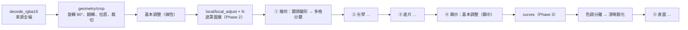

# 裁切、遮罩與細部曲線 Implementation Plan

> **For agentic workers:** REQUIRED SUB-SKILL: Use superpowers:subagent-driven-development (recommended) or superpowers:executing-plans to implement this plan task-by-task. Steps use checkbox (`- [ ]`) syntax for tracking.

**Goal:** 在 `dev-cutandmask` 分支依序加入 ① 裁切（含拉直、比例、翻轉）② 局部遮罩（顏色、線性、筆刷、多邊形、圓形，每個遮罩可調基本參數與曲線）③ 可調整的細部曲線（全域 RGB / 單色版 / 色相曲線）。

**Architecture:** 三個功能都沿用既有的「扁平 `Settings` → `ModuleParams` → CPU / GPU 雙管線」架構。裁切是一般的純量模組，在解碼後的第一個 pass 就把影像變成裁切後的畫框；曲線與遮罩是結構化資料，以兩個新的 `ParamKind`（`Curve`、`MaskStack`）存成**正規化的文字值**，因此三層覆寫、復原、預設、貼上、存檔全部不用改模型。遮罩的局部調整在線性段一次套用（幾何效果之前），全域曲線放在顯示段的基本調整之後。

**Tech Stack:** C# / .NET 10、Avalonia 12、CommunityToolkit.Mvvm、WebGPUSharp（Dawn）+ WGSL、xUnit（含 Avalonia.Headless）。

**Spec:** 本文件第 0 章即規格（使用者需求：「1. 裁切 2. 遮罩（簡單的顏色 & 線性 & 筆刷 & 多邊形 & 圓形），裡面可調整基本參數與曲線 3. 可調整的細部曲線」）。背景架構見 [../architecture.md](../architecture.md)、[../plan.md](../plan.md) 第 5、11 章。

## Global Constraints

- 分支：`dev-cutandmask`（由 `ai-denoise` 的 `00b2443` 分出）。
- 相依方向不變：Core 不引用 Avalonia / GPU；App 不直接呼叫 Gpu（見 architecture.md 2.1）。
- 新模組關閉或參數為預設值時，輸出必須與輸入**逐位元相同**（identity 測試）。
- 每個 CPU 演算法都要有對應的 GPU 實作，並以 `Gpu_MatchesCpu_*` 測試比對（無 GPU 時自動略過）。
- C# uniform record 與 WGSL `struct Params` 欄位順序、型別一致，16 位元組對齊。
- 新 shader 放在 `src/FilmBatch.Gpu/Shaders/v1/` 的新檔案（不改既有 shader 的數學，所以不需要 `v2/`）；改完一律 `dotnet run build/CheckShaders.cs`。
- 長度類參數（半徑、筆刷大小、羽化）以**短邊比例**儲存；位置類以 0–1 正規化座標儲存。
- 所有新增介面文字同時加進 `Strings.resx`（繁中）與 `Strings.en.resx`（英文，不可含中文）。
- 顏色只用 `Themes/Colors.axaml` 的 token；介面灰階 R = G = B。遮罩疊色是**影像內容**（由 shader 算），不是介面色。
- 每個 Task 結束時 `dotnet test` 全綠才 commit；commit 訊息結尾加 `Co-Authored-By` 行（依 repo 慣例）。

---

## 0. 範圍與順序

### 0.1 要做的事（依使用者指定順序）

| 階段 | 功能 | 內容 |
|---|---|---|
| **Phase 1** | 裁切 | 自由 / 固定比例裁切框、拉直（−45°～45°）、90° 旋轉、水平 / 垂直翻轉、三分線、自動限制在影像內；匯出與縮圖反映裁切 |
| **Phase 2** | 遮罩 | 最多 8 個遮罩圖層；每個圖層由最多 8 個形狀以「加 / 減 / 交集」組合；形狀類型：**顏色範圍、線性漸層、筆刷、多邊形、圓形（橢圓）**；每個圖層可調**基本參數**（曝光、色溫、色調、亮度、對比、亮部、暗部、飽和度）與**曲線**；圖層不透明度、反轉、紅色疊色檢視 |
| **Phase 3** | 細部曲線 | 全域 `curves` 模組：RGB 主曲線 + R / G / B 單色版曲線、RGB / 明度兩種套用模式、色相對色相 / 飽和度 / 明度與明度對飽和度曲線；完整曲線編輯器（直方圖底圖、精確數值、鍵盤微調、曲線範本） |

> **依賴說明**：遮罩「裡面可調整曲線」需要曲線的資料型別、LUT 烘焙與編輯器。為了維持使用者指定的順序，Phase 2 的 **Task 2.1 先做「曲線核心」最小版**（資料型別、單調樣條、LUT、只有主曲線的編輯器），Phase 3 在同一套元件上擴充成完整的細部曲線。

### 0.2 不做（本分支）

- AI 主體 / 天空遮罩、深度遮罩（之後可接 ADR 0002 的 ONNX 基礎設施）。
- 遮罩內的「細節提取 / 清晰度」等需要模糊核心的局部參數（每個圖層多一次模糊，成本高；列為後續）。
- 透視校正（keystone）、內容感知填補。
- 遮罩的「範圍遮罩」以明度 / 顏色限制其他形狀（Lightroom 的 Range Mask）——本版以「顏色形狀 + 交集」達成同樣效果。

### 0.3 時程估計

| 階段 | 估計 |
|---|---|
| Phase 1 裁切 | 1.5 週 |
| Phase 2 遮罩 | 4 週 |
| Phase 3 細部曲線 | 1.5 週 |
| 收尾（文件、冒煙、效能） | 0.5 週 |

---

## 1. 設計決策

### D1. 結構化參數存成「正規化文字值」

`Settings` 是「扁平 key → 純量」的不可變字典，三層合併、`PhotoOperations.Clean`（與基準相同就移除覆寫）、YAML 預設、`project.json`、貼上全部依賴它。曲線與遮罩以兩個新 `ParamKind` 表示，值的 `ValueKind` 仍是 `Text`：

| ParamKind | 文字格式 | 預設值 |
|---|---|---|
| `Curve` | `x,y;x,y;…`，座標 0–1、四位小數、依 x 遞增、2–16 點 | `0,0;1,1`（恆等） |
| `MaskStack` | 精簡 JSON（`{"v":1,"layers":[…]}`），數值四位小數 | `""`（空字串 = 沒有遮罩） |

**正規化是關鍵**：`ParamDef.Coerce` 會把值 parse 後再序列化，所以「內容相同 ⇔ 字串相同」，`Clean` 的相等比較不需要修改。parse 失敗時 `Coerce` 回傳預設值；`SettingsJsonConverter.Validate` / `PresetFile` 讀檔時 parse 失敗則丟 `InvalidDataException`（與既有的「範圍錯誤」行為一致）。

取捨：一個照片的整個遮罩堆疊是**一個覆寫單位**（改任何一個遮罩就覆寫整個 `local.masks`）。遮罩本來就以單張照片為主，這是可接受的；換來的是零模型改動。

### D2. 裁切在管線最前面



- 裁切後的畫框就是「照片」：暗角、漏光、顆粒、多格分鏡等都以裁切後的畫框計算（相當於 Lightroom 的 post-crop vignette），`ModuleParams` 的短邊也改用裁切後尺寸。
- GPU 工作紋理改以**輸出尺寸**配置；來源上傳紋理仍是原尺寸。

### D3. 座標系

| 對象 | 座標系 |
|---|---|
| 裁切框 | 「定向後」影像（套用 90° 旋轉與翻轉後、拉直前）的正規化座標；存中心點與寬高 |
| 遮罩形狀 | **定向後、裁切前**影像的正規化座標 → 重新裁切時遮罩跟著畫面內容走，不會跑掉 |
| 其他模組的 `center_x/y` | 裁切後畫框的正規化座標（行為不變） |

遮罩在 `local_adjust` 中評估時，以裁切變換把「輸出像素」映射回「定向座標」再算形狀。

### D4. 局部調整一次在線性段完成

每個遮罩圖層一個 pass：線性 → 曝光 / 色溫 / 色調 → 轉 sRGB → 亮度 / 對比 / 亮部 / 暗部 / 飽和度 → 圖層曲線 LUT → 轉回線性，再以遮罩值與原像素混合。放在幾何效果之前，之後的底片、光暈、顆粒都疊在局部調整的結果上（「先修圖、再模擬底片」）。

編輯遮罩時，預覽**暫停鏡頭變形與多格分鏡**（這兩者會移動像素，使畫布座標對不上），並在離開遮罩工具時恢復；裁切工具啟用時則暫停裁切、顯示全幅。這兩個「暫停」只影響預覽請求，不寫入照片設定。

### D5. 遮罩形狀的 GPU 實作

| 形狀 | GPU 作法 |
|---|---|
| 線性、圓形、顏色 | shader 內解析計算（uniform / storage buffer） |
| 多邊形 | 頂點放 storage buffer（每圖層 ≤ 64 點），shader 內 winding 測試 + 到邊距離做羽化 |
| 筆刷 | CPU 依筆觸點陣化成單通道遮罩（輸出尺寸的 1/2，以筆觸內容雜湊快取），上傳成 `r32float` 紋理，shader 雙線性取樣 |

CPU 參考實作用同一份數學（筆刷共用同一個點陣化函式），一致性測試比對兩者。

### D6. 相容性

- 新模組 `crop`、`local`、`curves` 預設關閉，舊專案外觀不變。
- 舊版程式開啟含新 key 的專案會因 `Unknown parameter` 失敗：在 `ProjectStorage` 把專案格式版本 +1，舊版顯示「專案由較新版本建立」而不是損毀訊息（Task 1.1 內處理）。
- 選擇性貼上新增「裁切」「局部調整」兩個分類，**全部貼上（Ctrl+V）預設不含這兩類**（裁切與遮罩通常只屬於單張照片，與 Lightroom 同步設定的預設一致）。

---

## 2. 檔案結構

| 動作 | 路徑 | 職責 |
|---|---|---|
| Modify | `src/FilmBatch.Core/Params/ParamDef.cs` | 新增 `ParamKind.Curve`、`ParamKind.MaskStack`、`ParamDef.Curve/MaskStack/MirrorAngle` 工廠、Coerce |
| Modify | `src/FilmBatch.Core/Params/ModuleSchema.cs` | `PasteCategory.Crop`、`PasteCategory.Local`；`ModuleGroup` 不變 |
| Modify | `src/FilmBatch.Core/Params/ModuleCatalog.cs` | 新模組 `crop`（最前）、`local`（basic 之後）、`curves`（film 之後、tone 之前） |
| Modify | `src/FilmBatch.Core/Params/SettingsJsonConverter.cs` | 新 kind 的驗證 |
| Modify | `src/FilmBatch.Core/Presets/PresetFile.cs` | 文字值 YAML 讀寫（確認長字串不被折行破壞） |
| Modify | `src/FilmBatch.Core/Projects/PhotoOperations.cs`、`SettingsClipboard.cs` | 新貼上分類、遮罩鏡像 |
| Modify | `src/FilmBatch.Core/Projects/ProjectStorage.cs` | 專案格式版本 +1 |
| Create | `src/FilmBatch.Core/Curves/ToneCurve.cs` | 曲線資料、parse / 序列化、單調樣條烘焙 |
| Create | `src/FilmBatch.Core/Curves/HueCurve.cs` | 週期性色相曲線（Phase 3） |
| Create | `src/FilmBatch.Core/Curves/CurvePresets.cs` | 曲線範本（Phase 3） |
| Create | `src/FilmBatch.Core/Masks/MaskModels.cs` | `MaskStack`、`MaskLayer`、各形狀 record、`LocalAdjust` |
| Create | `src/FilmBatch.Core/Masks/MaskStackCodec.cs` | JSON 正規化序列化、限制檢查 |
| Create | `src/FilmBatch.Core/Masks/MaskEdits.cs` | 純函式：新增 / 刪除 / 移動圖層與形狀、設定調整值、鏡像 |
| Create | `src/FilmBatch.Engine/Rendering/CropGeometry.cs` | 裁切仿射變換、限制在影像內 |
| Create | `src/FilmBatch.Engine/Rendering/MaskMath.cs` | 各形狀遮罩值（CPU，與 WGSL 同演算法） |
| Create | `src/FilmBatch.Engine/Rendering/BrushRasterizer.cs` | 筆觸點陣化（CPU / GPU 共用） |
| Create | `src/FilmBatch.Engine/Rendering/LocalAdjustments.cs` | CPU 局部調整 pass |
| Create | `src/FilmBatch.Engine/Rendering/RenderOverlay.cs` | 預覽專用的疊色 / 暫停選項（不進 Settings） |
| Modify | `src/FilmBatch.Engine/Rendering/ModuleParams.cs` | 解析 crop / local / curves；短邊改用裁切後尺寸 |
| Modify | `src/FilmBatch.Engine/Rendering/CpuPipeline.cs` | 插入 crop、local、curves |
| Modify | `src/FilmBatch.Engine/Rendering/GpuEffectPipeline.cs` | 新 kernel、工作紋理以輸出尺寸配置、uniform record |
| Modify | `src/FilmBatch.Engine/Rendering/IPreviewRenderer.cs`、`GpuSpikeRenderer.cs`、`CpuFakeRenderer.cs` | `RenderOverlay?` 參數；紋理上限檢查 |
| Modify | `src/FilmBatch.Engine/Exporting/BatchExporter.cs` | 以算圖結果尺寸（裁切後）縮放與寫 EXIF 尺寸 |
| Create | `src/FilmBatch.Gpu/Shaders/v1/geometry/crop.wgsl` | 裁切取樣 |
| Create | `src/FilmBatch.Gpu/Shaders/v1/local/local_adjust.wgsl` | 遮罩評估 + 局部調整 |
| Create | `src/FilmBatch.Gpu/Shaders/v1/local/mask_shapes.wgsl` | 形狀函式（被 include） |
| Create | `src/FilmBatch.Gpu/Shaders/v1/color/curves.wgsl` | 全域曲線（Phase 3） |
| Create | `src/FilmBatch.App/Controls/Tools/ICanvasTool.cs`、`CanvasMapping.cs` | 畫布工具介面與座標換算 |
| Create | `src/FilmBatch.App/Controls/Tools/CropTool.cs` | 裁切框互動與繪製 |
| Create | `src/FilmBatch.App/Controls/Tools/MaskTools.cs` | 線性 / 圓形 / 多邊形 / 筆刷 / 取色工具 |
| Modify | `src/FilmBatch.App/Controls/PreviewCanvas.cs` | `ActiveTool` 屬性；工具優先於控制點 |
| Create | `src/FilmBatch.App/Controls/CurveEditor.cs` | 曲線編輯器控制項 |
| Create | `src/FilmBatch.App/ViewModels/Tools/CropToolViewModel.cs` | 裁切工具狀態、比例、套用 / 取消 |
| Create | `src/FilmBatch.App/ViewModels/Local/MasksPanelViewModel.cs`、`MaskLayerViewModel.cs`、`MaskShapeViewModel.cs`、`MaskAdjustHost.cs` | 遮罩面板 |
| Create | `src/FilmBatch.App/ViewModels/CurveParamViewModel.cs` | 曲線參數（Inspector 與遮罩共用） |
| Modify | `src/FilmBatch.App/ViewModels/ParamViewModels.cs` | `Create` 支援 `Curve`；`MaskStack` 不在 Inspector 顯示 |
| Modify | `src/FilmBatch.App/ViewModels/SidebarViewModel.cs`、`MainWindowViewModel.cs`、`PreviewViewModel.cs` | 新分頁、工具模式、預覽請求調整 |
| Create | `src/FilmBatch.App/Views/MasksPanelView.axaml(.cs)` | 遮罩分頁 |
| Modify | `src/FilmBatch.App/Views/InspectorView.axaml`、`PreviewView.axaml`、`SidebarView.axaml` | 曲線 DataTemplate、裁切工具列、遮罩分頁 |
| Modify | `src/FilmBatch.App/Themes/Icons.axaml`、`Controls.axaml` | 新圖示與樣式 |
| Modify | `src/FilmBatch.App/Localization/Strings.resx`、`Strings.en.resx` | 文字 |
| Test | `tests/FilmBatch.Core.Tests/ToneCurveTests.cs`、`MaskStackCodecTests.cs`、`MaskEditsTests.cs`、`CropGeometryTests.cs`、`MaskMathTests.cs`、`LocalPipelineTests.cs`、`CurvesPipelineTests.cs` | 新測試 |
| Test | `tests/FilmBatch.App.Tests/CropToolTests.cs`、`MasksPanelTests.cs`、`CurveEditorTests.cs` | ViewModel / 控制項測試 |

---

# Phase 1：裁切

### Task 1.1：`crop` 模組 schema、鏡像角度與貼上分類

**Files:**
- Modify: `src/FilmBatch.Core/Params/ParamDef.cs`
- Modify: `src/FilmBatch.Core/Params/ModuleSchema.cs`（`PasteCategory`、`PasteCategoryLabel`）
- Modify: `src/FilmBatch.Core/Params/ModuleCatalog.cs`（`Modules` 陣列最前面）
- Modify: `src/FilmBatch.Core/Projects/PhotoOperations.cs`、`SettingsClipboard.cs`
- Modify: `src/FilmBatch.Core/Projects/ProjectStorage.cs`
- Test: `tests/FilmBatch.Core.Tests/PhotoOperationsTests.cs`、`PersistenceTests.cs`

**Interfaces:**
- Produces: flat keys `crop.enabled`、`crop.rect_cx`、`crop.rect_cy`、`crop.rect_w`、`crop.rect_h`、`crop.angle`、`crop.quarter`、`crop.flip_h`、`crop.flip_v`、`crop.aspect`、`crop.aspect_portrait`；`PasteCategory.Crop`、`PasteCategory.Local`；`ParamDef.MirrorAngle(string key, string label, double def, double min, double max)`。

> 中心點刻意命名為 `rect_cx/rect_cy` 而不是 `center_x/center_y`，避免 `ModuleSchema.HasCanvasPoint` 自動替裁切產生控制點。中心點用 `Position(..., PositionAxis.X)` 所以鏡像時自動 `1 − x`；角度用 `MirrorAngle`（`Axis = X`、`IsCenteredOffset = true`）所以鏡像時自動取負值，`PhotoOperations.MirrorValue` 不必改。

- [ ] **Step 1: 寫失敗的測試**

```csharp
// tests/FilmBatch.Core.Tests/PhotoOperationsTests.cs
[Fact]
public void Crop_Defaults_AreFullFrameAndDisabled()
{
    var d = ModuleCatalog.Defaults;
    Assert.False(d.Bool("crop.enabled"));
    Assert.Equal(0.5, d.Number("crop.rect_cx"));
    Assert.Equal(1.0, d.Number("crop.rect_w"));
    Assert.Equal("free", d.Text("crop.aspect"));
    Assert.Equal("crop", ModuleCatalog.Modules[0].Key);
}

[Fact]
public void Crop_Mirror_FlipsCenterAndNegatesAngle()
{
    Assert.Equal(0.3, PhotoOperations.MirrorValue(ModuleCatalog.Param("crop.rect_cx")!, 0.7).AsNumber, 6);
    Assert.Equal(-5.0, PhotoOperations.MirrorValue(ModuleCatalog.Param("crop.angle")!, 5.0).AsNumber, 6);
    Assert.Equal(0.4, PhotoOperations.MirrorValue(ModuleCatalog.Param("crop.rect_cy")!, 0.4).AsNumber, 6);
}

[Fact]
public void PasteAll_ExcludesCropAndLocalByDefault()
{
    var source = Entry("a.jpg", ("crop.enabled", true), ("crop.rect_w", 0.5), ("vignette.amount", 30.0));
    var target = Entry("b.jpg");
    var pasted = PhotoOperations.Paste(Clip(source), target, PasteOptions.All, _ => ModuleCatalog.Defaults);
    Assert.False(pasted.Overrides.ContainsKey("crop.rect_w"));
    Assert.Equal(30.0, pasted.Overrides.Number("vignette.amount"));
}
```

> `Entry`、`Clip` 是 `PhotoOperationsTests` 既有的輔助方法；若名稱不同，依檔案內現有輔助方法調整（不要另寫一套）。`Settings.Bool/Number/Text` 若名稱不同，以 `Settings.cs` 實際的存取方法為準。`PasteOptions.All` 對應目前「全部貼上」使用的選項物件。

- [ ] **Step 2: 執行確認失敗**

Run: `dotnet test tests/FilmBatch.Core.Tests --filter "FullyQualifiedName~PhotoOperationsTests"`
Expected: FAIL（`crop.enabled` 不存在 / `PasteCategory.Crop` 未定義）

- [ ] **Step 3: 實作**

```csharp
// ParamDef.cs
public static ParamDef MirrorAngle(string key, string label, double def, double min, double max, double step = 0.1) =>
    new() { Key = key, Label = label, Kind = ParamKind.Float, Default = def, Min = min, Max = max, Step = step,
            Unit = "°", Axis = PositionAxis.X, IsCenteredOffset = true };

// ModuleSchema.cs
public enum PasteCategory { Color, Optical, Surface, Crop, Local }
// PasteCategoryLabel 補 Crop => "裁切", Local => "局部調整"

// ModuleCatalog.cs —— Modules 陣列第一個元素
new("crop", "裁切", ModuleGroup.Geometry, PasteCategory.Crop,
[
    Bool(ModuleSchema.EnabledKey, "啟用"),
    Position("rect_cx", "中心 X", 0.5, PositionAxis.X),
    Position("rect_cy", "中心 Y", 0.5, PositionAxis.Y),
    Float("rect_w", "寬度", 1, 0.02, 1, 0.001),
    Float("rect_h", "高度", 1, 0.02, 1, 0.001),
    MirrorAngle("angle", "拉直", 0, -45, 45),
    Int("quarter", "旋轉 90°", 0, 0, 3),
    Bool("flip_h", "水平翻轉"),
    Bool("flip_v", "垂直翻轉"),
    Choice("aspect", "比例",
        O("free", "自由"), O("original", "原始"), O("1x1", "1:1"), O("4x5", "4:5"),
        O("3x2", "3:2"), O("16x9", "16:9"), O("6x7", "6:7"), O("xpan", "XPan 65:24")),
    Bool("aspect_portrait", "直式比例"),
]),
```

- `PhotoOperations.Paste`：「全部貼上」路徑跳過 `PasteCategory.Crop` 與 `PasteCategory.Local` 的模組；選擇性貼上照常依勾選。`SelectivePasteViewModel` 的分類清單會自動出現兩個新分類，預設**不勾選**。
- `ProjectStorage`：把寫入的格式版本常數 +1；讀到比自己新的版本時丟出可在地化的「專案由較新版本的 FilmBatch 建立」例外（`CoreText` 新增 key），測試鎖定。

- [ ] **Step 4: 執行確認通過**

Run: `dotnet test tests/FilmBatch.Core.Tests`
Expected: PASS（包含既有的 identity 測試——`crop` 預設關閉）

- [ ] **Step 5: 文字與 Commit**

`Strings.resx` / `Strings.en.resx` 加：`Module.crop`、`Param.crop.rect_cx/rect_cy/rect_w/rect_h/angle/quarter/flip_h/flip_v/aspect/aspect_portrait`、`Choice.crop.aspect.*`、`PasteCategory.Crop`、`PasteCategory.Local`。執行 `dotnet test tests/FilmBatch.App.Tests --filter "FullyQualifiedName~LocalizationTests"`。

```bash
git add -A
git commit -m "Add crop module schema and crop/local paste categories"
```

---

### Task 1.2：`CropGeometry`（變換、輸出尺寸、限制在影像內）

**Files:**
- Create: `src/FilmBatch.Engine/Rendering/CropGeometry.cs`
- Test: `tests/FilmBatch.Core.Tests/CropGeometryTests.cs`

**Interfaces:**
- Produces:
  - `readonly record struct CropParams(bool On, double Cx, double Cy, double W, double H, double AngleDeg, int Quarter, bool FlipH, bool FlipV)`
  - `readonly record struct Affine2(double M00, double M01, double M02, double M10, double M11, double M12)`，方法 `(double X, double Y) Apply(double x, double y)`、`Affine2 Then(Affine2 next)`、`Affine2 Inverse()`
  - `readonly record struct CropTransform(int OutWidth, int OutHeight, Affine2 OutToSource, Affine2 OutToOriented, int OrientedWidth, int OrientedHeight)`
  - `static class CropGeometry`：`CropTransform Compute(int srcW, int srcH, CropParams c)`、`bool FitsInside(int srcW, int srcH, CropParams c)`、`CropParams Constrain(int srcW, int srcH, CropParams c)`、`double AspectRatio(string key, bool portrait, int orientedW, int orientedH)`（`free` 回傳 `double.NaN`）

座標慣例：像素中心為 `(x + 0.5, y + 0.5)`；`OutToSource` 把輸出像素座標映到來源像素座標。

- [ ] **Step 1: 寫失敗的測試**

```csharp
public sealed class CropGeometryTests
{
    private static CropParams Full => new(true, 0.5, 0.5, 1, 1, 0, 0, false, false);

    [Fact]
    public void Disabled_IsIdentity()
    {
        var t = CropGeometry.Compute(400, 300, Full with { On = false });
        Assert.Equal((400, 300), (t.OutWidth, t.OutHeight));
        Assert.Equal((10.5, 20.5), t.OutToSource.Apply(10.5, 20.5));
    }

    [Fact]
    public void HalfCrop_TopLeftQuadrant()
    {
        var t = CropGeometry.Compute(400, 300, Full with { Cx = 0.25, Cy = 0.25, W = 0.5, H = 0.5 });
        Assert.Equal((200, 150), (t.OutWidth, t.OutHeight));
        var (x, y) = t.OutToSource.Apply(0, 0);
        Assert.Equal(0, x, 6); Assert.Equal(0, y, 6);
    }

    [Fact]
    public void Quarter1_SwapsDimensions_AndRotatesClockwise()
    {
        var t = CropGeometry.Compute(400, 300, Full with { Quarter = 1 });
        Assert.Equal((300, 400), (t.OutWidth, t.OutHeight));
        // 順時針 90°：輸出左上角來自來源左下角
        var (x, y) = t.OutToSource.Apply(0, 0);
        Assert.Equal(0, x, 6); Assert.Equal(300, y, 6);
    }

    [Fact]
    public void FlipH_MirrorsX()
    {
        var t = CropGeometry.Compute(400, 300, Full with { FlipH = true });
        Assert.Equal(400 - 10.5, t.OutToSource.Apply(10.5, 5).X, 6);
    }

    [Fact]
    public void Straighten_FullFrame_DoesNotFit_ConstrainShrinksUntilItFits()
    {
        var c = Full with { AngleDeg = 10 };
        Assert.False(CropGeometry.FitsInside(400, 300, c));
        var fixedC = CropGeometry.Constrain(400, 300, c);
        Assert.True(CropGeometry.FitsInside(400, 300, fixedC));
        Assert.Equal(c.W / c.H, fixedC.W / fixedC.H, 6);   // 等比縮小，比例不變
        Assert.True(fixedC.W > 0.7);                        // 不會縮過頭
    }

    [Theory]
    [InlineData("1x1", false, 400, 300, 1.0)]
    [InlineData("3x2", false, 400, 300, 1.5)]
    [InlineData("3x2", true, 400, 300, 2.0 / 3.0)]
    [InlineData("original", false, 400, 300, 4.0 / 3.0)]
    public void AspectRatio_IsPixelRatio(string key, bool portrait, int w, int h, double expected) =>
        Assert.Equal(expected, CropGeometry.AspectRatio(key, portrait, w, h), 6);
}
```

- [ ] **Step 2: 執行確認失敗**

Run: `dotnet test tests/FilmBatch.Core.Tests --filter "FullyQualifiedName~CropGeometryTests"`
Expected: FAIL（`CropGeometry` 不存在）

- [ ] **Step 3: 實作**

```csharp
namespace FilmBatch.Engine.Rendering;

public readonly record struct CropParams(bool On, double Cx, double Cy, double W, double H,
    double AngleDeg, int Quarter, bool FlipH, bool FlipV);

/// <summary>2D 仿射：(x, y) → (M00·x + M01·y + M02, M10·x + M11·y + M12)。</summary>
public readonly record struct Affine2(double M00, double M01, double M02, double M10, double M11, double M12)
{
    public static Affine2 Identity => new(1, 0, 0, 0, 1, 0);
    public (double X, double Y) Apply(double x, double y) => (M00 * x + M01 * y + M02, M10 * x + M11 * y + M12);
    /// <summary>先套用 this，再套用 next。</summary>
    public Affine2 Then(Affine2 n) => new(
        n.M00 * M00 + n.M01 * M10, n.M00 * M01 + n.M01 * M11, n.M00 * M02 + n.M01 * M12 + n.M02,
        n.M10 * M00 + n.M11 * M10, n.M10 * M01 + n.M11 * M11, n.M10 * M02 + n.M11 * M12 + n.M12);
    public Affine2 Inverse()
    {
        var det = M00 * M11 - M01 * M10;
        var a = M11 / det; var b = -M01 / det; var d = -M10 / det; var e = M00 / det;
        return new(a, b, -(a * M02 + b * M12), d, e, -(d * M02 + e * M12));
    }
}

public readonly record struct CropTransform(int OutWidth, int OutHeight, Affine2 OutToSource,
    Affine2 OutToOriented, int OrientedWidth, int OrientedHeight);

/// <summary>
/// 裁切幾何：來源 →（90° 旋轉、翻轉）→ 定向影像 →（以裁切中心拉直）→ 裁切框。
/// 裁切框以定向影像的正規化座標表示（中心 + 寬高）。CPU 與 crop.wgsl 共用此變換。
/// </summary>
public static class CropGeometry
{
    public static CropTransform Compute(int srcW, int srcH, CropParams c)
    {
        if (!c.On) return new(srcW, srcH, Affine2.Identity, Affine2.Identity, srcW, srcH);
        var q = ((c.Quarter % 4) + 4) % 4;
        var (ow, oh) = q % 2 == 1 ? (srcH, srcW) : (srcW, srcH);
        var outW = Math.Max(1, (int)Math.Round(c.W * ow));
        var outH = Math.Max(1, (int)Math.Round(c.H * oh));
        var a = c.AngleDeg * Math.PI / 180;
        var (cos, sin) = (Math.Cos(a), Math.Sin(a));
        // 輸出 → 定向：以輸出中心為原點旋轉，再平移到裁切中心
        var outToOriented = new Affine2(1, 0, -outW / 2.0, 0, 1, -outH / 2.0)
            .Then(new Affine2(cos, -sin, 0, sin, cos, 0))
            .Then(new Affine2(1, 0, c.Cx * ow, 0, 1, c.Cy * oh));
        return new(outW, outH, outToOriented.Then(OrientedToSource(srcW, srcH, ow, oh, q, c.FlipH, c.FlipV)),
            outToOriented, ow, oh);
    }

    /// <summary>定向座標 → 來源座標：先還原翻轉，再逆旋轉 90° 倍數（順時針為正）。</summary>
    private static Affine2 OrientedToSource(int srcW, int srcH, int ow, int oh, int q, bool flipH, bool flipV)
    {
        var unflip = new Affine2(flipH ? -1 : 1, 0, flipH ? ow : 0, 0, flipV ? -1 : 1, flipV ? oh : 0);
        var unrotate = q switch
        {
            1 => new Affine2(0, 1, 0, -1, 0, srcH),          // 順時針 90° 的逆
            2 => new Affine2(-1, 0, srcW, 0, -1, srcH),
            3 => new Affine2(0, -1, srcW, 1, 0, 0),
            _ => Affine2.Identity,
        };
        return unflip.Then(unrotate);
    }

    public static bool FitsInside(int srcW, int srcH, CropParams c)
    {
        var t = Compute(srcW, srcH, c);
        const double eps = 1e-6;
        foreach (var (x, y) in new[] { (0.0, 0.0), (t.OutWidth, 0.0), (0.0, t.OutHeight), (t.OutWidth, (double)t.OutHeight) })
        {
            var (sx, sy) = t.OutToSource.Apply(x, y);
            if (sx < -eps || sy < -eps || sx > srcW + eps || sy > srcH + eps) return false;
        }
        return true;
    }

    /// <summary>先把中心夾回 0–1，若仍超出影像就以二分搜尋等比縮小寬高（比例不變）。</summary>
    public static CropParams Constrain(int srcW, int srcH, CropParams c)
    {
        c = c with { Cx = Math.Clamp(c.Cx, c.W / 2, 1 - c.W / 2), Cy = Math.Clamp(c.Cy, c.H / 2, 1 - c.H / 2) };
        if (FitsInside(srcW, srcH, c)) return c;
        double lo = 0, hi = 1;
        for (var i = 0; i < 40; i++)
        {
            var mid = (lo + hi) / 2;
            if (FitsInside(srcW, srcH, c with { W = c.W * mid, H = c.H * mid })) lo = mid; else hi = mid;
        }
        return c with { W = Math.Max(0.02, c.W * lo), H = Math.Max(0.02, c.H * lo) };
    }

    public static double AspectRatio(string key, bool portrait, int orientedW, int orientedH)
    {
        double r = key switch
        {
            "original" => (double)Math.Max(orientedW, orientedH) / Math.Min(orientedW, orientedH),
            "1x1" => 1, "4x5" => 5.0 / 4, "3x2" => 1.5, "16x9" => 16.0 / 9, "6x7" => 7.0 / 6, "xpan" => 65.0 / 24,
            _ => double.NaN,
        };
        if (double.IsNaN(r)) return r;
        // original 依影像本身方向；其他比例以 portrait 決定橫直
        var landscape = key == "original" ? orientedW >= orientedH : !portrait;
        return landscape ? r : 1 / r;
    }
}
```

> 注意 `4x5`、`6x7` 的數字是「短:長」的慣用寫法，所以換算成「長 / 短」的比值。`Quarter1` 測試的期望值若與上面 `unrotate` 的方向相反，代表測試與實作對「順時針」定義不一致——以 UI 的「向右旋轉」按鈕是順時針為準修正實作，不要改測試的意圖。

- [ ] **Step 4: 執行確認通過**

Run: `dotnet test tests/FilmBatch.Core.Tests --filter "FullyQualifiedName~CropGeometryTests"`
Expected: PASS

- [ ] **Step 5: Commit**

```bash
git add src/FilmBatch.Engine/Rendering/CropGeometry.cs tests/FilmBatch.Core.Tests/CropGeometryTests.cs
git commit -m "Add crop geometry transform and constraint"
```

---

### Task 1.3：CPU 管線裁切 + `ModuleParams` 改用輸出尺寸

**Files:**
- Modify: `src/FilmBatch.Engine/Rendering/ModuleParams.cs`（`From` 解析 `Crop`、`CropTransform`；`ShortSide` 與種子以輸出尺寸計算）
- Modify: `src/FilmBatch.Engine/Rendering/CpuPipeline.cs`（`Process` 第一步）
- Test: `tests/FilmBatch.Core.Tests/EffectPipelineTests.cs`

**Interfaces:**
- Consumes: `CropGeometry.Compute`、`CropParams`
- Produces: `ModuleParams.Crop`（`CropParams`）、`ModuleParams.CropT`（`CropTransform`）、`ModuleParams.OutWidth/OutHeight`；`CpuPipeline.Crop(float[] srcLinear, int srcW, int srcH, CropTransform t) → float[]`（雙線性取樣，超出邊界以邊緣像素延伸）

- [ ] **Step 1: 寫失敗的測試**

```csharp
[Fact]
public void Crop_Disabled_IsBitIdentical()
{
    var src = Gradient(64, 48);
    var outImg = CpuPipeline.Process(src, ModuleCatalog.Defaults, null, default);
    Assert.Equal(src.Rgba16, outImg.Rgba16);
}

[Fact]
public void Crop_HalfWidth_OutputsCroppedRegion()
{
    var src = Gradient(64, 48);   // 左暗右亮的水平漸層
    var s = ModuleCatalog.Defaults.With("crop.enabled", true).With("crop.rect_w", 0.5).With("crop.rect_cx", 0.75);
    var outImg = CpuPipeline.Process(src, s, null, default);
    Assert.Equal((32, 48), (outImg.Width, outImg.Height));
    Assert.True(MaxAbsDiff(Column(outImg, 0), Column(src, 32)) <= 2);   // 只有雙線性四捨五入誤差
}

[Fact]
public void Crop_VignetteUsesCroppedFrame()
{
    var src = Flat(80, 40, 40000);
    var s = ModuleCatalog.Defaults.With("crop.enabled", true).With("crop.rect_w", 0.5).With("crop.rect_cx", 0.25)
        .With("vignette.enabled", true).With("vignette.amount", -80.0);
    var outImg = CpuPipeline.Process(src, s, null, default);
    // 暗角中心在裁切後畫框中心（40×40 的中心），不是原圖中心
    Assert.True(Pixel(outImg, 20, 20) > Pixel(outImg, 0, 0));
    Assert.Equal(Pixel(outImg, 0, 20), Pixel(outImg, 39, 20), 2);
}
```

> 在測試檔加 `Gradient(w, h)`（R=G=B 依 x 線性 0→65535）、`Column(img, x)`、`Pixel(img, x, y)`（回傳該點 R）三個小輔助方法，與既有 `Flat` 放在一起。

- [ ] **Step 2: 執行確認失敗**

Run: `dotnet test tests/FilmBatch.Core.Tests --filter "FullyQualifiedName~EffectPipelineTests.Crop"`
Expected: FAIL（輸出尺寸仍為 64×48）

- [ ] **Step 3: 實作**

- `ModuleParams.From(SourceImage source, Settings s)`：讀 `crop.*` 成 `CropParams`，`CropT = CropGeometry.Compute(source.Width, source.Height, Crop)`；所有以短邊計算的欄位改用 `Math.Min(CropT.OutWidth, CropT.OutHeight)`。
- `CpuPipeline.Process`：解碼成線性 float 後，若 `p.Crop.On` 就呼叫 `Crop(...)` 取得新的緩衝區與 `w/h`，後續所有模組使用新尺寸；`outRgba16` 長度檢查改用輸出尺寸；回傳的 `SourceImage` 為輸出尺寸。
- `Crop` 以像素中心取樣：`(sx, sy) = t.OutToSource.Apply(x + 0.5, y + 0.5)`，再減 0.5 做雙線性。

- [ ] **Step 4: 執行確認通過**

Run: `dotnet test tests/FilmBatch.Core.Tests`
Expected: PASS

- [ ] **Step 5: Commit**

```bash
git add -A
git commit -m "Apply crop first in CPU pipeline and size effects by cropped frame"
```

---

### Task 1.4：GPU 裁切 pass 與工作紋理以輸出尺寸配置

**Files:**
- Create: `src/FilmBatch.Gpu/Shaders/v1/geometry/crop.wgsl`
- Modify: `src/FilmBatch.Engine/Rendering/GpuEffectPipeline.cs`（`K("geometry/crop", …)`、`Acquire` / 工作紋理配置、`CropUniforms`）
- Modify: `src/FilmBatch.Engine/Rendering/GpuSpikeRenderer.cs`（紋理上限檢查用 `max(來源, 輸出)`）
- Test: `tests/FilmBatch.Core.Tests/EffectPipelineTests.cs`（`Gpu_MatchesCpu_Crop`）

**Interfaces:**
- Consumes: `ModuleParams.CropT`
- Produces: `CropUniforms(float M00, float M01, float M02, float SrcW, float M10, float M11, float M12, float SrcH)`（32 位元組）

- [ ] **Step 1: 寫失敗的測試**

```csharp
[Theory]
[InlineData(0.0, 0, false)]
[InlineData(7.5, 0, false)]
[InlineData(0.0, 1, true)]
[InlineData(-12.0, 3, false)]
public void Gpu_MatchesCpu_Crop(double angle, int quarter, bool flip)
{
    using var gpu = TryCreateGpu(); SkipWhenNoGpu(gpu);       // 沿用 GpuSpikeTests 的慣例
    var src = Gradient(96, 64);
    var s = ModuleCatalog.Defaults.With("crop.enabled", true).With("crop.rect_w", 0.6).With("crop.rect_h", 0.6)
        .With("crop.angle", angle).With("crop.quarter", quarter).With("crop.flip_h", flip);
    var cpu = CpuPipeline.Process(src, s, null, default);
    var gpuOut = RenderGpu16(gpu, src, s);
    Assert.Equal((cpu.Width, cpu.Height), (gpuOut.Width, gpuOut.Height));
    Assert.True(MaxAbsDiff(cpu.Rgba16, gpuOut.Rgba16) <= 64);  // 與其他幾何模組相同容差
}
```

> `TryCreateGpu` / `SkipWhenNoGpu` / `RenderGpu16` 以 `EffectPipelineTests` 中既有 GPU 比對測試使用的同名或等價輔助方法為準。

- [ ] **Step 2: 執行確認失敗**

Run: `dotnet test tests/FilmBatch.Core.Tests --filter "FullyQualifiedName~Gpu_MatchesCpu_Crop"`
Expected: FAIL（尺寸不符）或 SKIP（無 GPU——此時在有 GPU 的機器或 CI 驗證）

- [ ] **Step 3: 實作 shader**

```wgsl
// geometry/crop.wgsl —— 輸出像素 → 來源座標（CropGeometry.OutToSource），雙線性取樣、邊緣延伸。
#include "common/sampling.wgsl"

struct Params { m00: f32, m01: f32, m02: f32, src_w: f32, m10: f32, m11: f32, m12: f32, src_h: f32 }

@group(0) @binding(0) var src: texture_2d<f32>;
@group(0) @binding(1) var dst: texture_storage_2d<rgba32float, write>;
@group(0) @binding(2) var<uniform> p: Params;

@compute @workgroup_size(16, 16)
fn main(@builtin(global_invocation_id) id: vec3u) {
    let size = textureDimensions(dst);
    if (id.x >= size.x || id.y >= size.y) { return; }
    let o = vec2f(id.xy) + 0.5;
    let s = vec2f(p.m00 * o.x + p.m01 * o.y + p.m02, p.m10 * o.x + p.m11 * o.y + p.m12);
    textureStore(dst, id.xy, sample_bilinear_clamped(src, s - 0.5));
}
```

> 若 `common/sampling.wgsl` 的雙線性函式名稱不同，使用既有的那支（`lens_distortion.wgsl` 也在用）；不要再寫一份。

- [ ] **Step 4: 實作管線**

- 建構子：`_crop = K("geometry/crop", tex, storage, uniform);`
- `Render` / `Render16`：上傳與 `decode_rgba16` 仍用來源尺寸（`SourceTextures.Linear`），工作紋理（`_work[0..3]`）改以 `p.CropT.OutWidth/OutHeight` 配置；`Crop.On` 時先派送 `_crop` 把 `Linear` 取樣到 `_work[0]`，否則沿用原本路徑（identity 不多一個 pass）。
- `Finish` 讀回尺寸改用輸出尺寸。
- 執行 `dotnet run build/CheckShaders.cs`。

- [ ] **Step 5: 執行確認通過並 Commit**

Run: `dotnet test tests/FilmBatch.Core.Tests` → PASS

```bash
git add -A
git commit -m "Add GPU crop pass and allocate work textures at output size"
```

---

### Task 1.5：匯出、縮圖、CLI 反映裁切

**Files:**
- Modify: `src/FilmBatch.Engine/Exporting/BatchExporter.cs`（`ProcessOne`：縮放與 EXIF 尺寸用算圖結果尺寸）
- Test: `tests/FilmBatch.Core.Tests/BatchExporterTests.cs`

- [ ] **Step 1: 寫失敗的測試**

```csharp
[Fact]
public async Task Export_CroppedPhoto_HasCroppedDimensions()
{
    var (folder, project) = await NewProjectWithJpeg(400, 300);          // 既有輔助方法
    project.Service.SetValue(["a.jpg"], "crop.enabled", true, null);
    project.Service.SetValue(["a.jpg"], "crop.rect_w", 0.5, null);
    var result = await Export(project, new ExportOptions { Format = ExportFormat.Jpeg });
    using var img = new MagickImage(result.Single().OutputPath);
    Assert.Equal((200u, 300u), (img.Width, img.Height));
}
```

- [ ] **Step 2:** Run `dotnet test tests/FilmBatch.Core.Tests --filter "FullyQualifiedName~Export_CroppedPhoto"` → FAIL（或寫檔失敗於緩衝區長度）
- [ ] **Step 3:** `ProcessOne` 以 `Render16` 回傳影像的 `Width/Height` 做長邊縮放、寫 EXIF `PixelXDimension/PixelYDimension`；確認 `outRgba16` 緩衝區以輸出尺寸配置。縮圖走同一條算圖路徑，不需修改——在 `FilmstripMenuTests` 或手動檢查縮圖比例。
- [ ] **Step 4:** Run `dotnet test` → PASS
- [ ] **Step 5:** Commit `git commit -am "Export and thumbnails use cropped dimensions"`

---

### Task 1.6：畫布工具框架 + 裁切工具

**Files:**
- Create: `src/FilmBatch.App/Controls/Tools/ICanvasTool.cs`、`CanvasMapping.cs`、`CropTool.cs`
- Create: `src/FilmBatch.App/ViewModels/Tools/CropToolViewModel.cs`
- Modify: `src/FilmBatch.App/Controls/PreviewCanvas.cs`、`ViewModels/PreviewViewModel.cs`、`ViewModels/MainWindowViewModel.cs`、`Views/PreviewView.axaml`、`Themes/Icons.axaml`
- Test: `tests/FilmBatch.App.Tests/CropToolTests.cs`

**Interfaces:**
- Produces:

```csharp
// CanvasMapping：影像在畫布上的矩形 ↔ 正規化座標（0–1，相對於目前顯示的影像）
public readonly record struct CanvasMapping(Rect ImageRect)
{
    public Point ToImage(Point canvas) => new((canvas.X - ImageRect.X) / ImageRect.Width, (canvas.Y - ImageRect.Y) / ImageRect.Height);
    public Point ToCanvas(Point image) => new(ImageRect.X + image.X * ImageRect.Width, ImageRect.Y + image.Y * ImageRect.Height);
}

public interface ICanvasTool
{
    void Render(DrawingContext ctx, CanvasMapping map);
    /// <returns>true 表示工具接手這次拖曳（不平移畫布）。</returns>
    bool OnPressed(Point canvas, CanvasMapping map, KeyModifiers mods);
    void OnMoved(Point canvas, CanvasMapping map, KeyModifiers mods);
    void OnReleased(Point canvas, CanvasMapping map);
    /// <summary>工具狀態改變需重繪。</summary>
    event Action? Invalidated;
}
```

- `PreviewCanvas.ActiveTool`（`StyledProperty<ICanvasTool?>`）：非 null 時指標事件先交給工具；工具回傳 false 才走原本的平移 / 控制點邏輯。
- `CropToolViewModel`（`ObservableObject`）：
  - `[ObservableProperty] bool isActive`、`CropParams Working`、`string Aspect`、`bool Portrait`
  - `[RelayCommand] Begin()`、`Apply()`、`Cancel()`、`RotateLeft()`、`RotateRight()`、`FlipHorizontal()`、`FlipVertical()`、`Reset()`、`SwapOrientation()`
  - `void DragHandle(CropHandle handle, Point delta, bool fromCenter)`、`void DragMove(Point delta)`、`void DragRotate(double deltaDeg)`——全部在內部呼叫 `CropGeometry.Constrain`
  - 建構子注入 `Action<Settings> commit`（一次寫入多個 `crop.*` 鍵，包成一筆復原紀錄）與 `Func<(int W, int H)> sourceSize`
- `CropTool : ICanvasTool`：繪製全幅影像上的裁切框（框外以半透明黑遮住）、8 個把手、三分線（拖曳時）、拉直時改顯示細格線；框內拖曳 = 移動、把手 = 改大小（`Alt` 以中心縮放、固定比例時鎖比例）、框外拖曳 = 旋轉。

**互動與快捷鍵**

| 操作 | 行為 |
|---|---|
| `R` / 預覽底部工具列裁切按鈕 | 進入裁切工具；預覽請求以 `crop.enabled=false` 渲染全幅 |
| `Enter` / 再按 `R` / 點兩下框內 | 套用（`Apply`） |
| `Esc` | 取消，回到進入前的值 |
| `X` | 切換直式 / 橫式比例 |
| `[` / `]` | 向左 / 向右旋轉 90° |
| 底部工具列 | 比例下拉、拉直滑桿、翻轉、重設 |

- [ ] **Step 1: 寫失敗的測試**

```csharp
public sealed class CropToolTests
{
    private static (CropToolViewModel Vm, List<Settings> Commits) Create()
    {
        var commits = new List<Settings>();
        var vm = new CropToolViewModel(commits.Add, () => (400, 300));
        vm.Load(ModuleCatalog.Defaults);
        return (vm, commits);
    }

    [Fact]
    public void FixedAspect_ResizeKeepsRatio()
    {
        var (vm, _) = Create();
        vm.BeginCommand.Execute(null);
        vm.Aspect = "1x1";
        vm.DragHandle(CropHandle.Right, new Point(-0.2, 0), fromCenter: false);
        var px = vm.Working.W * 400 / (vm.Working.H * 300);
        Assert.Equal(1.0, px, 3);
    }

    [Fact]
    public void Cancel_RestoresOriginal_AndCommitsNothing()
    {
        var (vm, commits) = Create();
        vm.BeginCommand.Execute(null);
        vm.DragMove(new Point(0.1, 0));
        vm.CancelCommand.Execute(null);
        Assert.Empty(commits);
        Assert.Equal(0.5, vm.Working.Cx, 6);
    }

    [Fact]
    public void Apply_CommitsSingleSettingsWithEnabled()
    {
        var (vm, commits) = Create();
        vm.BeginCommand.Execute(null);
        vm.DragHandle(CropHandle.Left, new Point(0.25, 0), false);
        vm.ApplyCommand.Execute(null);
        var s = Assert.Single(commits);
        Assert.True(s.Bool("crop.enabled"));
        Assert.Equal(0.75, s.Number("crop.rect_w"), 3);
    }

    [Fact]
    public void Rotate_ShrinksToStayInside()
    {
        var (vm, _) = Create();
        vm.BeginCommand.Execute(null);
        vm.DragRotate(10);
        Assert.True(CropGeometry.FitsInside(400, 300, vm.Working));
    }
}
```

- [ ] **Step 2:** Run `dotnet test tests/FilmBatch.App.Tests --filter "FullyQualifiedName~CropToolTests"` → FAIL
- [ ] **Step 3: 實作 ViewModel 與工具**
  - `MainWindowViewModel`：持有 `CropTool`（`CropToolViewModel`）；`commit` 委派呼叫新的 `ProjectService.SetValues(IReadOnlyList<string> files, Settings values, string description)`（依 architecture.md 5.3 新增：`PhotoOperations.SetValues` 純函式 + 一筆 `PhotoEditCommand`，並在 `ProjectServiceTests` 加「一次復原就還原全部 crop 鍵」的測試）。
  - `RequestPreview`：`CropTool.IsActive` 時送出的設定為 `resolved.With("crop.enabled", false)`；`PreviewViewModel.ActiveTool` 指向 `CropTool` 的畫布工具。
  - 多選時裁切只作用於焦點照片（裁切工具按鈕在多選時仍可用，套用後提示「只套用到目前照片」——toast 文字 `Toast.CropFocusedOnly`）。
- [ ] **Step 4:** Run `dotnet test` → PASS；`dotnet run --project src/FilmBatch.App -- --gallery` 檢查裁切工具列外觀，再實際開一張照片操作（拖曳、旋轉、固定比例、Esc、Enter、復原）。
- [ ] **Step 5:** 文字（`Tool.Crop`、`Tool.Crop.Apply`、`Tool.Crop.Cancel`、`Tool.Crop.Straighten`、`Tool.Crop.RotateLeft/Right`、`Tool.Crop.FlipH/V`、`Tool.Crop.Reset`、`Toast.CropFocusedOnly`、快捷鍵說明）→ Commit `git commit -am "Add canvas tool framework and interactive crop tool"`

### Task 1.7（選做）：裁切後預覽清晰度

裁切是在預覽代理圖上做的；大幅裁切後放大會變糊。

- [ ] `ImageCache` 新增 `GetPreviewAsync(path, cropFraction)`：當 `max(rect_w, rect_h) < 0.75` 時以 `PreviewLongEdge / max(rect_w, rect_h)` 解碼（上限 2 倍或 8192 px），快取 key 加上這個長邊。
- [ ] `ImageCacheTests`：小裁切比例時要求的長邊較大、上限生效。
- [ ] Commit `git commit -am "Decode larger preview proxy for tight crops"`

---

# Phase 2：遮罩

### Task 2.1：曲線核心（`ToneCurve`、`ParamKind.Curve`、最小編輯器）

> 遮罩內的曲線需要這個元件；Phase 3 會在此基礎上擴充。

**Files:**
- Create: `src/FilmBatch.Core/Curves/ToneCurve.cs`
- Modify: `src/FilmBatch.Core/Params/ParamDef.cs`、`SettingsJsonConverter.cs`
- Create: `src/FilmBatch.App/Controls/CurveEditor.cs`
- Create: `src/FilmBatch.App/ViewModels/CurveParamViewModel.cs`
- Modify: `src/FilmBatch.App/ViewModels/ParamViewModels.cs`、`Views/InspectorView.axaml`
- Test: `tests/FilmBatch.Core.Tests/ToneCurveTests.cs`、`tests/FilmBatch.App.Tests/CurveEditorTests.cs`

**Interfaces:**
- Produces:

```csharp
namespace FilmBatch.Core.Curves;
public readonly record struct CurvePoint(double X, double Y);
public sealed class ToneCurve : IEquatable<ToneCurve>
{
    public const int MaxPoints = 16;
    public const int LutSize = 1024;
    public IReadOnlyList<CurvePoint> Points { get; }
    public static ToneCurve Identity { get; }
    public bool IsIdentity { get; }
    public static ToneCurve Create(IEnumerable<CurvePoint> points);     // 夾範圍、排序、去重、截到 16 點、四位小數
    public static bool TryParse(string text, out ToneCurve curve);
    public string Serialize();                                          // "x,y;x,y"
    public double Evaluate(double x);                                   // 單調三次（Fritsch–Carlson）
    public float[] Bake(int size = LutSize);
}
```

- `ParamKind.Curve`；`ParamDef.Curve(string key, string label)`（`Default = "0,0;1,1"`）；`Coerce`：`TryParse` 成功回傳 `Serialize()`，否則 `Default`。
- `SettingsJsonConverter.Validate`：`Curve` 期望 `ValueKind.Text` 且 `TryParse` 成功。
- `CurveEditor : Control`：`Points`（`IReadOnlyList<CurvePoint>`）、`StrokeBrush`、事件 `PointsEdited(IReadOnlyList<CurvePoint> points, bool isFinal)`。
- `CurveParamViewModel : ParamViewModel`：`Points` 屬性；`OnEdited(points, isFinal)` → `Host.SetValue(FlatKey, ToneCurve.Create(points).Serialize(), isFinal ? null : FlatKey)`，`isFinal` 時再 `Host.EndEdit()`。

- [ ] **Step 1: 寫失敗的測試**

```csharp
public sealed class ToneCurveTests
{
    [Fact]
    public void Identity_BakesToLinearRamp()
    {
        var lut = ToneCurve.Identity.Bake(5);
        Assert.Equal(new[] { 0f, 0.25f, 0.5f, 0.75f, 1f }, lut);
    }

    [Fact]
    public void Parse_Normalizes_SortsClampsAndRounds()
    {
        Assert.True(ToneCurve.TryParse("1,1;0,0;0.5,0.612345;0.5,0.7;1.2,-1", out var c));
        Assert.Equal("0,0;0.5,0.6123;1,1", c.Serialize());   // x 重複保留第一個；超出範圍的點夾回後與 (1,1) 重複被移除
    }

    [Theory]
    [InlineData("")]
    [InlineData("abc")]
    [InlineData("0,0")]          // 少於 2 點
    public void Parse_RejectsInvalid(string text) => Assert.False(ToneCurve.TryParse(text, out _));

    [Fact]
    public void Monotone_NoOvershoot()
    {
        var c = ToneCurve.Create([new(0, 0), new(0.3, 0.05), new(0.35, 0.9), new(1, 1)]);
        var lut = c.Bake();
        for (var i = 1; i < lut.Length; i++) Assert.True(lut[i] >= lut[i - 1] - 1e-6f);
        Assert.All(lut, v => Assert.InRange(v, 0f, 1f));
    }

    [Fact]
    public void Coerce_InvalidCurve_FallsBackToDefault()
    {
        var def = ParamDef.Curve("master", "主曲線");
        Assert.Equal("0,0;1,1", def.Coerce("garbage").AsText);
    }

    [Fact]
    public void EqualContent_SerializesIdentically()   // Clean 依賴字串相等
    {
        var a = ToneCurve.Create([new(0, 0), new(0.5, 0.6), new(1, 1)]);
        Assert.True(ToneCurve.TryParse("0.00000,0;0.5,0.60001;1,1", out var b));
        Assert.Equal(a.Serialize(), b.Serialize());
    }
}
```

- [ ] **Step 2:** Run `dotnet test tests/FilmBatch.Core.Tests --filter "FullyQualifiedName~ToneCurveTests"` → FAIL
- [ ] **Step 3: 實作 `ToneCurve`**

```csharp
using System.Globalization;

namespace FilmBatch.Core.Curves;

/// <summary>
/// 色調曲線：2–16 個控制點，0–1 座標，依 x 遞增。以 Fritsch–Carlson 單調三次樣條內插（不會過衝），
/// 曲線外側水平延伸。序列化格式 "x,y;x,y"（四位小數），內容相同 ⇔ 字串相同。
/// </summary>
public sealed class ToneCurve : IEquatable<ToneCurve>
{
    public const int MaxPoints = 16;
    public const int LutSize = 1024;
    private readonly double[] _xs, _ys, _ms;

    public IReadOnlyList<CurvePoint> Points { get; }
    public static ToneCurve Identity { get; } = Create([new(0, 0), new(1, 1)]);
    public bool IsIdentity => Points.Count == 2 && Points[0] == new CurvePoint(0, 0) && Points[1] == new CurvePoint(1, 1);

    private ToneCurve(List<CurvePoint> points)
    {
        Points = points;
        _xs = points.Select(p => p.X).ToArray();
        _ys = points.Select(p => p.Y).ToArray();
        _ms = Tangents(_xs, _ys);
    }

    public static ToneCurve Create(IEnumerable<CurvePoint> points)
    {
        var list = new List<CurvePoint>();
        foreach (var p in points
            .Select(p => new CurvePoint(R(Math.Clamp(p.X, 0, 1)), R(Math.Clamp(p.Y, 0, 1))))
            .OrderBy(p => p.X))
            if (list.Count == 0 || list[^1].X != p.X) list.Add(p);
        if (list.Count > MaxPoints) list = [.. list.Take(MaxPoints - 1), list[^1]];
        if (list.Count < 2) return Identity;
        return new ToneCurve(list);
    }

    public static bool TryParse(string text, out ToneCurve curve)
    {
        curve = Identity;
        if (string.IsNullOrWhiteSpace(text)) return false;
        var pts = new List<CurvePoint>();
        foreach (var pair in text.Split(';'))
        {
            var xy = pair.Split(',');
            if (xy.Length != 2
                || !double.TryParse(xy[0], NumberStyles.Float, CultureInfo.InvariantCulture, out var x)
                || !double.TryParse(xy[1], NumberStyles.Float, CultureInfo.InvariantCulture, out var y)
                || !double.IsFinite(x) || !double.IsFinite(y)) return false;
            pts.Add(new(x, y));
        }
        if (pts.Count < 2 || pts.Count > MaxPoints * 2) return false;
        curve = Create(pts);
        return curve.Points.Count >= 2;
    }

    public string Serialize() => string.Join(';', Points.Select(p =>
        string.Create(CultureInfo.InvariantCulture, $"{p.X:0.####},{p.Y:0.####}")));

    public double Evaluate(double x)
    {
        if (x <= _xs[0]) return _ys[0];
        if (x >= _xs[^1]) return _ys[^1];
        var i = Array.BinarySearch(_xs, x);
        if (i >= 0) return _ys[i];
        i = ~i - 1;
        var h = _xs[i + 1] - _xs[i];
        var t = (x - _xs[i]) / h;
        var t2 = t * t; var t3 = t2 * t;
        var y = (2 * t3 - 3 * t2 + 1) * _ys[i] + (t3 - 2 * t2 + t) * h * _ms[i]
              + (-2 * t3 + 3 * t2) * _ys[i + 1] + (t3 - t2) * h * _ms[i + 1];
        return Math.Clamp(y, 0, 1);
    }

    public float[] Bake(int size = LutSize)
    {
        var lut = new float[size];
        for (var i = 0; i < size; i++) lut[i] = (float)Evaluate(i / (double)(size - 1));
        return lut;
    }

    private static double[] Tangents(double[] x, double[] y)
    {
        var n = x.Length;
        var d = new double[n - 1];
        for (var i = 0; i < n - 1; i++) d[i] = (y[i + 1] - y[i]) / (x[i + 1] - x[i]);
        var m = new double[n];
        m[0] = d[0]; m[n - 1] = d[n - 2];
        for (var i = 1; i < n - 1; i++) m[i] = d[i - 1] * d[i] <= 0 ? 0 : (d[i - 1] + d[i]) / 2;
        for (var i = 0; i < n - 1; i++)
        {
            if (d[i] == 0) { m[i] = 0; m[i + 1] = 0; continue; }
            var a = m[i] / d[i]; var b = m[i + 1] / d[i]; var s = a * a + b * b;
            if (s > 9) { var tau = 3 / Math.Sqrt(s); m[i] = tau * a * d[i]; m[i + 1] = tau * b * d[i]; }
        }
        return m;
    }

    private static double R(double v) => Math.Round(v, 4, MidpointRounding.AwayFromZero);
    public bool Equals(ToneCurve? other) => other is not null && Serialize() == other.Serialize();
    public override bool Equals(object? obj) => Equals(obj as ToneCurve);
    public override int GetHashCode() => Serialize().GetHashCode(StringComparison.Ordinal);
}
```

> 注意：`Monotone_NoOvershoot` 只要求「控制點本身單調時不過衝」。使用者畫出非單調曲線（例如反轉）時，樣條仍會穿過每個點，只是兩點之間不會超出它們的範圍。

- [ ] **Step 4: 最小 `CurveEditor` 與 Inspector 整合**
  - 正方形畫布（寬度填滿側邊欄，高度 = 寬度），背景 `FB.InputBrush`、四等分格線 `FB.DividerBrush`、對角恆等參考線、曲線 `StrokeBrush`（預設 `FB.TextPrimaryBrush`）。
  - 點擊空白處新增點（不超過 16）；拖曳點移動（x 限制在左右鄰點之間，端點 x 可在 0 與下一點之間移動）；拖出畫布上下界或雙擊點刪除（端點不可刪）；拖曳中 `PointsEdited(…, false)`、放開時 `(…, true)`。
  - `ParamViewModel.Create` 加 `ParamKind.Curve => new CurveParamViewModel(moduleKey, def, host)`；`InspectorView.axaml` 加對應 `DataTemplate`。
  - `CurveEditorTests`（Avalonia.Headless）：模擬按下 / 移動 / 放開，驗證 `PointsEdited` 次數與最後一次 `isFinal = true`、點數上限、端點不可刪。
- [ ] **Step 5:** Run `dotnet test` → PASS；Commit `git commit -am "Add tone curve core, curve param kind and basic curve editor"`

---

### Task 2.2：遮罩資料模型與正規化 codec

**Files:**
- Create: `src/FilmBatch.Core/Masks/MaskModels.cs`、`MaskStackCodec.cs`
- Modify: `src/FilmBatch.Core/Params/ParamDef.cs`（`ParamKind.MaskStack`、`ParamDef.MaskStack`）、`SettingsJsonConverter.cs`、`ModuleCatalog.cs`（`local` 模組）
- Test: `tests/FilmBatch.Core.Tests/MaskStackCodecTests.cs`、`PersistenceTests.cs`

**Interfaces:**
- Produces:

```csharp
namespace FilmBatch.Core.Masks;

public enum MaskCombine { Add, Subtract, Intersect }

/// <summary>座標皆為定向後、裁切前影像的 0–1 正規化座標；長度（半徑、筆刷、羽化）為短邊比例。</summary>
[JsonPolymorphic(TypeDiscriminatorPropertyName = "t")]
[JsonDerivedType(typeof(LinearShape), "lin")]
[JsonDerivedType(typeof(RadialShape), "rad")]
[JsonDerivedType(typeof(PolygonShape), "poly")]
[JsonDerivedType(typeof(BrushShape), "brush")]
[JsonDerivedType(typeof(ColorShape), "color")]
public abstract record MaskShape
{
    public MaskCombine Combine { get; init; } = MaskCombine.Add;
    public bool Invert { get; init; }
}
/// <summary>線性漸層：在 (X0,Y0) 為 1，到 (X1,Y1) 為 0，兩點之間 smoothstep。</summary>
public sealed record LinearShape(double X0, double Y0, double X1, double Y1) : MaskShape;
/// <summary>圓形 / 橢圓：半徑為短邊比例，Feather 0–1（1 = 從中心開始漸變）。</summary>
public sealed record RadialShape(double Cx, double Cy, double Rx, double Ry, double AngleDeg, double Feather) : MaskShape;
/// <summary>多邊形：3–64 個頂點（自動閉合），Feather 為短邊比例的羽化寬度（以邊界為中心）。</summary>
public sealed record PolygonShape(IReadOnlyList<MaskPoint> Points, double Feather) : MaskShape;
/// <summary>Size 為筆刷直徑（短邊比例）；Hardness 0–1；Flow 0–1。</summary>
public sealed record BrushStroke(double Size, double Hardness, double Flow, bool Erase, IReadOnlyList<MaskPoint> Points);
public sealed record BrushShape(IReadOnlyList<BrushStroke> Strokes) : MaskShape;
/// <summary>顏色範圍：取樣色（顯示 sRGB 的 HSL，H 0–360、S/L 0–1）與容許範圍。</summary>
public sealed record ColorShape(double Hue, double Sat, double Lum,
    double HueRange, double SatRange, double LumRange, double Smoothness) : MaskShape;
public readonly record struct MaskPoint(double X, double Y);

/// <summary>圖層的基本參數，數值範圍與 basic 模組相同（−100–100、曝光 −3–3 EV）。</summary>
public sealed record LocalAdjust(double Exposure = 0, double Temperature = 0, double Tint = 0, double Brightness = 0,
    double Contrast = 0, double Highlights = 0, double Shadows = 0, double Saturation = 0)
{
    public bool IsZero => this == new LocalAdjust();
}

public sealed record MaskLayer(string Id, string Name, IReadOnlyList<MaskShape> Shapes)
{
    public bool Visible { get; init; } = true;
    public bool Invert { get; init; }
    public double Opacity { get; init; } = 1;
    public LocalAdjust Adjust { get; init; } = new();
    public string Curve { get; init; } = "0,0;1,1";   // ToneCurve.Serialize()
    public bool IsNoOp => !Visible || Opacity <= 0 || Shapes.Count == 0 || (Adjust.IsZero && Curve == "0,0;1,1");
}

public sealed record MaskStack(IReadOnlyList<MaskLayer> Layers)
{
    public const int MaxLayers = 8, MaxShapesPerLayer = 8, MaxPolygonPoints = 64, MaxBrushPointsPerLayer = 20_000, MaxTextLength = 512 * 1024;
    public static MaskStack Empty { get; } = new([]);
}

public static class MaskStackCodec
{
    public static string Serialize(MaskStack stack);            // Empty → ""；否則 {"v":1,"layers":[…]}，四位小數
    public static bool TryParse(string text, out MaskStack stack); // "" → Empty；超過限制、未知版本、型別錯誤 → false
    public static MaskStack Normalize(MaskStack stack);          // 夾範圍、截斷上限、四捨五入、Curve 經 ToneCurve 正規化
}
```

- `local` 模組（插在 `basic` 之後）：

```csharp
new("local", "局部調整", ModuleGroup.Basic, PasteCategory.Local,
[
    Bool(ModuleSchema.EnabledKey, "啟用", true),
    MaskStack("masks", "遮罩"),
]),
```

> `local.enabled` 預設 `true`、`local.masks` 預設 `""`：新增第一個遮罩就生效；模組開關可一次暫停所有遮罩。`ParamDef.MaskStack` 的 `Coerce` = `TryParse` 後 `Serialize`，失敗回傳 `""`。

- [ ] **Step 1: 寫失敗的測試**

```csharp
public sealed class MaskStackCodecTests
{
    private static MaskStack Sample() => new([
        new MaskLayer("l1", "天空", [
            new LinearShape(0.5, 0, 0.5, 0.45),
            new ColorShape(210, 0.5, 0.6, 25, 0.4, 0.4, 0.3) { Combine = MaskCombine.Intersect },
        ]) { Adjust = new(Exposure: -0.5, Saturation: 15), Curve = "0,0;0.5,0.45;1,1" },
        new MaskLayer("l2", "人物", [
            new RadialShape(0.4, 0.55, 0.2, 0.3, 15, 0.5),
            new BrushShape([new BrushStroke(0.05, 0.5, 1, true, [new(0.4, 0.5), new(0.42, 0.52)])]) { Combine = MaskCombine.Subtract },
            new PolygonShape([new(0.1, 0.1), new(0.3, 0.1), new(0.2, 0.3)], 0.01),
        ]) { Opacity = 0.8, Invert = true },
    ]);

    [Fact]
    public void RoundTrip_PreservesContent()
    {
        var text = MaskStackCodec.Serialize(Sample());
        Assert.True(MaskStackCodec.TryParse(text, out var back));
        Assert.Equal(text, MaskStackCodec.Serialize(back));
        Assert.IsType<ColorShape>(back.Layers[0].Shapes[1]);
        Assert.Equal(MaskCombine.Subtract, back.Layers[1].Shapes[1].Combine);
    }

    [Fact]
    public void Empty_IsEmptyString() => Assert.Equal("", MaskStackCodec.Serialize(MaskStack.Empty));

    [Fact]
    public void Normalize_ClampsAndTruncates()
    {
        var layers = Enumerable.Range(0, 12).Select(i => new MaskLayer($"l{i}", "x", [new RadialShape(2, -1, 5, 0.1, 0, 3)])).ToList();
        var n = MaskStackCodec.Normalize(new MaskStack(layers));
        Assert.Equal(MaskStack.MaxLayers, n.Layers.Count);
        var r = (RadialShape)n.Layers[0].Shapes[0];
        Assert.Equal((1.0, 0.0, 1.0), (r.Cx, r.Cy, r.Feather));
    }

    [Theory]
    [InlineData("{")]
    [InlineData("{\"v\":99,\"layers\":[]}")]
    [InlineData("{\"v\":1,\"layers\":[{\"id\":\"a\",\"name\":\"a\",\"shapes\":[{\"t\":\"nope\"}]}]}")]
    public void TryParse_RejectsInvalid(string text) => Assert.False(MaskStackCodec.TryParse(text, out _));

    [Fact]
    public void ProjectJson_RoundTripsMaskValue()
    {
        var text = MaskStackCodec.Serialize(Sample());
        var s = Settings.Empty.With("local.masks", text);
        var json = JsonSerializer.Serialize(s, PersistenceJson.Options);    // 以 PersistenceTests 既有的序列化選項為準
        var back = JsonSerializer.Deserialize<Settings>(json, PersistenceJson.Options)!;
        Assert.Equal(text, back.Text("local.masks"));
    }
}
```

另在 `PersistenceTests` 加一個「預設 YAML 含 `local.masks` 與 `curves` 長字串仍能讀回相同值」的測試（YAML 長字串可能被折行或需要引號，確認 `PresetFile` 的寫法）。

- [ ] **Step 2:** Run `dotnet test tests/FilmBatch.Core.Tests --filter "FullyQualifiedName~MaskStackCodecTests"` → FAIL
- [ ] **Step 3: 實作**
  - `MaskStackCodec` 以 `System.Text.Json` 搭配 **source generator**（`[JsonSerializable(typeof(MaskStackDto))]`，`PropertyNamingPolicy = CamelCase`，`DefaultIgnoreCondition = WhenWritingDefault`），避免反射以保留日後 AOT / trimming 的可能。外層包一個 `{ "v": 1, "layers": [...] }` 的 DTO。
  - `Normalize`：所有座標夾到 0–1；半徑 0.001–2；羽化 0–1（Radial）或 0–0.5（Polygon）；色相 0–360、範圍 0–180；不透明度 0–1；`Id` 為空時以 `Guid.NewGuid().ToString("N")[..8]` 補上（只在 `MaskEdits` 新增時產生，`Normalize` 不產生新 id，避免同一內容兩次正規化不同）；數值四捨五入四位小數；多邊形少於 3 點的形狀移除；筆刷點超過上限時以 Ramer–Douglas–Peucker（ε = 0.0005）簡化。
  - `TryParse` 先檢查長度 ≤ `MaxTextLength`。
- [ ] **Step 4:** Run `dotnet test` → PASS
- [ ] **Step 5:** 文字 `Module.local`、`Param.local.masks` → Commit `git commit -am "Add mask stack model, codec and local module schema"`

---

### Task 2.3：遮罩編輯純函式（`MaskEdits`）與鏡像

**Files:**
- Create: `src/FilmBatch.Core/Masks/MaskEdits.cs`
- Modify: `src/FilmBatch.Core/Projects/PhotoOperations.cs`（`Mirror` 對 `ParamKind.MaskStack` 呼叫 `MaskEdits.MirrorX`）
- Test: `tests/FilmBatch.Core.Tests/MaskEditsTests.cs`

**Interfaces:**
- Produces（全部回傳新的 `MaskStack`，不修改輸入；超過上限時回傳原物件）：

```csharp
public static class MaskEdits
{
    public static (MaskStack Stack, string LayerId) AddLayer(MaskStack s, MaskShape first, string name);
    public static MaskStack RemoveLayer(MaskStack s, string layerId);
    public static MaskStack MoveLayer(MaskStack s, string layerId, int newIndex);
    public static MaskStack DuplicateLayer(MaskStack s, string layerId);
    public static MaskStack UpdateLayer(MaskStack s, string layerId, Func<MaskLayer, MaskLayer> change);
    public static MaskStack AddShape(MaskStack s, string layerId, MaskShape shape);
    public static MaskStack ReplaceShape(MaskStack s, string layerId, int index, MaskShape shape);
    public static MaskStack RemoveShape(MaskStack s, string layerId, int index);   // 移除最後一個形狀時一併移除圖層
    public static MaskStack AppendStroke(MaskStack s, string layerId, int shapeIndex, BrushStroke stroke);
    public static MaskStack MirrorX(MaskStack s);                                  // x → 1 − x、角度取負；顏色形狀不變
}
```

- [ ] **Step 1: 寫失敗的測試**

```csharp
public sealed class MaskEditsTests
{
    [Fact]
    public void AddLayer_AssignsUniqueIds_UpToLimit()
    {
        var s = MaskStack.Empty;
        var ids = new HashSet<string>();
        for (var i = 0; i < 10; i++) { (s, var id) = MaskEdits.AddLayer(s, new RadialShape(0.5, 0.5, 0.2, 0.2, 0, 0.5), $"m{i}"); ids.Add(id); }
        Assert.Equal(MaskStack.MaxLayers, s.Layers.Count);
        Assert.Equal(MaskStack.MaxLayers, s.Layers.Select(l => l.Id).Distinct().Count());
    }

    [Fact]
    public void RemoveLastShape_RemovesLayer()
    {
        var (s, id) = MaskEdits.AddLayer(MaskStack.Empty, new LinearShape(0, 0, 0, 1), "a");
        Assert.Empty(MaskEdits.RemoveShape(s, id, 0).Layers);
    }

    [Fact]
    public void MirrorX_FlipsGeometryAndAngle()
    {
        var (s, _) = MaskEdits.AddLayer(MaskStack.Empty, new RadialShape(0.2, 0.3, 0.1, 0.2, 30, 0.5), "a");
        var r = (RadialShape)MaskEdits.MirrorX(s).Layers[0].Shapes[0];
        Assert.Equal((0.8, 0.3, -30.0), (r.Cx, r.Cy, r.AngleDeg));
    }

    [Fact]
    public void PasteWithMirror_MirrorsMaskStack()
    {
        var (stack, _) = MaskEdits.AddLayer(MaskStack.Empty, new LinearShape(0.1, 0, 0.1, 1), "a");
        var source = Entry("a.jpg", ("local.masks", MaskStackCodec.Serialize(stack)));
        var opts = PasteOptions.Selective([PasteCategory.Local]) with { MirrorPositions = true };   // 以既有選項建構方式為準
        var pasted = PhotoOperations.Paste(Clip(source), Entry("b.jpg"), opts, _ => ModuleCatalog.Defaults);
        Assert.True(MaskStackCodec.TryParse(pasted.Overrides.Text("local.masks"), out var m));
        Assert.Equal(0.9, ((LinearShape)m.Layers[0].Shapes[0]).X0, 6);
    }
}
```

- [ ] **Step 2:** Run `dotnet test tests/FilmBatch.Core.Tests --filter "FullyQualifiedName~MaskEditsTests"` → FAIL
- [ ] **Step 3:** 實作 `MaskEdits`（每個方法結尾都經 `MaskStackCodec.Normalize`）；`PhotoOperations.MirrorValue` 對 `ParamKind.MaskStack` 解析 → `MirrorX` → 序列化。
- [ ] **Step 4:** Run `dotnet test` → PASS
- [ ] **Step 5:** Commit `git commit -am "Add pure mask edit operations and mirrored paste"`

---

### Task 2.4：遮罩數學與筆刷點陣化（CPU）

**Files:**
- Create: `src/FilmBatch.Engine/Rendering/MaskMath.cs`、`BrushRasterizer.cs`
- Test: `tests/FilmBatch.Core.Tests/MaskMathTests.cs`

**Interfaces:**
- Produces:

```csharp
public static class MaskMath
{
    /// <summary>p 為定向座標的 0–1 正規化點；aspect = 定向寬 / 定向高；短邊比例的長度依 aspect 換算。</summary>
    public static float Linear(LinearShape s, double px, double py, double aspect);
    public static float Radial(RadialShape s, double px, double py, double aspect);
    public static float Polygon(PolygonShape s, double px, double py, double aspect);
    /// <summary>r, g, b 為顯示 sRGB 0–1。</summary>
    public static float Color(ColorShape s, float r, float g, float b);
    public static float Combine(float acc, float shape, MaskCombine mode);   // Add: max；Subtract: acc·(1−s)；Intersect: acc·s
    public static float SmoothStep(float e0, float e1, float x);
}

public static class BrushRasterizer
{
    /// <summary>把整個 BrushShape 點陣化成 width×height 的 0–1 遮罩（定向座標系、可為縮小解析度）。</summary>
    public static float[] Rasterize(BrushShape shape, int width, int height);
    /// <summary>筆觸內容雜湊，作為快取 key（GPU 端上傳紋理的快取也用它）。</summary>
    public static ulong Hash(BrushShape shape, int width, int height);
}
```

演算法（同時寫進 `mask_shapes.wgsl` 的註解，兩邊保持一致）：

| 形狀 | 公式 |
|---|---|
| 線性 | 以像素座標（x 乘 aspect）計算 `t = dot(p − p0, d) / dot(d, d)`，`m = 1 − smoothstep(0, 1, t)` |
| 圓形 | 平移到中心、旋轉 −angle、除以半徑（短邊單位）得 `r`；`inner = 1 − feather`；`m = 1 − smoothstep(inner, 1, r)`（feather = 0 時 `m = r ≤ 1 ? 1 : 0`） |
| 多邊形 | 偶奇規則判斷內外；`d` = 到最近邊的距離（短邊單位）；`sd = inside ? d : −d`；`m = smoothstep(−f/2, f/2, sd)`，`f = 0` 時硬邊 |
| 筆刷 | 沿筆觸每 `size × 0.15` 的間距放一個圓形 dab（`hardness` 決定實心比例，邊緣 smoothstep）；繪製：`m = max(m, dab·flow)`；擦除：`m = m·(1 − dab·flow)`；依筆觸順序處理 |
| 顏色 | 像素轉 HSL；`dh` = 環狀色相距離；`wh = 1 − smoothstep(HueRange, HueRange + 180·Smoothness, dh)`，再以 `smoothstep(0.02, 0.12, min(S, Sat))` 淡化低飽和時的色相權重；`ws`、`wl` 同理（範圍 0–1、平滑寬度 = Smoothness）；`m = wh·ws·wl` |

圖層遮罩：`acc = 0`；依序 `acc = Combine(acc, shape.Invert ? 1 − s : s, shape.Combine)`（第一個形狀不論模式都視為 Add）；`layer.Invert` 時 `acc = 1 − acc`；最後乘 `Opacity`。

- [ ] **Step 1: 寫失敗的測試**

```csharp
public sealed class MaskMathTests
{
    [Fact]
    public void Linear_FullAtStart_ZeroAtEnd_HalfInMiddle()
    {
        var s = new LinearShape(0.5, 0, 0.5, 1);
        Assert.Equal(1f, MaskMath.Linear(s, 0.5, 0, 1), 3);
        Assert.Equal(0f, MaskMath.Linear(s, 0.5, 1, 1), 3);
        Assert.Equal(0.5f, MaskMath.Linear(s, 0.2, 0.5, 1), 3);
    }

    [Fact]
    public void Radial_HardEdge_InsideOutside()
    {
        var s = new RadialShape(0.5, 0.5, 0.2, 0.2, 0, 0);
        Assert.Equal(1f, MaskMath.Radial(s, 0.5, 0.5, 1));
        Assert.Equal(0f, MaskMath.Radial(s, 0.75, 0.5, 1));
    }

    [Fact]
    public void Radial_UsesShortSideUnits_IsRoundOnWideImage()
    {
        var s = new RadialShape(0.5, 0.5, 0.25, 0.25, 0, 0);
        // 寬 2：高 1 的畫面，x 方向 0.125（正規化）＝ 短邊的 0.25
        Assert.True(MaskMath.Radial(s, 0.5 + 0.12, 0.5, 2) > 0.5f);
        Assert.Equal(0f, MaskMath.Radial(s, 0.5 + 0.13, 0.5, 2));
    }

    [Fact]
    public void Polygon_InsideOutside_AndFeatherCenteredOnEdge()
    {
        var s = new PolygonShape([new(0.2, 0.2), new(0.8, 0.2), new(0.8, 0.8), new(0.2, 0.8)], 0.1);
        Assert.Equal(1f, MaskMath.Polygon(s, 0.5, 0.5, 1));
        Assert.Equal(0f, MaskMath.Polygon(s, 0.05, 0.5, 1));
        Assert.Equal(0.5f, MaskMath.Polygon(s, 0.2, 0.5, 1), 2);
    }

    [Fact]
    public void Color_MatchesSampledHue_RejectsOpposite()
    {
        var s = new ColorShape(210, 0.6, 0.5, 20, 0.5, 0.5, 0.2);
        Assert.True(MaskMath.Color(s, 0.2f, 0.5f, 0.8f) > 0.9f);   // 藍
        Assert.Equal(0f, MaskMath.Color(s, 0.8f, 0.5f, 0.2f), 3);   // 橘
    }

    [Fact]
    public void Brush_EraseRemovesPaint_AndIsDeterministic()
    {
        // Size 為直徑（短邊比例）：50 px 影像上繪製半徑 10 px、擦除半徑 2.5 px
        var paint = new BrushStroke(0.4, 1, 1, false, [new(0.5, 0.5)]);
        var erase = paint with { Erase = true, Size = 0.1 };
        var mask = BrushRasterizer.Rasterize(new BrushShape([paint, erase]), 50, 50);
        Assert.Equal(0f, mask[25 * 50 + 25], 3);                      // 中心被擦掉
        Assert.True(mask[25 * 50 + 25 + 7] > 0.9f);                   // 外圈仍在
        Assert.Equal(BrushRasterizer.Hash(new BrushShape([paint, erase]), 50, 50),
                     BrushRasterizer.Hash(new BrushShape([paint, erase]), 50, 50));
    }

    [Theory]
    [InlineData(MaskCombine.Add, 0.3f, 0.6f, 0.6f)]
    [InlineData(MaskCombine.Subtract, 0.8f, 0.5f, 0.4f)]
    [InlineData(MaskCombine.Intersect, 0.8f, 0.5f, 0.4f)]
    public void Combine_Modes(MaskCombine mode, float acc, float s, float expected) =>
        Assert.Equal(expected, MaskMath.Combine(acc, s, mode), 4);
}
```

- [ ] **Step 2:** Run `dotnet test tests/FilmBatch.Core.Tests --filter "FullyQualifiedName~MaskMathTests"` → FAIL
- [ ] **Step 3:** 依上表實作（全部用 `float` 運算以對齊 GPU；多邊形距離用逐邊的點到線段距離）。
- [ ] **Step 4:** Run → PASS
- [ ] **Step 5:** Commit `git commit -am "Add CPU mask shape math and brush rasterizer"`

---

### Task 2.5：CPU 局部調整 pass

**Files:**
- Create: `src/FilmBatch.Engine/Rendering/LocalAdjustments.cs`
- Modify: `src/FilmBatch.Engine/Rendering/ModuleParams.cs`（`LocalOn`、`Masks`：解析後、去除 `IsNoOp` 的圖層、預先烘焙每層曲線 LUT）
- Modify: `src/FilmBatch.Engine/Rendering/CpuPipeline.cs`（基本調整線性段之後呼叫）
- Create: `src/FilmBatch.Engine/Rendering/RenderOverlay.cs`
- Test: `tests/FilmBatch.Core.Tests/LocalPipelineTests.cs`

**Interfaces:**
- Consumes: `MaskMath`、`BrushRasterizer`、`ToneCurve.Bake`、`CropTransform.OutToOriented`
- Produces:

```csharp
public sealed record PreparedMaskLayer(MaskLayer Layer, float[] CurveLut);
// ModuleParams
public bool LocalOn { get; init; }
public IReadOnlyList<PreparedMaskLayer> Masks { get; init; } = [];

/// <summary>預覽專用選項，不寫入照片設定、不影響匯出。</summary>
public sealed record RenderOverlay(string? MaskOverlayLayerId = null, bool SuspendGeometry = false, bool SuspendCrop = false);

public static class LocalAdjustments
{
    /// <summary>就地套用所有遮罩圖層。linear 為線性 RGBA float（輸出尺寸）。</summary>
    public static void Apply(float[] linear, int w, int h, ModuleParams p, RenderOverlay? overlay, CancellationToken ct);
    /// <summary>單一圖層在每個輸出像素的遮罩值（供測試與疊色）。</summary>
    public static float[] EvaluateMask(PreparedMaskLayer layer, float[] linear, int w, int h, ModuleParams p);
}
```

- 每像素調整順序（與 `local_adjust.wgsl` 相同）：
  1. 線性：`rgb *= 2^Exposure`；色溫 / 色調使用 `basic` 線性段同一組係數（把 `CpuPipeline` 內的色溫 / 色調計算抽成 `internal static` 的單像素函式共用，不複製）。
  2. 轉 sRGB；亮度、對比、亮部、暗部、飽和度使用 `basic` 顯示段的同一組單像素函式（同樣抽出共用；不含細節提取）。
  3. 曲線：`c = lut[c·1023]`（線性內插）分別套 R、G、B。
  4. 轉回線性；`out = mix(orig, adjusted, mask)`。
- 遮罩座標：輸出像素中心經 `CropT.OutToOriented` 得到定向像素座標，再除以 `OrientedWidth/Height` 得 0–1；`aspect = OrientedWidth / OrientedHeight`。
- 筆刷：以定向尺寸的 1/2 點陣化，雙線性取樣；同一張照片的同一筆刷內容以 `BrushRasterizer.Hash` 快取於 `ModuleParams` 之外的 `BrushMaskCache`（`ConditionalWeakTable` 或 LRU 8 筆），避免拖曳其他滑桿時重算。
- 顏色形狀：以進入此 pass 的影像（線性轉 sRGB）評估；同一圖層內的顏色形狀以「圖層開始時」的像素評估（不受前面圖層影響的順序問題：圖層依序套用，每層看到前一層的結果——與 Lightroom 相同）。
- `overlay.MaskOverlayLayerId` 符合時：在套用完所有圖層後，`out = mix(out, (1, 0.1, 0.1) 線性, 0.5·mask)`。

- [ ] **Step 1: 寫失敗的測試**

```csharp
public sealed class LocalPipelineTests
{
    private static Settings WithMasks(MaskStack s) =>
        ModuleCatalog.Defaults.With("local.masks", MaskStackCodec.Serialize(s));

    [Fact]
    public void EmptyStack_IsBitIdentical()
    {
        var src = Gradient(32, 32);
        Assert.Equal(src.Rgba16, CpuPipeline.Process(src, ModuleCatalog.Defaults, null, default).Rgba16);
    }

    [Fact]
    public void ZeroAdjustLayer_IsBitIdentical()
    {
        var (stack, _) = MaskEdits.AddLayer(MaskStack.Empty, new RadialShape(0.5, 0.5, 0.3, 0.3, 0, 0.5), "a");
        var src = Gradient(32, 32);
        Assert.Equal(src.Rgba16, CpuPipeline.Process(src, WithMasks(stack), null, default).Rgba16);
    }

    [Fact]
    public void RadialExposure_BrightensOnlyInside()
    {
        var (stack, id) = MaskEdits.AddLayer(MaskStack.Empty, new RadialShape(0.5, 0.5, 0.2, 0.2, 0, 0), "a");
        stack = MaskEdits.UpdateLayer(stack, id, l => l with { Adjust = new(Exposure: 1) });
        var src = Flat(40, 40, 20000);
        var outImg = CpuPipeline.Process(src, WithMasks(stack), null, default);
        Assert.True(Pixel(outImg, 20, 20) > 25000);
        Assert.Equal(20000, Pixel(outImg, 1, 1), 2);
    }

    [Fact]
    public void LayerCurve_AppliesInsideMask()
    {
        var (stack, id) = MaskEdits.AddLayer(MaskStack.Empty, new LinearShape(0, 0.5, 0, 0.5001), "a");  // 上半部 = 1
        stack = MaskEdits.UpdateLayer(stack, id, l => l with { Curve = "0,1;1,0" });                      // 反相
        var src = Flat(20, 20, 0);
        var outImg = CpuPipeline.Process(src, WithMasks(stack), null, default);
        Assert.True(Pixel(outImg, 10, 2) > 60000);
        Assert.Equal(0, Pixel(outImg, 10, 18), 2);
    }

    [Fact]
    public void Mask_FollowsContentWhenCropChanges()
    {
        var (stack, id) = MaskEdits.AddLayer(MaskStack.Empty, new RadialShape(0.25, 0.5, 0.1, 0.1, 0, 0), "a");
        stack = MaskEdits.UpdateLayer(stack, id, l => l with { Adjust = new(Exposure: 2) });
        var s = WithMasks(stack).With("crop.enabled", true).With("crop.rect_w", 0.5).With("crop.rect_cx", 0.25);
        var outImg = CpuPipeline.Process(Flat(80, 40, 10000), s, null, default);
        // 原圖 x=0.25 → 裁切後畫框的中心 x=20
        Assert.True(Pixel(outImg, 20, 20) > Pixel(outImg, 2, 20) + 5000);
    }

    [Fact]
    public void LocalModuleDisabled_IgnoresMasks()
    {
        var (stack, id) = MaskEdits.AddLayer(MaskStack.Empty, new RadialShape(0.5, 0.5, 0.5, 0.5, 0, 0), "a");
        stack = MaskEdits.UpdateLayer(stack, id, l => l with { Adjust = new(Exposure: 1) });
        var src = Flat(16, 16, 20000);
        var s = WithMasks(stack).With("local.enabled", false);
        Assert.Equal(src.Rgba16, CpuPipeline.Process(src, s, null, default).Rgba16);
    }
}
```

- [ ] **Step 2:** Run `dotnet test tests/FilmBatch.Core.Tests --filter "FullyQualifiedName~LocalPipelineTests"` → FAIL
- [ ] **Step 3:** 實作；`IPreviewRenderer.Render` / `Render16` 增加選用參數 `RenderOverlay? overlay = null`，`CpuFakeRenderer` 傳給 `CpuPipeline.Process`（新增多載）。`overlay.SuspendGeometry` 時 `ModuleParams` 視為 `lens_distortion` 與 `multi_lens` 關閉；`SuspendCrop` 時視為 `crop` 關閉。
- [ ] **Step 4:** Run `dotnet test` → PASS（既有 basic 模組測試必須仍通過，證明抽出的共用函式沒改數學）
- [ ] **Step 5:** Commit `git commit -am "Add CPU local adjustment pass driven by mask layers"`

---

### Task 2.6：GPU 局部調整

**Files:**
- Create: `src/FilmBatch.Gpu/Shaders/v1/local/mask_shapes.wgsl`、`local/local_adjust.wgsl`
- Modify: `src/FilmBatch.Engine/Rendering/GpuEffectPipeline.cs`
- Modify: `src/FilmBatch.Engine/Rendering/GpuSpikeRenderer.cs`（`RenderOverlay` 傳遞）
- Test: `tests/FilmBatch.Core.Tests/LocalPipelineTests.cs`（`Gpu_MatchesCpu_Local*`）

**Interfaces:**
- Produces（`GpuEffectPipeline.cs` 底部）：

```csharp
[StructLayout(LayoutKind.Sequential)]
private readonly record struct LocalUniforms(
    // 輸出 → 定向（CropTransform.OutToOriented）
    float M00, float M01, float M02, float OrientedW,
    float M10, float M11, float M12, float OrientedH,
    // 調整
    float Exposure, float Temperature, float Tint, float Brightness,
    float Contrast, float Highlights, float Shadows, float Saturation,
    // 圖層
    float Opacity, int Invert, int ShapeCount, int Overlay,
    int HasBrush, int HasCurve, float _pad0, float _pad1);   // 96 位元組

// storage buffer：每個形狀 16 個 float（type、combine、invert、參數…），多邊形頂點另一個 storage buffer
[StructLayout(LayoutKind.Sequential)]
private struct ShapeGpu { public float Type, Combine, Invert, VertexStart, VertexCount, A, B, C, D, E, F, G, H, I, J, K; }
```

- binding：`0` 輸入紋理、`1` 輸出 storage、`2` uniform、`3` 形狀 storage（`array<Shape, 8>`）、`4` 多邊形頂點 storage（`array<vec2f>`）、`5` 筆刷遮罩紋理（`r32float`，無筆刷時綁 1×1 黑色）、`6` 曲線 LUT storage（`array<f32, 1024>`）、`7` sampler。
- 每個非 no-op 圖層派送一次 `local_adjust`（ping-pong 用 `Apply`，不需新的工作紋理）。
- 筆刷紋理：GPU 端以 `BrushRasterizer.Hash` 為 key 快取 `GpuTexture`（每個 pipeline 最多 8 張，超出 LRU 釋放），只在雜湊變更時重新上傳。
- 曲線 LUT 與形狀 buffer 每層一份，`GpuBuffer` 以最大容量預先配置並重用。

- [ ] **Step 1: 寫失敗的測試**

```csharp
public static TheoryData<string> LocalCases => new()
{
    "linear", "radial", "polygon", "brush", "color", "combined", "inverted-curve",
};

[Theory]
[MemberData(nameof(LocalCases))]
public void Gpu_MatchesCpu_Local(string name)
{
    using var gpu = TryCreateGpu(); SkipWhenNoGpu(gpu);
    var src = ColorField(96, 64);                         // 色相沿 x、明度沿 y 變化，讓顏色遮罩有東西抓
    var s = ModuleCatalog.Defaults.With("local.masks", MaskStackCodec.Serialize(LocalCase(name)));
    var cpu = CpuPipeline.Process(src, s, null, default);
    var gpuOut = RenderGpu16(gpu, src, s);
    Assert.True(MaxAbsDiff(cpu.Rgba16, gpuOut.Rgba16) <= 96);
}
```

> `LocalCase(name)` 在測試檔中建構對應的 `MaskStack`（每種形狀一層，`combined` 為「圓形 Add + 筆刷 Subtract + 顏色 Intersect」，`inverted-curve` 為反轉圖層 + 非恆等曲線），調整值皆非零。`ColorField` 為新的輔助方法。

- [ ] **Step 2:** Run `dotnet test tests/FilmBatch.Core.Tests --filter "FullyQualifiedName~Gpu_MatchesCpu_Local"` → FAIL / SKIP
- [ ] **Step 3:** 寫 shader：`mask_shapes.wgsl` 逐一對應 `MaskMath` 的函式（`mask_linear`、`mask_radial`、`mask_polygon`、`mask_color`、`mask_combine`），`local_adjust.wgsl` 以 `#include "local/mask_shapes.wgsl"`、`#include "common/color.wgsl"`，並 include `linear/basic_linear.wgsl` / `linear/basic_display.wgsl` 中的單像素函式（若這兩支目前不是函式形式，先抽成 `common/basic_pixel.wgsl` 並讓原 shader 改用它——數學不變，以既有的 `Gpu_MatchesCpu_*` 測試證明）。執行 `dotnet run build/CheckShaders.cs`。
- [ ] **Step 4:** 管線接線；Run `dotnet test` → PASS
- [ ] **Step 5:** Commit `git commit -am "Add GPU local adjustment pass with mask shapes"`

---

### Task 2.7：遮罩畫布工具

**Files:**
- Create: `src/FilmBatch.App/Controls/Tools/MaskTools.cs`（`LinearMaskTool`、`RadialMaskTool`、`PolygonMaskTool`、`BrushMaskTool`、`ColorPickTool`）
- Modify: `src/FilmBatch.App/Controls/Tools/CanvasMapping.cs`（加入裁切變換）
- Test: `tests/FilmBatch.App.Tests/MasksPanelTests.cs`（工具部分以純邏輯方法測試）

**Interfaces:**
- `CanvasMapping` 擴充：`CanvasMapping(Rect ImageRect, CropTransform Crop)`；`Point ToOriented(Point canvas)`（畫布 → 輸出 0–1 → 輸出像素 → `OutToOriented` → 定向 0–1）、`Point FromOriented(Point oriented)`（反向，用 `OutToOriented.Inverse()`）、`double ShortSidePixels`（短邊在畫布上的像素長度，用來畫半徑 / 筆刷大小）。
- 每個工具建構子注入 `MaskEditorViewModel`（Task 2.8）並只呼叫它的方法：`BeginShapeEdit()`、`PreviewShape(MaskShape)`（拖曳中，`mergeKey` 非 null）、`CommitShape(MaskShape)`（放開）、`CommitStroke(BrushStroke)`。
- `ColorPickTool` 透過 `Func<Point, (float R, float G, float B)?> samplePreview` 從目前預覽點陣圖取 3×3 平均色（顯示 sRGB）。

| 工具 | 建立 | 編輯 |
|---|---|---|
| 線性 | 拖曳：起點 = 全效果、終點 = 無效果 | 三條線（起、中、終）；拖中線平移、拖端線改距離、拖中線上的圓點旋轉 |
| 圓形 | 拖曳：從中心拉出半徑（`Shift` 正圓） | 中心點移動、4 個把手改兩軸半徑、外圈把手旋轉、內圈虛線表示羽化起點（可拖曳改羽化） |
| 多邊形 | 逐點點擊；點回第一點或 `Enter` 閉合；`Backspace` 刪最後一點；`Esc` 放棄 | 拖曳頂點、點邊新增頂點、`Alt`+點頂點刪除；羽化在面板滑桿調整 |
| 筆刷 | 拖曳繪製；放開時把整筆（簡化後的點）`CommitStroke`，一筆一個復原紀錄 | `Alt` 暫時切換為擦除；`[` / `]` 調大小；游標顯示內外兩圈（大小 / 硬度） |
| 顏色 | 點擊取樣；`Shift`+拖曳擴大範圍 | 面板滑桿調色相 / 飽和 / 明度範圍與平滑度；再次點擊重新取樣 |

- [ ] **Step 1: 寫失敗的測試**（以工具的純邏輯方法測試，不靠像素點擊）

```csharp
[Fact]
public void Mapping_RoundTrips_ThroughCrop()
{
    var crop = CropGeometry.Compute(400, 300, new CropParams(true, 0.4, 0.5, 0.5, 0.8, 8, 0, false, false));
    var map = new CanvasMapping(new Rect(10, 20, crop.OutWidth, crop.OutHeight), crop);
    var o = map.ToOriented(new Point(60, 80));
    var back = map.FromOriented(o);
    Assert.Equal(60, back.X, 3); Assert.Equal(80, back.Y, 3);
}

[Fact]
public void PolygonTool_ClosesOnFirstPoint_AndCommitsOnce()
{
    var editor = new FakeMaskEditor();
    var tool = new PolygonMaskTool(editor);
    var map = IdentityMapping(100, 100);
    foreach (var p in new[] { new Point(10, 10), new Point(90, 10), new Point(50, 90), new Point(11, 11) })
    { tool.OnPressed(p, map, KeyModifiers.None); tool.OnReleased(p, map); }
    var shape = Assert.IsType<PolygonShape>(Assert.Single(editor.Committed));
    Assert.Equal(3, shape.Points.Count);
}

[Fact]
public void BrushTool_OneDrag_IsOneStroke_WithAltErasing()
{
    var editor = new FakeMaskEditor();
    var tool = new BrushMaskTool(editor) { Size = 0.05 };
    var map = IdentityMapping(100, 100);
    tool.OnPressed(new Point(10, 10), map, KeyModifiers.Alt);
    for (var x = 11; x < 60; x++) tool.OnMoved(new Point(x, 10), map, KeyModifiers.Alt);
    tool.OnReleased(new Point(60, 10), map);
    var stroke = Assert.Single(editor.Strokes);
    Assert.True(stroke.Erase);
    Assert.True(stroke.Points.Count < 50);    // 已簡化
}
```

> `FakeMaskEditor` 實作 Task 2.8 的 `IMaskEditor` 介面（見下）並記錄呼叫；`IdentityMapping(w, h)` 建立未裁切的 mapping。

- [ ] **Step 2:** Run → FAIL
- [ ] **Step 3:** 實作工具與繪製（線條：1 px 白線 + 3 px 半透明黑陰影，與既有分割線一致；把手：白色實心圓，沿用 `PreviewCanvas` 控制點的樣式常數）。
- [ ] **Step 4:** Run → PASS
- [ ] **Step 5:** Commit `git commit -am "Add canvas tools for linear, radial, polygon, brush and color masks"`

---

### Task 2.8：遮罩面板（側邊欄「局部調整」分頁）

**Files:**
- Create: `src/FilmBatch.App/ViewModels/Local/IMaskEditor.cs`、`MaskEditorViewModel.cs`、`MaskLayerViewModel.cs`、`MaskShapeViewModel.cs`、`MaskAdjustHost.cs`、`LocalAdjustSchema.cs`
- Create: `src/FilmBatch.App/Views/MasksPanelView.axaml(.cs)`
- Modify: `src/FilmBatch.App/ViewModels/SidebarViewModel.cs`、`MainWindowViewModel.cs`、`PreviewViewModel.cs`、`Views/SidebarView.axaml`、`Services/PreviewService.cs`、`Themes/Icons.axaml`
- Modify: `src/FilmBatch.App/ViewModels/InspectorViewModel.cs`（模組清單略過 `local`——它只在遮罩分頁編輯）
- Test: `tests/FilmBatch.App.Tests/MasksPanelTests.cs`

**Interfaces:**

```csharp
public interface IMaskEditor
{
    MaskStack Current { get; }
    string? SelectedLayerId { get; }
    int? SelectedShapeIndex { get; }
    void PreviewShape(MaskShape shape);   // 拖曳中：SetValue(..., mergeKey: "local.masks:" + layerId)
    void CommitShape(MaskShape shape);    // 放開：最後一次 SetValue 後 EndEdit()
    void CommitStroke(BrushStroke stroke);
}

/// <summary>圖層調整滑桿用的 ParamDef（不在 ModuleCatalog，範圍與 basic 相同）。</summary>
public static class LocalAdjustSchema
{
    public static IReadOnlyList<ParamDef> Params { get; }   // exposure, temperature, tint, brightness, contrast, highlights, shadows, saturation
    public static LocalAdjust With(LocalAdjust a, string key, double v);
    public static double Get(LocalAdjust a, string key);
}

/// <summary>把圖層滑桿的修改轉成 local.masks 的整體更新。flatKey 格式："local.masks/{layerId}/{paramKey}"。</summary>
public sealed class MaskAdjustHost(MaskEditorViewModel editor) : IParamHost { … }
```

- `MaskEditorViewModel : ObservableObject, IMaskEditor`
  - `ObservableCollection<MaskLayerViewModel> Layers`、`[ObservableProperty] MaskLayerViewModel? selectedLayer`、`[ObservableProperty] MaskShapeViewModel? selectedShape`、`[ObservableProperty] bool showOverlay`（`O` 鍵）、`[ObservableProperty] MaskToolKind activeTool`
  - `[RelayCommand]`：`AddLinear`、`AddRadial`、`AddPolygon`、`AddBrush`、`AddColor`（新增圖層並進入對應工具）；`AddShapeToLayer(MaskToolKind)`（同一圖層再加形狀）；`DeleteLayer`、`DuplicateLayer`、`MoveLayerUp/Down`、`DeleteShape`、`SetCombine(MaskCombine)`、`ResetLayerAdjust`、`ToggleLayerVisible`
  - 建構子注入 `Func<MaskStack> read`、`Action<string text, string? mergeKey> write`、`Action endEdit`；`MainWindowViewModel` 以 `ProjectService.SetValue(focused, "local.masks", text, mergeKey)` 實作 `write`。
  - `Refresh()`：`Project.EntriesChanged` 時重建 `Layers`（保持選取的 layerId / shapeIndex）。
  - 多選：遮罩只編輯焦點照片；面板頂端顯示「只編輯目前照片」提示。
- `MaskLayerViewModel`：名稱（可重新命名）、可見、反轉、不透明度、`Adjust` 的 8 個 `SliderParamViewModel`（`ParamViewModel.Create("local", def, MaskAdjustHost)`）、一個 `CurveParamViewModel`（flatKey `local.masks/{id}/curve`）。
- `MaskShapeViewModel`：類型圖示、組合模式（+ / − / ∩ 分段按鈕）、反轉、類型專屬參數（圓形：羽化；多邊形：羽化；筆刷：大小 / 硬度 / 流量 / 擦除——這些是「下一筆」的設定，存在 `AppSettings` 而非照片；顏色：色相 / 飽和 / 明度範圍、平滑度、取樣色色塊）。
- 預覽：遮罩分頁開啟時，`RequestPreview` 送 `RenderOverlay(SuspendGeometry: true, MaskOverlayLayerId: ShowOverlay ? SelectedLayer?.Id : null)`；`PreviewService` 把 overlay 傳給 `RenderScheduler.RequestPreview`（新增參數）。縮圖與匯出永遠不帶 overlay。
- 版面（側邊欄分頁，由上到下）：
  1. 標題列：「局部調整」＋ 模組開關（眼睛圖示，對應 `local.enabled`）＋ 疊色切換（`O`）
  2. 新增遮罩按鈕列：線性、圓形、多邊形、筆刷、顏色（圖示按鈕 + tooltip）
  3. 圖層清單：每列為眼睛、名稱、形狀數；選取列以 `FB.SelectedBrush` 底色；右鍵 / `⋯`：重新命名、複製、上移、下移、刪除
  4. 選取圖層的形狀清單：每列為類型圖示 + 組合模式 + 刪除；「＋ 加入形狀」下拉
  5. 選取形狀的參數
  6. 圖層：不透明度、反轉
  7. 調整：8 個滑桿（沿用 `ParamRow`）
  8. 曲線：`CurveEditor`（主曲線）

- [ ] **Step 1: 寫失敗的測試**

```csharp
public sealed class MasksPanelTests
{
    private static (MaskEditorViewModel Vm, Func<MaskStack> Read, List<string?> MergeKeys) Create()
    {
        var text = "";
        var merges = new List<string?>();
        var vm = new MaskEditorViewModel(
            read: () => MaskStackCodec.TryParse(text, out var s) ? s : MaskStack.Empty,
            write: (t, k) => { text = t; merges.Add(k); },
            endEdit: () => merges.Add("<end>"));
        return (vm, () => MaskStackCodec.TryParse(text, out var s) ? s : MaskStack.Empty, merges);
    }

    [Fact]
    public void AddRadial_CreatesLayer_SelectsIt_AndActivatesTool()
    {
        var (vm, read, _) = Create();
        vm.AddRadialCommand.Execute(null);
        Assert.Single(read().Layers);
        Assert.NotNull(vm.SelectedLayer);
        Assert.Equal(MaskToolKind.Radial, vm.ActiveTool);
    }

    [Fact]
    public void LayerSlider_WritesStack_WithMergeKey_ThenEndsEdit()
    {
        var (vm, read, merges) = Create();
        vm.AddRadialCommand.Execute(null);
        var exposure = vm.SelectedLayer!.Adjustments.OfType<SliderParamViewModel>().First(p => p.Def.Key == "exposure");
        exposure.Value = 0.5; exposure.Value = 0.8;
        exposure.EndEdit();                                   // 以 SliderParamViewModel 實際的結束編輯方法為準
        Assert.Equal(0.8, read().Layers[0].Adjust.Exposure, 6);
        Assert.Equal("<end>", merges[^1]);
        Assert.All(merges.SkipLast(1).Skip(1), k => Assert.StartsWith("local.masks", k));
    }

    [Fact]
    public void SetCombine_UpdatesSelectedShape()
    {
        var (vm, read, _) = Create();
        vm.AddRadialCommand.Execute(null);
        vm.AddShapeToLayerCommand.Execute(MaskToolKind.Brush);
        vm.SelectedShape = vm.SelectedLayer!.Shapes[1];
        vm.SetCombineCommand.Execute(MaskCombine.Subtract);
        Assert.Equal(MaskCombine.Subtract, read().Layers[0].Shapes[1].Combine);
    }

    [Fact]
    public void Refresh_KeepsSelectionAcrossUndo()
    {
        var (vm, _, _) = Create();
        vm.AddLinearCommand.Execute(null);
        vm.AddRadialCommand.Execute(null);
        var id = vm.SelectedLayer!.Id;
        vm.Refresh();
        Assert.Equal(id, vm.SelectedLayer!.Id);
    }
}
```

另在 `MainWindowViewModelTests` 加：開啟遮罩分頁時預覽請求帶 `SuspendGeometry = true`；關閉後不帶；縮圖請求永遠沒有 overlay。

- [ ] **Step 2:** Run `dotnet test tests/FilmBatch.App.Tests --filter "FullyQualifiedName~MasksPanelTests"` → FAIL
- [ ] **Step 3:** 實作 ViewModel、View、側邊欄分頁（圖示 `Icon.Mask`）與快捷鍵（`M` 開啟遮罩分頁、`O` 疊色、`Delete` 刪除選取形狀、`Ctrl+D` 複製圖層）。
- [ ] **Step 4:** Run `dotnet test` → PASS；`--gallery` 加入遮罩面板的空 / 有圖層 / 多選三種狀態並目視檢查；實際操作五種遮罩各一次、復原 / 重做、切換照片、重新開啟專案。
- [ ] **Step 5:** 文字（`Sidebar.Masks`、`Masks.Add.Linear/Radial/Polygon/Brush/Color`、`Masks.Layer.*`、`Masks.Shape.*`、`Masks.Combine.Add/Subtract/Intersect`、`Masks.Overlay`、`Masks.FocusedOnly`、`Masks.Adjust.*`、`Masks.Curve`、`Masks.Limit`（達到上限的提示））→ Commit `git commit -am "Add masks sidebar panel with layer adjustments and curve"`

---

### Task 2.9：遮罩的效能與邊界

**Files:**
- Modify: `src/FilmBatch.Engine/Rendering/GpuEffectPipeline.cs`、`BrushRasterizer.cs`
- Test: `tests/FilmBatch.Core.Tests/LocalPipelineTests.cs`

- [ ] **Step 1:** 寫測試：8 層 × 8 形狀（含 20,000 點筆刷）在 CPU 上對 512×512 影像算圖不丟例外、輸出確定性（兩次結果相同）；`MaskStack` 文字超過 `MaxTextLength` 時 `Coerce` 回傳空字串且 `ProjectService.SetValue` 顯示 toast `Masks.TooLarge`（App 測試）。
- [ ] **Step 2:** Run → FAIL
- [ ] **Step 3:** 實作：筆刷點陣化改為「只重畫新增的筆觸」（快取上一個雜湊前綴的結果）；`filmbatch-cli spike` 新增 `--masks` 情境以量測 4K 預覽的 pass 時間，目標 8 層 < 16 ms（RTX 3060 等級）。
- [ ] **Step 4:** Run → PASS；記錄基準數字到 PR 描述。
- [ ] **Step 5:** Commit `git commit -am "Cache brush rasterization and add mask performance bounds"`

---

# Phase 3：細部曲線

### Task 3.1：`curves` 模組（RGB 主曲線 + R / G / B，RGB / 明度模式）

**Files:**
- Modify: `src/FilmBatch.Core/Params/ModuleCatalog.cs`（插在 `film` 之後、`tone`（色調分離）之前；依 `CpuPipeline` 的實際顯示段順序放在「基本調整（顯示）」之後）
- Modify: `src/FilmBatch.Engine/Rendering/ModuleParams.cs`、`CpuPipeline.cs`
- Create: `src/FilmBatch.Gpu/Shaders/v1/color/curves.wgsl`
- Modify: `src/FilmBatch.Engine/Rendering/GpuEffectPipeline.cs`
- Test: `tests/FilmBatch.Core.Tests/CurvesPipelineTests.cs`

**Interfaces:**
- flat keys：`curves.enabled`、`curves.mode`（`rgb` / `luminance`）、`curves.master`、`curves.red`、`curves.green`、`curves.blue`
- `ModuleParams.CurvesOn`、`CurvesLuminance`、`CurveLuts`（`float[4 * 1024]`，依序 master、R、G、B；全部恆等時 `CurvesOn = false`）

```csharp
new("curves", "曲線", ModuleGroup.Basic, PasteCategory.Color,
[
    Bool(ModuleSchema.EnabledKey, "啟用"),
    Choice("mode", "模式", O("rgb", "RGB"), O("luminance", "明度")),
    Curve("master", "RGB"),
    Curve("red", "紅"),
    Curve("green", "綠"),
    Curve("blue", "藍"),
]),
```

> `ModuleGroup` 若顯示順序需要「曲線」緊接在「基本調整」之下，以 `ModuleCatalog` 的陣列位置為準（陣列順序 = 面板順序 = 處理順序，見 architecture.md 4.1）。面板位置與處理位置必須一致——因為它在顯示段，陣列位置要在 `film` 之後。

套用公式（顯示 sRGB，0–1）：
- RGB 模式：`c' = Ch(Master(c))`，各通道獨立。
- 明度模式：`Y = luma(rgb)`；`Y' = Master(Y)`；`rgb *= Y' / max(Y, 1e-5)`（保色），再套 R / G / B 通道曲線；結果夾到 0–1。

- [ ] **Step 1: 寫失敗的測試**

```csharp
public sealed class CurvesPipelineTests
{
    [Fact]
    public void IdentityCurves_EnabledModule_IsBitIdentical()
    {
        var src = Gradient(32, 8);
        var s = ModuleCatalog.Defaults.With("curves.enabled", true);
        Assert.Equal(src.Rgba16, CpuPipeline.Process(src, s, null, default).Rgba16);
    }

    [Fact]
    public void MasterInvert_InvertsDisplayValues()
    {
        var src = Flat(4, 4, 0);
        var s = ModuleCatalog.Defaults.With("curves.enabled", true).With("curves.master", "0,1;1,0");
        Assert.True(Pixel(CpuPipeline.Process(src, s, null, default), 0, 0) > 65000);
    }

    [Fact]
    public void RedChannelCurve_OnlyAffectsRed()
    {
        var src = Flat(4, 4, 32768);
        var s = ModuleCatalog.Defaults.With("curves.enabled", true).With("curves.red", "0,0;0.5,0.8;1,1");
        var o = CpuPipeline.Process(src, s, null, default);
        Assert.True(o.Rgba16[0] > 45000);
        Assert.Equal(src.Rgba16[1], o.Rgba16[1], 2);
        Assert.Equal(src.Rgba16[2], o.Rgba16[2], 2);
    }

    [Fact]
    public void LuminanceMode_PreservesHueRatio()
    {
        var src = Solid(4, 4, 40000, 20000, 10000);
        var s = ModuleCatalog.Defaults.With("curves.enabled", true).With("curves.mode", "luminance")
            .With("curves.master", "0,0;0.5,0.7;1,1");
        var o = CpuPipeline.Process(src, s, null, default);
        Assert.Equal(40000.0 / 20000, (double)o.Rgba16[0] / o.Rgba16[1], 1);
    }

    [Fact]
    public void Gpu_MatchesCpu_Curves()
    {
        using var gpu = TryCreateGpu(); SkipWhenNoGpu(gpu);
        var src = ColorField(64, 64);
        foreach (var mode in new[] { "rgb", "luminance" })
        {
            var s = ModuleCatalog.Defaults.With("curves.enabled", true).With("curves.mode", mode)
                .With("curves.master", "0,0.05;0.3,0.25;0.7,0.8;1,0.95").With("curves.blue", "0,0.1;1,0.9");
            Assert.True(MaxAbsDiff(CpuPipeline.Process(src, s, null, default).Rgba16, RenderGpu16(gpu, src, s).Rgba16) <= 64);
        }
    }
}
```

- [ ] **Step 2:** Run `dotnet test tests/FilmBatch.Core.Tests --filter "FullyQualifiedName~CurvesPipelineTests"` → FAIL
- [ ] **Step 3:** 實作 CPU、shader（LUT 以 storage buffer `array<f32, 4096>` 傳入，線性內插）、管線接線、`CheckShaders`。
- [ ] **Step 4:** Run `dotnet test` → PASS
- [ ] **Step 5:** 文字 `Module.curves`、`Param.curves.*`、`Choice.curves.mode.*` → Commit `git commit -am "Add global tone curves module with RGB and luminance modes"`

---

### Task 3.2：完整曲線編輯器

**Files:**
- Modify: `src/FilmBatch.App/Controls/CurveEditor.cs`
- Create: `src/FilmBatch.App/ViewModels/CurvesModuleViewModel.cs`（把 `curves` 的 4 條曲線合成一個帶通道分頁的編輯器）
- Modify: `src/FilmBatch.App/ViewModels/ModuleSectionViewModel.cs`（`curves` 模組用自訂內容而不是 4 個獨立參數列）、`Views/InspectorView.axaml`
- Test: `tests/FilmBatch.App.Tests/CurveEditorTests.cs`

**新增功能**

| 功能 | 說明 |
|---|---|
| 通道分頁 | RGB / 紅 / 綠 / 藍；非作用中通道以淡色顯示在背後；有修改的通道分頁加琥珀色小點（「被覆寫」語意一致） |
| 直方圖底圖 | 使用 `PreviewViewModel` 既有的直方圖資料，依通道顯示對應分佈 |
| 精確數值 | 選取點時顯示「輸入 / 輸出」數值框（0–255 顯示，內部 0–1），可直接輸入 |
| 鍵盤 | 方向鍵移動選取點 1/255（`Shift` 10/255），`Tab` 切換點，`Delete` 刪除 |
| 微調拖曳 | 拖曳時按住 `Shift` 移動量 ×0.25 |
| 取樣到曲線 | 在預覽上按住 `Ctrl` 點擊：在曲線上對應該像素亮度的位置新增點（Lightroom 的 targeted adjustment） |
| 重設 | 雙擊空白處重設目前通道；模組 `⋯` 選單「重設全部曲線」 |
| 黑白點 | 端點可水平移動（裁切黑 / 白）或垂直移動（褪色 / 壓白） |

- [ ] **Step 1: 寫失敗的測試**

```csharp
[AvaloniaFact]
public void ArrowKey_MovesSelectedPoint_ByOneLevel()
{
    var editor = new CurveEditor { Width = 256, Height = 256, Points = [new(0, 0), new(0.5, 0.5), new(1, 1)] };
    IReadOnlyList<CurvePoint>? last = null;
    editor.PointsEdited += (p, final) => { if (final) last = p; };
    editor.SelectedIndex = 1;
    editor.RaiseKey(Key.Up);                       // TestSupport 既有的鍵盤輔助方法
    Assert.Equal(0.5 + 1 / 255.0, last![1].Y, 4);
}

[Fact]
public void CurvesModule_ChannelTabs_WriteSeparateKeys()
{
    var host = new RecordingParamHost();           // TestSupport：記錄 SetValue 的 key / 值
    var vm = new CurvesModuleViewModel(host, ModuleCatalog.Defaults);
    vm.SelectedChannel = CurveChannel.Green;
    vm.OnEdited([new(0, 0), new(0.5, 0.6), new(1, 1)], isFinal: true);
    Assert.Equal("curves.green", host.Last.Key);
    Assert.True(vm.ChannelHasEdits(CurveChannel.Green));
    Assert.False(vm.ChannelHasEdits(CurveChannel.Red));
}

[Fact]
public void TargetedSample_AddsPointAtLuminance()
{
    var host = new RecordingParamHost();
    var vm = new CurvesModuleViewModel(host, ModuleCatalog.Defaults);
    vm.AddPointAtSample(0.25f, 0.25f, 0.25f);
    Assert.True(ToneCurve.TryParse(host.Last.Value.AsText, out var c));
    Assert.Contains(c.Points, p => Math.Abs(p.X - 0.25) < 0.01);
}
```

- [ ] **Step 2:** Run → FAIL
- [ ] **Step 3:** 實作；遮罩圖層的曲線（Task 2.8）同樣改用新的編輯器（遮罩只有主曲線，所以隱藏通道分頁——`CurveEditor.ShowChannels = false`）。
- [ ] **Step 4:** Run `dotnet test` → PASS；`--gallery` 加曲線編輯器各狀態；實際操作檢查直方圖、鍵盤、取樣。
- [ ] **Step 5:** 文字 → Commit `git commit -am "Expand curve editor with channels, histogram, precise input and targeted sampling"`

---

### Task 3.3：色相曲線（色相對色相 / 飽和度 / 明度，明度對飽和度）

**Files:**
- Create: `src/FilmBatch.Core/Curves/HueCurve.cs`
- Modify: `ModuleCatalog.cs`（`curves` 加 4 個 `Curve` 參數，預設為水平線 `0,0.5;1,0.5`）、`ModuleParams.cs`、`CpuPipeline.cs`、`color/curves.wgsl`、`GpuEffectPipeline.cs`、`CurvesModuleViewModel.cs`、`CurveEditor.cs`
- Test: `tests/FilmBatch.Core.Tests/ToneCurveTests.cs`、`CurvesPipelineTests.cs`

**Interfaces:**
- flat keys：`curves.hue_hue`、`curves.hue_sat`、`curves.hue_lum`、`curves.lum_sat`
- `HueCurve`：包裝 `ToneCurve`，`Evaluate` 時把控制點在 x 方向複製到 ±1 形成週期樣條（`hue_*` 三條；`lum_sat` 不是週期性，直接用 `ToneCurve`）；`static bool IsNeutral(ToneCurve c)`（所有點 y = 0.5）。
- 語意：y = 0.5 不變；`hue_hue`：色相位移 `(y − 0.5) × 120°`；`hue_sat`、`lum_sat`：飽和度乘 `2y`；`hue_lum`：明度位移 `(y − 0.5) × 0.5`，以飽和度加權（灰色不受影響）。
- 處理位置：在 RGB 曲線之後，於 HSL 空間套用；`CurveEditor` 對色相曲線顯示彩虹底色條，`ShowChannels` 分頁增加「色相」群組。

- [ ] **Step 1: 寫失敗的測試**

```csharp
[Fact]
public void HueCurve_IsPeriodic_AcrossRedWrap()
{
    Assert.True(ToneCurve.TryParse("0,0.5;0.02,0.8;0.98,0.8;1,0.5", out var c));
    var h = new HueCurve(c);
    Assert.Equal(h.Evaluate(0.999), h.Evaluate(0.001), 2);
}

[Fact]
public void NeutralHueCurves_AreBitIdentical()
{
    var src = ColorField(32, 32);
    var s = ModuleCatalog.Defaults.With("curves.enabled", true);
    Assert.Equal(src.Rgba16, CpuPipeline.Process(src, s, null, default).Rgba16);
}

[Fact]
public void HueSat_DesaturatesOnlyBlues()
{
    var s = ModuleCatalog.Defaults.With("curves.enabled", true)
        .With("curves.hue_sat", "0,0.5;0.5,0.5;0.6,0;0.7,0.5;1,0.5");     // 約 216° 降到 0 飽和
    var blue = CpuPipeline.Process(Solid(2, 2, 10000, 25000, 60000), s, null, default);
    var orange = CpuPipeline.Process(Solid(2, 2, 60000, 30000, 10000), s, null, default);
    Assert.True(Spread(blue) < 3000);       // 幾乎變灰
    Assert.True(Spread(orange) > 40000);    // 不受影響
}
```

GPU 一致性：在 `Gpu_MatchesCpu_Curves` 加一組四條色相曲線皆非中性的情境。

- [ ] **Step 2:** Run → FAIL
- [ ] **Step 3:** 實作（LUT 增加 4 × 1024；中性時跳過 HSL 轉換以保持 identity）；`CheckShaders`。
- [ ] **Step 4:** Run `dotnet test` → PASS
- [ ] **Step 5:** Commit `git commit -am "Add hue and luminance-vs-saturation curves"`

---

### Task 3.4：曲線範本

**Files:**
- Create: `src/FilmBatch.Core/Curves/CurvePresets.cs`
- Modify: `CurvesModuleViewModel.cs`、`CurveEditor` 工具列（範本下拉）
- Test: `tests/FilmBatch.Core.Tests/ToneCurveTests.cs`

**Interfaces:**
- `public sealed record CurvePreset(string Key, string Label, string Points)`；`CurvePresets.All`：
  - `linear`：`0,0;1,1`
  - `medium-contrast`：`0,0;0.25,0.21;0.75,0.79;1,1`
  - `strong-contrast`：`0,0;0.25,0.17;0.75,0.84;1,1`
  - `film-fade`：`0,0.06;0.25,0.24;0.75,0.78;1,0.96`
  - `matte`：`0,0.12;0.2,0.18;0.8,0.85;1,0.94`
  - `cross-low`：`0,0.04;0.5,0.5;1,0.94`（套到藍色版，其他版恆等）
- 範本只是一次性帶入目前通道的值（與底片配方相同的「原子帶入、之後可改」語意），不存範本 key。

- [ ] **Step 1:** 測試：每個範本可 parse 且 `Serialize()` 與定義字串相同；`ApplyPreset("film-fade")` 只寫目前通道的 key，一筆復原紀錄。
- [ ] **Step 2:** Run → FAIL
- [ ] **Step 3:** 實作；文字 `CurvePreset.*`。
- [ ] **Step 4:** Run → PASS
- [ ] **Step 5:** Commit `git commit -am "Add tone curve presets"`

---

# 收尾

### Task 4.1：文件與冒煙測試

**Files:**
- Modify: `docs/plan.md`（版本 v0.12：1.4 移除「局部調整、筆刷遮罩」的不做項目；5.2 處理順序加 crop / local / curves；5.3 模組清單；版本變更表）
- Modify: `docs/architecture.md`（名詞速查加「遮罩圖層、形狀、定向座標」；4.1 新 ParamKind；4.6 處理順序表；4.10 畫布工具與遮罩面板；5 修改食譜加「新增一種遮罩形狀」；6 測試對照）
- Modify: `README.md`（功能清單）
- Modify: `src/FilmBatch.App/Services/SmokeTest.cs`（`--smoke` 流程加：設定裁切、新增一個圓形遮罩、設定一條曲線、匯出一張，檢查輸出尺寸）

- [ ] **Step 1:** 更新文件（「新增一種遮罩形狀」食譜：`MaskModels` 加 record + `JsonDerivedType` → `MaskStackCodec.Normalize` → `MaskMath` → `mask_shapes.wgsl` + `ShapeGpu` 打包 → `MaskTools` 工具 → `MaskShapeViewModel` 參數 → 文字 → 測試）。
- [ ] **Step 2:** 更新冒煙流程並在本機執行發佈版 `--smoke`（見 building.md）。
- [ ] **Step 3:** 全套驗證：

```bash
dotnet test
```

```bash
dotnet run build/CheckShaders.cs
```

- [ ] **Step 4:** Commit `git commit -am "Document crop, masks and curves; extend smoke test"`

---

## 驗收標準

| # | 標準 |
|---|---|
| A1 | 裁切：自由 / 8 種比例、拉直 ±45° 自動內縮、90° 旋轉、翻轉；`Esc` 取消、`Enter` 套用；一次復原還原整個裁切 |
| A2 | 裁切後暗角、漏光、顆粒、多格分鏡以裁切後畫框計算；縮圖、預覽、匯出（含 CLI）尺寸一致 |
| A3 | 五種遮罩形狀皆可建立與編輯；同一圖層的形狀可加 / 減 / 交集；圖層可反轉、調不透明度、隱藏、複製、排序 |
| A4 | 每個遮罩圖層可調 8 個基本參數與曲線；`O` 顯示紅色疊色 |
| A5 | 重新裁切後，遮罩仍貼在原本的畫面內容上 |
| A6 | 遮罩、曲線、裁切皆可復原 / 重做、存於專案、可存成預設；選擇性貼上可選擇是否帶入，鏡像貼上會鏡像幾何 |
| A7 | 全域曲線：RGB / 紅 / 綠 / 藍、RGB / 明度模式、4 條色相曲線、直方圖底圖、精確數值、鍵盤、預覽取樣、範本 |
| A8 | 所有新模組關閉或為預設值時逐位元 identity；CPU / GPU 一致性測試通過；`CheckShaders` 通過 |
| A9 | 4K 預覽、8 個遮罩圖層時拖曳滑桿仍流暢（單次算圖 < 50 ms，RTX 3060 等級） |
| A10 | 英文介面無中文殘留（`LocalizationTests`） |

## 風險與對策

| 風險 | 對策 |
|---|---|
| 裁切讓預覽代理圖解析度不足 | Task 1.7 依裁切比例放大代理圖解碼尺寸（上限 2 倍） |
| 遮罩文字值太大（大量筆刷）拖慢存檔與比較 | 點數上限 + RDP 簡化 + 512 KB 上限；超過時提示 |
| 舊版程式開啟新專案 | 專案格式版本 +1，舊版顯示明確訊息（D6） |
| 抽出 basic 的單像素函式時改到數學 | 以既有 `Gpu_MatchesCpu_*` 與 basic 測試鎖定；抽函式的 commit 不混入新功能 |
| 編輯遮罩時暫停幾何效果造成「看到的不是最終結果」 | 只在遮罩分頁開啟時暫停，狀態列顯示「編輯遮罩時暫停鏡頭變形與多格分鏡」 |
| 顏色遮罩在低飽和區域抖動 | 低飽和時淡化色相權重（Task 2.4 公式） |
| GPU 綁定數量（每層 8 個 binding）超過裝置限制 | 8 個 binding 低於 WebGPU 預設上限（每 stage 16 個 sampled texture / 8 個 storage buffer）；若在特定後端失敗，把形狀與頂點合併為一個 storage buffer |
