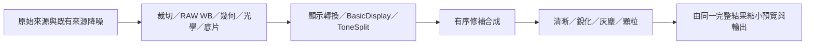

# 物件移除：操作與資料契約

- 日期：2026-10-20。
- 設計版本：1（提案）；實作時若改需求或驗收，需同步更新相依計畫與驗收紀錄。
- 狀態：**待實作提案；通用移除產品 NO-GO，尚無合格預設模型**。前置、原生完整鏈、VAE 與場景微調證據見 Survey [第 9 節](object-removal-survey.md#9-本機可行性實驗)、[第 10 節](object-removal-survey.md#10-續驗與採用決策)、[第 11 節](object-removal-survey.md#11-權重來源與後續研究)、[第 12 節](object-removal-survey.md#12-場景微調vae-身分與原生續驗)；[第 13 節](object-removal-survey.md#13-多角色替代方案與實驗) 的古典／人工 donor 只作研究對照；[第 14 節](object-removal-survey.md#14-小型模型與-depth-分層實驗) 補上 MI-GAN 儲存精度失敗、Depth Small 原生與可見圖層研究，不新增產品圖層需求。Depth band 不是物件 mask／alpha matting，重組相同不代表還原隱藏背景。研究期間舊 `dist/` artifact 消失，新 v2 不是舊資料重跑；來源中斷不撤銷原失敗，也不補出產品資格。T1 未通過，不開始 T2–T5；沒有產品移除 UI、逐張資產或人類畫質盲評，不以小型瑕疵子功能縮減原需求。
- 提示詞續驗：[第 15 節](object-removal-survey.md#15-提示詞與-llm-引導實驗) 另用真正文字條件 artifact 與本機文字 LLM 作同模型對照；不是對既有 MI-GAN 增加文字輸入，也不是 VLM 自動看圖。研究不新增產品 prompt／圖層功能，不改 OR-01–OR-14 或既有接受資產契約。
- 原生／外部來源續查：[第 16 節](object-removal-survey.md#16-原生平台與最低可行成本) 以既有裝置的最低實用成本比較三階層；保留共用渲染器與選取／重建分離。平台 app 功能不等於 SDK，8-bit 候選不迫使遮罩外降精度；該節 REST endpoint 仍是來源調查，未新增產品上傳或雲端 fallback。若未來另行採用，接受後可保存本機資產，不必每次匯出重呼叫；本輪不新增產品 provider、LLM 或平台渲染分支。
- 既有 CLI 實測：[第 17 節](object-removal-survey.md#17-既有-cli-作為外部模型入口) 依後續授權實跑 codex／agy／Cursor／opencode；Codex 另產生一個真實影像候選並驗證 host 保存。這與第 16 節尚未 live 呼叫的 REST endpoint 分開，不把文字能力、單張 RGB8 結果或現有訂閱推定為完整產品品質／散布契約；本輪仍不新增產品 backend。
- 訓練空間條件續驗：[第 18 節](object-removal-survey.md#18-訓練空間條件續驗與最小可行路線) 在相同 4ch 模型內比較訓練分支 ON/OFF，保留局部重建增益、自然移除失敗與 FP32 offload 成本。48 份完整留存結果不等於全部嘗試數；OOM 後未授權 resume／清 cache 偏差不追認為預註冊通過。未取得 PowerPaint v1 權重，不放寬既有需求或 T1 gate。
- 情境決策：[第 19 節](object-removal-survey.md#19-情境解法成本效益與決策紀錄) 與[兩案資格驗證計畫](superpowers/plans/2026-10-21-object-removal-scenario-qualification.md) 分開離線、人工、原生與外部候選用途。只有研究 GO-PLAN，未證明最高效益；外部或人工模式不能默改 OR-02 的本機模型要求，新增產品 scope 仍需明確同意。本設計版本與 T1–T5 不變，`RetouchStack` 仍未實作。
- 決策：[ADR 0005](adr/0005-ai-object-removal.md)；證據與候選：[Survey](object-removal-survey.md)；執行切片與驗收：[實作計畫](superpowers/plans/2026-10-20-ai-object-removal.md)。

## 1. 目的與邊界

使用者要移除干擾物，而非學習模型名稱。提供一個「移除」工具，將「選哪裡」與「如何重建」分開；先檢視結果，接受後才修改照片編輯狀態。以可取得、授權明確、實際可執行的本機模型為起點，保留高品質生成式方案的比較入口，不假裝單一模型處理所有場景。

- 一般影像與 RAW 均可在**現像後的顯示域**修補；不修改原始檔、RAW 感光樣本或 `RawSceneData`。
- RAW 白平衡、降噪、底片等現有參數仍有效；上游改變與修補失效有明確操作，不將影像偷偷換成烘焙後的來源。
- 初次交付須具備選取、真實本機 AI 填補、比較、套用／復原、保存／重開、縮圖與批次匯出、錯誤／取消。不能只有模型 demo 或一個可點的面板。
- 不包含影片、文字生成物件、全圖庫自動清除人物、跨照片移植生成像素、背景無人值守重生成、雲端上傳或已驗證的 HDR 場景重建。

## 2. 現行程式可重用與缺口

| 現行來源 | 可重用 | 不能假設已存在 |
|---|---|---|
| `FilmBatch.App.Shared/Controls/PreviewCanvas.cs`、`Controls/Tools/ICanvasTool.cs`、`CanvasMapping.cs` | 工具互斥、畫布座標、平移縮放、取消互動 | 完整筆刷 hover／鍵盤／Pencil 壓力、可編輯物件遮罩、修補前後比較 |
| `FilmBatch.Core/Projects/PhotoEntry.cs`、`Commands/PhotoEditCommand.cs`、`Projects/ProjectService.cs` | 不可變照片快照、命令、undo／redo、存檔成功後發布 | 修補像素資產、修補狀態相等判斷、跨資產與 JSON 的提交契約 |
| `FilmBatch.Engine/Denoising/`、[ADR 0002](adr/0002-ai-denoise.md) | 已驗證模型安裝、固定雜湊、有界推論、取消後檢查、真實 provider 報告的做法 | 降噪張量／分塊／快取鍵可直接用於 inpainting，或任何候選已在 CoreML／DirectML／iOS 執行 |
| `SourceImage.Scene`、`SemanticMasks` | 原始 RAW、色彩／幾何資訊保持權威 | DNG 語意遮罩可當成使用者修補遮罩；sRGB 像素可逆轉回 RAW |
| CPU／GPU 效果與 `BatchExporter` | 現有現像、效果、輸出格式及來源保護 | 僅靠 `Settings` 能傳遞逐張照片的生成資產 |

## 3. 使用方式

### 一般流程

1. 選一張照片，進入「移除」。多選時明示「只編輯焦點照片」，不複製修補到其他照片。
2. 以筆刷或閉合圈選標記物件。可加選、減選、調整筆刷大小；「協助選取」另外使用正／負點與框選模型，不把預測當成使用者已接受的範圍。
3. 檢查遮罩。陰影、倒影、電線、接觸地面邊緣可手動補選；模型不保證自動推斷所有物件影響。
4. 選「本機 AI」並按「產生」。顯示實際處理範圍、模型、品質限制與進度；未安裝時提供明確安裝／匯入，不在 render 內下載。
5. 切換「修補前／候選結果」，放大至 100% 檢查。接受後才按「套用」；不喜歡可改遮罩或明確重新產生，不用調整滑桿偷偷觸發推論。
6. 一次套用是一筆命令；取消候選不改照片。已套用的每個修補可停用、刪除、重新產生或復原。

「原圖」仍指既有未調整來源比較；「修補前」是在相同現像、效果與裁切下移除修補的比較，兩者不可共用含混標籤。確定性本機模型可以只有一個候選；相同輸入的重跑不是假裝有多個不同版本。真正隨機生成才顯示變體與 seed。

### 桌面與行動操作

- 桌面：可見的加／減選、大小、產生、取消、比較、套用按鈕；Esc 取消當前草稿，滑鼠離開畫框不截斷已捕捉的筆劃。快捷鍵不得攔截文字輸入欄位。
- 行動：同一份狀態／命令，窄螢幕底部操作列與可觸控大小控制；兩指平移縮放取消單指未完成筆劃，不能畫出跨畫面的連線。壓力感應不是完成基本功能的前提。
- 螢幕閱讀器需能取得工具模式、選取範圍、候選狀態、錯誤與所有動作名稱；覆蓋層至少兩種對比選項，不能只以顏色表示加／減選。
- 照片切換、工具替換、失焦、背景化、關閉取消當前筆劃與推論；回前景不自動重生成。已套用的修補不因取消而遺失。

## 4. 唯一修補平面與處理順序

### 選定的插入點

採**晚期顯示域、色調分離後、清晰／銳化前**。對應 `CpuPipeline.Process` 的 `ToneSplit` 後／`Detail` 前；現行 GPU 對應順序見 `GpuEffectPipeline.Process`。不是降噪的來源階段，也不是顆粒後覆蓋。

選取用畫面渲染到修補平面，暫停清晰／銳化、灰塵與顆粒；保留已完成的裁切、變形與其他上游效果。候選比較／接受畫面則包含後續效果，與最終輸出相符。模型不把合成的底片灰塵當成待移除場景，也不讓新 patch 跳過銳化。這不能消除模型本身的軟化或虛構細節，仍須品質驗收。

### 算圖與資料域

- 有修補的照片採**canonical CPU 完整解析度參考管線**建立基底、依序合成、執行後段效果，再縮小成預覽／輸出。這是明示的效果算圖模式，不是偷偷把 AI 換成 CPU 濾鏡。ONNX 可使用通過驗證的 CPU／CoreML／DirectML，另行報告。
- 不同 CPU／GPU 上游近似結果不可共用一份以像素完全相等為前提的修補快取。初次交付不新增第二套神經網路 shader，也不重寫 GPU 效果；沒有修補時保留現有 CPU／GPU 快速路徑與數值容差。
- 全解析度基底／最終結果有界快取於目前照片。建立、取消與來源重載均在背景工作中執行，不阻塞 UI；上游變更先顯示過期狀態，不等待昂貴的完整算圖。
- 工作基底保留既有浮點值；只將模型所需 ROI 依已驗證契約轉為有界 sRGB。生成 patch 是 SDR 顯示資料，**不是 RAW／HDR 高光恢復**。16-bit 容器也不表示模型提供 16-bit 的真實細節。
- 模型輸入尺寸與保存 patch 尺寸分開記錄；512 像素結果放大到完整尺寸不得稱為原生全解析度生成。若只有代理候選，套用必須等同一候選的正式結果完成，不能在匯出時換一張重生成圖。
- Alpha 不送入 RGB 模型，合成保留基底 alpha；完全透明像素不納入移除遮罩。部分透明邊界以 straight RGBA 驗證，不能用黑色預乘邊緣偽造合理上下文。

### 合成與區域不變量

`M` 是最後經使用者確認的修補遮罩，`B` 是相同平面的基底，`P` 是 patch：RGB 為 `(1-M)*B + M*P`，alpha 取 `B`。`M=0` 必須直接保留基底值，不做整圖量化或色域 round trip。可見羽化只向已確認遮罩內側；擴張範圍須先顯示並存進遮罩。

**嚴格遮罩外不變**指修補合成當下。後續清晰、銳化與顆粒柔焦含鄰域運算，最終像素可能在遮罩外改變；測試須用目前參數算出所有剩餘濾波的合成支撐範圍，而不是固定一個銳化半徑。不能宣稱所有 grain 都是逐像素局部操作。無修補與有修補比較以相同 canonical CPU 管線為基準，不以不同 backend 的誤差冒充修補越界。

## 5. 座標與遮罩

- Canonical 平面＝全尺寸、已定向／裁切／變形、上述插入點的輸出畫框。筆劃點以此平面正規化 `x,y∈[0,1]` 保存，半徑以短邊比例保存；同時保留原始像素尺寸與座標版本。
- 保存可重編輯向量筆劃與最終 raster mask。模型協助選取的結果須保存成固定遮罩資產，不能只留提示點、重開時重跑 SAM；筆刷與預測遮罩依順序合成加／減操作。
- `CanvasMapping` 只負責 canvas 到這個畫框的對應，不聲稱能逆轉鏡頭、多格分鏡或 RAW 幾何。顯示縮放／旋轉後的點選、框選與筆刷均測試四角／邊緣。
- 螢幕外筆劃截到畫框；ROI 外框、padding、網路 stride、遮罩正負值、resize 插值與 crop-back 由所選模型契約固定。空遮罩不推論；全幅遮罩缺乏可用背景時明確拒絕或標成不可可靠重建，不回原圖假成功。
- 使用者可圈選任何可見結果，包含多格／雙重曝光合成中的物件；這是移除目前畫面中的內容，不是辨識其原始 RAW 物件身分。

## 6. 逐張照片狀態與保存

### 資料所有權

在 Core 新增不可變 `RetouchStack`／`RetouchOperation`，成為 `PhotoEntry` 的逐張照片狀態，不塞入 `Settings` 字串或預設 YAML。`PhotoEntry.Equals`、專案讀寫、reset、undo／redo 必須一併更新。

| 記錄 | 必須綁定的欄位 |
|---|---|
| 平面身分 | 來源 SHA-256／版本、RAW 選項、尺寸／方向、幾何 key、上游 resolved settings／素材內容雜湊、管線／canonical CPU 演算法版本 |
| 修補操作 | 穩定 ID、順序、enabled、座標版本、向量筆劃、確認 mask、bbox、輸入基底 key、前序操作內容 key |
| 接受結果 | patch／mask 資產相對路徑與 SHA-256、尺寸／編碼、模型／權重／轉換版／provider、真正推論尺寸與 context extent、seed／參數（如適用） |
| 明確重套用 | `rebasedFrom`、目前基底 key、`rebased=true`；只記目前這次來源，不無限延長鏈；原始生成來源另保留 |

運算 key 以固定欄位順序與不受文化設定影響的編碼雜湊；用 tuple 判斷失效，不為每次 UI 變更重算整圖雜湊。來源／外部素材內容雜湊在載入或檔案版本改變時更新。metadata 的 SHA-256 只證明內容一致，不證明作者、來源授權或記錄完整性。

### 原子提交與還原

- 新資產放在 `AppPaths.ProjectFolder(photoFolder)/retouch/`，其中 `photoFolder` 是 `Project.Folder`；bbox patch 採無損 RGB16 PNG，mask 採無損 16-bit 灰階 PNG；PNG 內無需帶 EXIF／GPS。Core 只存參照，Engine 負責編碼及驗證，不引入影像套件到 Core。
- 正式候選在顯示／接受前，先把 patch／mask 規範為將保存的 RGB16／灰階16 值；預覽、提交與重開都合成這組相同值。不能先讓使用者接受 float 候選，再於存檔時量化成另一個結果；無損編碼往返須保留像素。
- 採內容定址資產，先寫暫存、檢查尺寸／byte 上限／SHA-256、原子啟用，再由既有 `ProjectService`／`PhotoEditCommand` 與帶 revision check 的 `ProjectStorage.Write` 提交 JSON。存檔失敗不得先更新畫面為已套用。
- 專案格式由目前 2 升為 3；讀取舊 1／2 時修補為空，不修改舊檔，直到正常存檔。舊 app 必須依現有較新版本防護拒絕，而非忽略修補後覆寫。
- Undo 只切換不可變操作／資產參照；redo 不推論。新候選在接受前屬暫存，不是專案真相。缺少模型仍可顯示／匯出已接受 patch；缺少或損毀的已引用 patch 則逐張報錯，不能略過修補。
- 路徑限制在 canonical 專案資產根目錄，拒絕絕對路徑、`..`、symlink 逸出、尺寸溢位與解壓炸彈。搬動完整專案目錄仍可重開；iOS 匯入／匯出專案副本須包含修補資產。
- Session 內只保留一個目前候選與一個目前照片完整工作結果；保存 bbox 而非每次一整張影像。接受前以預估磁碟需求與可用空間檢查，失敗保留原專案。
- 資產 GC 只能刪除不被已保存專案、undo／redo 快照、目前候選／提交工作引用的自有 blob；持專案鎖並重新讀取 revision。程序重開、舊 undo 已不復存在後才可回收孤立資產；禁止按檔齡直接刪除。此規則限制孤立垃圾，不保證使用者保留大量有效修補時磁碟固定大小。

### 不跨照片複製

一般 copy／paste、套用預設、儲存／更新預設都不攜帶修補筆劃、遮罩或生成像素；修改上游參數仍可能使目標照片既有修補過期。「重設此張」清除該張修補並可復原；「重設模組」只改其原有模組，不悄悄刪修補。初次交付不提供跨照片修補複製；日後若支援，應是重新選取／生成並逐張接受，不是移植像素。

## 7. 過期、取消與批次

| 變動／事件 | 處置 |
|---|---|
| 來源內容、RAW 解碼尺寸／方向、裁切、幾何／鏡頭／多格變更 | **硬過期**：不得放回舊座標；保留舊遮罩記錄與原因，不覆蓋到新畫框；重新選取並產生，或明確停用，不靠同比例座標猜測仍有效 |
| 相同來源與幾何、曝光／WB／降噪／底片／色調／其他上游像素改變 | **內容過期**：可重新產生；也可明確預覽「保留像素、重套用」並接受到目前基底，警告色調接縫；不自動變成有效 |
| 清晰／銳化、灰塵或顆粒改變 | 下游正常重算，不重新推論；同一已接受 patch 不換版本 |
| 改／刪／重排第 k 個修補 | 保守使所有後續操作過期；不只看 mask 重疊，後續模型可能讀到遠方 patch 或全圖 Fourier context |
| undo 回到原基底 key | 原資產仍在時自動恢復有效，不要求重跑；過期不是刪除 |
| 取消、切照片、背景、模型錯誤 | 丟棄未接受結果、解除 busy、顯示原因；原專案、既有 patch、undo 不變；native 回來後再檢查 token 與世代 |
| 批次匯出遇到過期／缺資產 | 該張失敗並寫明原因，其他符合條件的照片可繼續；禁止悄悄輸出未修補版本或匯出時重生成 |

提供逐張 badge、filmstrip 的過期數量與明確「重新產生過期修補」動作。使用者先選照片，依順序生成、預覽並接受；可取消整批，完成與未完成逐張列出，不自動接受後續候選。重新產生、重套用、停用與刪除各有可復原命令。

推論沿用 ADR 0002 的有界 native flight／post-run token 原則；共用排程入口協調降噪與修補，不讓各自一個 semaphore 變成同時兩個巨型模型。前景選取優先於批次；背景任務不自動讀取整個資料夾的完整來源。匯出已有 patch 不應要求模型、網路或加速器重新可用。

## 8. 平台與安全

- macOS、Windows、iOS 各自記錄模型原生執行、實際 provider、冷／暖延遲、峰值記憶體、取消／重用、完整預覽與輸出證據。可編譯、成功封裝、Simulator、實機是不同 gate。
- 既有 ONNX pin 保持 Apple `1.25.0`、Windows DirectML `1.24.4`；是否支援候選 graph 必須實測。FFT custom op、第二個 Python／LibTorch runtime 或新的雲端服務均須新決策，不以相似模型取代卻沿用名稱。
- iOS 無 Dawn 攝影運算路徑；平台能力未證實時不顯示可用的「本機 AI 產生」。可在有界資源內重開／輸出已接受資產的能力也須獨立驗證。
- 安裝顯示模型大小／作者／權重與基底模型授權，雜湊驗證後才啟用。下載權限不等於 render 上傳權限。
- 雲端目前不接入。未來需獨立取得供應商／帳號／付費／照片外送同意，預覽真正會離開裝置的 ROI 與 context，移除 EXIF／GPS，說明保存／訓練／地區政策。逾時且不知供應商是否接單時標成 `OUTCOME_UNKNOWN`，不盲目重送或重扣款。
- 匯出記錄接受 patch 雜湊、模型來源／provider、實際尺寸、是否重套用與效果 renderer。這是產品稽核紀錄，不宣稱已簽署 C2PA Content Credentials；不暗藏完整提示、GPS 或照片縮圖於一般 log。

## 9. 功能需求與驗收索引

| ID | 必須達成的結果 | 計畫中的可觀察檢查 |
|---|---|---|
| OR-01 | 筆刷／圈選／加減選、縮放後座標一致，輔助模型可取消 | T3-選取模型；T4-畫布工具、桌面與觸控 smoke |
| OR-02 | 真實本機模型填補，未安裝／損毀／不支援明確失敗 | T1-模型資格；T3-推論 |
| OR-03 | 使用者比較／接受才提交；不冒稱多個變體 | T3-接受與無模型重開；T4-候選流程 |
| OR-04 | 一次套用可 undo／redo，保存／搬移重開像素相同 | T2-命令／資產；T4-重開 smoke |
| OR-05 | 修補平面、SDR／RAW、alpha 與遮罩外不變量成立 | T2-合成；T3-正式輸出；T5-品質 |
| OR-06 | 上游分級過期、明確重套用、後序失效及 undo 恢復 | T2-依賴；T4-過期批次 |
| OR-07 | 取消／換照片／背景不發布舊結果，不污染成功快取 | T3-取消與 native smoke；T4-生命週期 |
| OR-08 | 預覽／縮圖／CLI／四格式批次輸出使用同一接受結果 | T3-消費端；T4-原生輸出檢查 |
| OR-09 | 預設／一般貼上不攜帶修補；reset 契約一致 | T2-專案回歸 |
| OR-10 | 不改原檔，資產提交失敗可恢復，路徑／雜湊有驗證 | T2-安全與故障注入 |
| OR-11 | 最高品質以盲評與失敗率決定，不以 PSNR 或宣傳代替 | T1-比較設計；T5-留出集與最差案例 |
| OR-12 | 平台宣稱、資源限制、授權與 provider 均有相應證據 | T1-資格；T5-平台／封裝 |
| OR-13 | 操作可被鍵盤／輔助技術使用，窄螢幕不遮住套用／取消 | T4-實際畫面與操作 |
| OR-14 | 本機 render 不連線，不未經授權上傳或重試付費請求 | T3-離線 smoke；雲端接入前另行 Human Review |

這些是未執行的驗收契約，不是本輪通過結果。模型／資料取得、品質評估方法與平台 gate 的輸入見 Survey 及計畫；本文件不綁定尚未驗證的權重 digest。
