# FilmBatch 計畫書：批次底片效果處理工具

> 版本：v0.11（規劃稿）
> 日期：2026-10-15
> 定位：獨立的批次類比效果工具。接收任何 RAW 編輯器（例如 RapidRAW）匯出的照片，為每張照片套上底片色彩與類比效果後批次輸出
> 技術：C# / **.NET 10（LTS）** ＋ **Avalonia UI 12**（Fluent 深色主題、MVVM）＋ **WebGPU（wgpu-native）與 WGSL compute shader 影像引擎**，以 `dotnet publish` 發佈為 Windows / macOS / Linux 原生執行檔

> **歷史設計稿**：保留當時的需求、方案與里程碑，不是目前功能或驗收清單。RAW、底片 LUT、GPU 綁定與支援平台已有後續決策；現況從[文件地圖](README.md)、[架構](architecture.md)、[驗證入口](../VERIFY.md)及[提交歷史](history.md)查閱，不因本文仍有待辦就推定功能不存在。

### 版本變更

| 版本 | 變更 |
|---|---|
| v0.1 | 初版：三層設定模型、預設庫、複製貼上、底片模型、批次匯出 |
| v0.2 | 新增光學、合成、表面類效果模組；改為純 Python 跨平台 |
| v0.3 | 打包改用 Nuitka；UI 採 PySide6 Fusion + 深色調色盤；所有流程與架構圖改為 Mermaid；UI 規範獨立為第 2 章，並列為開發第一階段（M0） |
| v0.4 | 移除所有與第三方濾鏡軟體的對照與依賴，成為獨立產品：效果模組改用自有命名與分類；模組面板順序改為依處理階段排列；第 6 章改為「效果模組總覽」；LUT 匯入改為通用流程 |
| v0.5 | UI 主題改用 PyQtDarkTheme（`pyqtdarktheme-fork`） |
| v0.6 | 技術棧改為 C# / .NET 10 + Avalonia UI；影像運算採 OpenCvSharp4 + SIMD；影像 IO 採 Magick.NET。Python 版計畫保存於 `plan_python_v0.5.md` |
| v0.7 | **影像引擎改為 GPU 架構（參考 RapidRAW 的 wgpu + WGSL 做法）**：移除 OpenCV，全部效果以 WGSL compute shader 實作，透過 C# 的 WebGPU 綁定呼叫 wgpu-native（Windows：DX12 / Vulkan、macOS：Metal、Linux：Vulkan）；預覽與匯出共用同一套 shader；CPU 端只負責檔案讀寫（Magick.NET）與排程。UI 升級為 **Avalonia 12** 與對應的 Dock.Avalonia 12。改寫 5、7、9–16 章 |
| v0.8 | M0 結果：C# WebGPU 綁定定案為 **WebGPUSharp（Dawn）**，取代 9.1 的 Silk.NET 首選（理由見 `docs/adr/0001-webgpu-binding.md`）；標題列與選單列合一（2.2.1）；M0 進度與發現見 `docs/M0-status.md` |
| v0.9 | **底片色彩全部改為搬移 [Recipe Lab](https://github.com/voxivoid/recipe-lab-sony-pmca)（MIT）的 77 組配方**：移除自有的參數化底片模型、內建 10 款底片與 LUT / HaldCLUT 匯入；`film` 模組改為「配方 + Sony 成像模擬」，參數沿用 Recipe Lab 欄位；自訂配方與 Recipe Lab 的 `.YML` 格式相容；以 Recipe Lab 樣張校正。改寫第 7 章，並同步 1.3、4.2、5、6、8–16 章的相關段落 |
| v0.10 | 新增**示波器**（直方圖、波形圖、RGB 分量圖）：UI 規格見 2.4.6，算圖時序見 11.3，排入 M3（1.5 週 → 2 週），並補上 1.4、12、14、16.2 的相關段落 |
| v0.11 | **UI 改版同步（M0 回饋）**：視覺改為扁平、圓角、少框線的現代修圖介面（參考 Lightroom 跨平台版 / RapidRAW）；強調色由琥珀橘改為藍色，琥珀色只標示「被覆寫」；預設庫、照片基本參數、照片匯出合併為**右側邊欄**，以外緣的**分頁工具列**切換；匯出對話框改為側邊欄分頁；工具列併入標題列、檢視控制移到底部狀態列；參數列改為兩行式；模組啟用改為眼睛圖示；Dock 不再顯示工具標題列。改寫 2.1–2.5、2.8、2.11，並同步 11.5、13.1 |

### 目錄

1. 背景與目標
2. **UI 規範（第一優先）**
3. 核心概念
4. 資料模型
5. 影像處理管線
6. 效果模組總覽
7. 底片色彩配方（移植自 Recipe Lab）
8. 材質庫
9. 跨平台與 .NET 發佈
10. 批次匯出
11. 系統架構
12. 效能策略
13. 開發里程碑
14. 測試策略
15. 風險與對策
16. 驗收標準

---

## 1. 背景與目標

### 1.1 要解決的問題

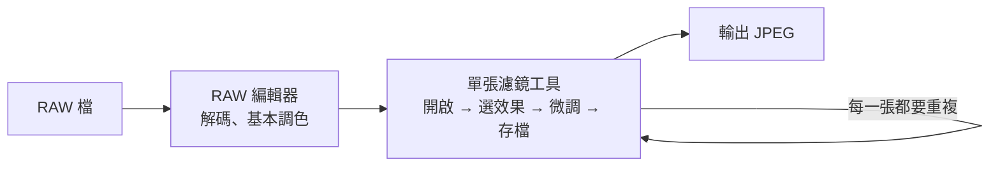

為照片加上底片風格時，常見的做法是逐張開啟濾鏡工具處理。這種做法有幾個痛點：

- 每張照片都要各自開啟、選效果、微調、存檔，非常耗時。
- 一般的批次功能只能「整批套同一個效果」，沒辦法每張用不同底片、不同效果。
- 批次存檔缺乏匯出控制（格式、品質、目的地），也無法事後回頭修改單張設定。

FilmBatch 的目標是把「每張不同、但可以批次管理」這件事做好。

### 1.2 目標流程

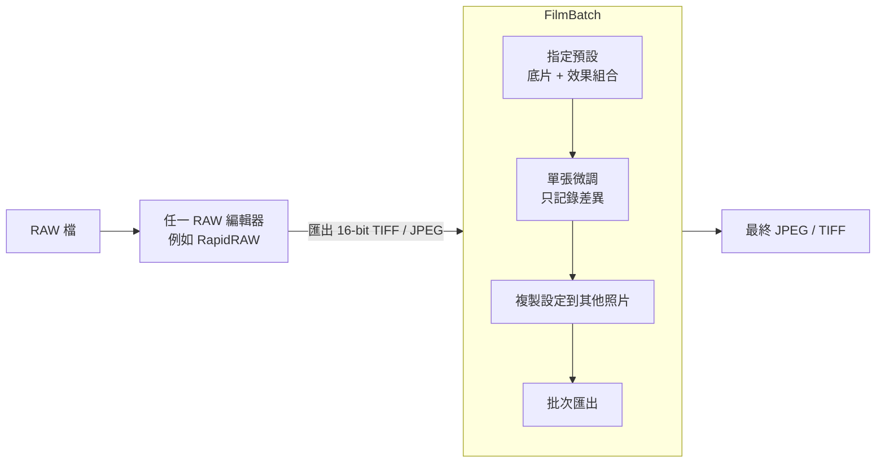

### 1.3 核心需求

| # | 需求 | 優先度 |
|---|---|---|
| R1 | 每張照片可以有各自的底片色彩與效果 | 必要 |
| R2 | 可儲存**多個**預設（配置檔），組成預設庫 | 必要 |
| R3 | 每張照片可指定要套用哪個預設 | 必要 |
| R4 | 在預設之上可針對單張微調，且只記錄差異 | 必要 |
| R5 | 可將某張照片的設定複製到其他照片（可選擇複製哪些部分） | 必要 |
| R6 | 即時預覽（拖曳滑桿時即時更新），可對比原圖 | 必要 |
| R7 | 批次匯出：可選格式、品質、尺寸、目的地 | 必要 |
| R8 | 非破壞性編輯，原始檔永不修改 | 必要 |
| R9 | 提供完整的類比效果模組：底片色彩、顆粒、光暈、漏光、光學模糊、鏡頭變形、雙重曝光、多格分鏡、灰塵刮痕、古典版材等（見第 6 章） | 必要 |
| R10 | UI 使用 Avalonia Fluent 深色主題，配色依 2.2 規格 | 必要 |
| R11 | 以 C# / .NET 10 + Avalonia 開發，影像運算在 GPU 上以 WGSL compute shader 執行，發佈為三平台執行檔 | 必要 |
| R12 | 內建 Recipe Lab 的 77 組底片配方；可讀寫與 Recipe Lab 相容的自訂配方檔（`.YML`），與相機記憶卡互通 | 重要 |
| R13 | 多選後可同時調整同一參數 | 重要 |

### 1.4 不在範圍內（第一版不做）

- RAW 解碼、鏡頭校正、白平衡挑色器（交給上游的 RAW 編輯器）
- 相框與邊框
- 局部調整、筆刷遮罩（第一版以各模組內建的對焦區 / 保護區遮罩處理常見需求）
- 照片管理（評分、標籤、關鍵字）
- 向量示波器（vectorscope）與膚色線（第一版的示波器只提供直方圖、波形圖與 RGB 分量圖，見 2.4.6）
- 沒有可用 GPU 的環境下的高效能運作（以軟體 GPU 介面卡維持可用，但速度不列入效能目標，見 12）

---

## 2. UI 規範（第一優先）

> UI 是使用者每天面對的部分，也決定了資料模型與互動流程該長什麼樣子。
> 因此在開發順序上，**先完成 UI 規範與可操作的原型（M0）**，凍結後再實作影像引擎。
> 後續各章的功能都必須能對應到本章定義的介面元件。
> 既有的 Python / PySide6 M0 原型可作為互動行為的參考，Avalonia 版本以本章為準重新實作。

### 2.1 設計原則

| 原則 | 說明 |
|---|---|
| **中性灰** | 所有介面灰階的 R = G = B，不帶色偏，避免影響使用者對照片色彩的判斷 |
| **照片優先** | 預覽區佔最大面積；側邊欄與縮圖列可調整大小、可隱藏（`Tab` 切換全部面板）；工具集中在一個側邊欄，以分頁切換，不同時攤開多個面板 |
| **扁平、少框線** | 以灰階的明度層次（畫布 ＜ 標題列 / 底列 ＜ 側邊欄 ＜ 輸入框 ＜ 按鈕）區分區塊，不用框線與標題條；圓角柔化控制項；次要動作用外框按鈕或純圖示按鈕，畫面保持安靜 |
| **克制的強調色** | 只有一個介面強調色（藍色）標示「主要動作」「勾選 / 開啟」與「焦點」；「被覆寫」另以琥珀色小面積標記。選取中的縮圖以亮白外框標示，不用彩色，避免干擾對照片色彩的判斷 |
| **所見即所算** | 模組面板由上到下依處理階段排列（色彩 → 光學 → 底片 → 表面），面板順序就是運算順序，讓使用者直覺理解效果如何疊加 |
| **不打斷操作** | 算圖、縮圖產生、匯出都在背景執行，UI 執行緒永不阻塞；錯誤以狀態列或非阻斷提示呈現 |
| **鍵盤友善** | 常用操作都有快捷鍵；macOS 上 `Ctrl` 自動對應 `⌘` |
| **MVVM** | 所有畫面以 ViewModel 驅動，View 只負責呈現與輸入；ViewModel 不引用任何 Avalonia 控制項，可單獨測試 |

### 2.2 主題：Avalonia Fluent（深色）＋ 自訂資源字典

#### 2.2.1 實作方式

- 使用 Avalonia 內建的 **`FluentTheme`**，`Application.RequestedThemeVariant = ThemeVariant.Dark`，**不跟隨作業系統**的淺色 / 深色設定，三個平台外觀一致。
- **配色依 2.2.2 規格**：在 `Themes/Colors.axaml` 的 `ThemeDictionaries` → `Dark` 中覆寫 Fluent 的系統資源（`SystemAccentColor` 及其 `Light1–3` / `Dark1–3` 變體、`SystemRegionColor` 等），並定義本專案的色彩 token（`FB.*Brush`）。
  - Fluent 深色版的灰階本身已接近中性灰；M0 以元件展示視窗逐一檢查，凡帶色偏的 Fluent 資源一律覆寫為 2.2.2 的色碼。
  - Avalonia 12 的 Fluent 資源鍵若與 11 有差異，以 12 的主題原始碼為準，於 M0 定稿對照表。
- 自訂元件的樣式集中在 `Themes/Controls.axaml`（Avalonia `Styles`，以 class 選擇器套用，例如 `Border.module-header`、`TextBlock.overridden`），不散落在各 View。
- 所有 XAML 使用**編譯繫結**，繫結錯誤在建置時即可發現，也為日後的 Native AOT / Trimming 鋪路。
- 已知注意事項：
  - Fluent 的控制項尺寸偏大（觸控友善），需在 `Controls.axaml` 統一調整 `NumericUpDown`、`ComboBox`、`TextBox` 的高度（28px）與內距；圓角以 `ControlCornerRadius`（6px）與 `OverlayCornerRadius`（8px）資源統一設定。
  - `Slider` 不使用 Fluent 樣板（其上下標題列與刻度列會擠壓圓鈕），改用精簡樣板：2px 中性灰軌道 ＋ 14px 空心圓鈕（深色填色、亮灰外框，滑過時放大 1.15 倍）；軌道不分已填 / 未填段，因為多數參數以中央為零。`ParamSlider` 的點擊換算需配合圓鈕半徑內縮 7px。
  - 「模組停用時內容淡化但仍可調整」不能用 `IsEnabled=false`（會無法操作），改以內容區 `Opacity` + 停用色樣式 class 實作。
  - `NumericUpDown` 設 `ShowButtonSpinner="False"` 作為參數數值框；參數列上的數值框平常透明、看起來像文字，滑過或編輯時才顯示輸入框底色。
  - Dock.Avalonia 主題：**不顯示 IDE 式的工具標題列與文件分頁**（`ToolDock.GripMode = Hidden`，於 `DockFactory.InitLayout` 設定，還原舊版面時也套用；另以樣式隱藏 `DocumentTabStrip`），面板看起來像固定欄位。注意 Dock 主題在 `:pointerover` 時會重新顯示標題列，且其內部以 `StaticResource` 別名引用的色彩鍵（例如 `DockBorderSubtleBrush`）必須逐一覆寫才會生效。
- 標題列：**標題列與選單列合一**（M0 定案）。主視窗以 `ExtendClientAreaToDecorationsHint` 把內容延伸進標題列（高 44px），同一列依序為「圖示｜選單｜視窗標題（置中）｜常用動作按鈕｜系統按鈕」；空白處以 `WindowDecorationProperties.ElementRole="TitleBar"` 標為原生拖曳區（拖曳移動、雙擊最大化、Windows 貼齊版面皆由系統處理），系統按鈕仍由平台繪製，只隱藏平台繪製的標題文字。macOS 的紅綠燈在左側，圖示與選單需右移讓出位置（跨平台建置時驗證）。對話框維持原生標題列。

```xml
<!-- FilmBatch.App/Themes/Colors.axaml（節錄） -->
<ResourceDictionary xmlns="https://github.com/avaloniaui"
                    xmlns:x="http://schemas.microsoft.com/winfx/2006/xaml">
  <ResourceDictionary.ThemeDictionaries>
    <ResourceDictionary x:Key="Dark">
      <!-- 覆寫 Fluent 系統資源 -->
      <Color x:Key="SystemAccentColor">#3D8EF0</Color>
      <Color x:Key="SystemAccentColorLight1">#5AA0F3</Color>
      <Color x:Key="SystemRegionColor">#232323</Color>
      <!-- 本專案色彩 token -->
      <SolidColorBrush x:Key="FB.CanvasBrush"     Color="#161616"/>
      <SolidColorBrush x:Key="FB.WindowBrush"     Color="#1C1C1C"/>
      <SolidColorBrush x:Key="FB.PanelBrush"      Color="#232323"/>
      <SolidColorBrush x:Key="FB.BaseBrush"       Color="#2C2C2C"/>
      <SolidColorBrush x:Key="FB.ButtonBrush"     Color="#333333"/>
      <SolidColorBrush x:Key="FB.TextBrush"       Color="#E6E6E6"/>
      <SolidColorBrush x:Key="FB.AccentBrush"     Color="#3D8EF0"/>
      <SolidColorBrush x:Key="FB.OverrideBrush"   Color="#E8A43C"/>
      <SolidColorBrush x:Key="FB.PresetUpdatedBrush" Color="#5AA9E6"/>
      <!-- Dock：面板底色與分隔線（含 Dock 內部的別名鍵） -->
      <SolidColorBrush x:Key="DockSurfacePanelBrush" Color="#232323"/>
      <SolidColorBrush x:Key="DockBorderSubtleBrush" Color="#161616"/>
      <!-- … 其餘見 Colors.axaml -->
    </ResourceDictionary>
  </ResourceDictionary.ThemeDictionaries>
</ResourceDictionary>
```

#### 2.2.2 配色規格

介面灰階依明度分層，由暗到亮：**畫布 → 標題列 / 底列 / 縮圖列 → 側邊欄 → 輸入框 → 按鈕**。區塊之間靠明度差區分，面板之間的間隙露出畫布色，不另畫框線。

| 色彩 token（資源鍵） | 色碼 | 用途 |
|---|---|---|
| `FB.CanvasBrush` | `#161616` | 預覽畫布、Dock 面板之間的間隙 |
| `FB.WindowBrush` | `#1C1C1C` | 視窗、標題列、底部狀態列、縮圖列、側邊欄的分頁工具列、對話框背景 |
| `FB.PanelBrush` | `#232323` | 側邊欄各分頁的背景 |
| `FB.BaseBrush` | `#2C2C2C` | 輸入框、下拉選單、工具按鈕群組的底座、摘要卡片、釘選鍵標記 |
| `FB.AlternateBaseBrush` | `#262626` | 保留（清單交錯列） |
| `FB.ButtonBrush` / `FB.ButtonHoverBrush` | `#333333` / `#3D3D3D` | 一般按鈕、選取中的清單項目、作用中的分頁、開啟中的切換按鈕 |
| `FB.HoverOverlayBrush` | 白色 8% 不透明（`#14FFFFFF`） | 滑鼠停留的底色（圖示按鈕、模組標題、清單項目）；疊在任何灰階上都維持中性 |
| `FB.TextBrush` | `#E6E6E6` | 一般文字、數值、模組名稱、被覆寫的參數名稱 |
| `FB.SecondaryTextBrush` | `#A0A0A0` | 參數名稱、選單列、底部狀態列文字 |
| `FB.PlaceholderBrush` | `#7C7C7C` | 提示文字、分組標題、表單欄位標籤、未選取的分頁圖示 |
| `FB.ToolTipBackgroundBrush` / `FB.ToolTipTextBrush` | `#333333` / `#F0F0F0` | 工具提示、ToastBar |
| `FB.BorderLightBrush` / `FB.BorderBrush` | `#4A4A4A` / `#2E2E2E` | 外框按鈕、滑過時的縮圖外框 / 輸入框邊框 |
| `FB.DividerBrush` | `#2C2C2C` | 模組之間、面板標題下方的細分隔線 |
| `FB.ShadowBrush` / `FB.ShadowDarkBrush` | `#141414` / `#0E0E0E` | 陰影 |
| `FB.ThumbnailBackBrush` | `#121212` | 縮圖的留白底色 |
| `FB.SliderTrackBrush` | `#4A4A4A` | 滑桿軌道 |
| `FB.SliderThumbFillBrush` / `FB.SliderThumbStrokeBrush` | `#232323` / `#E6E6E6` | 滑桿空心圓鈕 |
| `FB.SelectionRingBrush` | `#F2F2F2` | 選取中縮圖的 2px 外框 |
| `FB.AccentBrush`（`SystemAccentColor`） | `#3D8EF0` | **強調色**：主要動作按鈕、勾選框與開關的開啟狀態、輸入焦點框、開啟中工具按鈕的圖示、拖曳分隔線與停靠指示 |
| `FB.AccentHoverBrush` | `#5AA0F3` | 強調色按鈕滑過 |
| `FB.AccentTextBrush` | `#FFFFFF` | 強調色上的文字 |
| `FB.WarningTextBrush` | `#FF6B6B` | 警示文字 |
| `FB.LinkBrush` | `#6AAAF5` | 連結（例如 ToastBar 的「復原」） |
| `FB.DisabledTextBrush` | `#666666` | 停用狀態文字、停用模組的名稱與眼睛圖示 |
| `FB.DisabledAccentBrush` | `#4A4A4A` | 停用狀態選取 |

語意色（只用於小面積標記，不作為大面積背景）：

| 用途 | 色碼 |
|---|---|
| 參數被覆寫的標記點 ●、模組的覆寫數（`FB.OverrideBrush`） | `#E8A43C`（琥珀色） |
| 預設已更新 ⟳ | `#5AA9E6` |
| 錯誤 | `#E05555` |
| 成功 | `#6BBF59` |

預覽畫布背景**不屬於主題資源**，由偏好設定切換：深灰 `#161616`（預設，與畫布色相同）、中灰 `#808080`（判斷亮度用）、純黑 `#000000`。

#### 2.2.3 字型與尺寸

| 項目 | 規格 |
|---|---|
| 字型 | 以 `FontManagerOptions` 設定預設字型與後備字型：Windows「Microsoft JhengHei UI」、macOS「PingFang TC」、Linux「Noto Sans CJK TC」 |
| 基本字級 | 13px（約 10pt；數值欄位使用等寬數字 `FontFeatures="tnum"`） |
| 字級層次 | 面板標題 16px SemiBold；模組名稱 14px SemiBold；分組標題與表單欄位標籤 11px SemiBold、字距 0.6；次要資訊與底部狀態列 11px |
| 間距 | 以 4px 為基本單位（4 / 8 / 12 / 16）；側邊欄內容左右留白 16px |
| 圓角 | 控制項 6px；工具按鈕群組、選單、摘要卡片 8px；主要動作按鈕與 ToastBar 為膠囊形（16–18px） |
| 參數列高度 | 滑桿參數列 46px（兩行：名稱與數值 / 滑桿）；下拉與開關參數列 38px；控制項高度 28px |
| 固定區塊尺寸 | 標題列 44px；底部狀態列 40px；模組標題列 40px；分頁工具列寬 48px（按鈕 36 × 36px） |
| 視窗最小尺寸 | 1280 × 800 |
| HiDPI | Avalonia 以 DIP 排版；預覽影像依 `TopLevel.RenderScaling` 決定 GPU 輸出的像素尺寸，避免模糊 |

### 2.3 主視窗版面

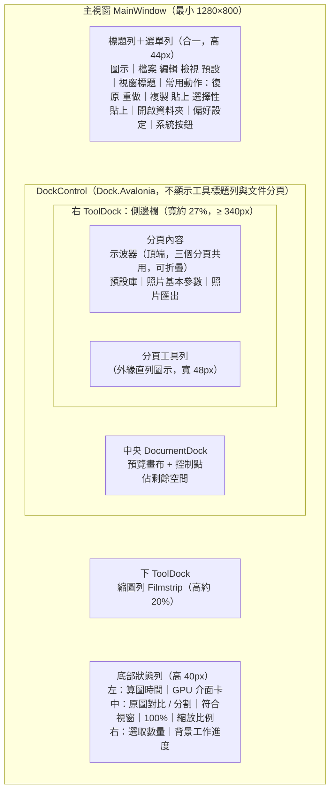

- 停靠系統使用 **Dock.Avalonia**（MIT，版本需與 Avalonia 12 對應），但**不顯示 IDE 式的工具標題列與文件分頁**：面板看起來像固定欄位，不能拖曳到其他邊或浮動；面板之間的分隔線可拖曳調整大小（滑過時以強調色提示）。
- 工具集中在**一個右側邊欄**，以外緣的分頁工具列切換（見 2.4.2），不同時攤開多個工具面板，讓預覽區保持最大。
- 版面以 Dock 的序列化功能存成 `layout.json`，視窗位置與大小存入 `settings.json`（見 9.2），下次開啟還原。版面檔的面板組成與目前版本不符時（例如 v0.10 以前「左側預設庫＋右側模組」的版面），改用內建預設版面並寫入 log。
- 「檢視」選單提供「重設版面」（載入內建預設版面）。
- `Tab` 隱藏或顯示所有面板，`F` 切換全螢幕預覽（`WindowState.FullScreen`）。
- 底部狀態列顯示目前使用的 GPU 介面卡與後端（例如「Apple M2 · Metal」），使用軟體介面卡時以警示色與 ⚠ 圖示提示。中央的檢視控制放在圓角群組底座上，與標題列的工具按鈕群組外觀一致。

### 2.4 區域規格

#### 2.4.1 常用動作與檢視控制

沒有獨立的工具列：編輯類動作放在標題列右側，檢視類控制放在底部狀態列中央，兩者都以圓角群組底座（`FB.BaseBrush`）把相關按鈕放在一起。

| 位置 | 按鈕 | 快捷鍵 | 說明 |
|---|---|---|---|
| 標題列 | 復原 / 重做 | `Ctrl/⌘+Z` / `Ctrl/⌘+Shift+Z`（Windows 另可 `Ctrl+Y`） | 專案層級的復原堆疊 |
| 標題列 | 複製設定 | `Ctrl/⌘+C` | 複製目前照片的設定 |
| 標題列 | 貼上 | `Ctrl/⌘+V` | 完整貼上到選取照片 |
| 標題列 | 選擇性貼上 | `Ctrl/⌘+Shift+V` | 開啟選擇性貼上對話框 |
| 標題列 | 開啟資料夾 | `Ctrl/⌘+O` | 以 `StorageProvider.OpenFolderPickerAsync` 選擇照片資料夾，自動載入或建立專案 |
| 標題列 | 偏好設定（齒輪圖示） | — | 開啟偏好設定對話框 |
| 底部狀態列 | 原圖對比 / 左右分割 | 按住 `空白鍵`；`Y` 切換左右分割 | 檢視原圖；分割開啟時按鈕圖示以強調色顯示 |
| 底部狀態列 | 符合視窗 / 100% | `Ctrl/⌘+0` / `Ctrl/⌘+1` | 旁邊顯示目前縮放比例 |
| 側邊欄 | 照片匯出 | `Ctrl/⌘+E`（或「檔案 → 匯出…」） | 切換到側邊欄的「照片匯出」分頁（見 2.4.7）；面板隱藏或全螢幕時先恢復面板 |

- 快捷鍵以 `KeyBinding` + `KeyGesture` 定義，修飾鍵使用平台熱鍵設定（`PlatformHotkeyConfiguration`），在 macOS 自動對應 `⌘`。macOS 另提供原生選單列（`NativeMenu`）。
- 圖示使用單色線條圖示（SVG 轉 `StreamGeometry` / `PathIcon`），顏色跟隨 `FB.TextBrush`，停用時跟隨 `FB.DisabledTextBrush`。工具按鈕為透明背景、6px 圓角，滑過時顯示 `FB.HoverOverlayBrush`。
- 標題列不放「匯出」按鈕：匯出是側邊欄的一個分頁，避免同一個功能有兩個入口外觀。

#### 2.4.2 右側邊欄與預設庫分頁

**側邊欄**（`SidebarView` / `SidebarViewModel`）是右 ToolDock 中唯一的面板，由「分頁內容」與外緣的「分頁工具列」組成（Lightroom 式）：

| 分頁 | 圖示 | 內容 |
|---|---|---|
| 預設庫 | 疊放的相片 | 見下方 |
| 照片基本參數（預設分頁） | 滑桿 | 見 2.4.5 |
| 照片匯出 | 下載箭頭 | 見 2.4.7 |

- 分頁工具列在側邊欄的**外緣**（視窗右側），寬 48px、背景 `FB.WindowBrush`；按鈕為 36 × 36px、8px 圓角的圖示按鈕，以 `RadioButton`（同一 `GroupName`）實作互斥選取。作用中的分頁底色為 `FB.ButtonBrush`、圖示為 `FB.TextBrush`，其餘圖示為 `FB.PlaceholderBrush`；滑鼠停留時於左側顯示分頁名稱的工具提示。
- 三個分頁的 View 與 ViewModel 常駐，切換時只改變顯示中的分頁（`IsVisible`），保留各自的捲動位置與輸入內容。
- 示波器（見 2.4.6）位於分頁內容的頂端，三個分頁共用。
- 切換到「照片匯出」分頁時，重新整理匯出範圍的張數、預設清單與預設目的地。

**預設庫分頁**（`PresetLibraryView`）

- 頂端為面板標題「預設庫」（16px SemiBold），右側「＋」圖示按鈕：以目前照片建立預設。
- 以 `TreeView` 呈現：分類（SemiBold）→ 預設。每個預設顯示**圓形色彩標籤**、名稱，釘選的預設在右側顯示數字鍵小標記；滑鼠停留 500ms 顯示效果縮圖（`ToolTip` 內放縮圖；M0 原型先顯示參數摘要文字，縮圖於 M3 接上引擎後加入）。選取中的項目以 6px 圓角的 `FB.ButtonBrush` 底色標示。
- 操作：
  - 拖曳預設到縮圖列或預覽區，指定給該照片（或所有選取照片）。拖放使用 Avalonia `DragDrop`，資料格式為自訂的 `filmbatch/preset-id`。
  - 雙擊：指定給目前選取的照片。
  - 右鍵選單（`ContextMenu`）：套用到選取照片、重新命名、更改色彩標籤、釘選、複製、刪除、在檔案總管中顯示（`ILauncher` 開啟所在資料夾）。
- 底部：外框按鈕「管理…」（開啟預設管理對話框）。
- 前 9 個「釘選」預設可用數字鍵 `1`–`9` 快速套用（不論目前在哪個分頁）。

#### 2.4.3 預覽畫布（中央）

- 自訂控制項 `PreviewCanvas : Control`，覆寫 `Render(DrawingContext)` 繪製預覽影像，不使用巢狀的 `Image` / `Canvas` 版面，以降低每次更新的負擔。
- **影像來源**：GPU 引擎在 GPU 上完成算圖並轉成 8-bit BGRA 後讀回，寫入 `WriteableBitmap`（第一版）。日後可改為 Avalonia 的 GPU 互通（`ICompositionGpuInterop`）直接共享紋理，省去讀回（見 12）。
- 縮放：符合視窗 / 100% / 滾輪縮放；放大時以滑鼠拖曳平移（`PointerPressed` / `PointerMoved` + `Pointer.Capture`）。100% 檢視時只算可見區域（見 12）。
- 原圖對比：按住空白鍵顯示原圖；`Y` 切換左右分割（分割線可拖曳）。
- 算圖中在右上角顯示細小的旋轉指示，**不遮擋畫面、不鎖住操作**；舊結果保留到新結果出來。
- 多選時顯示目前焦點照片，左上角疊字「已選取 N 張，調整將套用到全部」。

**畫布控制點**

| 模組 | 控制點 |
|---|---|
| 焦外成像 | 對焦中心（拖曳）、清晰區大小（外圈把手）、過渡區（虛線外圈） |
| 縮放和旋轉模糊 | 模糊中心、保護區半徑 |
| 動態模糊 | 保護區中心與半徑、方向指示線（拖曳端點改角度） |
| 鏡頭暈影 | 暈影中心、大小把手 |
| 漏光 | 進光方向（沿畫面邊緣拖曳） |
| 雙重曝光 | 第二張影像的位移、縮放、旋轉把手 |

控制點外觀：直徑 12px 白色圓圈加 1px 深色外框（任何畫面上都看得清楚），作用中的控制點以強調色填充。控制點在 `PreviewCanvas.Render` 中與影像一起繪製（不建立子控制項），命中測試自行計算。只顯示**目前展開模組**的控制點，避免畫面雜亂。拖曳時即時更新預覽（GPU 足以在拖曳中直接算 1600px 代理圖），放開後寫入參數，並記為一筆復原紀錄。

#### 2.4.4 縮圖列（下面板）

使用 `ListBox` + 水平 `VirtualizingStackPanel` + `DataTemplate`（`ThumbnailView`），支援數千張照片的虛擬化捲動；縮圖點陣圖由 `ThumbnailViewModel` 非同步載入，捲出畫面時可釋放。

| 位置 | 標記 | 意義 |
|---|---|---|
| 左下 | 膠囊形半透明底 ＋ 圓形色彩標籤 ＋ 預設名稱縮寫 | 這張照片使用的預設 |
| 右上 | ● 琥珀色（`FB.OverrideBrush`） | 有單張覆寫 |
| 右上 | ⟳ 藍色 | 所用預設已在預設庫中更新，可同步 |
| 外框 | 亮白 2px（`FB.SelectionRingBrush`） | 選取中 |
| 縮圖本身 | — | 套用效果後的結果（背景以 GPU 批次更新） |

- 縮圖為 6px 圓角，留白處為 `FB.ThumbnailBackBrush`；未選取的縮圖略為淡化（不透明度 0.82），滑鼠停留時恢復並顯示 `FB.BorderLightBrush` 外框，選取中的縮圖完全不透明。
- 自行處理 `Ctrl/⌘` 與 `Shift` 多選、`Ctrl/⌘+A` 全選，行為與檔案總管一致。
- 上方篩選列（無框線的扁平下拉選單）：依預設篩選、只顯示有覆寫的照片、只顯示未指定預設的照片，右側顯示張數（以篩選集合實作，避免整份清單重建）。

#### 2.4.5 照片基本參數（側邊欄分頁）

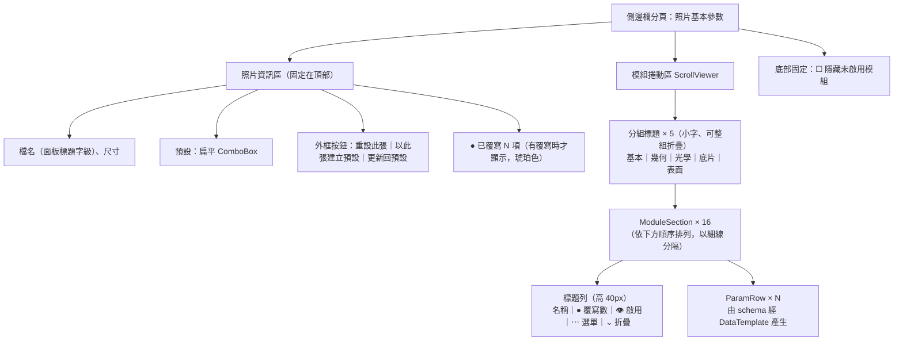

模組面板依**處理階段**分組，由上到下的順序與第 5 章的運算順序一致：

| 分組 | 模組 |
|---|---|
| 基本 | 基本調整 |
| 幾何 | 鏡頭變形、多格分鏡 |
| 光學 | 雙重曝光、散景與選擇性對焦、放射與旋轉模糊、動態模糊、暗角、光暈、漏光 |
| 底片 | 底片色彩、古典版材、色調分離、清晰與銳化 |
| 表面 | 灰塵與刮痕、顆粒 |

- 面板內容由參數 schema 產生：每個 `ParamDef` 對應一個 ViewModel（`SliderParamVM`、`ChoiceParamVM`、`ToggleParamVM`…），由 `DataTemplates` 依型別選擇 View，新增參數不需要寫 XAML。
- 分組標題可整組折疊；未啟用的模組可選擇「隱藏未啟用模組」，讓面板只顯示正在使用的效果。
- 「基本調整」橫跨線性與顯示兩段運算（見 5.2），在面板上仍放在最上方，因為它是最常調整的模組。

#### 2.4.6 示波器（直方圖、波形圖、RGB 分量圖）

調整色調與底片配方時，用來客觀判斷亮部 / 暗部是否裁切、整體亮度分布與色偏，不必只靠螢幕目視。

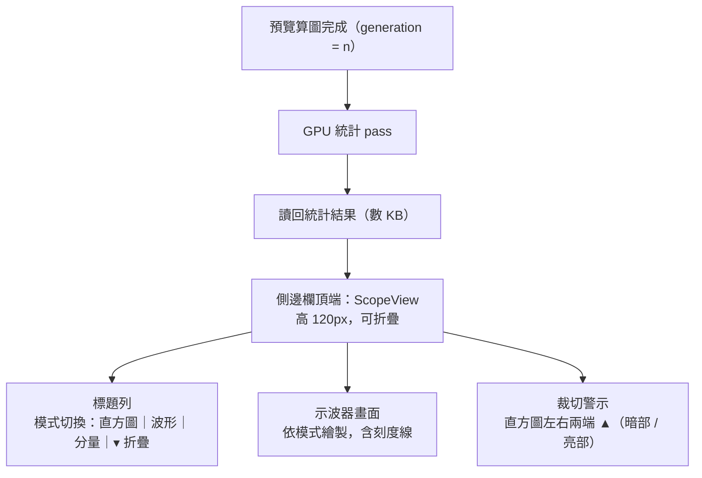

| 模式 | 內容 | 用途 |
|---|---|---|
| **直方圖** | R、G、B 三通道疊合（加法混色，重疊處呈白色）＋ 亮度輪廓線；256 個區間 | 整體亮度分布、通道是否裁切 |
| **波形圖** | 橫軸對應影像的水平位置，縱軸為亮度（0–100%），以點的密度表示該位置的像素數量 | 看出畫面中「哪一區」過亮或過暗，例如天空、暗角、漏光的範圍 |
| **RGB 分量圖** | 波形圖的 R、G、B 三通道並排（parade） | 判斷色偏、白平衡與配方的通道曲線差異 |

- **位置**：右側邊欄分頁內容的頂端，三個分頁（預設庫、照片基本參數、照片匯出）共用，切換分頁時保持顯示，不隨捲動移動；可折疊為只剩標題列。模式與折疊狀態存入 `settings.json`。
- **資料來源**：預覽算圖的最終結果（顯示空間的 sRGB 編碼值，也就是畫面上看到的影像），不是線性光中間值。按住空白鍵看原圖時，示波器同步改為顯示原圖的分布；左右分割對比時顯示調整後的結果。
- **多選**：以焦點照片計算（與預覽畫布相同）。
- **裁切警示**：任一通道值為 0 或 255 的像素超過總數 0.1% 時，直方圖對應端的 ▲ 亮起（暗部、亮部分開）；滑鼠停留顯示裁切比例。點擊 ▲ 可在預覽畫布上暫時以色塊標出裁切區域（暗部藍、亮部紅），再點一次取消。
- **刻度**：波形圖與分量圖在 0%、25%、50%、75%、100% 畫淡色刻度線；直方圖不畫刻度。
- **配色**：示波器的 R / G / B 與裁切標示屬於「資料顯示」，與預覽影像一樣不受 2.2.2「介面灰階 R = G = B」的限制；背景使用畫布色，刻度線使用 `FB.BorderBrush`。
- **更新頻率**：隨預覽每一幀更新，不另外排程；拖曳中預覽降為 800px 時，示波器也以 800px 結果計算。示波器折疊或面板隱藏（`Tab`、全螢幕）時不執行統計 pass。
- **實作**：自訂控制項 `ScopeView`（不使用 `Image` 控制項），以 `WriteableBitmap` 繪製統計結果；繪製本身在 UI 執行緒只做「把統計值畫成點」，不碰影像像素。

#### 2.4.7 照片匯出（側邊欄分頁）

匯出設定放在側邊欄的分頁中（`ExportPanelView`，ViewModel 為 `ExportViewModel`），而不是對話框：設定時仍看得到預覽與縮圖列，也可以一邊調整選取範圍一邊看張數變化。

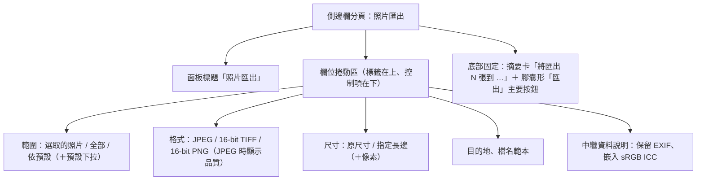

- 欄位與選項見第 10 章；側邊欄寬度有限，因此每個欄位採「標籤在上、控制項在下」的直向排列，下拉選單撐滿寬度。
- 摘要卡即時顯示「將匯出 N 張到 …」；切換到本分頁、選取改變或預設庫改變時重新計算。目的地未填時預設為 `<資料夾>/export/`；多選時範圍自動改為「選取的照片」（使用者自行選過的範圍不覆蓋）。
- 按下「匯出」後工作排入背景佇列（見 10、11.5），進度顯示在底部狀態列右側；分頁本身不鎖住，可立即調整設定準備下一批。
- 可儲存為匯出預設（M7）。

### 2.5 自訂元件規格

| 元件 | Avalonia 實作 | 行為規格 |
|---|---|---|
| **ParamRow** | `UserControl`，兩行式（高 46px）：上行「名稱 ● ｜ 數值框（靠右）」，下行整寬 `ParamSlider` | 參數名稱平常為次要文字色；被覆寫時名稱改為主文字色並加粗、名稱後顯示琥珀色 ●（`Classes.overridden` 繫結）；雙擊名稱重設回預設值；數值框平常看起來像文字，滑過顯示底色、編輯時顯示強調色焦點框，可直接輸入；滑桿與數值框同步 |
| **滑桿滾輪行為** | `ParamSlider : Slider` | **只有在滑桿取得焦點時才處理 `PointerWheelChanged`**，否則不標記 `Handled`，讓事件冒泡給 `ScrollViewer`，避免捲動面板時誤改參數 |
| **滑桿拖曳** | `ParamSlider` | 拖曳中持續送出預覽請求；放開時合併為一筆復原紀錄；按住 `Shift` 微調（步進 ÷ 10） |
| **ChoiceRow** | 單行（高 38px）：名稱 ● ＋ 靠右的扁平 `ComboBox`（寬 ≥ 150px） | 用於底片配方（依品牌分組的下拉選單，含「自訂」分組）、創意風格、照片效果、光圈形狀、版面配置等 |
| **ToggleRow** | 單行（高 38px）：名稱 ● ＋ 靠右的小型 `ToggleSwitch`（不顯示文字） | 用於開關類參數（例如自動裁切） |
| **ModuleSection** | `HeaderedContentControl`（自訂 `ControlTemplate`）：標題列（高 40px，無底色）＋ 內容區，區塊之間以 `FB.DividerBrush` 細線分隔 | 標題列由左到右：名稱（14px SemiBold）｜● 覆寫數｜👁 啟用｜`⋯` 選單｜⌄ 折疊箭頭；點名稱或箭頭折疊 / 展開，滑過時標題列顯示 `FB.HoverOverlayBrush`；**眼睛圖示**切換模組啟用（關閉時為劃線的眼睛、名稱改為停用色），內容區淡化但仍可預先調整；`⋯` 選單提供「重設此模組」「只複製此模組」 |
| **SidebarTabRail** | 側邊欄外緣的 `RadioButton`（`Classes="rail"`，自訂 `ControlTemplate`）直列 | 見 2.4.2；作用中的分頁以底色與亮圖示標示 |
| **PresetItem** | `TreeViewItem` 的 `DataTemplate`：圓形色彩標籤 ＋ 名稱 ＋ 釘選鍵標記 | 可拖曳；停留 500ms（`ToolTip.ShowDelay`）顯示效果縮圖 |
| **ThumbnailView** | `ListBoxItem` 的 `DataTemplate`：縮圖 ＋ 標記 | 見 2.4.4 |
| **ControlPoint** | `PreviewCanvas` 內繪製的圓形把手 | 見 2.4.3 |
| **ScopeView** | 自訂 `Control`，以 `WriteableBitmap` 繪製 GPU 讀回的統計結果 | 直方圖 / 波形 / 分量三種模式、裁切警示 ▲；見 2.4.6 |
| **ToastBar** | 底部狀態列上方置中的膠囊形非阻斷提示（覆蓋層 `Panel`，帶柔和陰影） | 3 秒後自動消失（`DispatcherTimer`），可附「復原」按鈕（例如「已貼上到 12 張照片｜復原」） |

### 2.6 互動狀態

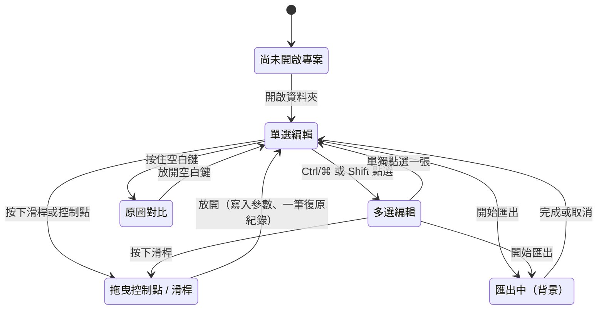

匯出在背景進行，**匯出期間仍可繼續編輯其他照片**。匯出開始時，會先為每張照片建立參數快照（不可變的 `record`），所以匯出期間的修改不會影響已排入佇列的照片。匯出與預覽共用同一個 GPU，排程器讓預覽請求優先（見 11.3）。

### 2.7 主要互動流程

#### 2.7.1 指定預設

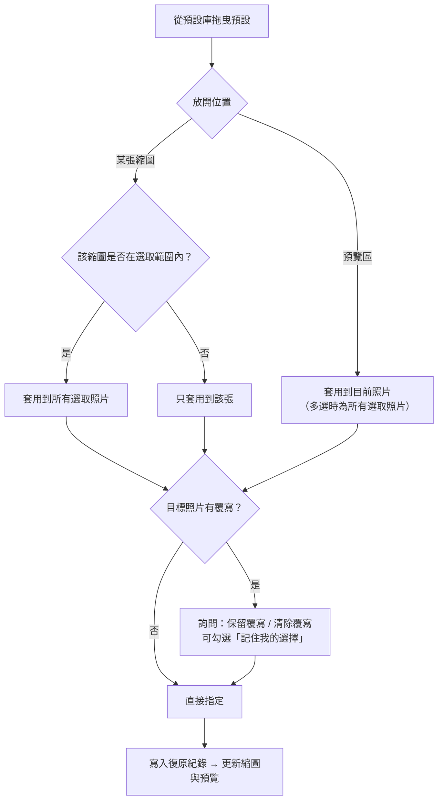

#### 2.7.2 複製與貼上

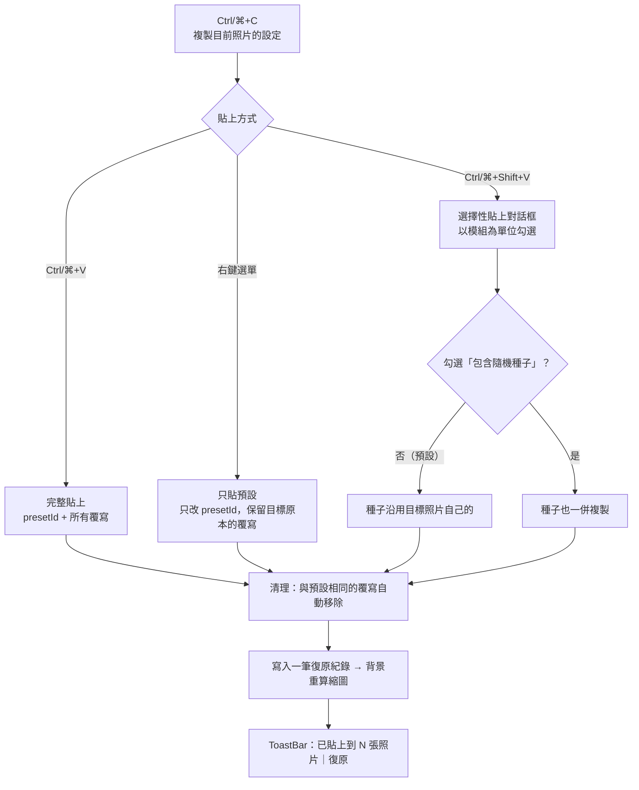

設定剪貼簿為程式內部狀態；同時以 JSON 寫入系統剪貼簿，方便在兩個 FilmBatch 視窗之間貼上。

### 2.8 對話框

所有對話框皆為 `Window` + `ShowDialog<TResult>(owner)`，以 ViewModel 回傳結果，使用原生標題列與 `FB.WindowBrush` 背景；確認類詢問以自訂的小型對話框實作。**匯出不是對話框**，而是側邊欄的「照片匯出」分頁（見 2.4.7）。

| 對話框 | 內容 | 規格 |
|---|---|---|
| **選擇性貼上** | 16 個模組的勾選清單（分組：色彩類 / 光學類 / 表面類）、「包含隨機種子」、「貼上時鏡像位置」 | 提供「全選」「全不選」「只選色彩類」快捷按鈕；記住上次的勾選 |
| **預設管理** | 預設清單、分類、色彩標籤、匯入 / 匯出 YAML | 刪除預設時顯示「有 N 張照片使用中，將改用專案內快照」 |
| **偏好設定** | 預覽背景色、預覽代理圖尺寸、GPU 介面卡選擇（多顯卡時）與後端偏好、GPU 記憶體上限、材質庫與自訂配方資料夾、預設參考色溫、語言 | 修改後立即生效（切換介面卡需重新建立 GPU 裝置） |
| **同步預設** | 列出所用預設已更新的照片，可逐張或全部同步 | 見 4.4 |

### 2.9 回饋與錯誤處理

- 背景工作（縮圖、預覽、匯出）的進度統一顯示在狀態列右側，點擊可展開工作清單（`Flyout`）。
- 讀檔失敗的照片在縮圖列顯示錯誤圖示，滑鼠停留可看原因，不影響其他照片。
- **GPU 裝置遺失**（驅動程式重置、外接顯示卡拔除）時，引擎自動重建裝置並重新上傳目前照片，狀態列提示「GPU 已重新初始化」，不中斷操作；匯出佇列中的工作自動重試。
- 啟動時找不到硬體 GPU 介面卡，改用軟體介面卡並以 ToastBar 說明效能會受影響。
- 只有「會影響多張照片且無法復原」的操作才跳出確認對話框，例如刪除預設、把調整更新回預設。其餘操作一律可復原，不額外確認。
- 未處理的例外由 `Dispatcher.UIThread.UnhandledException` 與 `TaskScheduler.UnobservedTaskException` 統一攔截，寫入 log 並以 ToastBar 提示，不直接讓程式結束。

### 2.10 多國語系

- 所有介面字串放在 `.resx` 資源檔（`Strings.resx`、`Strings.en.resx`），以強型別資源類別在 ViewModel 中使用，XAML 中以自訂 `{l:Tr Key}` 標記延伸存取，切換語言時即時更新。
- 預設語言為繁體中文，英文列為後續擴充。

### 2.11 M0 的 UI 交付物

| # | 交付物 | 說明 |
|---|---|---|
| 1 | `Themes/Colors.axaml` + `Themes/Controls.axaml` | Fluent 深色主題 + 自訂資源，依 2.2 的規格實作 |
| 2 | **元件展示視窗**（Widget Gallery） | 列出所有自訂元件的各種狀態：一般、滑鼠停留、按下、停用、被覆寫、多選，用來檢查主題一致性；以 `--gallery` 參數啟動 |
| 3 | **可操作原型** | 主視窗、側邊欄（預設庫、照片基本參數、照片匯出三個分頁）、縮圖列皆可操作；使用範例照片與「假算圖器」，用來驗證互動與流暢度 |
| 4 | 對話框與匯出分頁原型 | 選擇性貼上、預設管理、偏好設定對話框，以及側邊欄的照片匯出分頁（尚無實際功能） |
| 5 | 資料流驗證 | 原型已串接第 4 章的三層設定模型與復原堆疊 |
| 6 | **GPU 技術驗證（spike）** | 「假算圖器」直接以 WGSL compute shader 實作（亮度、飽和、一個可分離高斯模糊），驗證：C# WebGPU 綁定的選型（見 9.1）、上傳 16-bit 影像 → 運算 → 讀回 → `WriteableBitmap` 的完整路徑與延遲、三平台後端（DX12 / Metal / Vulkan）與軟體介面卡 |
| 7 | **三平台發佈冒煙建置** | 原型以 `dotnet publish` 在三個平台各發佈一次並能啟動，確認 wgpu-native、SkiaSharp、Magick.NET 原生函式庫都能載入（見 9.4） |
| 8 | UI 規範定稿 | 依原型實際操作回饋修訂本章，凍結為 v1 UI 規範 |

---

## 3. 核心概念

### 3.1 三層設定模型

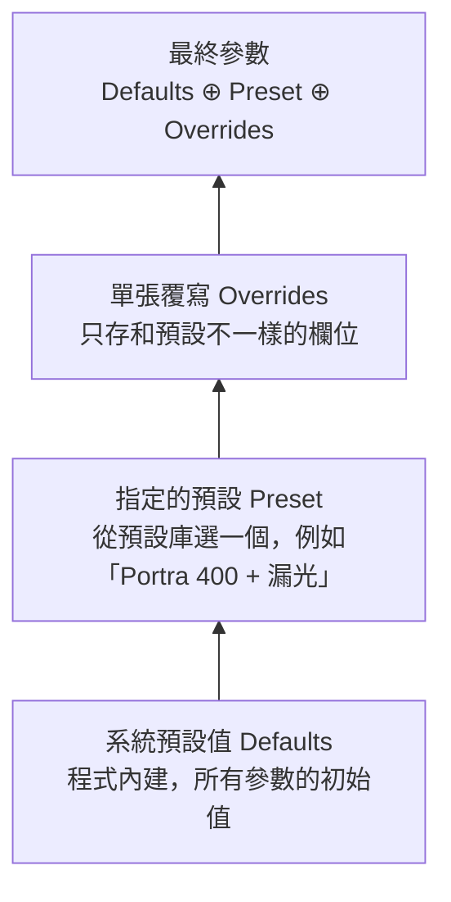

這樣設計的好處：

- **修改預設會自動同步**：把預設的顆粒調大，所有使用這個預設的照片都會跟著變，但每張手動調過的欄位不受影響。
- **單張覆寫一目了然**：UI 標示哪些參數被這張照片改過，並提供「重設回預設」。
- **檔案很小**：每張照片只存幾個差異欄位。

### 3.2 效果模組與開關

- 每個效果都是一個**模組**，有一個 `enabled` 開關。開關與其他參數一樣，可存進預設、可被單張覆寫、可被複製。
- 關閉的模組完全不參與運算（不派送對應的 shader）。
- 模組的**執行順序固定**，由處理管線決定（第 5 章），不開放拖曳排序。
  - 理由：順序會大幅影響物理正確性（例如顆粒一定要在最後），固定順序讓結果可預期，預設也更容易共用。

### 3.3 預設庫

- 預設是一份 YAML 檔，內容是一組完整參數，包含各模組的開關。
- 預設庫存在使用者設定資料夾，可跨專案重複使用（路徑見 9.2）。
- 每個預設有唯一 ID（`Guid`），改名不會影響已指定的照片。
- 可分類、可設定色彩標籤、可附帶效果縮圖。

### 3.4 照片設定的操作

| 操作 | 行為 |
|---|---|
| **指定預設** | 設定照片的 `presetId`；可選擇保留或清除既有覆寫 |
| **微調** | 修改參數；與預設相同的值會自動從覆寫中移除 |
| **重設單一參數** | 移除該欄位的覆寫 |
| **重設單一模組** | 移除該模組所有欄位的覆寫 |
| **重設此張** | 清除所有覆寫，回到純預設 |
| **以此張建立新預設** | 把目前最終參數存成新預設，並讓這張改指定為新預設（覆寫清空） |
| **把此張的調整更新回預設** | 將覆寫合併回預設（會影響所有使用該預設的照片，需確認） |

### 3.5 複製設定的規則

流程見 2.7.2。補充規則：

- 選擇性貼上時，被勾選的模組（含開關）會寫成目標照片的覆寫，再依「與預設相同則移除」的規則清理。
- **隨機種子預設不複製**：漏光、顆粒、灰塵與刮痕、古典版材、多格分鏡等隨機效果，每張照片依檔名產生自己的種子，否則貼上後每張的形狀會一模一樣。
- **位置類參數以正規化座標儲存**（0–1），所以在不同尺寸、不同長寬比的照片間貼上仍然合理；可選擇「貼上時鏡像位置」，方便橫直幅混用。
- **雙重曝光的來源**若是「本張自己」，貼上後使用目標照片自己；若是指定檔案，則沿用該檔案。

---

## 4. 資料模型

### 4.1 類別關係

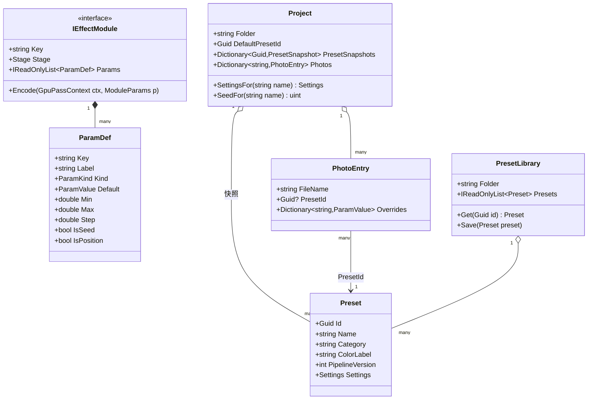

- `ParamValue` 為小型的不可變值型別（`readonly record struct`），可容納數值、布林、字串（選項 key、相對路徑）三種內容，避免以 `object` 裝箱。
- `Settings` 為扁平 key → `ParamValue` 的不可變字典（`ImmutableDictionary` 或 `FrozenDictionary`），可安全地在背景執行緒間傳遞。
- 模組的數值參數在算圖時打包成對應 WGSL `struct` 的 uniform 緩衝區（欄位佈局由 schema 產生，見 11.2）。

### 4.2 預設檔（YAML）

以 YamlDotNet 讀寫；檔案中的 key 使用 snake_case，C# 端以命名慣例轉換為 PascalCase 屬性。

```yaml
id: 3f2a9c1e-8b4d-4e2a-9f1c-0a7b6d5e4c3b
name: Portra 400 + 漏光
category: 人像
color_label: "#D98E2B"
pipeline_version: 1
modules:
  basic:      { enabled: true, exposure: 0.0, brightness: 5, contrast: 0, highlights: -10,
                shadows: 10, temperature: 0, tint: 0, saturation: 0, structure: 0 }
  lens_distortion: { enabled: false, amount: 0, chromatic: 0, edge_soften: 0, auto_crop: true }
  multi_lens: { enabled: false }
  double_exposure: { enabled: false }
  bokeh:      { enabled: false }
  zoom_rotate_blur: { enabled: false }
  motion_blur:{ enabled: false }
  vignette:   { enabled: true, amount: 15, size: 60, roundness: 0, feather: 60,
                center_x: 0.5, center_y: 0.5 }
  halation:   { enabled: true, amount: 20, threshold: 70, radius: 30, hue: 10 }
  light_leak: { enabled: true, mode: procedural, amount: 35, angle: 30, size: 40, hue: 25,
                irregularity: 50 }
  film:       { enabled: true, recipe: kodak-portra-400, strength: 85, style: portrait,
                saturation: -1, contrast: -1, sharpness: 0, white_balance: auto,
                amber_blue: 3, green_magenta: 1, effect: off, effect_option: null,
                exposure: 2, dro: auto, wb_reference: 5500 }   # exposure 以 1/3 EV 為單位
  photo_plate:{ enabled: false }
  tone:       { enabled: true, shadow_hue: 200, shadow_amount: 10, highlight_hue: 40,
                highlight_amount: 15, balance: 0 }
  detail:     { enabled: true, sharpen: 0, clarity: 0 }
  dirt_scratches: { enabled: false }
  grain:      { enabled: true, amount: 25, size: 30, roughness: 50, color: 30 }
```

### 4.3 專案檔（JSON）

存在 `<照片資料夾>/.filmbatch/project.json`，以 `System.Text.Json` 的原始碼產生器（`JsonSerializerContext`）讀寫，屬性命名使用 snake_case：

```json
{
  "pipeline_version": 1,
  "default_preset_id": "3f2a9c1e-...",
  "preset_snapshots": {
    "3f2a9c1e-...": { "name": "Portra 400 + 漏光", "updated_at": "2026-10-13T15:00:00", "settings": { } }
  },
  "photos": {
    "DSC_0012.tif": {
      "preset_id": "3f2a9c1e-...",
      "overrides": { "basic.exposure": 0.3, "light_leak.amount": 50, "bokeh.enabled": true }
    },
    "DSC_0013.tif": { "preset_id": "a81b...", "overrides": {} }
  }
}
```

- 寫檔採「寫入暫存檔 → `File.Move(overwrite: true)`」的原子替換，避免當機時專案檔損毀。

### 4.4 預設快照與同步

預設庫是全域的，日後修改或刪除預設時，舊專案的結果不應該在不知情的情況下改變。因此專案會保存所用預設的快照：

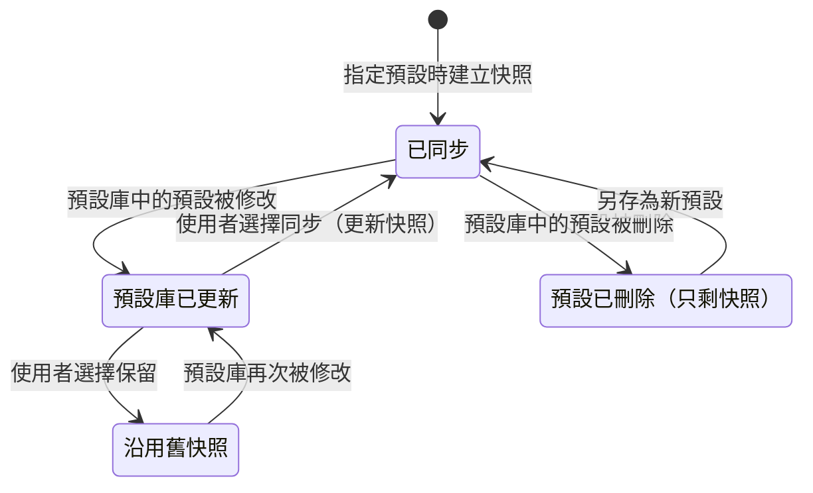

預設庫資料夾以 `FileSystemWatcher` 監看，外部修改 YAML 時自動重新載入並更新同步狀態。

### 4.5 設計決策

- **參數 key 一律扁平化**：格式為 `模組.參數`，例如 `bokeh.blur`。合併、比對、複製都以扁平 key 處理；YAML 只是為了好讀才寫成巢狀。
- **沒有指定預設的照片**：使用 `default_preset_id`，新匯入的照片也自動指定為它。
- **`pipeline_version`**：日後改進演算法時，舊專案仍以舊版演算法算圖，避免結果突然改變（概念同主流 RAW 編輯器的「處理版本」）。shader 依版本分資料夾保存（`Shaders/v1/`、`Shaders/v2/`），舊版 shader 不刪除。
- **檔案路徑**：專案內引用的材質或雙重曝光影像一律存相對路徑，並使用 `/` 分隔，確保專案在三個作業系統之間搬移仍可開啟。
- **核心資料不依賴 Avalonia 與 GPU**：`FilmBatch.Core` 只引用 BCL 與 YamlDotNet，可在沒有 GPU 的環境下完整測試。

---

## 5. 影像處理管線

### 5.1 輸入假設與 GPU 資料格式

- 輸入是 RAW 編輯器已完成基礎調色的 **sRGB** 影像，建議使用 16-bit TIFF，避免色階斷層。
- 這是「顯示參考」（display-referred）影像，不是場景線性資料。所以配方的色調曲線（見 7.3）必須保持 0→0、1→1，不能再套一次完整的 S 曲線，否則對比會被重複壓縮。
- **CPU 端**：Magick.NET 解碼、EXIF 轉正，轉成 16-bit RGBA 後上傳 GPU。CPU 不做任何效果運算。
- **GPU 端**：
  - 上傳紋理 `rgba16uint` 或 `rgba16float`，第一個 shader 轉成**線性光 `rgba32float`** 的工作紋理。
  - 管線在兩張工作紋理之間來回寫入（ping-pong），每個模組是一到數個 compute pass；需要多次模糊的模組另外配置暫存紋理，由紋理池重複使用。
  - 區段快取（見 12）以 `rgba16float` 保存以節省顯示記憶體。
  - 輸出 pass 轉回 sRGB：預覽輸出 `rgba8unorm`（BGRA 排列）讀回顯示；匯出輸出 16-bit 讀回再交給 Magick.NET 編碼。
- **尺寸上限**：一般 GPU 支援的 2D 紋理邊長上限為 8192–16384。啟動時查詢介面卡的 `maxTextureDimension2D` 與 `maxBufferSize`；超過上限或顯示記憶體不足的匯出改為**分塊算圖**（見 12）。

### 5.2 處理順序

光學與曝光類效果在**線性光**中進行，模糊時高光才會形成自然的光斑，疊加時亮度才會正確相加。

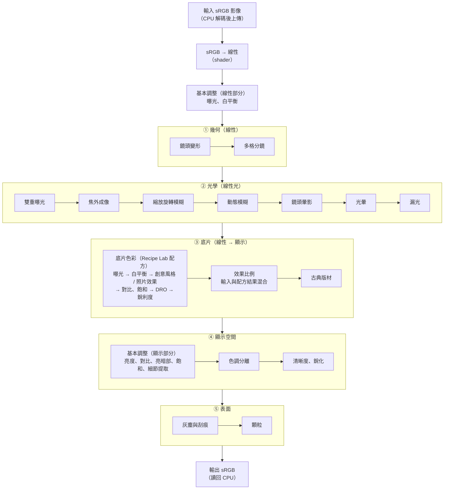

排序上的考量：

- **鏡頭暈影在光學區段**：暗角是鏡頭的光學現象，發生在底片曝光之前，所以在線性光中以乘法處理，高光區域的暗角會被配方的色調曲線自然壓縮。
- **光暈與漏光放在模糊之後**：它們發生在底片乳劑上，不應該被鏡頭模糊。
- **灰塵與刮痕在底片之後、顆粒之前**：灰塵與刮痕位於底片表面，不會被底片的色彩曲線改變顏色，但仍會被顆粒覆蓋。
- **顆粒最後加入**：才不會被其他調整放大。
- **逐像素模組可合併**：相鄰且只做逐像素運算的模組（例如基本調整線性部分、暗角、底片色彩的逐像素部分、色調分離；底片色彩的 DRO 與銳利度為空間運算，不合併），日後可由 shader 組合器合併成單一 pass，減少紋理讀寫（見 12）。

### 5.3 模組與參數清單

所有參數集中定義在一份 schema 中（key、顯示名稱、型別、範圍、預設值、步進、是否為隨機種子、是否為位置座標）。schema 以 C# 程式碼宣告於各模組類別，啟動時由 `ModuleRegistry` 收集。UI 面板、YAML 讀寫、合併、驗證、選擇性貼上、**WGSL uniform struct 的佈局**都由這份 schema 自動產生，新增參數時只需要改一個地方。

座標類參數（`center_x`、`center_y`…）以 0–1 正規化表示；尺寸類參數以短邊比例換算。

下列「實作」皆指 WGSL compute shader。共用的工具函式（色彩空間轉換、雜湊亂數、雜訊、可分離模糊、取樣）放在 `Shaders/common/`，由 shader 前處理器組合（見 11.4）。

#### 5.3.1 基本調整 `basic`

| 參數 | 範圍 | 說明 |
|---|---|---|
| exposure | −3 ~ +3 EV | 曝光（線性） |
| temperature / tint | −100 ~ 100 | 色溫、綠↔洋紅（線性） |
| brightness | −100 ~ 100 | 中間調亮度 |
| contrast | −100 ~ 100 | 對比 |
| highlights / shadows | −100 ~ 100 | 亮部、暗部 |
| saturation | −100 ~ 100 | 飽和度 |
| structure | −100 ~ 100 | 細節提取：中頻局部對比 |

實作：線性與顯示兩部分各為一個逐像素 pass；`structure` 需要一次中半徑模糊（共用可分離高斯）。

#### 5.3.2 鏡頭變形 `lens_distortion`

| 參數 | 範圍 | 說明 |
|---|---|---|
| amount | −100 ~ 100 | 負值為桶狀（魚眼感），正值為枕狀 |
| chromatic | 0 ~ 100 | 橫向色散：紅、藍通道以不同半徑縮放，邊緣出現彩色鑲邊 |
| edge_soften | 0 ~ 100 | 邊緣柔化，模擬廉價鏡頭邊緣解像力下降 |
| auto_crop | 開 / 關 | 自動放大，裁掉變形後的黑邊 |

實作：每個輸出像素以徑向多項式 `r' = r·(1 + k1·r² + k2·r⁴)` 反算來源座標，以雙線性取樣（或 bicubic，品質選項）讀取；R、B 通道使用略為不同的 k 值形成色散；邊緣柔化依半徑混合原圖與模糊版本。

#### 5.3.3 多格分鏡 `multi_lens`

| 參數 | 範圍 | 說明 |
|---|---|---|
| layout | 2 橫格 / 3 橫格 / 4 橫格 / 2 直格 / 2×2 / 4 格交錯 | 版面配置 |
| offset | 0 ~ 100 | 各格之間的畫面錯位量（模擬鏡頭視差） |
| zoom_variation | 0 ~ 100 | 各格的縮放差異 |
| exposure_variation | 0 ~ 100 | 各格的曝光差異（模擬快門不一致） |
| color_variation | 0 ~ 100 | 各格的色偏差異 |
| divider | 0 ~ 100 | 分隔線柔和度（0 = 硬邊，100 = 完全漸層融合） |
| seed | 整數 | 各格隨機變化的種子 |

實作：各格的位移、縮放、曝光與色偏在 CPU 端由種子算出，以 uniform 陣列傳入；單一 pass 中每個像素判斷所屬格子與羽化權重，從原圖取樣後合成。

#### 5.3.4 雙重曝光 `double_exposure`

| 參數 | 範圍 | 說明 |
|---|---|---|
| source | 本張自己 / 專案內另一張 / 外部檔案 | 第二次曝光的影像來源 |
| source_path | 相對路徑 | 來源為檔案或其他照片時使用 |
| blend | 相加 / 濾色 / 變亮 / 色彩增值 | 合成模式（在線性光中計算） |
| opacity | 0 ~ 100 | 第二次曝光的強度 |
| offset_x / offset_y | −0.5 ~ 0.5 | 位移（正規化） |
| scale | 50 ~ 200 % | 縮放 |
| rotation | −180 ~ 180° | 旋轉 |
| mirror | 無 / 水平 / 垂直 | 鏡像（可用同一張圖做重影效果） |
| exposure_balance | −100 ~ 100 | 兩次曝光的亮度分配，避免疊加後過曝 |

實作：第二張影像上傳為另一張紋理，仿射轉換矩陣在 CPU 端算好以 uniform 傳入，shader 以反向映射取樣後在線性光中合成。「相加」最接近底片實際的兩次曝光，搭配 `exposure_balance` 讓總曝光量維持合理。

#### 5.3.5 焦外成像 `bokeh`

| 參數 | 範圍 | 說明 |
|---|---|---|
| center_x / center_y | 0 ~ 1 | 對焦點（可在預覽上拖曳） |
| focus_size | 0 ~ 100 | 清晰區大小 |
| focus_shape | 圓形 / 橢圓 / 水平帶 / 垂直帶 | 清晰區形狀（水平帶可做移軸效果） |
| aspect / angle | — | 橢圓長寬比、帶狀區角度 |
| transition | 0 ~ 100 | 清晰區到模糊區的過渡寬度 |
| blur | 0 ~ 100 | 最大模糊量 |
| shape | 圓形 / 六角形 / 八角形 / 貓眼 | 光圈形狀，決定光斑外觀 |
| highlight_boost | 0 ~ 100 | 光斑亮度增強 |

實作：

- 先以 shader 產生「模糊半徑圖」（依清晰區形狀與過渡計算每個像素的模糊程度）。
- 模糊前先提高高光、模糊後還原，才會出現明顯的光斑。
- **主要做法：散射 / 聚集式（gather）可變半徑模糊**。在半解析度上以光圈形狀的取樣點陣（黃金角螺旋或多邊形取樣）聚集鄰近像素，取樣權重依鄰近像素自身的模糊半徑決定，避免清晰前景被背景「吃掉」；最後與全解析度清晰影像依半徑圖混合。
- 六角形 / 八角形光圈可改用多次方向性一維模糊組合（類似遊戲引擎的六角形景深），成本與半徑呈線性關係。
- 貓眼形狀：依離畫面中心的方向，裁切取樣點陣（模擬機械暈影）。
- 備案：若聚集式在大半徑下品質不足，再實作 GPU FFT（Stockham）卷積處理固定光圈形狀，並以多級模糊內插近似可變模糊。

#### 5.3.6 縮放和旋轉模糊 `zoom_rotate_blur`

| 參數 | 範圍 | 說明 |
|---|---|---|
| center_x / center_y | 0 ~ 1 | 模糊中心（可在預覽上拖曳） |
| zoom | 0 ~ 100 | 放射狀模糊（爆炸變焦） |
| rotate | −100 ~ 100 | 旋轉模糊，正負代表方向 |
| protect_radius | 0 ~ 100 | 中心保護區半徑 |
| transition | 0 ~ 100 | 保護區過渡寬度 |

實作：每個像素沿「指向中心的方向」（放射）或「以中心為圓心的圓弧」（旋轉）取 N 個樣本平均，樣本數依模糊長度自動決定；大量模糊時以多次較短的 pass 疊代（每次長度倍增），以少量樣本達到長距離平滑。最後依保護區遮罩與原圖混合。GPU 上不需要極座標轉換。

#### 5.3.7 動態模糊 `motion_blur`

| 參數 | 範圍 | 說明 |
|---|---|---|
| angle | 0 ~ 180° | 模糊方向 |
| length | 0 ~ 100 | 模糊長度（短邊比例） |
| protect_enabled | 開 / 關 | 是否啟用保護區 |
| protect_x / protect_y / protect_size | — | 保護區，例如保持主體清晰（可在預覽上拖曳） |

實作：沿指定方向的一維線段取樣（同樣採用疊代倍增），在線性光中模糊，依保護區遮罩混合。

#### 5.3.8 鏡頭暈影 `vignette`

| 參數 | 範圍 | 說明 |
|---|---|---|
| amount | −100 ~ 100 | 正值變暗（暗角），負值變亮（亮角） |
| size | 0 ~ 100 | 暈影起始位置 |
| roundness | −100 ~ 100 | −100 貼合畫面矩形，100 為正圓 |
| feather | 0 ~ 100 | 漸層柔和度 |
| center_x / center_y | 0 ~ 1 | 暈影中心（可在預覽上拖曳） |

實作：逐像素 pass，以超橢圓距離函式計算衰減並乘上線性值。

#### 5.3.9 光暈 `halation`

| 參數 | 範圍 | 說明 |
|---|---|---|
| amount | 0 ~ 100 | 強度 |
| threshold | 0 ~ 100 | 高光閾值 |
| radius | 1 ~ 100 | 擴散半徑 |
| hue | 0 ~ 60 | 色相（紅 → 橘） |

實作：取亮度超過閾值的部分（軟閾值），建立降採樣金字塔做兩種半徑的模糊（類似 bloom 的 downsample / upsample 鏈），染色後加回線性影像。

#### 5.3.10 漏光 `light_leak`

| 參數 | 範圍 | 說明 |
|---|---|---|
| mode | 程序化 / 材質 | 程序化自動產生；材質則從漏光材質庫挑選 |
| texture | 材質名稱或「隨機」 | 材質模式使用 |
| amount | 0 ~ 100 | 強度 |
| angle | 0 ~ 360° | 漏光從畫面哪個邊緣進入 |
| size | 5 ~ 100 | 範圍 |
| hue | 0 ~ 360 | 色相（材質模式時為色相偏移） |
| irregularity | 0 ~ 100 | 不規則度（程序化模式） |
| count | 1 ~ 3 | 漏光數量 |
| seed | 整數 | 樣式種子 |

實作：程序化模式在 shader 中以正規化座標計算從畫面邊緣某點向內衰減的光斑，以低頻雜訊（以種子決定的值雜訊 / simplex）扭曲形狀，中心偏白、邊緣飽和；材質模式則把黑底的漏光掃描圖上傳為紋理，轉線性、縮放旋轉後相加。兩者都是在線性光中「增加曝光」，再由配方的色調曲線壓縮，看起來比 Screen 混合更像真的漏光。

#### 5.3.11 底片色彩 `film`

> **已由 [film-looks.md](film-looks.md) 取代**（2026-10）：`film` 模組改為 底片顏色模擬（RawTherapee Hald CLUT ＋ 八色相帶修正），本節的 Recipe Lab 配方、Sony 成像模擬與自訂配方已移除，僅保留作為歷史紀錄。

| 參數 | 範圍 | 說明 |
|---|---|---|
| recipe | 內建配方 key 或 `custom:名稱` | 底片配方（Recipe Lab 的 77 組內建配方或自訂配方，見第 7 章） |
| strength | 0 ~ 100 % | 效果比例（輸入與配方結果混合） |
| style | standard / vivid / neutral / portrait / clear / deep / light / mono / sepia | 創意風格 |
| saturation / contrast / sharpness | −9 ~ +9 | 創意風格的飽和、對比、銳利度（範圍比照 Sony 四代機選單；校準數據只到 ±3，±4 ~ ±9 以 ±3 端點等比外推） |
| white_balance | auto / keep / 2500K ~ 9900K | 白平衡（auto 與 keep 皆沿用輸入） |
| amber_blue / green_magenta | −7 ~ +7 | 白平衡微調 |
| effect / effect_option | 見 7.2 | 照片效果與其子參數；啟用時忽略創意風格 |
| exposure | −15 ~ +15（1/3 EV 格數） | 曝光補償，顯示為 −5.0 ~ +5.0 |
| dro | off / 1 ~ 5 / auto | 動態範圍最佳化 |
| wb_reference | 2500 ~ 9900 K | 參考色溫：輸入影像被視為在此色溫下已平衡（只影響指定色溫的配方） |

選擇 `recipe` 時，`style` 到 `dro` 的欄位會帶入該配方的值；各欄位之後仍可單獨覆寫，與配方不同時顯示 EDITED 標記。底片的色彩與顆粒拆成「底片色彩」與「顆粒」兩個模組，讓兩者可以獨立微調與複製。實作見第 7 章。

#### 5.3.12 古典版材 `photo_plate`

模擬 19 世紀的濕版、錫版等古典攝影質感。

| 參數 | 範圍 | 說明 |
|---|---|---|
| plate_type | 錫版 / 玻璃濕版 / 藍曬 / 蛋白相紙 | 決定基本色調與感光特性 |
| strength | 0 ~ 100 % | 與底片色彩結果的混合比例 |
| ortho | 0 ~ 100 | 正色性感光：紅色偏暗、藍色偏亮 |
| tint_hue / tint_amount | 0 ~ 360 / 0 ~ 100 | 自訂染色 |
| edge_erosion | 0 ~ 100 | 版材邊緣的不規則塗佈與剝落 |
| stains | 0 ~ 100 | 化學污漬與流痕 |
| uneven | 0 ~ 100 | 塗佈不均造成的明暗起伏 |
| seed | 整數 | 隨機紋理種子 |

實作：依版材的感光權重轉成單色（正色性時藍色權重高），再依版材類型染色；邊緣剝落以「到畫面邊緣的距離」（矩形距離可直接解析計算）加上多層低頻雜訊做閾值處理；污漬以多層雜訊的閾值與模糊組合產生；也可疊加材質庫中的版材掃描圖。

#### 5.3.13 色調分離 `tone`

| 參數 | 範圍 | 說明 |
|---|---|---|
| shadow_hue / shadow_amount | 0 ~ 360 / 0 ~ 100 | 暗部色調 |
| highlight_hue / highlight_amount | 0 ~ 360 / 0 ~ 100 | 亮部色調 |
| balance | −100 ~ 100 | 暗部與亮部的分界 |

實作：逐像素 pass。

#### 5.3.14 清晰與銳化 `detail`

| 參數 | 範圍 | 說明 |
|---|---|---|
| clarity | −100 ~ 100 | 清晰度（大半徑局部對比，限中間調） |
| sharpen | 0 ~ 100 | 銳化（小半徑反銳化遮罩，只作用於亮度） |

實作：清晰度使用降採樣金字塔上的大半徑模糊（或邊緣保留的導向濾波）；銳化為全解析度小半徑可分離高斯。

#### 5.3.15 灰塵與刮痕 `dirt_scratches`

| 參數 | 範圍 | 說明 |
|---|---|---|
| mode | 程序化 / 材質 | 程序化自動產生，或從材質庫挑選 |
| dust | 0 ~ 100 | 灰塵點數量 |
| scratches | 0 ~ 100 | 刮痕數量 |
| hairs | 0 ~ 100 | 毛髮 / 纖維數量 |
| polarity | 亮 / 暗 / 混合 | 正片上的灰塵為暗，負片放大後為亮 |
| strength | 0 ~ 100 | 整體不透明度 |
| scale | 50 ~ 200 % | 材質縮放 |
| seed | 整數 | 分布種子 |

實作（程序化）：灰塵、刮痕、毛髮的形狀在 **CPU 端依種子以正規化座標產生**（點的位置與大小、貝茲曲線控制點），以 storage buffer 傳入 GPU；shader 以「到最近圖形的有號距離」（分格加速，每格只檢查附近的圖形）算出抗鋸齒遮罩，再依極性提亮或壓暗。所有尺寸以短邊比例計算，因此與解析度無關。

#### 5.3.16 顆粒 `grain`

| 參數 | 範圍 | 說明 |
|---|---|---|
| amount | 0 ~ 100 | 強度 |
| size | 1 ~ 100 | 顆粒大小（短邊比例） |
| roughness | 0 ~ 100 | 粗糙度（粗細兩層雜訊的比例） |
| color | 0 ~ 100 | 彩色顆粒比例 |

實作：雜訊以「種子 + 正規化座標」為輸入的整數雜湊函式產生（見 5.4），粗細兩層以不同頻率疊加；強度隨亮度變化：中間調最明顯，暗部與亮部較弱。

### 5.4 一致性原則

- **空間參數以短邊比例計算**：半徑、長度、顆粒與灰塵大小都依短邊換算，低解析度預覽與全尺寸匯出看起來一致。
- **座標以正規化表示**：對焦點、模糊中心、暈影中心等皆為 0–1。
- **隨機效果使用固定種子**：種子由「檔名 CRC32（`System.IO.Hashing.Crc32`）+ 模組種子參數」產生。同一張照片每次算圖結果相同；不同照片自動得到不同的漏光、灰塵、刮痕。
- **GPU 亂數用整數雜湊**：shader 內以 PCG / xxHash 類的**整數**雜湊函式（輸入種子與座標）產生亂數，不依賴浮點運算順序，各家 GPU 結果一致；CPU 端需要亂數時（例如灰塵位置）使用相同演算法的 C# 實作，不使用 `System.Random`（其演算法可能隨 .NET 版本改變）。
- **形狀與解析度無關**：隨機形狀以固定大小的低頻網格產生（例如 5×5）再以平滑內插放大；顆粒雜湊的座標先量化到「以短邊比例決定的顆粒格」，所以預覽與匯出的顆粒分布相同（預覽只是較小的取樣）。
- **分塊不影響結果**：分塊算圖時，每塊取足夠的邊界延伸（apron，依該次管線中最大的模糊半徑計算），雜湊亂數以全圖座標計算，所以分塊與否結果相同。
- **浮點精度**：WGSL 的 `f32` 在不同 GPU 間不保證逐位元相同（超越函式如 `exp`、`log`、`pow` 的精度由實作決定）。因此跨裝置以 ΔE 門檻驗證；同一裝置、同一驅動程式要求逐位元相同（見 14）。

---

## 6. 效果模組總覽

### 6.1 模組分類

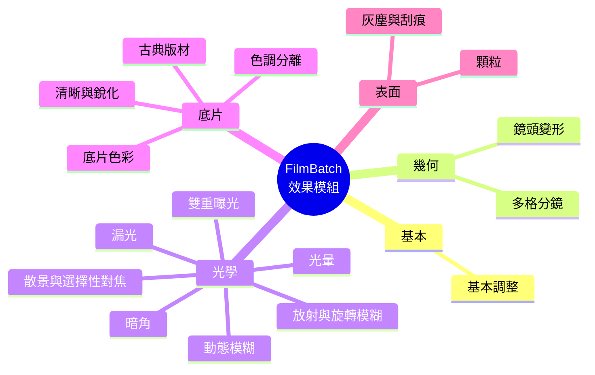

### 6.2 模組特性一覽

| 模組 | key | 階段 | 隨機種子 | 畫布控制點 | 材質 | GPU 成本 | 里程碑 |
|---|---|---|---|---|---|---|---|
| 基本調整 | `basic` | 線性 + 顯示 | — | — | — | 低（含一次中半徑模糊） | M1 |
| 鏡頭變形 | `lens_distortion` | 幾何 | — | — | — | 低 | M5 |
| 多格分鏡 | `multi_lens` | 幾何 | ✓ | — | — | 低 | M6 |
| 雙重曝光 | `double_exposure` | 光學 | — | ✓ | ✓ | 低 | M6 |
| 散景與選擇性對焦 | `bokeh` | 光學 | — | ✓ | — | **高** | M5 |
| 放射與旋轉模糊 | `zoom_rotate_blur` | 光學 | — | ✓ | — | 中 | M5 |
| 動態模糊 | `motion_blur` | 光學 | — | ✓ | — | 中 | M5 |
| 暗角 | `vignette` | 光學 | — | ✓ | — | 極低 | M1 |
| 光暈 | `halation` | 光學 | — | — | — | 中 | M1 |
| 漏光 | `light_leak` | 光學 | ✓ | ✓ | ✓ | 低 | M1（程序化）/ M6（材質） |
| 底片色彩 | `film` | 底片 | — | — | — | 低（開啟 DRO / 銳利度時為中） | M1 |
| 古典版材 | `photo_plate` | 底片 | ✓ | — | ✓ | 低 | M6 |
| 色調分離 | `tone` | 顯示 | — | — | — | 極低 | M1 |
| 清晰與銳化 | `detail` | 顯示 | — | — | — | 中 | M1 |
| 灰塵與刮痕 | `dirt_scratches` | 表面 | ✓ | — | ✓ | 低 | M6 |
| 顆粒 | `grain` | 表面 | ✓ | — | — | 低 | M1 |

說明：

- **隨機種子**：該模組的隨機形狀由「檔名 + 種子參數」決定，複製設定時預設不複製種子（見 3.5）。
- **畫布控制點**：可在預覽上直接拖曳位置類參數（見 2.4.3）。
- **材質**：除了內建程序化效果，也可使用材質庫中的外部素材（見第 8 章）。

### 6.3 模組設計原則

- **單一職責**：每個模組只做一件事，例如底片色彩與顆粒分開，才能各自微調、各自複製。
- **零值即恆等**：參數全為 0 或模組關閉時，輸出必須與輸入完全相同（關閉時不派送 pass；參數為 0 時 shader 的數學也必須是恆等）。
- **物理優先**：光學與曝光類效果在線性光中計算，形狀與強度盡量符合真實光學與底片的行為，而不是單純的圖層混合。
- **程序化優先、材質為輔**：所有效果在沒有任何外部素材時都能運作；材質用於追求特定質感。
- **自有實作**：shader 全部自行撰寫。可參考公開的演算法與論文，以及 RapidRAW 等專案的架構思路，但 **RapidRAW 為 AGPL-3.0 授權，不複製其任何程式碼或 shader**。

---

## 7. 底片色彩配方（移植自 Recipe Lab）

> **已由 [film-looks.md](film-looks.md) 取代**（2026-10）：`film` 模組改為 底片顏色模擬（RawTherapee Hald CLUT ＋ 八色相帶修正），本節的 Recipe Lab 配方、Sony 成像模擬與自訂配方已移除，僅保留作為歷史紀錄。

FilmBatch 的底片色彩**全部搬移自 [Recipe Lab](https://github.com/voxivoid/recipe-lab-sony-pmca)**（voxivoid/recipe-lab-sony-pmca）。該專案是在 Sony PlayMemories Camera Apps 相機（A6000、A6300、A6500、A7 II 等）上執行的小程式，把 77 組「底片模擬 / 相機風格」配方寫進相機設定，讓相機直出就有該風格。FilmBatch 沿用它的配方資料、欄位定義、品牌分組與自訂配方檔格式，再以自有的 GPU shader 在電腦上重現 Sony 相機的成像，讓 RAW 編輯器匯出的照片也能套用這些配方。

### 7.1 來源、範圍與授權

| 項目 | 內容 |
|---|---|
| 來源檔案 | `src/com/voxivoid/recipelab/Recipes.java`（配方表 `Recipes.ALL`）、`docs/DEVELOPMENT.md`（自訂配方格式 1）、`docs/SAMPLES.md` 與 `docs/samples/`（77 張實拍樣張） |
| 搬移內容 | 77 組配方的**原始數值**（一字不改）、欄位語意與範圍、12 個品牌分組與排列順序、自訂配方 YAML 格式 1、樣張（作為校正與回歸測試的參考圖） |
| 不搬移 | Android App 程式碼、相機設定寫入、按鍵與介面；這些與 FilmBatch 無關 |
| 授權 | MIT License，Copyright (c) 2026 André Domingues。於 `THIRD_PARTY_NOTICES.md` 與「關於」對話框保留版權聲明；內建資料檔標頭記錄來源 commit |
| 商標 | 配方名稱沿用 Recipe Lab 的命名，只用來描述「近似的風格」；Kodak、Fujifilm、Ilford 等名稱為各公司商標，FilmBatch 不宣稱與其有關聯 |

Recipe Lab 的配方本身就是**近似**：A6000 無法儲存色調曲線與 log 設定檔，每組配方只用相機可儲存的設定（創意風格、飽和、對比、銳利度、白平衡、曝光補償、照片效果、DRO）去接近目標風格，並非複製其他品牌的色彩科學。FilmBatch 忠實搬移這些設定值，風格的準確度以「與 Recipe Lab 樣張的差距」衡量（見 7.6）。

### 7.2 配方欄位

每組配方是一組 Sony 相機設定。欄位名稱沿用 Recipe Lab 自訂配方格式 1 的 key，數值範圍與相機可儲存的範圍相同：

| 欄位 | 範圍 | 說明 |
|---|---|---|
| `style` | standard / vivid / neutral / portrait / clear / deep / light / mono / sepia | 創意風格（Creative Style）。另有 landscape、sunset、night、red-leaves 為 Recipe Lab 已辨識但內建配方未使用的風格 |
| `saturation` | −9 ~ +9 | 創意風格的飽和度調整 |
| `contrast` | −9 ~ +9 | 創意風格的對比調整 |
| `sharpness` | −9 ~ +9 | 創意風格的銳利度調整 |
| `white-balance` | `auto` / `keep` / `2500K` ~ `9900K`（以 100K 為單位） | 白平衡模式；`auto` 與 `keep` 在 FilmBatch 中都表示「沿用輸入的白平衡」 |
| `amber-blue` | −7 ~ +7 | 白平衡微調，琥珀（+）／藍（−），畫面顯示為 A1 / B1 |
| `green-magenta` | −7 ~ +7 | 白平衡微調，綠（+）／洋紅（−），畫面顯示為 G1 / M1 |
| `effect` | off / toy-camera / pop-color / posterization / retro-photo / soft-high-key / part-color / rough-mono / soft-focus / hdr-art / richtone-mono / miniature / illust / watercolor | 照片效果（Picture Effect）。啟用時相機會**忽略創意風格**（含飽和、對比、銳利度），FilmBatch 照做 |
| `effect-option` | 依效果而定 | 效果的子參數：Soft High-key 色調 blue / pink / green；Toy 色調 normal / cool / warm / green / magenta；Part color 色相 red / green / blue / yellow；Posterization color / b&w |
| `exposure` | −5.0 ~ +5.0（1/3 EV 步進） | 曝光補償；內部以「1/3 EV 的整數格數」儲存，顯示為 +0.3、+0.7、+1.0 |
| `dro` | off / 1 ~ 5 / auto | 動態範圍最佳化（Dynamic Range Optimizer） |

### 7.3 Sony 成像模擬（FilmBatch 自有實作）

Recipe Lab 只提供「相機要設成什麼」，真正的成像是在相機內完成的。FilmBatch 的輸入已是 RAW 編輯器調好的 sRGB 影像，因此把配方解讀為**相對於相機原廠設定 `FACTORY (ST)`（Standard 0/0、白平衡 auto、DRO auto）的差異**：套用 `FACTORY (ST)` 時輸出等於輸入（符合「零值即恆等」原則），其他配方只套用與原廠設定不同的部分。

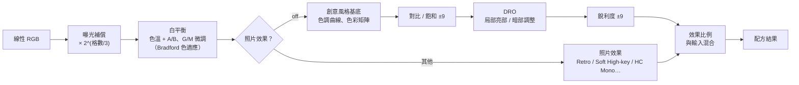

| 步驟 | 做法 |
|---|---|
| 曝光補償 | 在線性光中乘上 `2^(exposure/3)` |
| 白平衡 | `auto` / `keep`：不變。指定色溫：假設輸入已平衡到「參考色溫」`wb_reference`（預設 5500K，可單張覆寫），以 Bradford 色適應把白點從參考色溫移到「相機設定的色溫」所看到的顏色——設定值低於參考色溫時偏藍、高於時偏黃，與在相機上的行為一致。`amber-blue`、`green-magenta` 以每格固定的 mired / CC 偏移疊加（初始係數見 `creative_styles.json`，由 7.6 校正） |
| 創意風格基底 | 每種風格一組參數：色調曲線（logit 空間 `y = sigmoid(k · logit(x) − shift)`，保持 0→0、1→1）、3×3 色彩矩陣（每列總和為 1，中性灰不變）、黑白風格的通道權重、Sepia 的染色。Standard 為恆等，其餘以 Recipe Lab 樣張校正 |
| 對比 / 飽和 | 每格對應曲線斜率 `k` 的倍率與 OKLab 色度的倍率（逐格查表，非線性；初始值每格約 ±12%，由校正決定） |
| DRO | 在降採樣金字塔上以邊緣保留濾波取得基底層，依等級提亮暗部、壓低亮部。以 `auto` 為恆等基準：`off` 讓暗部略沉（Bleach Bypass 類配方用它補足飽和 −3 不夠的部分），`Lv1`–`Lv5` 依等級相對於 `auto` 增減 |
| 銳利度 | 只作用於亮度的小半徑反銳化遮罩；負值為輕微柔化 |
| 照片效果 | 第一版實作內建配方用到的三種：**Retro**（降飽和、暖色偏、褪色黑位）、**Soft High-key**（提亮、低對比、依 `effect-option` 染色）、**HC Mono / rough-mono**（高反差黑白、輕微粗粒）。其餘效果可被自訂配方讀入，但在實作前顯示「此效果尚未支援」並以 off 算圖 |
| 效果比例 | `strength` 0–100%，把配方結果與輸入混合（FilmBatch 自有參數，不寫入配方檔） |

創意風格基底與每格係數放在 `Film/creative_styles.json`（`EmbeddedResource`），與配方資料分開：配方數值永遠與 Recipe Lab 一致，只有「Sony 相機怎麼成像」的模擬參數會隨校正更新。調整配方欄位只更新 uniform，不需要重建任何資料；DRO 與銳利度為空間運算，各需一到兩個額外 pass。

### 7.4 內建配方一覽（77 組，12 個品牌）

以下數值逐字搬移自 Recipe Lab `Recipes.ALL`，順序即底片選單的順序（先依品牌，再依原始順序）。`key` 為 FilmBatch 內部識別碼（由配方英文名稱轉成小寫連字號）；配方名稱沿用 Recipe Lab 的英文原名，中文介面另有翻譯名稱，但識別一律用 `key`。白平衡微調以 A（琥珀）/ B（藍）、G（綠）/ M（洋紅）加格數表示。

| # | 品牌 | 配方 | key | 創意風格 | 飽和 | 對比 | 銳利 | 白平衡 | A/B | G/M | 照片效果 | 曝光 | DRO | 備註 |
|---|---|---|---|---|---|---|---|---|---|---|---|---|---|---|
| 1 | Sony | FACTORY (ST) | `factory-st` | Standard | 0 | 0 | 0 | auto | 0 | 0 | — | 0 | auto |  |
| 2 | Sony | Sony PT (portrait) | `sony-pt-portrait` | Portrait | 0 | 0 | 0 | auto | 0 | 0 | — | 0 | auto |  |
| 3 | Sony | Sony NT (neutral) | `sony-nt-neutral` | Neutral | 0 | 0 | 0 | auto | 0 | 0 | — | 0 | auto |  |
| 4 | Sony | Sony VV (vivid) | `sony-vv-vivid` | Vivid | 0 | 0 | 0 | auto | 0 | 0 | — | 0 | auto |  |
| 5 | Sony | Sony VV2 | `sony-vv2` | Vivid | +2 | +1 | 0 | auto | 0 | 0 | — | 0 | auto |  |
| 6 | Sony | Sony FL (film-like) | `sony-fl-film-like` | Neutral | −3 | −1 | 0 | auto | A1 | 0 | — | 0 | auto |  |
| 7 | Sony | Sony IN (instant) | `sony-in-instant` | Neutral | −3 | −3 | 0 | auto | 0 | M1 | — | 0 | auto |  |
| 8 | Sony | Sony SH (soft high-key) | `sony-sh-soft-high-key` | Light | −2 | −2 | 0 | auto | A1 | 0 | Soft High-key | +1.0 | auto | 柔和高調，藍色調（effect_option = blue） |
| 9 | Fuji Sim | Provia | `provia` | Standard | +1 | 0 | 0 | auto | 0 | 0 | — | 0 | auto |  |
| 10 | Fuji Sim | Velvia | `velvia` | Vivid | +3 | +2 | 0 | auto | 0 | 0 | — | 0 | auto |  |
| 11 | Fuji Sim | Astia | `astia` | Portrait | 0 | −1 | 0 | auto | A1 | 0 | — | +0.3 | auto |  |
| 12 | Fuji Sim | Classic Chrome | `classic-chrome` | Standard | −1 | +2 | 0 | auto | A3 | G1 | — | −0.3 | auto | 金黃調、藍色壓低 |
| 13 | Fuji Sim | Classic Negative | `classic-negative` | Standard | −3 | +3 | +1 | auto | B1 | G1 | — | 0 | auto |  |
| 14 | Fuji Sim | Nostalgic Neg | `nostalgic-neg` | Standard | +1 | 0 | 0 | auto | A3 | 0 | — | 0 | auto | 琥珀色、飽和 |
| 15 | Fuji Sim | Reala Ace | `reala-ace` | Standard | 0 | +1 | 0 | auto | 0 | 0 | — | 0 | auto |  |
| 16 | Fuji Sim | Pro Neg Std | `pro-neg-std` | Portrait | −2 | −1 | 0 | auto | 0 | 0 | — | 0 | auto |  |
| 17 | Fuji Sim | Pro Neg Hi | `pro-neg-hi` | Portrait | −2 | +1 | 0 | auto | 0 | 0 | — | 0 | auto |  |
| 18 | Fuji Sim | Eterna | `eterna` | Neutral | −3 | −2 | −1 | auto | 0 | 0 | — | −0.3 | Lv3 |  |
| 19 | Fuji Sim | Eterna Bleach Bypass | `eterna-bleach-bypass` | Neutral | −3 | +3 | 0 | auto | 0 | 0 | — | −0.3 | off | 飽和只能存到 −3，其餘由關閉 DRO 補足 |
| 20 | Fuji Sim | Acros | `acros` | B&W | 0 | +1 | +1 | auto | 0 | 0 | — | 0 | auto |  |
| 21 | Fuji Sim | Acros +Ye (yellow filter) | `acros-ye-yellow-filter` | B&W | 0 | +1 | +1 | 4000K | 0 | 0 | — | 0 | auto |  |
| 22 | Fuji Sim | Acros +R (red filter) | `acros-r-red-filter` | B&W | 0 | 0 | 0 | 2500K | 0 | 0 | HC Mono | 0 | auto | 深黑、天空戲劇化 |
| 23 | Fuji Sim | Acros +G (green filter) | `acros-g-green-filter` | B&W | 0 | +1 | +1 | 5600K | 0 | G4 | — | 0 | auto |  |
| 24 | Fuji Sim | Sepia | `sepia` | Sepia | 0 | 0 | 0 | auto | 0 | 0 | — | 0 | auto |  |
| 25 | Fuji Film | Fuji Pro 400H | `fuji-pro-400h` | Light | −2 | −2 | 0 | auto | B1 | G1 | — | +0.7 | auto | 冷調粉彩 |
| 26 | Fuji Film | Fuji Fortia 50 | `fuji-fortia-50` | Vivid | +3 | +2 | 0 | auto | B1 | 0 | — | −0.3 | auto |  |
| 27 | Fuji Film | Fuji Superia 400 | `fuji-superia-400` | Standard | +1 | +1 | 0 | auto | A1 | G1 | — | +0.3 | auto |  |
| 28 | Fuji Film | Fuji C200 | `fuji-c200` | Standard | 0 | 0 | 0 | auto | B1 | G1 | — | 0 | auto |  |
| 29 | Fuji Film | Fuji Natura 1600 | `fuji-natura-1600` | Portrait | −2 | −2 | 0 | auto | A1 | 0 | — | +0.3 | auto |  |
| 30 | Kodak | Kodak Portra 160 | `kodak-portra-160` | Portrait | −3 | −2 | 0 | auto | A1 | M1 | — | +0.7 | auto | 暖調粉彩、帶一點洋紅 |
| 31 | Kodak | Kodak Portra 400 | `kodak-portra-400` | Portrait | −1 | −1 | 0 | auto | A3 | G1 | — | +0.7 | auto | 金黃、柔和 |
| 32 | Kodak | Kodak Portra 800 | `kodak-portra-800` | Portrait | −2 | −2 | 0 | auto | A1 | G1 | — | +0.3 | auto | 霧面、褪色暖調 |
| 33 | Kodak | Kodak Gold 200 | `kodak-gold-200` | Standard | +2 | +1 | 0 | auto | A3 | G1 | — | +0.3 | auto |  |
| 34 | Kodak | Kodak Ultra Max 400 | `kodak-ultra-max-400` | Standard | 0 | 0 | 0 | auto | 0 | G1 | — | +0.3 | auto |  |
| 35 | Kodak | Kodak Color Plus 200 | `kodak-color-plus-200` | Standard | +1 | +1 | 0 | auto | A2 | G1 | — | +0.3 | auto |  |
| 36 | Kodak | Kodak Ektar 100 | `kodak-ektar-100` | Standard | +3 | +1 | +1 | auto | 0 | 0 | — | −0.3 | auto |  |
| 37 | Kodak | Kodak Ektachrome E100 | `kodak-ektachrome-e100` | Clear | +3 | +1 | 0 | auto | B1 | 0 | — | −0.3 | auto |  |
| 38 | Kodak | Kodachrome 64 | `kodachrome-64` | Deep | +3 | +2 | +1 | auto | B1 | 0 | — | −0.3 | auto | 參考為冷中性 |
| 39 | Kodak | Kodak Vision3 500T (daylight) | `kodak-vision3-500t-daylight` | Neutral | −1 | 0 | 0 | 3200K | 0 | 0 | — | +0.3 | Lv3 |  |
| 40 | Kodak | Kodak Vision 200T (Asteroid City) | `kodak-vision-200t-asteroid-city` | Neutral | −2 | −3 | 0 | 5000K | A2 | G3 | — | +0.3 | Lv3 | 黃綠粉彩、青色天空 |
| 41 | Kodak | Kodak Tri-X 400 | `kodak-tri-x-400` | B&W | 0 | +2 | +2 | auto | 0 | 0 | — | +0.3 | auto |  |
| 42 | Kodak | Kodak T-Max | `kodak-t-max` | B&W | 0 | +2 | +3 | auto | 0 | 0 | — | 0 | auto |  |
| 43 | Kodak | Kodak Tri-X 1600 (pushed) | `kodak-tri-x-1600-pushed` | B&W | 0 | 0 | 0 | auto | 0 | 0 | HC Mono | +0.3 | auto | 增感的高反差 |
| 44 | Cine | Cinestill 50D (Blue Velvet) | `cinestill-50d-blue-velvet` | Standard | −2 | −1 | 0 | 5500K | B1 | M1 | — | 0 | auto | 褪色、近中性、略冷略洋紅 |
| 45 | Cine | Cinestill 800T | `cinestill-800t` | Neutral | 0 | 0 | 0 | 3200K | 0 | M1 | — | +0.3 | auto |  |
| 46 | Cine | Classic Cinema | `classic-cinema` | Standard | 0 | −1 | 0 | 6000K | A2 | 0 | — | 0 | Lv3 | 金黃、飽和 |
| 47 | Cine | Rec709 Video (flat-ish) | `rec709-video-flat-ish` | Neutral | −2 | −2 | 0 | auto | 0 | 0 | — | 0 | Lv5 |  |
| 48 | Ricoh GR | GR Positive Film | `gr-positive-film` | Standard | +3 | +2 | 0 | auto | A2 | 0 | — | −0.3 | auto |  |
| 49 | Ricoh GR | GR Negative Film | `gr-negative-film` | Neutral | −2 | +1 | 0 | auto | B1 | G1 | — | +0.3 | auto |  |
| 50 | Ricoh GR | GR Bleach Bypass | `gr-bleach-bypass` | Neutral | −3 | +3 | +1 | auto | 0 | 0 | — | 0 | off | 飽和只能存到 −3，其餘由關閉 DRO 補足 |
| 51 | Ricoh GR | GR Retro | `gr-retro` | Standard | −3 | −1 | 0 | auto | A3 | M1 | Retro | 0 | auto |  |
| 52 | Ricoh GR | GR Cross Process | `gr-cross-process` | Vivid | +2 | +2 | 0 | auto | B2 | G4 | — | 0 | auto |  |
| 53 | Ricoh GR | GR Hi-Contrast B&W | `gr-hi-contrast-b-w` | B&W | 0 | +3 | +1 | auto | 0 | 0 | HC Mono | 0 | auto |  |
| 54 | Ricoh GR | GR Hard Monotone | `gr-hard-monotone` | B&W | 0 | +2 | +2 | auto | 0 | 0 | — | 0 | auto |  |
| 55 | Ricoh GR | GR Soft Monotone | `gr-soft-monotone` | B&W | 0 | −2 | −1 | auto | 0 | 0 | — | 0 | auto |  |
| 56 | Leica | Leica Contemporary | `leica-contemporary` | Standard | +1 | +1 | 0 | auto | 0 | 0 | — | 0 | auto |  |
| 57 | Leica | Leica Classic | `leica-classic` | Standard | −1 | +2 | 0 | auto | A1 | 0 | — | 0 | auto |  |
| 58 | Leica | Leica Eternal | `leica-eternal` | Neutral | −3 | −1 | 0 | auto | A1 | 0 | — | 0 | Lv3 |  |
| 59 | Leica | Leica Monochrom | `leica-monochrom` | B&W | 0 | +2 | +1 | auto | 0 | 0 | — | 0 | auto |  |
| 60 | Hasselblad | Hasselblad HNCS Natural | `hasselblad-hncs-natural` | Neutral | −1 | −1 | 0 | auto | 0 | 0 | — | 0 | auto |  |
| 61 | Canon / Nikon | Canon Standard | `canon-standard` | Standard | +1 | +1 | 0 | auto | A1 | M1 | — | 0 | auto |  |
| 62 | Canon / Nikon | Canon Portrait | `canon-portrait` | Portrait | 0 | 0 | −1 | auto | A1 | M1 | — | 0 | auto |  |
| 63 | Canon / Nikon | Canon Faithful | `canon-faithful` | Neutral | 0 | 0 | 0 | auto | 0 | 0 | — | 0 | auto |  |
| 64 | Canon / Nikon | Nikon Flat | `nikon-flat` | Neutral | −3 | −3 | −1 | auto | 0 | 0 | — | 0 | Lv5 |  |
| 65 | Canon / Nikon | Nikon Vivid | `nikon-vivid` | Vivid | +1 | +1 | +1 | auto | 0 | 0 | — | 0 | auto |  |
| 66 | Pana / Olympus | Pana L.Monochrome D | `pana-l-monochrome-d` | B&W | 0 | +3 | +1 | auto | 0 | 0 | — | 0 | auto |  |
| 67 | Pana / Olympus | Pana L.ClassicNeo | `pana-l-classicneo` | Neutral | −3 | −1 | 0 | auto | A2 | 0 | — | +0.3 | auto |  |
| 68 | Pana / Olympus | Olympus Pop Art | `olympus-pop-art` | Vivid | +3 | +3 | 0 | auto | 0 | 0 | — | 0 | auto |  |
| 69 | Pana / Olympus | Olympus Pale & Light | `olympus-pale-light` | Light | −3 | −2 | 0 | auto | 0 | 0 | — | +0.7 | auto |  |
| 70 | Other Stocks | Agfa Vista 200 | `agfa-vista-200` | Standard | +2 | +1 | 0 | auto | A2 | M1 | — | +0.3 | auto |  |
| 71 | Other Stocks | Agfa Ultra 100 | `agfa-ultra-100` | Vivid | +3 | +1 | 0 | auto | 0 | 0 | — | 0 | auto |  |
| 72 | Other Stocks | Polaroid / Instax | `polaroid-instax` | Standard | −3 | −2 | 0 | auto | A1 | M2 | Retro | +0.3 | auto |  |
| 73 | Ilford | Ilford HP5 | `ilford-hp5` | B&W | 0 | +1 | 0 | auto | 0 | 0 | — | +0.3 | auto |  |
| 74 | Ilford | Ilford FP4 | `ilford-fp4` | B&W | 0 | +1 | +1 | auto | 0 | 0 | — | 0 | auto |  |
| 75 | Ilford | Ilford Delta 100 | `ilford-delta-100` | B&W | 0 | +1 | +1 | auto | 0 | 0 | — | 0 | auto |  |
| 76 | Ilford | Ilford Delta 3200 | `ilford-delta-3200` | B&W | 0 | +3 | −2 | auto | 0 | 0 | — | +0.7 | auto |  |
| 77 | Ilford | Ilford Pan F 50 | `ilford-pan-f-50` | B&W | 0 | +2 | +2 | auto | 0 | 0 | — | 0 | auto |  |

各品牌數量：Sony 8、Fuji Sim 16、Fuji Film 5、Kodak 14、Cine 4、Ricoh GR 8、Leica 4、Hasselblad 1、Canon / Nikon 5、Pana / Olympus 4、Other Stocks 3、Ilford 5。

- 啟用照片效果的 6 組（Sony SH、Acros +R、Tri-X 1600、GR Retro、GR Hi-Contrast B&W、Polaroid / Instax）：表中的創意風格與飽和 / 對比 / 銳利度照原樣保存，但算圖時忽略（同相機行為）。
- 指定色溫的 8 組（Acros +Ye / +R / +G、Vision3 500T、Vision 200T、Cinestill 50D / 800T、Classic Cinema）：結果取決於 `wb_reference`。Recipe Lab 註明這些配方以日光為準，所以參考色溫預設 5500K；室內照片可把參考色溫改成實際光源。

### 7.5 內建資料與自訂配方

**內建資料**：77 組配方存成 `Film/Recipes/recipelab.json`（`EmbeddedResource`），每筆保留 Recipe Lab 的英文名稱、品牌、全部欄位與 `key`；檔頭記錄來源 repo、commit 與授權。資料由 `tools/import-recipelab` 腳本從 `Recipes.java` 轉出，不手動輸入；單元測試比照 Recipe Lab 的 `RecipesTest` 檢查筆數、品牌順序、飽和 / 對比 / 銳利度不超出 ±3、色溫在 2500–9900K 等規則。

**自訂配方**：與 Recipe Lab 的自訂配方檔**完全相容**，相機與電腦之間可以直接互通。

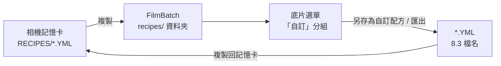

- 位置：`<使用者資料夾>/FilmBatch/recipes/`，一個配方一個 `.yml` 檔；底片選單在 12 個品牌之後顯示「自訂」分組，依名稱排序。
- 格式：Recipe Lab 自訂配方**格式 1**——扁平的 YAML（每行一個 `key: value`、`#` 註解、UTF-8，忽略 BOM），key 見 7.2，另有 `format`（預設 1）、`name`（1–24 個字元：`A–Z a–z 0–9` 與 ` -.'()&+`）、`made-on`（僅供參考）。
- 讀取規則照搬 Recipe Lab：不認得的 key 忽略；任何一個值超出範圍就略過整個檔案並顯示原因（不自動截斷）；`format` 比程式支援的新則整檔略過；名稱與已載入的配方重複（不分大小寫）則略過；超過 8KB 或隱藏檔忽略。
- 寫出時採 Recipe Lab 的命名規則（名稱前 8 個英數字轉大寫，重複時加數字，例如 `GOLDENHO.YML`、`GOLDENH2.YML`），名稱一律加引號；`strength`、`wb_reference` 等 FilmBatch 自有參數不寫入配方檔。
- 預設與配方的關係：預設（第 3 章）的 `film` 模組記錄「選了哪個配方」與各欄位的值。選擇配方會把該配方的欄位值帶入；之後修改任一欄位，模組標題顯示 **EDITED** 標記（沿用 Recipe Lab 的概念），可「重設為配方值」或「另存為自訂配方」。

### 7.6 以 Recipe Lab 樣張校正

Recipe Lab 的 `docs/samples/` 有 77 張在同一場景、同一曝光（ILCE-6000、1/30、f/4.5、ISO 250）下依配方順序拍攝的相機直出樣張（寬 900px），第 01 張為 `FACTORY (ST)`。FilmBatch 以此校正 7.3 的模擬參數：

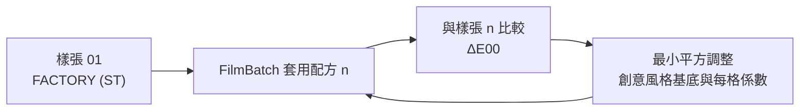

- 校正使用白平衡為 auto 的配方；指定色溫的 8 組在室內拍攝，結果相對於室內光源，只用來檢查方向，不參與擬合。
- Recipe Lab 註明有 9 張樣張拍攝時飽和超出 ±3（Sony FL、Sony IN、Velvia、Eterna、Eterna Bleach Bypass、Fortia 50、GR Bleach Bypass、Olympus Pop Art、Agfa Ultra 100），另有 5 張使用已停用的 PP3 色彩矩陣；這些樣張與現行數值不符，排除在擬合之外，待上游重拍後再納入。
- 樣張場景沒有膚色、植物與天空，人像類配方（Portra、Astia、Pro Neg、Canon Portrait）較難判斷；日後可補拍日光下的樣張再校正。
- 校正結果寫回 `creative_styles.json`，並以樣張建立回歸測試（見 14）。

### 7.7 限制與未來擴充

- **近似的近似**：Recipe Lab 的配方是以相機設定近似目標風格，FilmBatch 再以 shader 近似 Sony 相機的成像；風格以「接近 Recipe Lab 樣張」為目標，不以真實底片為目標。
- **輸入已經調過色**：輸入不是 Sony 的 RAW，而是 RAW 編輯器的輸出，白平衡為 auto 的配方直接沿用輸入的白平衡。
- **跟進上游**：Recipe Lab 新增或修改配方時，重新執行 `tools/import-recipelab` 更新內建資料（`key` 不變的配方維持相容；專案檔已記錄實際欄位值，舊專案結果不受影響）；若上游推出自訂配方格式 2，新增對應的讀取器並保留格式 1。
- 補齊其餘照片效果（Toy、Pop color、Posterization、Part color、Soft focus、HDR art、Rich-tone mono、Miniature、Illustration、Watercolor）。

---

## 8. 材質庫

漏光、灰塵與刮痕、古典版材、雙重曝光都可以使用外部材質。

### 8.1 資料夾結構

```
<使用者資料夾>/FilmBatch/
├── settings.json     偏好設定、視窗位置、GPU 介面卡選擇
├── layout.json       停靠面板版面
├── presets/          預設檔（YAML）
├── recipes/          自訂底片配方（Recipe Lab 相容 .yml）
├── logs/             執行記錄
└── textures/
    ├── leaks/        漏光掃描（黑底）
    ├── dust/         灰塵、刮痕、毛髮（黑底白痕或透明 PNG）
    ├── plates/       版材紋理
    └── overlays/     雙重曝光用素材
```

### 8.2 規則

- 支援 JPEG、PNG（含透明通道）、16-bit TIFF；以 Magick.NET 解碼後上傳為 GPU 紋理，並建立 mipmap 以便縮小取樣時不產生鋸齒。
- 材質依目標照片長寬比自動裁切與縮放（在 shader 中以取樣座標完成），可旋轉 90° 配合直幅照片。
- 選擇「隨機材質」時，以照片種子決定挑選哪一張，所以每張照片的結果固定（材質清單先依檔名以 `StringComparer.Ordinal` 排序，避免不同 OS 的列舉順序造成差異）。
- 程式**內建程序化產生器**，沒有任何材質檔時所有效果仍可使用。
- 材質庫只放使用者自製（例如自己掃描的漏光、灰塵）或授權明確可自由使用的素材，**不擷取其他軟體內附的材質**，以免違反授權。
- 未來可提供「材質製作工具」：把自己拍攝的底片掃描圖轉成黑底材質（去背、正規化亮度）。

---

## 9. 跨平台與 .NET 發佈

### 9.1 技術選型

| 用途 | 套件 | 說明 |
|---|---|---|
| 語言 / 執行環境 | **C# 14 / .NET 10（LTS）** | .NET 8 的支援於 2026-11 結束，不採用 |
| GUI | **Avalonia UI 12.x** | 三平台一致外觀（自繪，Skia 算繪）、HiDPI、MIT 授權 |
| UI 主題 | Avalonia `FluentTheme`（深色）+ 自訂資源字典 | 依 2.2 配色 |
| 停靠面板 | **Dock.Avalonia 12.x** | 對應 Avalonia 12 的版本線；提供可調整大小的版面與版面序列化（v0.11 起不顯示工具標題列，不使用拖曳停靠與浮動，見 2.3）；MIT 授權 |
| MVVM | **CommunityToolkit.Mvvm** | 原始碼產生器，無反射、對 Trimming 友善；MIT 授權 |
| 依賴注入 / 記錄 | Microsoft.Extensions.DependencyInjection、Microsoft.Extensions.Logging | 組裝服務、檔案記錄 |
| **GPU API** | **WebGPU（wgpu-native）** | 跨平台 GPU 抽象：Windows → DX12 / Vulkan、macOS → Metal、Linux → Vulkan；MIT / Apache-2.0 授權 |
| **C# WebGPU 綁定** | 首選 **Silk.NET.WebGPU**（+ `Silk.NET.WebGPU.Native.WGPU`、`Extensions.WGPU`）；候選 Evergine `WebGPU.NET`（wgpu-native）、`WebGPUSharp`（Dawn，.NET 10、支援 AOT） | 於 M0 spike 比較後定案；引擎只透過自有的 `FilmBatch.Gpu` 薄封裝存取，日後可替換 |
| Shader 語言 | **WGSL** | 以 compute shader 實作全部效果；CI 以 naga 驗證語法 |
| 影像 IO / EXIF / ICC | **Magick.NET**（Q16-HDRI） | 讀寫 16-bit TIFF / PNG、JPEG，保留 EXIF、嵌入 ICC，日後的色彩管理（內含 LittleCMS）；Apache 2.0 授權 |
| 預設檔 | YamlDotNet | YAML 讀寫 |
| 專案檔 | System.Text.Json（原始碼產生器） | JSON 讀寫，Trimming 安全 |
| 命令列 | System.CommandLine | `filmbatch` CLI 子命令 |
| 測試 | xUnit、**Avalonia.Headless.XUnit** | UI 測試不需要實體顯示器；GPU 測試見 14 |
| 發佈 | `dotnet publish`（self-contained、ReadyToRun）；選用 Velopack 產生安裝檔與自動更新 | 見 9.3 |

選型注意：

- **為什麼用 GPU 而不是 OpenCV**：本專案的效果幾乎都是逐像素運算或大半徑卷積，正是 GPU 擅長的工作；以 WGSL 撰寫可讓預覽與匯出在三個平台共用同一份程式碼，拖曳滑桿時即時更新。OpenCV 的 GPU 路徑不符合需求（CUDA 只支援 NVIDIA、OpenCL 在 macOS 已被棄用）。
- **Silk.NET.WebGPU 的維護狀況**：Silk.NET 團隊目前把主要精力放在 3.0，2.x 版本更新較少。因此綁定一律包在 `FilmBatch.Gpu` 內，M0 同時試做候選綁定，選定後鎖定 wgpu-native 版本。
- **wgpu-native 版本**：綁定套件內附的 wgpu-native 版本決定可用的 WebGPU 功能；以 CPM 鎖定版本，升級前在三平台 CI 驗證。
- **版本集中管理**：使用 `Directory.Packages.props`（Central Package Management）鎖定所有套件版本，Avalonia 與 Dock.Avalonia 必須同一主版本。
- **不使用 ImageSharp / Emgu CV / OpenCV**：ImageSharp 採 Six Labors Split License、Emgu CV 為 GPL / 商業雙授權；OpenCV 已由 GPU 引擎取代。
- **GPU 不採用 OpenGL compute shader / OpenCL**：macOS 的 OpenGL 停在 4.1、OpenCL 已被 Apple 棄用。

### 9.2 跨平台注意事項

| 項目 | 做法 |
|---|---|
| 路徑 | 一律使用 `Path.Combine` / `Path.GetRelativePath`；專案檔內存相對路徑並用 `/` 分隔 |
| 中文路徑 | .NET 與 Magick.NET 皆支援 Unicode 路徑；仍納入路徑測試（見 14） |
| 使用者資料夾 | 自行實作 `AppPaths`，以 `OperatingSystem.IsWindows() / IsMacOS() / IsLinux()` 決定：Windows `%APPDATA%\FilmBatch`、macOS `~/Library/Application Support/FilmBatch`、Linux `$XDG_CONFIG_HOME/FilmBatch`（預設 `~/.config/FilmBatch`） |
| 程式內建資源 | 圖示、XAML 以 `AvaloniaResource`（`avares://`）嵌入；內建配方資料（Recipe Lab）、創意風格模擬參數與 **WGSL shader** 以 `EmbeddedResource` 嵌入；開發模式可改從原始碼資料夾讀取 shader 以支援熱重載 |
| 偏好設定 | 統一存為 `settings.json`（System.Text.Json） |
| 檔名大小寫 | 比對副檔名一律 `OrdinalIgnoreCase`；專案內照片 key 保留原始大小寫，並以 `StringComparer.Ordinal` 比對 |
| GPU 後端 | Windows 預設 DX12（Vulkan 為備援）、macOS 為 Metal、Linux 為 Vulkan；偏好設定可強制指定後端，方便排除驅動程式問題 |
| 無 GPU 環境 | Windows 可用 WARP（DX12 軟體介面卡）、Linux 可用 lavapipe（Mesa 的 Vulkan 軟體實作）；macOS 一律有 Metal。啟動時列舉介面卡，硬體優先 |
| GPU 執行緒 | 所有 GPU 指令由單一「GPU 執行緒」提交（`Channel` 佇列），避免多執行緒同時操作佇列；CPU 解碼 / 編碼在執行緒池並行 |
| UI 執行緒 | 背景結果一律經 `Dispatcher.UIThread.Post` / `InvokeAsync` 回到 UI 執行緒；不在背景執行緒存取任何控制項 |
| 快捷鍵 | 使用 `KeyGesture` + 平台熱鍵設定，`Ctrl` 在 macOS 自動對應 `⌘` |
| 編碼 | 文字檔讀寫一律 UTF-8（.NET 預設，不寫 BOM） |
| Linux 相依 | 執行需 `libfontconfig1`、X11 相關函式庫，以及 **Vulkan 驅動程式**（`mesa-vulkan-drivers` 或廠商驅動）；在發佈說明列出 |

### 9.3 發佈設定

採用 **self-contained + 資料夾發佈**（輸出一個資料夾或 macOS `.app`），不採用 single-file 壓縮：

- self-contained 不需要使用者另外安裝 .NET 執行環境。
- 原生函式庫（SkiaSharp、HarfBuzzSharp、wgpu-native、Magick.Native）保持獨立檔案，便於除錯與授權聲明。
- 啟用 **ReadyToRun** 縮短冷啟動時間；**Native AOT 列為 M7 之後的評估項目**（需確認 Dock.Avalonia、YamlDotNet、Magick.NET 與所選 WebGPU 綁定的 AOT 相容性）。
- Trimming 先使用 `TrimMode=partial`；以元件展示視窗與冒煙測試確認沒有遺漏。

共用設定集中在 `Directory.Build.props` 與 `FilmBatch.App.csproj`，各平台只差 RID：

```xml
<!-- src/FilmBatch.App/FilmBatch.App.csproj（節錄） -->
<PropertyGroup>
  <OutputType>WinExe</OutputType>
  <TargetFramework>net10.0</TargetFramework>
  <AssemblyName>FilmBatch</AssemblyName>
  <ApplicationIcon>Assets/icon.ico</ApplicationIcon>
  <SelfContained>true</SelfContained>
  <PublishReadyToRun>true</PublishReadyToRun>
  <PublishTrimmed>true</PublishTrimmed>
  <TrimMode>partial</TrimMode>
  <Version>1.0.0</Version>
  <Company>FilmBatch</Company>
  <Product>FilmBatch</Product>
</PropertyGroup>
```

```bash
# Windows
dotnet publish src/FilmBatch.App -c Release -r win-x64 -o dist/win-x64

# macOS（Apple Silicon / Intel），之後由 build 腳本組成 FilmBatch.app
dotnet publish src/FilmBatch.App -c Release -r osx-arm64 -o dist/osx-arm64
dotnet publish src/FilmBatch.App -c Release -r osx-x64   -o dist/osx-x64

# Linux
dotnet publish src/FilmBatch.App -c Release -r linux-x64 -o dist/linux-x64
```

打包腳本 `build/Build.cs`（.NET 10 的檔案型程式，`dotnet run build/Build.cs -- --rid osx-arm64 --smoke`）負責：以 naga 驗證所有 WGSL、發佈、組成 macOS `.app`（`Info.plist`、`icon.icns`、`Contents/MacOS/`）、複製授權聲明、執行冒煙測試、壓縮產物。

各平台的建置需求：

| 平台 | 需求 | 其他 |
|---|---|---|
| Windows | .NET 10 SDK | 選用：Velopack / Inno Setup 安裝檔、程式碼簽章 |
| macOS | .NET 10 SDK、Xcode Command Line Tools（簽章、`hdiutil`） | 公開發佈需 Apple Developer 簽章與公證；`.app` 內所有 `.dylib`（含 `libwgpu_native.dylib`）都要簽章 |
| Linux | .NET 10 SDK | 在較舊的發行版（例如 Ubuntu 22.04）建置與測試，以提高 glibc 相容性；選用 AppImage |

注意事項：

- **ReadyToRun 跨平台**：ReadyToRun 可以在單一 OS 上為其他 RID 編譯，但 macOS 的簽章、公證與 `.dmg` 必須在 macOS 上進行，因此仍以三平台矩陣建置。
- **授權檔**：發佈包中附上 Avalonia、Dock.Avalonia、SkiaSharp、wgpu-native、WebGPU 綁定、ImageMagick / Magick.NET、YamlDotNet 等第三方授權聲明（`THIRD-PARTY-NOTICES.txt`）。

### 9.4 建置與發佈流程

以 GitHub Actions 矩陣自動化：

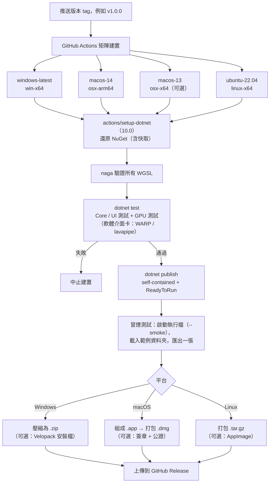

- 開發與自用階段直接 `dotnet run --project src/FilmBatch.App`，不必發佈。
- CI 的 runner 沒有實體 GPU：Windows 使用 WARP、Linux 安裝 `mesa-vulkan-drivers` 使用 lavapipe；macOS runner 的 Metal 可用性於 M0 驗證，若不可用則 macOS 的 GPU 測試改在本機執行。
- **M0 階段就要完成一次冒煙建置**：把 UI 原型（含 GPU spike）在三個平台各發佈一次並確認能啟動，及早發現原生函式庫、Trimming、資源嵌入等問題。

---

## 10. 批次匯出

| 選項 | 內容 |
|---|---|
| 範圍 | 選取的照片 / 全部 / 依預設篩選 |
| 格式 | JPEG（品質 1–100）、16-bit TIFF、16-bit PNG |
| 尺寸 | 原尺寸 / 長邊指定像素（縮放在 GPU 上以高品質濾波完成） |
| 目的地 | 預設為 `<資料夾>/export/`，可自訂 |
| 檔名 | 範本，例如 `{name}_{preset}`，或 `{name}` 加後綴 |
| 中繼資料 | 保留 EXIF（方向重設為 1）；嵌入 sRGB ICC（Magick.NET） |
| 進度 | 可取消（`CancellationToken`）、顯示進度（`IProgress<T>`） |

**匯出管線**：GPU 一次只算一張，CPU 端的解碼與編碼與之重疊，形成三段式流水線：

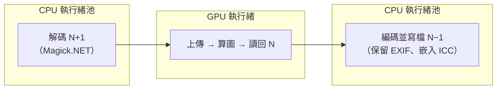

- 預讀張數依記憶體自動決定（預設前後各 1–2 張），取代原本的「並行數」設定。
- 匯出期間預覽請求可插隊：GPU 執行緒在兩張匯出之間（或分塊之間）優先處理預覽請求。

匯出時，在 `.filmbatch/export_log.json` 記錄每張照片實際使用的完整參數、演算法版本與 GPU 介面卡資訊，方便日後重現。

另提供命令列介面（獨立的主控台程式 `filmbatch`，與 GUI 共用 Core / Engine），方便寫腳本或排程：

```bash
filmbatch export <照片資料夾> --out <輸出資料夾> --format jpg --quality 95
filmbatch export <照片資料夾> --preset "Portra 400" --only-unassigned
filmbatch export <照片資料夾> --adapter software   # 強制使用軟體介面卡
filmbatch recipes list                              # 列出內建與自訂底片配方
filmbatch recipes import <記憶卡>/RECIPES           # 匯入 Recipe Lab 自訂配方
filmbatch gpu-info                                  # 列出可用的 GPU 介面卡與限制
```

GUI 在 Windows 為 `WinExe`（不帶主控台視窗），因此 CLI 另建 `FilmBatch.Cli` 專案，兩者一起發佈在同一個資料夾。

---

## 11. 系統架構

### 11.1 分層架構

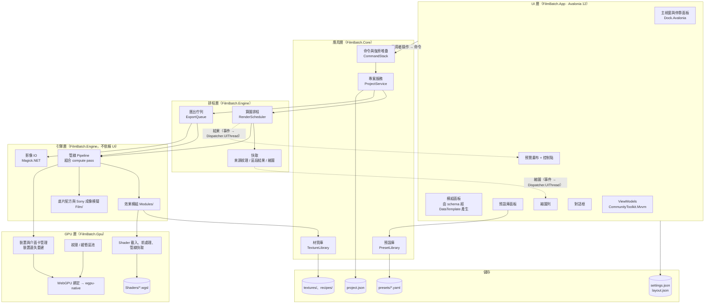

關鍵原則：

- **引擎層不依賴 UI**：`RenderAsync(來源, 參數, 種子, 輸出規格, CancellationToken) → 影像` 可以在 CLI、測試、背景中直接使用。
- **GPU 細節集中在 `FilmBatch.Gpu`**：模組只描述「要派送哪些 pass、綁定哪些資源」，不直接呼叫 WebGPU 綁定的 API，日後可更換綁定或後端。
- **Core 不引用 Avalonia 與 GPU**：專案相依以 `.csproj` 參考強制分層（App → Engine → Gpu；App / Engine → Core），由建置保證不會反向依賴。
- **UI 不直接改資料**：所有修改都透過命令物件進入 `CommandStack`，因此每個操作都能復原，也能合併連續的滑桿拖曳。
- **單一 GPU 執行緒**：所有 GPU 提交經由一個佇列序列化；結果以事件 / `IProgress<T>` 傳出，由 ViewModel 經 `Dispatcher.UIThread` 回到 UI 執行緒。
- **參數 schema 單一來源**：UI 面板、序列化、驗證、選擇性貼上、uniform 佈局都從 schema 產生。
- **預覽與匯出共用同一套 shader**，只有輸出解析度與分塊方式不同，避免結果不一致。

### 11.2 效果模組介面

```csharp
public enum Stage { Linear, Geometry, Optical, Film, Display, Surface }

public interface IEffectModule
{
    string Key { get; }                          // "vignette"
    Stage Stage { get; }
    IReadOnlyList<ParamDef> Params { get; }      // schema（同時決定 uniform 佈局）

    /// 準備本模組需要的 GPU 資源（材質、DRO 金字塔、灰塵圖形緩衝區…），可快取
    ValueTask PrepareAsync(ModuleParams p, RenderContext ctx);

    /// 把本模組的 compute pass 錄進指令編碼器：讀 ctx.Input、寫 ctx.Output
    void Encode(GpuPassContext ctx, ModuleParams p);
}

public sealed class VignetteModule : IEffectModule
{
    public string Key => "vignette";
    public Stage Stage => Stage.Optical;
    public IReadOnlyList<ParamDef> Params { get; } =
    [
        ParamDef.Bool("enabled", "啟用", false),
        ParamDef.Float("amount", "強度", 0, -100, 100),
        ParamDef.Float("size", "大小", 50, 0, 100),
        ParamDef.Position("center_x", "中心 X", 0.5),
        ParamDef.Position("center_y", "中心 Y", 0.5),
        // …
    ];

    public ValueTask PrepareAsync(ModuleParams p, RenderContext ctx) => ValueTask.CompletedTask;

    public void Encode(GpuPassContext ctx, ModuleParams p) =>
        ctx.Dispatch("optical/vignette.wgsl", uniforms: p.ToUniforms(Params));
}
```

```wgsl
// Shaders/v1/optical/vignette.wgsl（節錄）
#include "common/color.wgsl"

struct Params { amount: f32, size: f32, roundness: f32, feather: f32, center: vec2f, aspect: f32 }
@group(0) @binding(0) var src: texture_2d<f32>;
@group(0) @binding(1) var dst: texture_storage_2d<rgba32float, write>;
@group(0) @binding(2) var<uniform> p: Params;

@compute @workgroup_size(16, 16)
fn main(@builtin(global_invocation_id) id: vec3u) {
    let size = textureDimensions(src);
    if (id.x >= size.x || id.y >= size.y) { return; }
    let uv = (vec2f(id.xy) + 0.5) / vec2f(size);
    let c = textureLoad(src, id.xy, 0);
    textureStore(dst, id.xy, vec4f(c.rgb * vignette_falloff(uv, p), c.a));
}
```

- 管線依 `Stage` 與註冊順序依序呼叫已啟用的模組。模組在 `ModuleRegistry` 中明確註冊（不以反射掃描組件，保持 Trimming / AOT 相容）。
- 新增效果時只需要新增一個模組類別、一或多個 `.wgsl` 檔並註冊，UI 面板會依 schema 自動長出對應的參數列。
- uniform 緩衝區的位元組佈局由 schema 依 WGSL 對齊規則產生；單元測試比對 C# 端佈局與 WGSL `struct` 宣告（以 naga 反射取得）是否一致。

### 11.3 預覽算圖時序

```mermaid
sequenceDiagram
    actor U as 使用者
    participant P as 模組面板（ViewModel）
    participant C as CommandStack
    participant S as ProjectService
    participant R as RenderScheduler
    participant G as GPU 執行緒
    participant V as 預覽畫布

    U->>P: 拖動滑桿
    P->>C: SetParamCommand（拖曳中，可合併）
    C->>S: SetValue(photo, key, value)
    S-->>P: 更新覆寫標記
    S->>R: RequestPreview(photo, 1600px)
    Note over R: 每個顯示幀最多一次請求<br/>只保留最新請求（Channel 容量 1、DropOldest）
    R->>G: 從受影響的區段開始算圖（其餘用區段快取）
    G->>G: 派送 compute pass → 轉 BGRA8 → 複製到讀回緩衝區
    G->>G: 示波器統計 pass（直方圖 / 波形，示波器折疊時略過）
    G-->>R: MapAsync 完成（generation = n）
    R-->>V: 經 Dispatcher.UIThread：若 n 為最新則更新 WriteableBitmap 與示波器，否則丟棄
    U->>P: 放開滑桿
    P->>C: 結束合併，記為一筆復原紀錄
    R->>G: 背景更新該照片縮圖（低優先）
```

- 來源影像在切換照片時上傳一次，之後只有 uniform 改變，不重新上傳。
- 讀回使用雙緩衝的讀回緩衝區（注意 WebGPU 要求每列位元組數為 256 的倍數），GPU 寫下一幀時 CPU 讀上一幀。
- 若 GPU 跟不上（例如散景大半徑），排程器自動把拖曳中的預覽降為 800px，放開後補算 1600px。
- 示波器統計（見 2.4.6）緊接在轉 BGRA8 之後、對同一張預覽紋理執行，與預覽共用同一個 generation，因此畫面與示波器永遠對應同一幀：
  - 直方圖：每個 workgroup 先在共享記憶體累加 4 × 256 個區間（R、G、B、亮度），最後以 `atomicAdd` 合併到全域緩衝區，讀回 4KB。
  - 波形 / 分量圖：把影像寬度分為 256 欄，每欄 × 256 個亮度區間的計數（分量圖為 3 組），讀回 256KB–768KB，由 `ScopeView` 依計數的對數值畫成點的亮度。
  - 統計緩衝區每幀先清零（`clearBuffer`），與讀回緩衝區同樣採雙緩衝。

### 11.4 Shader 管理

- WGSL 檔案放在 `src/FilmBatch.Gpu/Shaders/v{版本}/`，以 `EmbeddedResource` 打包。
- WGSL 本身沒有 include 機制，由自有的簡易前處理器處理 `#include` 與常數替換（例如 workgroup 大小），前處理結果以內容雜湊為鍵快取已編譯的 compute pipeline。
- 開發模式（`--shader-dev`）從原始碼資料夾讀取並監看 `.wgsl`，存檔後自動重新編譯並重算預覽，方便調整效果。
- CI 以 naga CLI 對前處理後的每個 shader 做語法與型別驗證。

### 11.5 批次匯出時序

```mermaid
sequenceDiagram
    actor U as 使用者
    participant D as 匯出分頁（側邊欄）
    participant S as ProjectService
    participant Q as ExportQueue
    participant L as 解碼工作者
    participant G as GPU 執行緒
    participant W as 編碼工作者
    participant B as 狀態列

    U->>D: 設定並按「匯出」
    D->>S: 取得每張照片的參數快照
    S-->>D: [(照片, 最終參數, 種子), …]
    D->>Q: Enqueue(工作清單)
    loop 每張照片（三段流水線重疊執行）
        Q->>L: 解碼全尺寸（Magick.NET）
        L->>G: 上傳 → 算圖（必要時分塊）→ 讀回 16-bit
        G->>W: 編碼並寫檔（保留 EXIF、嵌入 ICC）
        W-->>Q: 完成 / 失敗
        Q-->>B: IProgress 更新進度
    end
    U-->>Q: （可隨時取消，CancellationToken）
    Q-->>B: 完成：成功 N 張、失敗 M 張
    Q->>S: 寫入 export_log.json
```

### 11.6 專案目錄結構

```
FilmBatch/
├── FilmBatch.sln
├── Directory.Build.props         # 共用編譯設定（Nullable、LangVersion、TreatWarningsAsErrors）
├── Directory.Packages.props      # 集中鎖定套件版本
├── global.json                   # 鎖定 .NET SDK 版本
├── build/
│   └── Build.cs                  # naga 驗證、發佈、.app 組裝、冒煙測試（dotnet run）
├── src/
│   ├── FilmBatch.Gpu/            # WebGPU 薄封裝
│   │   ├── Device/               # 介面卡列舉、裝置建立、裝置遺失處理
│   │   ├── Resources/            # 紋理 / 緩衝區池、讀回緩衝區
│   │   ├── ShaderSystem/         # 前處理器、pipeline 快取、熱重載
│   │   └── Shaders/
│   │       └── v1/
│   │           ├── common/       # 色彩轉換、雜湊亂數、雜訊、可分離模糊、取樣
│   │           ├── linear/  geometry/  optical/  film/  display/  surface/
│   │           └── io/           # sRGB↔線性、輸出轉換、縮放
│   ├── FilmBatch.Engine/         # 不依賴 UI
│   │   ├── Imaging/              # Magick.NET 讀寫、EXIF、上傳格式轉換
│   │   ├── Pipeline/             # Pipeline、RenderContext、區段快取、分塊算圖
│   │   ├── Film/                 # Recipe Lab 配方資料、創意風格參數（EmbeddedResource）、成像模擬、自訂配方 YAML 讀寫
│   │   ├── Modules/              # 每個效果一個類別
│   │   ├── Textures/             # 材質載入、灰塵 / 刮痕圖形產生
│   │   └── Scheduling/           # RenderScheduler、快取、ExportQueue
│   ├── FilmBatch.Core/           # 不依賴 UI 與 GPU
│   │   ├── Params/               # ParamDef、ParamValue、合併、diff、uniform 佈局
│   │   ├── Projects/             # Project、project.json
│   │   ├── Presets/              # PresetLibrary、YAML、快照同步
│   │   ├── Commands/             # 命令與復原堆疊
│   │   ├── Random/               # 與 shader 相同演算法的雜湊亂數
│   │   └── AppPaths.cs           # 使用者資料夾、相對路徑
│   ├── FilmBatch.App/            # Avalonia GUI
│   │   ├── App.axaml(.cs)
│   │   ├── Program.cs            # 進入點（--gallery、--smoke、--shader-dev）
│   │   ├── Themes/               # Colors.axaml、Controls.axaml
│   │   ├── ViewModels/
│   │   ├── Views/                # MainWindow、Dock 版面、面板
│   │   ├── Controls/             # ParamSlider、ParamRow、ModuleSection、PreviewCanvas…
│   │   ├── Dialogs/
│   │   ├── Gallery/              # 元件展示視窗（M0）
│   │   ├── Localization/         # Strings.resx、Strings.en.resx、Tr 標記延伸
│   │   └── Assets/               # 圖示
│   └── FilmBatch.Cli/            # filmbatch 命令列（System.CommandLine）
├── tests/
│   ├── FilmBatch.Core.Tests/     # 合併、貼上、快照同步、亂數、uniform 佈局
│   ├── FilmBatch.Engine.Tests/   # GPU：identity、回歸、一致性、決定性、分塊
│   ├── FilmBatch.App.Tests/      # Avalonia.Headless UI 測試
│   └── ReferenceImages/
└── .github/workflows/            # 三平台 CI 與發佈
```

---

## 12. 效能策略

GPU 讓逐像素運算幾乎不成問題，效能的重點轉為：**減少 CPU↔GPU 傳輸、減少紋理讀寫次數、控制顯示記憶體用量**。

- **影像常駐 GPU**：切換到一張照片時上傳一次原圖（全尺寸與 1600px 代理圖），之後調整參數只更新 uniform；最近使用的幾張照片的來源紋理以 LRU 保留在 GPU 上（上限依顯示記憶體設定）。
- **區段快取**：快取每個區段（幾何 / 光學 / 底片 / 顯示）的輸出紋理（`rgba16float`）。例如只調顆粒時，從快取的「表面區段之前」結果開始算，不必重做模糊與底片。
- **Pass 合併**：相鄰的逐像素模組由 shader 組合器合併為單一 pass，減少全圖讀寫（M5 之後的優化項目；第一版每個模組獨立 pass，確保正確性）。
- **模糊類效果**：
  - 高斯類以可分離 pass + workgroup 共享記憶體實作；大半徑改在降採樣金字塔上計算再放大。
  - 散景以半解析度的聚集式可變模糊為主（見 5.3.5）。
  - 放射 / 旋轉 / 動態模糊以疊代倍增的少量取樣達到長距離平滑。
- **讀回成本**：預覽在 GPU 上先轉成 8-bit BGRA 再讀回（1600px 約 10MB），並以雙緩衝避免等待；縮圖批次產生後一次讀回。未來可評估 Avalonia GPU 互通直接共享紋理，完全省去讀回。
- **示波器**：統計在 GPU 上完成，只讀回統計結果（直方圖 4KB、波形 / 分量圖 256–768KB），不讀回影像；只計算目前顯示的模式，折疊或面板隱藏時完全略過。目標是開啟示波器後，拖曳滑桿的預覽更新時間增加不超過 1 ms（1600px）。
- **100% 檢視**：只算可見區域加上邊界延伸的全解析度圖塊，平移時增量補算。
- **分塊匯出**：影像尺寸超過 `maxTextureDimension2D`，或預估顯示記憶體用量超過上限時，以重疊圖塊算圖（邊界延伸依管線中最大的模糊半徑計算），逐塊讀回後在 CPU 端拼接。
- **顯示記憶體估算**：24MP `rgba32float` 一張約 384MB；工作紋理 2 張 + 區段快取（`rgba16float` 約 192MB × 數張）+ 暫存，24MP 全尺寸算圖約需 1.2–1.8GB 顯示記憶體。顯示記憶體較小的 GPU（例如 2GB 內顯）自動改用分塊。
- **CPU 端**：解碼與編碼是匯出的主要 CPU 成本，以流水線與 GPU 重疊（見 10）；大型 CPU 緩衝區以 `ArrayPool` / `NativeMemory` 重複使用，避免 LOH 碎片與 Gen2 GC 停頓。
- **啟動時間**：ReadyToRun 預先編譯；GPU 裝置與常用 compute pipeline 在背景初始化，視窗先顯示；pipeline 編譯結果在執行期間快取。

效能目標（以搭載內顯的一般筆電估算；軟體介面卡不列入）：

| 項目 | 只開色彩與顆粒 | 開啟光學模糊類效果 |
|---|---|---|
| UI 互動（切換照片、展開模組） | < 50 ms | < 50 ms |
| 拖曳滑桿時的預覽更新（1600px） | < 16 ms（60 fps） | < 50 ms |
| 切換照片後的首張預覽（含解碼與上傳） | < 300 ms | < 400 ms |
| 匯出（24MP，單張，不含磁碟寫入） | < 1.5 s | < 3 s |
| 發佈版冷啟動 | < 2 s | — |

---

## 13. 開發里程碑

**UI 規範（M0）為第一個階段**：先凍結介面、互動與資料流，並完成 GPU 技術驗證，再實作完整影像引擎，避免後期因介面或技術選型調整而重寫。

### 13.1 階段說明

| 階段 | 內容 | 產出 | 預估 |
|---|---|---|---|
| **M0 UI 規範、原型與 GPU spike** | 第 2 章全部內容：方案骨架（sln、分層專案、CPM、CI）、Fluent 深色主題與資源字典、Dock 版面、元件展示視窗、可操作原型、對話框原型、三層設定模型與復原堆疊；**GPU spike：WebGPU 綁定選型、上傳 → compute → 讀回 → 顯示的完整路徑、三平台後端與軟體介面卡**；三平台發佈冒煙建置；UI 規範定稿 | 凍結的 v1 UI 規範 + 可發佈的原型 + 綁定選型結論 | 3 週 |
| **M1 GPU 引擎核心** | `FilmBatch.Gpu`（裝置、資源池、shader 前處理與快取）、Magick.NET IO、參數 schema 與 uniform 佈局、模組介面、管線；基本調整、底片色彩（Recipe Lab 77 組配方資料、Sony 成像模擬、Retro / Soft High-key / HC Mono 照片效果）、色調分離、清晰與銳化、暗角、光暈、程序化漏光、顆粒；CLI 批次輸出 | `filmbatch export` 可用 | 2.5 週 |
| **M2 預設與專案** | 預設庫（YAML）、專案檔、預設快照與同步、`AppPaths`、Recipe Lab 自訂配方 `.yml` 讀寫 | 合併、貼上、同步規則的單元測試 | 1 週 |
| **M3 UI 與引擎整合** | 原型接上 GPU 引擎：RenderScheduler、來源紋理 LRU、區段快取、縮圖背景產生、指定預設、覆寫標示、裝置遺失處理；**示波器**（直方圖、波形圖、RGB 分量圖、裁切警示，見 2.4.6）；以 Recipe Lab 樣張校正成像模擬（見 7.6） | 日常使用可行（色彩類效果） | 2 週 |
| **M4 批次操作** | 完整 / 只貼預設 / 選擇性貼上、多選調整、拖曳套用預設、ToastBar 復原 | 完整批次工作流程 | 1 週 |
| **M5 光學效果** | 鏡頭變形、焦外成像、縮放旋轉模糊、動態模糊、畫布控制點、100% 檢視的區域算圖 | 光學類模組完成 | 2.5 週 |
| **M6 合成與表面效果** | 雙重曝光、多格分鏡、灰塵與刮痕、古典版材、材質漏光、材質庫 | 第 6 章全部 16 個模組完成 | 2 週 |
| **M7 匯出與發佈** | 匯出分頁接上三段流水線、分塊匯出、檔名範本、EXIF / ICC、`THIRD_PARTY_NOTICES.md`（Recipe Lab MIT 授權）、三平台 CI 正式發佈（.zip / .dmg / .tar.gz）、Pass 合併優化、Native AOT 評估 | 可發佈的 v1.0 | 2 週 |

### 13.2 時程

```mermaid
gantt
    title FilmBatch 開發時程（預估）
    dateFormat YYYY-MM-DD
    axisFormat %m/%d

    section 規範
    M0 UI 規範、原型與 GPU spike :m0, 2026-10-19, 21d
    UI 規範與技術選型定稿（里程碑） :milestone, after m0, 0d

    section 核心
    M1 GPU 引擎核心             :m1, after m0, 17d
    M2 預設與專案               :m2, after m1, 7d
    M3 UI 與引擎整合            :m3, after m2, 13d
    M4 批次操作                 :m4, after m3, 7d
    完整批次工作流程（里程碑）    :milestone, after m4, 0d

    section 效果
    M5 光學效果                 :m5, after m4, 17d
    M6 合成與表面效果           :m6, after m5, 14d

    section 發佈
    M7 匯出與發佈               :m7, after m6, 14d
    v1.0 發佈（里程碑）          :milestone, after m7, 0d
```

合計約 16 週（以業餘時間開發可能更長）。GPU 引擎的前期成本較高（M0 spike、M1 基礎建設），但之後各效果模組的開發與調校會比 CPU 版快，預覽體驗也好得多。M4 完成後即可進行大部分日常批次工作。

### 13.3 階段相依關係

```mermaid
flowchart LR
    M0["M0<br/>UI 規範、原型<br/>與 GPU spike"] --> M1["M1<br/>GPU 引擎核心"]
    M0 --> M2["M2<br/>預設與專案"]
    M1 --> M3["M3<br/>UI 與引擎整合"]
    M2 --> M3
    M3 --> M4["M4<br/>批次操作"]
    M3 --> M5["M5<br/>光學效果"]
    M4 --> M7["M7<br/>匯出與發佈"]
    M5 --> M6["M6<br/>合成與表面效果"]
    M6 --> M7
    M0 -.->|"冒煙建置經驗"| M7
```

M1（引擎）與 M2（預設與專案）在 M0 之後彼此獨立，若有兩人以上開發可以並行。

---

## 14. 測試策略

| 類別 | 內容 |
|---|---|
| **UI 測試**（xUnit + Avalonia.Headless） | 元件狀態（覆寫標記、停用、多選）、滑桿與數值框同步、滾輪只在焦點時生效、拖曳指定預設、選擇性貼上對話框、復原 / 重做；以 `[AvaloniaFact]` 在無顯示器環境執行（使用假算圖器，不需要 GPU） |
| **ViewModel 測試** | 直接測試 ViewModel 與命令（不建立任何控制項），涵蓋大部分互動邏輯 |
| **主題檢查** | 元件展示視窗以 Avalonia.Headless + Skia 算繪成 PNG，在三個平台截圖比對，確認深色主題一致 |
| **合併規則單元測試** | 三層合併、覆寫自動清理、各種貼上模式、模組開關的貼上、預設刪除與更新、快照同步狀態 |
| **Shader 驗證** | 所有 WGSL 經前處理後以 naga 驗證；C# 端 uniform 佈局與 WGSL `struct` 一致 |
| **亂數一致性** | C# 與 WGSL 的雜湊亂數對同一組輸入產生相同結果（GPU 跑一個測試 shader 讀回比對） |
| **模組 identity 測試** | 每個模組在參數為 0 或關閉時，輸出必須與輸入完全相同（以 `[Theory]` 對所有已註冊模組執行） |
| **影像回歸測試** | 5–10 張代表性照片（人像、夜景、高反差、低飽和、直幅），對每組配方與每個模組的代表參數產生參考圖，比對 ΔE，超過門檻則失敗 |
| **配方資料測試** | 內建配方與 Recipe Lab 來源 commit 的 `Recipes.java` 逐筆一致（77 筆、品牌順序）；飽和 / 對比 / 銳利度在 ±3 內、色溫 2500–9900K、白平衡微調 ±7 |
| **自訂配方相容測試** | 讀取 Recipe Lab 格式 1 的範例檔；寫出後再讀回不失真；超出範圍、格式版本過新、名稱重複的檔案被略過並回報原因 |
| **樣張比對測試** | 以 Recipe Lab 樣張 01（FACTORY）套用各配方，與對應樣張比較 ΔE00，平均值不得比上次校正結果變差（排除 7.6 所列不適用的樣張） |
| **示波器測試** | 以已知分布的測試圖（純色、水平漸層、左黑右白）比對 GPU 統計結果與 CPU 參考實作，必須完全相同；裁切警示在 0.1% 門檻上下正確切換；示波器折疊時不派送統計 pass |
| **一致性測試** | 同一張照片在不同解析度下算圖，縮小後比對，驗證「以短邊比例計算」有效 |
| **分塊測試** | 同一張照片以整張與分塊兩種方式算圖，結果在 ΔE 門檻內（理想為逐位元相同） |
| **決定性測試** | 同一設定在同一台機器、同一 GPU 與驅動程式上重複算圖，結果逐位元相同 |
| **跨裝置測試** | 軟體介面卡（WARP / lavapipe）與本機硬體 GPU（NVIDIA / AMD / Intel / Apple）的結果在 ΔE 門檻內；硬體部分在發佈前於本機執行 |
| **裝置遺失測試** | 模擬裝置遺失（強制銷毀裝置），確認自動重建、預覽恢復、匯出工作重試 |
| **路徑測試** | 中文、空白、emoji 的檔名與資料夾名稱在三個平台都能讀寫 |
| **序列化測試** | YAML / JSON 往返（round-trip）不失真；舊版 `pipeline_version` 的專案仍可讀取並以對應版本的 shader 算圖 |
| **發佈冒煙測試** | `dotnet publish` 後以 `--smoke` 啟動執行檔、建立 GPU 裝置、載入範例資料夾、匯出一張，確認原生函式庫、嵌入的 shader 與 Trimming 沒有問題 |

---

## 15. 風險與對策

| 風險 | 影響 | 對策 |
|---|---|---|
| UI 規範在開發後期大幅變動 | 重工 | M0 先做可操作原型並實際使用後才凍結規範 |
| C# WebGPU 綁定不成熟或停止維護（Silk.NET 2.x 投入有限） | 無法升級 wgpu、遇到綁定缺陷 | M0 試做多個候選綁定；引擎只透過 `FilmBatch.Gpu` 薄封裝存取，必要時可切換綁定（甚至自行以 P/Invoke 綁定 wgpu-native 的 C 標頭） |
| wgpu-native / WebGPU 規格變動 | 編譯或行為差異 | 鎖定 wgpu-native 版本；升級前在三平台 CI 與本機 GPU 驗證 |
| 使用者的 GPU 驅動程式老舊或有缺陷 | 當機、畫面錯誤 | 偏好設定可切換後端（DX12 / Vulkan）或強制軟體介面卡；記錄介面卡與驅動程式資訊於 log 方便排查 |
| 沒有 GPU 的環境（虛擬機、遠端桌面、CI） | 速度極慢 | 自動改用軟體介面卡並提示；文件註明最低需求（支援 DX12 / Vulkan 1.1 / Metal 的 GPU） |
| 顯示記憶體不足（內顯、大型影像） | 算圖失敗 | 依介面卡限制與記憶體預算自動分塊；紋理池設上限；區段快取可降級或關閉 |
| 不同 GPU 的浮點結果不一致 | 跨機器結果略有差異 | 亂數一律用整數雜湊；跨裝置以 ΔE 門檻驗證；`export_log.json` 記錄介面卡資訊 |
| GPU 裝置遺失（驅動程式重置、睡眠喚醒） | 預覽或匯出中斷 | 裝置遺失回呼 → 重建裝置與資源 → 重新上傳 → 重試未完成的工作 |
| 散景等大半徑效果在 GPU 上的品質（聚集式模糊的邊緣瑕疵） | 質感 | 以參考圖比對調校；保留 GPU FFT 卷積作為備案 |
| CPU↔GPU 讀回成為預覽瓶頸 | 拖曳不流暢 | 在 GPU 上先轉 8-bit、雙緩衝讀回；拖曳中自動降解析度；未來評估 Avalonia GPU 互通共享紋理 |
| 誤用 AGPL 程式碼（參考 RapidRAW 時） | 授權問題 | 只參考架構與公開演算法，不複製其程式碼或 shader；程式碼審查時確認來源 |
| Avalonia 12 / Dock.Avalonia 大版本升級造成破壞性變更 | 重工 | 以 CPM 鎖定版本；兩者維持同一主版本；Dock 版面只透過自有的 `LayoutService` 存取 |
| Fluent 主題的預設資源與自訂樣式互相干擾 | 外觀不一致 | 自訂樣式集中在 `Controls.axaml` 並最後載入；以元件展示視窗檢查所有狀態 |
| Trimming 移除了 XAML、序列化或綁定需要的型別 | 發佈版當機 | 編譯繫結與 JSON 原始碼產生器；`TrimMode=partial`；發佈冒煙測試涵蓋 GPU 初始化與所有視窗 |
| Sony 成像模擬與相機直出差距過大 | 配方風格不像 | 以 Recipe Lab 樣張校正並建立回歸測試；模擬參數獨立於 `creative_styles.json`，可只更新參數不動配方資料；日後補拍日光樣張 |
| Recipe Lab 上游修改或刪除配方 | 內建資料過時、舊預設找不到配方 | 資料檔記錄來源 commit，以 `tools/import-recipelab` 更新；預設與專案保存實際欄位值，配方消失時仍可算圖並標示「配方已移除」 |
| 第三方資料授權與商標 | 法律風險 | 遵守 MIT 授權保留版權聲明；配方名稱僅作風格描述，說明文件註明與各底片品牌無關 |
| 程序化的灰塵、刮痕、版材不夠真實 | 質感 | 支援使用者自備材質；程序化版作為預設 |
| 修改預設意外影響舊專案 | 結果不可重現 | 專案保存預設快照，更新時需使用者確認；舊版 shader 依 `pipeline_version` 保留 |
| macOS 未簽章的 App 被 Gatekeeper 擋下 | 安裝困難 | 自用時右鍵開啟；公開發佈時申請 Apple Developer 簽章與公證 |
| 輸入非 sRGB（例如 Display P3） | 色偏 | 第一版提示僅支援 sRGB；之後以 Magick.NET（LittleCMS）加入色彩管理 |
| 預覽未做顯示器色彩管理 | 廣色域螢幕上預覽偏飽和 | 第一版假設 sRGB 顯示器並於說明中註明；日後評估依螢幕 ICC 在輸出 shader 中轉換 |

---

## 16. 驗收標準

### 16.1 M0：UI 規範、原型與 GPU spike

- [ ] 套用深色主題後，所有介面灰階皆為中性灰（R = G = B），強調色只出現在選取與覆寫標記。
- [ ] 元件展示視窗涵蓋所有自訂元件的一般、停留、按下、停用、被覆寫、多選狀態。
- [ ] 原型可開啟範例資料夾，縮圖列、預設庫、模組面板、預覽畫布皆可操作，且操作中 UI 執行緒不阻塞。
- [ ] 指定預設、單張微調、三種貼上模式、復原 / 重做已串接三層設定模型。
- [ ] 滑桿只在取得焦點時接受滾輪；捲動模組面板不會誤改參數。
- [ ] 停靠面板版面在重新啟動後還原。
- [ ] GPU spike：在 Windows（DX12）、macOS（Metal）、Linux（Vulkan）上，16-bit 影像上傳 → compute shader（亮度、飽和、高斯模糊）→ 讀回 → 顯示的路徑可運作，1600px 預覽拖曳時更新 ≥ 30 fps；軟體介面卡可正確算出相同結果（ΔE 門檻內）。
- [ ] 已定案 C# WebGPU 綁定，並記錄選型理由。
- [ ] 原型以 `dotnet publish` 在 Windows、macOS、Linux 各發佈一次，皆可正常啟動、建立 GPU 裝置並顯示深色主題。

### 16.2 v1.0

**工作流程**

- [ ] 開啟 200 張 16-bit TIFF 的資料夾，縮圖在背景逐步載入，介面不卡頓。
- [ ] 可建立至少 10 個預設，並分類管理。
- [ ] 每張照片可指定不同預設，縮圖上可看出各自使用的預設。
- [ ] 單張微調只記錄差異；修改預設後，未覆寫的欄位自動同步。
- [ ] 複製一張照片的設定，可用三種模式貼到多張照片；選擇性貼上可以模組為單位勾選。
- [ ] 貼上後，各照片的漏光、灰塵、刮痕形狀預設不同。

**效果**

- [ ] 第 6 章的 16 個模組全部完成，每個模組可獨立開關。
- [ ] 只開色彩與顆粒時，拖曳任一滑桿的預覽更新達 60 fps（一般筆電內顯）。
- [ ] 焦外成像、縮放旋轉模糊、動態模糊、鏡頭暈影、漏光、雙重曝光可在預覽上拖曳控制點，並即時看到結果。
- [ ] 沒有任何材質檔時，漏光、灰塵與刮痕、古典版材仍可使用程序化效果。
- [ ] 底片選單可選用 Recipe Lab 全部 77 組配方（依 12 個品牌分組），且可調整效果比例；套用 `FACTORY (ST)` 時輸出與輸入相同。
- [ ] 以 Recipe Lab 樣張校正後，適用樣張的平均 ΔE00 達到 M3 訂定的門檻。
- [ ] 從相機記憶卡 `RECIPES/` 複製來的自訂配方可以直接使用；在 FilmBatch 另存的自訂配方放回記憶卡後，Recipe Lab 可讀取。
- [ ] 預覽與匯出結果目視一致；整張與分塊匯出結果一致。
- [ ] 示波器可切換直方圖、波形圖、RGB 分量圖，拖曳滑桿時與預覽同步更新且仍達 60 fps（只開色彩與顆粒）；亮部或暗部裁切時 ▲ 亮起，可在預覽上標出裁切區域；按住空白鍵時顯示原圖的分布。

**匯出與平台**

- [ ] 一次匯出 200 張 JPEG，可取消、可看進度，並保留 EXIF；匯出期間仍可繼續編輯，預覽不明顯變慢。
- [ ] 超過 GPU 紋理上限的大型影像（例如 100MP）可透過分塊正確匯出。
- [ ] 關閉再開啟專案，所有設定完整還原；原始檔未被修改。
- [ ] 同一個專案資料夾在三個作業系統、不同 GPU 之間搬移後都能開啟，結果一致（ΔE 門檻內）。
- [ ] 三個平台皆有以 `dotnet publish` 建置的可執行版本，冷啟動 < 2 秒；無 GPU 環境下可用軟體介面卡完成匯出。
